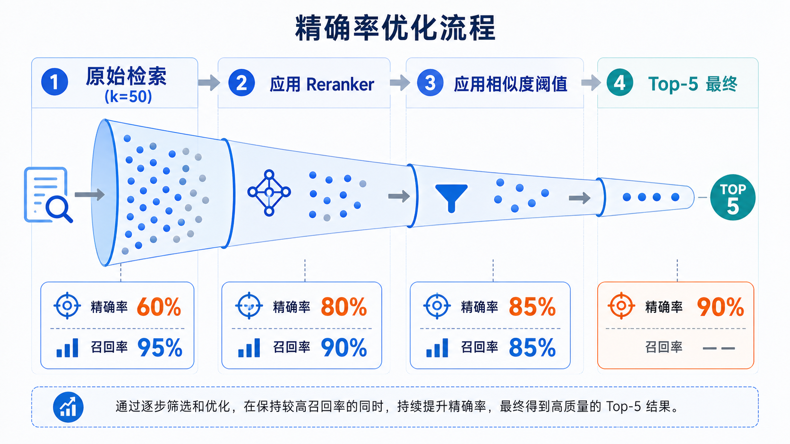

## 知识点讲解



### 1. 核心概念

精确率（Precision）在 RAG 里的定义：检索出来的文档里，真正相关的占多少。精确率低意味着 LLM 拿到了一堆不相关的 chunk，上下文里充斥噪声，生成质量下降，甚至把不相关内容误认为是答案的依据。

精确率和召回率是两个阶段的问题：先保召回（别漏掉），再提精确（别噪声太多）。这两件事同时做不现实，分阶段处理才合理——**粗检索保召回，精排保精确**。

精确率低的常见原因：

| 原因 | 表现 |
| --- | --- |
| top-K 设太大 | 后面排列的都是低相关文档，信噪比低 |
| Embedding 排序不准 | 语义上相近但语义不相关的文档排前面 |
| 缺少重排步骤 | 向量距离排序和"对回答有用"不等价 |
| 没有元数据过滤 | 检索到了正确主题但错误时间/来源的文档 |

### 2. 技术细节

#### 2.1 Reranker：精确率提升最有效的手段

Reranker（重排器）用 Cross-Encoder 架构——把"查询 + 候选文档"拼在一起输入模型，输出一个相关性分数。这比 Bi-encoder（分别 embed 再算相似度）精准得多，因为它能捕捉查询和文档之间的交叉语义。

代价是慢：每个候选文档要单独一次推理，top-50 候选就是 50 次推理。所以 Reranker 只用来做"精排"，不用来做初始检索。

**Reranker 主流选择：**

| 模型 | 特点 |
| --- | --- |
| BAAI/bge-reranker-v2-m3 | 开源首选，多语言，效果好 |
| Cohere Rerank API | 云端 API，延迟约 50-100ms，无需部署 |
| ms-marco-MiniLM-L-6-v2 | 轻量英文 Reranker，速度快 |
| LLM-as-Reranker | 用 GPT-4o 等直接判断相关性，精度最高但成本高 |

#### 2.2 其他提精确率的方法

**相似度阈值**：设置最低相似度，低于阈值的 chunk 不注入 LLM。简单直接，但阈值太高会误杀相关文档，需要在评估集上校准。

**元数据过滤**：在向量检索时加条件过滤（年份、部门、文档类型），减少噪声源。比如"查 2024 年的财务数据"，过滤 `year < 2024` 的文档，精确率自然上升。

**压缩提取（Contextual Compression）**：检索到文档后，用 LLM 只提取其中和查询相关的部分，其余截断。相当于二次过滤，注入 LLM 的是"已经选好的相关句"，精确率高但多一次 LLM 调用。

## 代码示例

**Reranker 精排（BGE，本地部署）**

```python
from sentence_transformers import CrossEncoder
import numpy as np

class BGEReranker:
    def __init__(self, model_name: str = "BAAI/bge-reranker-v2-m3"):
        self.model = CrossEncoder(model_name, max_length=512)

    def rerank(
        self,
        query: str,
        candidates: list[dict],   # [{"id": ..., "text": ...}]
        top_k: int = 5,
    ) -> list[dict]:
        if not candidates:
            return []

        # 构造 (query, doc) 对
        pairs = [[query, c["text"]] for c in candidates]

        # 批量推理打分
        scores = self.model.predict(pairs, batch_size=16, show_progress_bar=False)

        # 按分数排序取 top-k
        ranked = sorted(
            zip(candidates, scores),
            key=lambda x: x[1],
            reverse=True,
        )
        return [
            {**doc, "rerank_score": float(score)}
            for doc, score in ranked[:top_k]
        ]

# 使用示意
reranker = BGEReranker()

# 先粗检索 top-50（保召回）
candidates = vector_retriever.search(query, top_k=50)

# 再精排 top-5（保精确）
final_docs = reranker.rerank(query, candidates, top_k=5)
```

**相似度阈值过滤**

```python
def threshold_filter(
    results: list[dict],  # [{"id", "text", "score"}, ...]
    min_score: float = 0.65,
    min_results: int = 1,  # 至少保留 1 个，避免全部被过滤
) -> list[dict]:
    """过滤掉相似度低于阈值的结果"""
    filtered = [r for r in results if r.get("score", 0) >= min_score]

    # 防止过度过滤：如果全都被过滤了，至少保留分数最高的
    if not filtered and results:
        filtered = [max(results, key=lambda r: r.get("score", 0))]

    return filtered
```

**Contextual Compression（文档内容压缩）**

```python
def contextual_compress(
    query: str,
    doc_text: str,
    llm,
    max_tokens: int = 300,
) -> str:
    """
    从候选文档里提取和查询最相关的部分
    减少注入 LLM 的噪声 token
    """
    prompt = f"""从以下文档中，只提取与问题直接相关的内容。
如果文档完全不相关，输出"无相关内容"。
保留原文，不要改写，控制在 {max_tokens} 字以内。

问题：{query}

文档：
{doc_text}

相关内容："""
    return llm.call(prompt)

def compressed_retrieval(query: str, candidates: list[dict], llm, top_k: int = 5) -> list[dict]:
    """先粗检索，再对每个候选文档做内容压缩，过滤无关内容"""
    compressed = []
    for doc in candidates:
        relevant_text = contextual_compress(query, doc["text"], llm)
        if "无相关内容" not in relevant_text:
            compressed.append({**doc, "text": relevant_text})

    return compressed[:top_k]
```

**完整精确率优化管道**

```python
def precision_optimized_pipeline(
    query: str,
    vector_retriever,
    reranker: BGEReranker,
    top_k_candidate: int = 50,
    top_k_final: int = 5,
    min_score: float = 0.6,
) -> list[dict]:
    """粗检索 → 阈值过滤 → Reranker 精排"""
    # 1. 粗检索，网撒宽
    candidates = vector_retriever.search(query, top_k=top_k_candidate)

    # 2. 初步相似度过滤（去掉明显不相关的）
    candidates = threshold_filter(candidates, min_score=min_score, min_results=10)

    # 3. Reranker 精排
    final = reranker.rerank(query, candidates, top_k=top_k_final)

    return final
```

## 面试怎么答

精确率优化的核心思路是"先保召回，再精排"。不在初始检索阶段追求精确，而是检索宽一点（top-50）保住召回率，再用 Reranker 从候选里选精准的 top-5。

Reranker 是效果最明显的手段。它用 Cross-Encoder 架构，把查询和候选文档拼在一起让模型判断相关性，比 Bi-encoder 的向量相似度精准得多——因为它能捕捉"这篇文档里的这段话专门在回答这个问题"这种细粒度的关联。代价是慢，所以只用来做精排，不做初始检索。开源首选 bge-reranker-v2-m3，中英文都行，本地部署延迟几十毫秒。

其他手段：元数据过滤（直接在检索时缩小范围）成本低、效果稳定；相似度阈值可以做初步过滤，但阈值要在评估集上校准，设太高会误杀相关文档；contextual compression 用 LLM 从候选文档里提取相关片段，精确度高但多一次 LLM 调用，适合对质量要求极高的场景。

## 高频追问 & 加分点

- **Q1：Reranker 会增加多少延迟？**  
    取决于候选数量和模型大小。bge-reranker-v2-m3 在 GPU 上处理 50 个候选大约 100-300ms；CPU 上慢 3-5 倍。可以异步处理（前端先展示向量搜索结果，Reranker 结果到了再刷新），或者减少候选数量（top-20 而不是 top-50）来降延迟。
- **Q2：LLM-as-Reranker 和 Cross-Encoder Reranker 怎么选？**  
    Cross-Encoder 速度快得多、成本低、效果已经很好（bge-reranker 接近 GPT-4o 在中文场景）。LLM-as-Reranker 精度极高但每次查询要 50 次 LLM 调用，成本高 100 倍以上。通常只在精度要求极高、实时性不敏感的场景（如合规审计）才用 LLM-as-Reranker。
- **Q3：相似度阈值怎么定？**  
    在评估集上扫描（0.5-0.8 范围），观察 Precision@K 和召回率的变化曲线，找到"精确率最高且召回率不低于可接受值"的交叉点。不同领域和 embedding 模型的阈值差异很大，不能拍脑袋定。另外一定要加"至少保留 N 个"的兜底逻辑，防止全部被过滤。
- **Q4：元数据过滤和向量搜索的顺序问题**  
    先过滤再搜索（pre-filtering）：只在满足过滤条件的子集里搜索，精确但可能召回率低（候选集太小）。先搜索再过滤（post-filtering）：全量搜索后过滤，精确率低（可能还没到 top-K 就被过滤完了）。Qdrant 和 Pinecone 的实现是"混合策略"——根据过滤后的数据量自动选择哪种方式，这是最实用的。
- **Q5：精确率提升后生成质量一定更好吗？**  
    不一定是线性关系。关键是"有没有给模型提供它需要的信息"。有时候精确率很高（5 个结果都相关）但召回率低（漏掉了最关键的那个 chunk），生成质量反而差。评估指标要看端到端的"答案正确率"而不只是检索的精确率数字。
