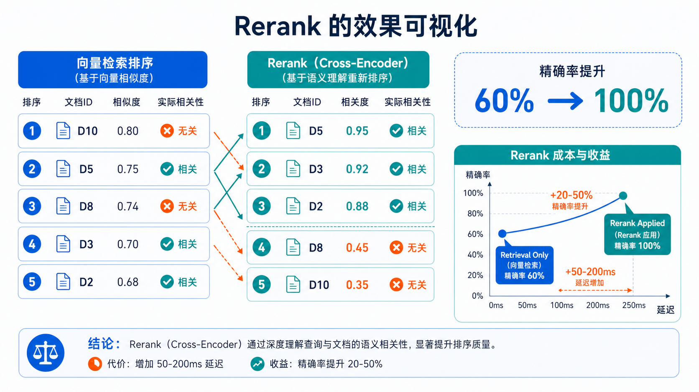

## 知识点讲解



### 1. 核心概念

Rerank 在 RAG pipeline 里处于"粗检索"和"生成"之间，是精排那一步：

```latex
用户查询 → Embedding → 向量检索 top-50（快）→ Reranker 精排 → top-5 → LLM 生成
                         Bi-encoder，速度优先                Cross-Encoder，精度优先
```

向量检索用的是 Bi-encoder——查询和文档分别 embed，算向量相似度排序。速度快，但本质上只是"向量距离近"，和"这个文档真的能回答这个问题"并不完全等价。

Reranker 用的是 Cross-Encoder——把"查询 + 候选文档"拼在一起输入模型，输出一个相关性分数。能捕捉查询和文档内容之间的精细交叉语义，比向量相似度精准得多。代价是每个候选都要单独推理一次，慢 10-50 倍——所以只在少量候选上做，不参与初始检索。

Rerank 的作用：在几乎不损失召回率的前提下，把精确率提升 20-50%。

### 2. 技术细节

#### 2.1 Bi-encoder vs Cross-Encoder

| 架构 | 处理方式 | 速度 | 精度 | 适合阶段 |
| --- | --- | --- | --- | --- |
| Bi-encoder | 查询和文档独立 embed | 极快（O(1) 查询） | 中等 | 初始检索 |
| Cross-Encoder | 查询+文档拼接输入 | 慢（O(n) 候选） | 高 | 精排 |

Bi-encoder 快的原因：文档的向量预先算好存库，查询时只需要算一个查询向量，再做内积搜索。Cross-Encoder 慢的原因：每对 (query, doc) 都要单独推理，100 个候选 = 100 次推理。

#### 2.2 主流 Reranker 模型

| 模型 | 特点 | 适合场景 |
| --- | --- | --- |
| BAAI/bge-reranker-v2-m3 | 开源，多语言，效果好 | 通用首选，中英文都行 |
| BAAI/bge-reranker-base | 更轻量，速度快 | 对延迟敏感的场景 |
| Cohere Rerank API | 云 API，无需部署 | 快速上线，不想运维 |
| ms-marco-MiniLM-L-6-v2 | 轻量英文 Reranker | 英文场景，速度优先 |

#### 2.3 Reranker 效果预期

实践中，粗检索 top-50 → Reranker → top-5 的流程：

- 精确率从 60-70% 提升到 85-90%+
- 召回率基本不变（只要 top-50 足够宽，真正相关的文档都在里面）
- 延迟增加 100-300ms（GPU 部署）

这是性价比极高的优化——2 小时接入，精确率显著提升。

## 代码示例

**BGE Reranker 接入（推荐）**

```python
from sentence_transformers import CrossEncoder
from dataclasses import dataclass

@dataclass
class RankedDoc:
    id: str
    text: str
    vector_score: float
    rerank_score: float

class BGEReranker:
    def __init__(self, model_name: str = "BAAI/bge-reranker-v2-m3"):
        # 本地加载，数据不出网
        self.model = CrossEncoder(model_name, max_length=512)

    def rerank(
        self,
        query: str,
        candidates: list[dict],  # [{"id": ..., "text": ..., "score": ...}]
        top_k: int = 5,
    ) -> list[RankedDoc]:
        if not candidates:
            return []

        pairs = [[query, c["text"]] for c in candidates]
        rerank_scores = self.model.predict(pairs, batch_size=32)

        ranked = sorted(
            zip(candidates, rerank_scores),
            key=lambda x: x[1],
            reverse=True,
        )

        return [
            RankedDoc(
                id=doc["id"],
                text=doc["text"],
                vector_score=doc.get("score", 0.0),
                rerank_score=float(score),
            )
            for doc, score in ranked[:top_k]
        ]
```

**完整 RAG Pipeline 集成**

```python
def rag_with_rerank(
    query: str,
    vector_retriever,
    reranker: BGEReranker,
    llm,
    candidate_k: int = 50,
    final_k: int = 5,
) -> str:
    # ① 粗检索：向量搜索，网撒宽
    candidates = vector_retriever.search(query, top_k=candidate_k)

    # ② 精排：Reranker 重新打分排序
    ranked_docs = reranker.rerank(query, candidates, top_k=final_k)

    # ③ 可选：过滤 Rerank 分数很低的（通常 <0.1 说明完全不相关）
    ranked_docs = [d for d in ranked_docs if d.rerank_score >= 0.05]

    if not ranked_docs:
        return "未找到相关信息。"

    # ④ 生成
    context = "\n\n".join([
        f"[来源 {i+1}] {doc.text}"
        for i, doc in enumerate(ranked_docs)
    ])

    prompt = f"""根据以下参考资料回答问题。如果资料中没有足够信息，请明确说明。

参考资料：
{context}

问题：{query}"""

    return llm.call(prompt)
```

**Cohere Rerank API（快速原型，无需 GPU）**

```python
import cohere

co = cohere.Client(api_key="your-api-key")

def cohere_rerank(
    query: str,
    candidates: list[dict],
    top_k: int = 5,
    model: str = "rerank-multilingual-v3.0",  # 支持中文
) -> list[dict]:
    docs_text = [c["text"] for c in candidates]

    response = co.rerank(
        query=query,
        documents=docs_text,
        top_n=top_k,
        model=model,
        return_documents=True,
    )

    return [
        {**candidates[r.index], "rerank_score": r.relevance_score}
        for r in response.results
    ]
```

**对比有无 Rerank 的效果**

```python
def evaluate_rerank_impact(
    qa_pairs: list[dict],  # [{"query": ..., "answer_doc_id": ...}]
    vector_retriever,
    reranker: BGEReranker,
    top_k: int = 5,
) -> dict:
    """量化 Rerank 对精确率的提升"""
    before_hits = 0
    after_hits = 0

    for qa in qa_pairs:
        q, answer_id = qa["query"], qa["answer_doc_id"]

        # 无 Rerank：直接取向量检索 top-5
        vector_results = vector_retriever.search(q, top_k=top_k)
        if answer_id in {r["id"] for r in vector_results}:
            before_hits += 1

        # 有 Rerank：粗检索 top-50 → Reranker top-5
        candidates = vector_retriever.search(q, top_k=50)
        reranked = reranker.rerank(q, candidates, top_k=top_k)
        if answer_id in {d.id for d in reranked}:
            after_hits += 1

    n = len(qa_pairs)
    return {
        f"Precision@{top_k} 无Rerank": before_hits / n,
        f"Precision@{top_k} 有Rerank": after_hits / n,
        "提升幅度": (after_hits - before_hits) / n,
    }
```

## 面试怎么答

Rerank 解决的问题是：向量检索基于 embedding 相似度，"向量距离近"和"能回答这个问题"并不完全等价，结果里有噪声。Reranker 用 Cross-Encoder 把查询和每个候选文档拼在一起推理，精准判断相关性——比向量相似度精准得多，但慢，所以只在少量候选上跑。

标准模式是：向量检索粗检索 top-50（保召回，速度快），Reranker 精排出 top-5（保精确，准）。精确率提升一般在 20-50%，召回率基本不变（只要粗检索的网够宽）。

开源首选 bge-reranker-v2-m3，多语言、效果好、本地部署、数据不出网。Cohere Rerank API 是另一个选项，适合不想运维的场景但有云端依赖。不推荐用 LLM-as-Reranker 做实时查询，50 个候选 = 50 次 LLM 调用，成本和延迟都扛不住。

## 高频追问 & 加分点

- **Q1：Reranker 会影响召回率吗？**  
    会有轻微影响，但可控。粗检索 top-50 时，如果真正相关的文档在 50 名内，Reranker 精排后它应该排得更靠前，被选进 top-5 的概率更高。只有当相关文档连 top-50 都没进（召回阶段的问题），Reranker 才没有机会修复。所以先优化召回，再做精排。
- **Q2：Reranker 的延迟怎么优化？**  
    几个方向：①减少候选数（top-50 → top-20，延迟减半，精度略降）；②用更小的模型（bge-reranker-base 比 v2-m3 快）；③异步处理（先返回向量检索结果，Reranker 结果到了再刷新）；④批量推理（batch_size 调大，GPU 利用率更高）。
- **Q3：列表重排（Listwise Reranking）是什么？**  
    传统 Reranker 是逐个给候选打分（pointwise），不考虑候选之间的关系。Listwise 是把所有候选一起输入给 LLM，让它直接给出排序结果——能捕捉"这个比那个更相关"的相对关系，精度更高，但需要强模型支持（GPT-4o 级别），成本高，适合离线精排。
- **Q4：什么情况下 Rerank 效果不明显？**  
    两种情况：①粗检索质量太差，top-50 里根本没有相关文档——Reranker 从垃圾里选最好的，也出不了好结果；②问题本身语义太简单（精确关键词匹配），向量检索已经排得很准，Rerank 边际改善很小。第一种情况要先优化召回；第二种情况可以按查询类型跳过 Reranker。
- **Q5：多路召回 + Rerank 的顺序是怎样的？**  
    先多路召回（向量 + BM25 + 其他）合并去重，得到总的候选列表（约 50-100 个），再把所有候选一起送给 Reranker 精排。Reranker 作为统一的"裁判"，不管候选从哪一路来，按相关性统一排序，效果比各路单独 Rerank 再合并要好。
