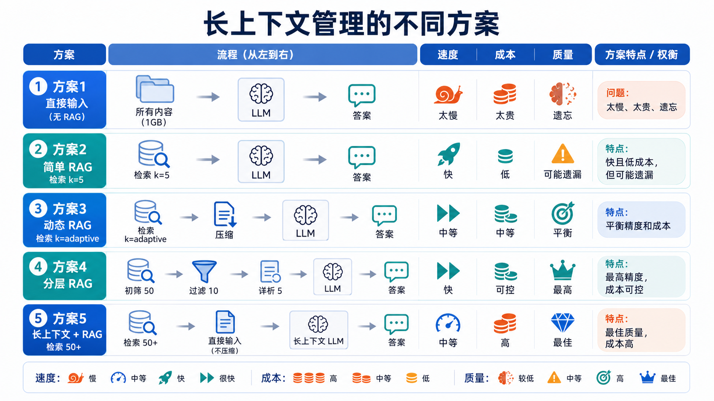

## 知识点讲解



### 1. 核心概念

RAG 的长上下文问题本质上是两个相互矛盾的需求撞在一起：**要检索足够多的内容保证质量，但放进 LLM 的内容多了成本高、速度慢、而且中间的内容容易被忽视**。

"Lost in the Middle" 现象是有实验支撑的：研究发现 LLM 对放在上下文开头和结尾的信息更敏感，中间位置的文档容易被"遗漏"。这意味着堆砌大量检索文档不一定让回答变好——反而可能因为噪声和注意力分散让质量下降。

RAG 本来就是为了解决"不可能把整个知识库塞进上下文"的问题，但如果检索出来的内容也太长，同样要处理。

长上下文的问题分两类：

- **检索内容总量过多**：top-K 太大，每个 chunk 内容也多
- **单个 chunk 本身太长**：文档没有合理分块

### 2. 技术细节

#### 2.1 四种处理策略

**① 动态 top-K**：根据查询复杂度调整检索数量。简单查询（"X 是什么"）top-3 足够；复杂查询（"比较 A 和 B 的区别"）top-10 才能覆盖两方面。自动判断复杂度可以用规则（query token 数、是否有比较词），也可以让 LLM 先判断一下。

**② 内容压缩（Contextual Compression）**：检索到文档后，不把整块 chunk 放进 LLM，而是先让 LLM 提取其中与查询相关的句子，再注入。token 大幅减少，相关性密度提高。

**③ 分层检索（Hierarchical Retrieval）**：先粗后细，两步走。第一步检索摘要层（每篇文档的摘要），快速筛选相关文档；第二步只在筛选出的文档里检索具体 chunk。减少无关文档的干扰。

**④ Lost in the Middle 缓解**：把 Reranker 排名靠前的文档放在 context 的开头和结尾（"V 字形排列"），把较低相关性的放中间。

#### 2.2 长上下文模型 vs RAG 的定位

| 场景 | 推荐方案 |
| --- | --- |
| 知识库大（>100 万 token） | RAG |
| 实时问答，延迟敏感 | RAG |
| 少量文档，需要全局理解 | 长上下文模型 |
| 多文档跨文档推理 | RAG + 长上下文模型结合 |

两者不是对立关系。实践中常见的组合：用 RAG 缩减到 20-50 个候选文档，再交给长上下文模型做深度推理——既不超出向量库能力，又利用了长上下文模型的全局理解能力。

## 代码示例

**动态 top-K 选择**

```python
def estimate_query_complexity(query: str, llm=None) -> str:
    """估计查询复杂度：simple / medium / complex"""
    word_count = len(query.split())
    has_comparison = any(w in query for w in ["比较", "区别", "哪个更", "vs", "优缺点"])
    has_multi_aspect = any(w in query for w in ["以及", "和", "同时", "另外"])

    if word_count < 15 and not has_comparison and not has_multi_aspect:
        return "simple"
    elif has_comparison or has_multi_aspect:
        return "complex"
    else:
        return "medium"

COMPLEXITY_TO_K = {
    "simple":  3,   # 事实性问题
    "medium":  5,   # 一般问答
    "complex": 10,  # 比较分析类
}

def adaptive_retrieve(query: str, retriever) -> list[dict]:
    complexity = estimate_query_complexity(query)
    k = COMPLEXITY_TO_K[complexity]
    return retriever.search(query, top_k=k)
```

**内容压缩（Contextual Compression）**

```python
def compress_chunk(query: str, chunk_text: str, llm) -> str | None:
    """
    从 chunk 里只提取和查询相关的内容。
    返回 None 表示该文档完全不相关，应跳过。
    """
    prompt = f"""阅读以下文档，只提取与问题直接相关的内容。
如果文档中没有与问题相关的信息，输出"IRRELEVANT"。
保留原文表述，不要改写，控制在 200 字以内。

问题：{query}

文档：{chunk_text}

相关内容："""

    result = llm.call(prompt).strip()
    return None if result.upper() == "IRRELEVANT" else result

def compressed_rag_pipeline(
    query: str, candidates: list[dict], llm, max_chunks: int = 5
) -> str:
    # 对每个候选文档做压缩提取
    compressed = []
    for doc in candidates:
        extracted = compress_chunk(query, doc["text"], llm)
        if extracted:
            compressed.append({"id": doc["id"], "text": extracted})
        if len(compressed) >= max_chunks:
            break

    if not compressed:
        return "未找到相关信息。"

    context = "\n\n".join([f"[{i+1}] {d['text']}" for i, d in enumerate(compressed)])
    return llm.call(f"根据以下信息回答问题：\n{context}\n\n问题：{query}")
```

**分层检索（先检索摘要，再检索详情）**

```python
class HierarchicalRetriever:
    def __init__(self, summary_index, chunk_index, embed_fn):
        """
        summary_index: 存储每篇文档摘要的向量索引
        chunk_index: 存储细粒度 chunk 的向量索引
        """
        self.summary_index = summary_index
        self.chunk_index = chunk_index
        self.embed = embed_fn

    def retrieve(self, query: str, summary_top_k: int = 10, chunk_top_k: int = 5) -> list[dict]:
        query_emb = self.embed(query)

        # 第一层：检索摘要，确定相关文档
        summary_results = self.summary_index.search(query_emb, top_k=summary_top_k)
        relevant_doc_ids = {r["doc_id"] for r in summary_results}

        # 第二层：只在相关文档的 chunk 里精细检索
        chunk_results = self.chunk_index.search(
            query_emb,
            top_k=chunk_top_k * 3,  # 多检索一些，再 filter
            filter={"doc_id": {"$in": list(relevant_doc_ids)}},
        )

        return chunk_results[:chunk_top_k]
```

**"V 字形"排列缓解 Lost in the Middle**

```python
def v_shape_arrange(docs: list[dict]) -> list[dict]:
    """
    按 V 字形排列文档：相关性最高的放首尾，次相关的放中间
    利用 LLM 对首尾信息更敏感的特点
    """
    if len(docs) <= 2:
        return docs

    n = len(docs)
    result = [None] * n
    left, right = 0, n - 1

    for i, doc in enumerate(docs):
        if i % 2 == 0:
            result[left] = doc
            left += 1
        else:
            result[right] = doc
            right -= 1

    return [d for d in result if d is not None]

# 使用：Rerank 后排列再注入 LLM
ranked_docs = reranker.rerank(query, candidates, top_k=7)
arranged = v_shape_arrange(ranked_docs)
context = "\n\n".join(d.text for d in arranged)
```

## 面试怎么答

RAG 的长上下文问题有两个层面：一是检索到的内容总量太多，堆进 LLM 性价比不高；二是"Lost in the Middle"现象——LLM 对放在中间的内容不够敏感，大量文档塞进去反而损失质量。

几种处理策略：最简单的是动态 top-K，简单问题检索 3 个、复杂问题检索 10 个，不要一刀切；内容压缩是先让 LLM 提取每个 chunk 里和查询直接相关的句子，再注入，大幅减少 token 但保留有效信息；分层检索是先在摘要层找相关文档，再在找到的文档里精细检索，减少无关文档干扰；缓解 Lost in the Middle 可以用 V 字形排列——最相关的文档放头尾，次相关的放中间。

长上下文模型（Claude 200K、Gemini 1M）和 RAG 不是非此即彼。常见的混合方案：用 RAG 从大知识库里缩减到 20-50 篇文档，再把这些文档整体放进长上下文模型做全局推理——两者互补，而不是替代关系。

## 高频追问 & 加分点

- **Q1：有了 Gemini 1M context，还需要 RAG 吗？**  
    需要。几个原因：知识库可能远超 1M token（大型企业文档库 TB 级别）；超长上下文的推理速度慢、成本高（GPT-4o 128K 窗口一次推理的成本远超 RAG）；长上下文模型的精度随着上下文增长而下降（LLM 没有完美的全局注意力）。RAG 的价值在于精准缩减，而不会被大上下文完全替代。
- **Q2：内容压缩会不会把关键信息压掉？**  
    有这个风险，特别是当 LLM 压缩器不知道哪些细节是"关键"的时候。缓解方法：压缩 prompt 里明确说"保留所有数字、日期、专有名词"；对高度相关的文档（Rerank 分数很高）不压缩，直接使用原文；设置最小保留长度。
- **Q3：分层检索怎么构建摘要索引？**  
    入库时为每篇文档生成一段摘要（可以用 LLM 生成），和原始 chunk 分别建索引。摘要代表文档的"整体主题"，chunk 代表"具体细节"。第一层用摘要索引定位相关文档，第二层用 chunk 索引定位具体段落。ParentDocument Retriever 是 LangChain 里实现这个模式的组件。
- **Q4：如何评估长上下文问题的影响？**  
    构造测试集：让答案在不同位置（头部/中部/尾部）的问题，对比 LLM 的回答准确率。如果中部位置的准确率明显低于首尾，就说明 Lost in the Middle 影响显著。另外看 token 成本和延迟——压缩方案通常能节省 50-70% 的 token 数。
- **Q5：实时系统里内容压缩来得及吗？**  
    内容压缩多一次 LLM 调用，延迟增加 0.5-2s。对实时问答系统有影响。妥协方案：只对返回的前几个 chunk 做压缩（Rerank 后排前三的做压缩，其他直接截断），或者用更小的模型做压缩（不一定要用 GPT-4o，gpt-4o-mini 或本地 llama 效果也够用）。
