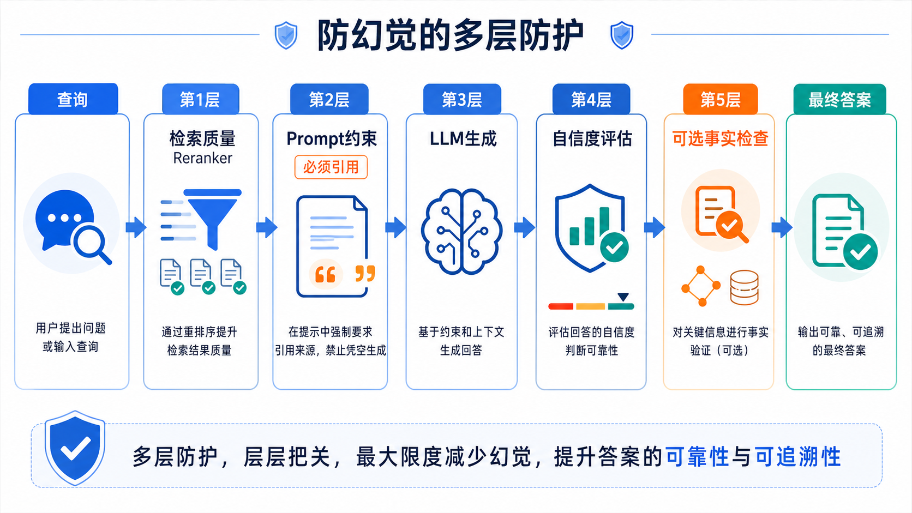

## 知识点讲解



### 1. 核心概念

幻觉（Hallucination）是 LLM 生成了不真实或无法溯源的内容。RAG 本身就是一种减少幻觉的机制——给 LLM 提供真实文档作为依据，限制它"自由发挥"。

但 RAG 不能完全消除幻觉。即使有了检索文档，LLM 仍可能：

- 错误解读文档内容（理解偏差）
- 把检索到的错误文档当成事实（检索质量问题）
- 在没有找到相关文档时，混入"自己知道的"内容（知识混入）
- 把多个文档的信息错误地拼接（信息组合错误）

RAG 把幻觉率从"LLM 自由生成"的 30-60% 降到了 10-20%，但要进一步压低，还需要多层防护。

### 2. 技术细节

#### 2.1 幻觉的来源层级

```latex
检索阶段幻觉：没找到相关文档 → 模型用"自己的知识"填充
生成阶段幻觉：找到了文档，但模型理解/组合错误
格式化幻觉：引用了存在的文档，但篡改了具体数字/名称
```

不同阶段的幻觉有不同的干预方式。

#### 2.2 防幻觉的四层机制

**① 检索质量控制（第一道防线）**：用高质量的检索减少"找到错误文档"的概率。Recall@K > 90%、Reranker 精排、相似度阈值过滤。

**② Prompt 约束（成本最低的防护）**：明确告诉模型"只基于提供文档回答，没有依据就说不知道"。配合要求引用来源，让模型的生成受到文档约束。

**③ 答案验证（事后检查）**：生成后验证：答案里的每个声明是否能在检索文档里找到依据。可以用 LLM-as-judge，也可以用 NLI（自然语言推断）模型判断文档是否蕴含答案。

**④ 置信度评估（透明化不确定性）**：当检索结果不够好（相似度分数低、Reranker 分数低）时，在回答里标注"信息不足，以下可能不完整"，而不是直接给出自信满满但不可靠的答案。

## 代码示例

**带强约束的 RAG Prompt**

```python
ANTI_HALLUCINATION_SYSTEM = """你是一个严格基于事实的回答助手。

【规则】
1. 只能使用"参考资料"中提供的信息回答问题
2. 每个关键陈述必须在答案后标注来源编号，格式：[来源N]
3. 如果参考资料中没有足够信息，回答"根据现有资料，无法确定"
4. 不允许根据常识或训练数据补充参考资料中未提到的事实

【禁止行为】
- 不得捏造数据、日期、人名
- 不得混入参考资料以外的知识
- 不得猜测文档未提及的信息"""

def rag_with_anti_hallucination(query: str, retriever, llm) -> dict:
    docs = retriever.search(query, top_k=5)
    context = "\n\n".join([
        f"[来源{i+1}] {doc['text']}"
        for i, doc in enumerate(docs)
    ])

    response = llm.call(
        system=ANTI_HALLUCINATION_SYSTEM,
        user=f"参考资料：\n{context}\n\n问题：{query}",
    )

    return {
        "answer": response,
        "sources": [{"id": d["id"], "text": d["text"][:200]} for d in docs],
    }
```

**答案验证（Faithfulness Check）**

```python
def check_faithfulness(answer: str, source_docs: list[str], llm) -> dict:
    """
    验证答案中的每个声明是否有文档依据
    返回：{"faithful": bool, "unsupported_claims": [...], "score": float}
    """
    context = "\n\n".join(source_docs)
    prompt = f"""你是一个事实核查员。
请逐句检查"答案"中的每个声明是否有"文档"的明确支撑。

文档：
{context}

答案：
{answer}

输出 JSON：
{{
  "faithful": true/false,
  "unsupported_claims": ["没有文档依据的声明1", ...],
  "faithfulness_score": 0-1（1表示完全有依据）
}}"""

    result = llm.call(prompt, response_format="json")
    return result

# 使用
result = rag_with_anti_hallucination("公司的退款政策是什么？", retriever, llm)
faithfulness = check_faithfulness(
    answer=result["answer"],
    source_docs=[s["text"] for s in result["sources"]],
    llm=llm,
)

if not faithfulness["faithful"]:
    # 回答包含幻觉，降级处理
    print("⚠️ 检测到潜在幻觉：", faithfulness["unsupported_claims"])
    result["answer"] = "根据现有资料，部分信息无法确认，建议联系人工客服。"
```

**置信度评估（检索质量感知）**

```python
def retrieve_with_confidence(query: str, retriever, reranker) -> dict:
    """根据检索质量评估回答置信度"""
    candidates = retriever.search(query, top_k=20)
    ranked = reranker.rerank(query, candidates, top_k=5)

    if not ranked:
        return {"confidence": "low", "docs": [], "warning": "未找到相关文档"}

    # 用最高 Rerank 分数估计置信度
    top_score = ranked[0].rerank_score

    if top_score >= 0.7:
        confidence = "high"
        warning = None
    elif top_score >= 0.4:
        confidence = "medium"
        warning = "部分信息可能不完整，建议核实"
    else:
        confidence = "low"
        warning = "相关资料不足，以下回答可能不准确"

    return {
        "confidence": confidence,
        "warning": warning,
        "docs": ranked,
        "top_rerank_score": top_score,
    }

def confidence_aware_rag(query: str, retriever, reranker, llm) -> dict:
    retrieval_result = retrieve_with_confidence(query, retriever, reranker)

    if retrieval_result["confidence"] == "low":
        # 直接拒绝回答，不要强行生成
        return {
            "answer": "当前知识库中没有足够信息来可靠地回答这个问题。",
            "confidence": "low",
            "sources": [],
        }

    # 正常生成
    context = "\n\n".join([f"[来源{i+1}] {d.text}" for i, d in enumerate(retrieval_result["docs"])])
    answer = llm.call(
        system=ANTI_HALLUCINATION_SYSTEM,
        user=f"参考资料：\n{context}\n\n问题：{query}",
    )

    result = {
        "answer": answer,
        "confidence": retrieval_result["confidence"],
        "sources": [{"text": d.text[:200]} for d in retrieval_result["docs"]],
    }
    if retrieval_result["warning"]:
        result["warning"] = retrieval_result["warning"]

    return result
```

## 面试怎么答

RAG 减少幻觉的原理是给 LLM 提供可信赖的文档作为生成依据，约束它不能"自由发挥"。但 RAG 不能完全消除幻觉，因为模型还是可能误解文档、混入外部知识、或者在检索质量不好时凑数。

防幻觉的几层措施：最基础的是 Prompt 约束——明确告诉模型"只能用提供的文档，没依据就说不知道"，同时要求引用来源编号；检索质量是第一道防线，召回率高、有 Reranker 精排，找到正确文档是防幻觉的前提；事后验证是最可靠的，用 LLM-as-judge 逐句检查答案是否有文档支撑；置信度评估是透明化不确定性——当检索结果质量低时，与其生成一个不可靠的答案，不如告诉用户"信息不足"。

其中最容易被忽视的是"当找不到相关文档时怎么办"。很多实现会让 LLM 在没有好的检索结果时也继续生成，这是幻觉的高发场景。应该设置检索质量门槛，低于阈值直接拒绝回答或升级到人工，而不是强行生成。

## 高频追问 & 加分点

- **Q1：Prompt 约束够用吗？**  
    单靠 Prompt 约束不够可靠。即使你明确说"只用提供文档"，LLM 在生成时还是会有"泄露"训练数据的倾向，特别是当检索文档和问题语义契合度不够高时。Prompt 是第一层保障，还需要加事后验证才比较稳。
- **Q2：Faithfulness Check 用什么模型做？**  
    小场景可以用 GPT-4o 或 Claude 做 LLM-as-judge（效果好但成本高）；也可以用 NLI（自然语言推断）模型，如 `cross-encoder/nli-deberta-v3-small`，判断文档是否蕴含答案，速度快、成本低。两种方式可以按场景选，对精度要求高的用 LLM-judge，高吞吐量用 NLI 模型。
- **Q3：要求引用来源会影响回答流畅性吗？**  
    会有影响，回答会多一些括号和编号。可以调整格式——把引用放回答末尾的"信息来源"部分，正文保持自然表述。对于面向普通用户的产品，在 UI 层做"展示/收起来源"的设计，比在答案里塞编号体验更好。
- **Q4：RAG 能把幻觉率降到 0 吗？**  
    理论上不能，实践中接近但无法达到 0。原因：LLM 会在理解和综合文档时引入偏差；检索系统也不完美，可能找到误导性文档。多层防护 + 持续评估 + 人工抽检是正确的思路，而不是"找到一个方法一劳永逸"。
- **Q5：如何持续监控生产系统的幻觉率？**  
    三个指标：①User Negative Feedback Rate（用户明确反馈"错误"的比例）；②Faithfulness Score（抽样用 LLM-judge 评估答案是否有文档支撑）；③Citation Coverage（答案中带来源引用的比例）。这三个结合看，能给出幻觉风险的全貌。
