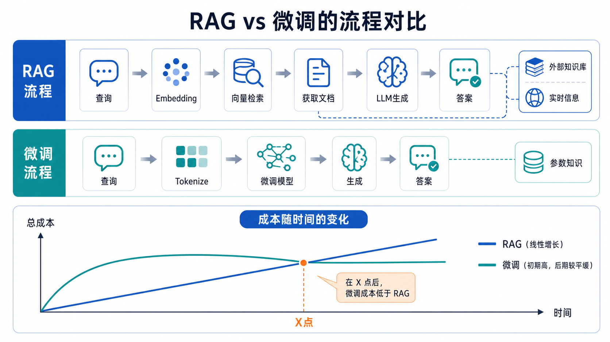

## 知识点讲解



### 1. 核心概念

RAG 和微调（Fine-tuning）都是"让 LLM 更懂你的业务"的手段，但原理完全不同：

**RAG** 是在推理时动态检索外部知识库，把相关文档拼进 prompt 让模型参考。知识存在外部，模型本身不变。

**微调** 是在训练阶段把知识"烧进"模型参数。推理时不需要额外检索，模型直接从参数里调用知识。

说白了，RAG 是"开卷考试"，微调是"死记硬背"。两者适合的场景完全不同，选错了会让你在错误的方向上白费力气。

### 2. 技术细节

#### 2.1 核心对比

| 维度 | RAG | 微调 |
| --- | --- | --- |
| 知识存储位置 | 外部向量库 | 模型参数 |
| 知识更新速度 | 秒级（改文档即生效） | 天级（重新训练） |
| 数据量要求 | 少（原始文档） | 多（标注的问答对） |
| 训练成本 | 基本没有 | GPU 资源 + 数据标注 |
| 可解释性 | 高（可以看到来源文档） | 低（参数黑盒） |
| 知识遗忘问题 | 无 | 有（持续微调会遗忘旧知识） |
| 擅长什么 | 垂直领域私有文档 | 通用能力、语言风格、输出格式 |

#### 2.2 选择决策逻辑

**优先选 RAG 的情况：**

- 知识更新频繁（新闻、法规、产品手册迭代快）
- 私有数据不方便参与训练（合规、安全问题）
- 需要可溯源——答案必须能追回到具体文档
- 数据量不够——标注问答对少于 1000 条
- 快速上线——不想等训练流程

**优先选微调的情况：**

- 知识几乎不变（某个固定领域的基础常识）
- 要改变模型的语言风格或输出格式
- 有充足标注数据（>10000 对问答）
- 对延迟极度敏感——不想承受检索的额外耗时

**两者结合的情况（最常见）：**  
微调让模型掌握领域语言和格式习惯，RAG 提供最新的、动态的具体知识。比如法律问答系统：微调让模型学会法律文书的表达方式，RAG 检索最新的法条和判例。

#### 2.3 一个常被忽视的判断维度

微调不是万能的"精度提升器"。它在以下情况下效果很差：

- **知识截断问题**：微调只能学习训练数据里的知识，训练集之后的新内容它不知道
- **数据标注瓶颈**：高质量的问答对很贵，低质量的标注会让微调效果比不微调还差
- **灾难性遗忘**：在新数据上微调，可能把原来的通用能力给"洗掉"

## 代码示例

**RAG 方案骨架**

```python
class RAGPipeline:
    def __init__(self, vector_store, llm):
        self.store = vector_store
        self.llm = llm

    def run(self, query: str) -> dict:
        # 检索相关文档
        docs = self.store.search(query, top_k=5)
        context = "\n\n".join(
            f"[来源{i+1}] {d['text']}" for i, d in enumerate(docs)
        )

        # 生成，注入文档上下文
        answer = self.llm.call(
            system="只根据提供的参考资料回答，无依据说不知道。",
            user=f"参考资料：\n{context}\n\n问题：{query}",
        )
        return {"answer": answer, "sources": docs}
```

**微调方案骨架（LoRA 参数高效微调）**

```python
from peft import LoraConfig, get_peft_model
from transformers import AutoModelForCausalLM, Trainer, TrainingArguments

def finetune_with_lora(base_model_name: str, train_dataset):
    model = AutoModelForCausalLM.from_pretrained(base_model_name)

    # LoRA 配置：只训练少量适配参数，降低显存和成本
    lora_config = LoraConfig(
        r=16,                    # 低秩矩阵秩
        lora_alpha=32,
        target_modules=["q_proj", "v_proj"],
        lora_dropout=0.1,
        task_type="CAUSAL_LM",
    )
    model = get_peft_model(model, lora_config)

    training_args = TrainingArguments(
        output_dir="./finetuned_model",
        num_train_epochs=3,
        per_device_train_batch_size=4,
        learning_rate=2e-4,
        fp16=True,
    )

    trainer = Trainer(
        model=model,
        args=training_args,
        train_dataset=train_dataset,
    )
    trainer.train()
    model.save_pretrained("./finetuned_model")
```

**RAG + 微调结合的推理流程**

```python
class HybridRAGFinetunedPipeline:
    """微调模型 + RAG 动态知识的混合方案"""

    def __init__(self, finetuned_model_path: str, vector_store):
        # 用微调后的模型（而非通用模型）
        self.llm = load_finetuned_model(finetuned_model_path)
        self.store = vector_store

    def run(self, query: str) -> str:
        # RAG 检索动态知识
        docs = self.store.search(query, top_k=5)
        context = "\n\n".join(d["text"] for d in docs)

        # 微调模型理解领域语言 + RAG 补充最新信息
        prompt = f"""参考资料：
{context}

问题：{query}
回答："""
        # 微调模型的 system prompt 可以更简短
        # 因为领域知识已经烧进参数，不用再在 prompt 里反复强调
        return self.llm.generate(prompt, max_new_tokens=512)
```

**选择辅助：数据量和场景的简单判断函数**

```python
def suggest_approach(
    data_size: int,          # 标注问答对数量
    update_frequency: str,   # "daily" / "weekly" / "static"
    needs_traceability: bool,
    has_gpu_budget: bool,
) -> str:
    if update_frequency in ("daily", "weekly") or needs_traceability:
        return "RAG"

    if data_size < 1000 or not has_gpu_budget:
        return "RAG"

    if data_size >= 10000 and update_frequency == "static":
        return "Fine-tuning"

    return "RAG + Fine-tuning（先上 RAG，积累标注后再微调）"
```

## 面试怎么答

RAG 和微调解决的是不同层面的问题，不是非此即彼的关系。RAG 擅长处理动态、私有、需要溯源的知识——把文档实时检索出来注入 context；微调擅长改变模型的能力边界和语言习惯，比如学会用特定格式、理解领域术语。

实践中的选择逻辑：如果知识频繁更新，或者数据量不够、合规不让模型直接学，就选 RAG；如果要改语言风格、有充足标注数据、知识相对静态，可以考虑微调；大多数企业场景是两者结合——微调让模型"懂行话"，RAG 补充具体的动态知识。

一个经常被忽视的点：微调的代价不只是 GPU 钱，还有数据标注成本。高质量的问答对很贵，标注质量差反而会让效果更糟。在数据不够之前，RAG 的收益通常远高于微调。

## 高频追问 & 加分点

- **Q1：微调之后还需要 RAG 吗？**  
    大多数情况需要。微调解决的是模型"懂不懂这个领域的话"，RAG 解决的是"有没有最新的具体信息"。比如微调让模型学会理解医学术语和格式，RAG 检索最新的临床指南——两件事同时需要。
- **Q2：LoRA 和全参数微调怎么选？**  
    99% 的业务场景选 LoRA。全参数微调显存需求是 LoRA 的 5-10 倍，且更容易灾难性遗忘。LoRA 只更新少量适配参数，训练快、成本低，效果在大多数垂直场景里和全参数相当。
- **Q3：微调的数据质量怎么保证？**  
    这是微调最难的部分。常见策略：先用 GPT-4o 生成候选问答对，再让领域专家审核打分；只保留置信度高的；宁可少要好，500 条高质量数据比 5000 条低质量数据效果好得多。
- **Q4：RAG 的检索延迟是劣势吗？**  
    在大多数 B 端场景（几百毫秒到秒级可接受）不是劣势。对延迟极敏感的场景（实时对话、游戏 NPC），检索确实增加了 50-200ms，这时候可以做异步预加载（用户开始打字时就提前检索），或者把高频知识缓存起来。
- **Q5：In-context Learning 算是 RAG 的替代吗？**  
    不完全算。ICL 是在 prompt 里直接给几个示例让模型类比推理，适合"展示输出格式"这类任务，但不适合注入大量私有知识（token 有限）。ICL 解决的是"怎么答"，RAG 解决的是"答什么"，定位不同。
