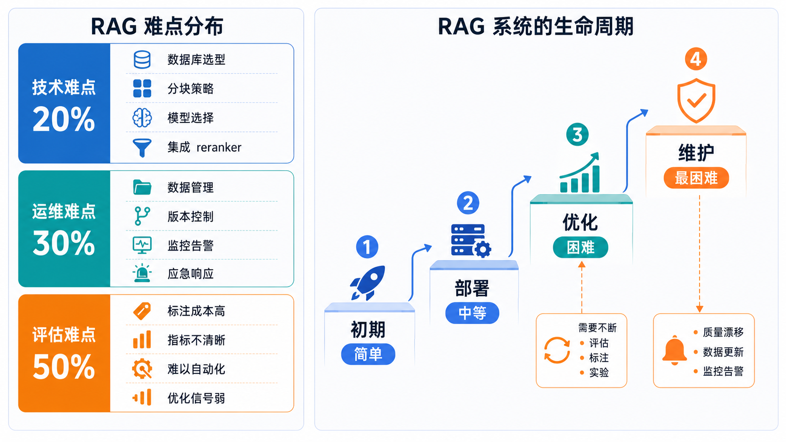

## 知识点讲解



### 1. 核心概念

很多人做完 RAG Demo 之后感觉"不难嘛"，然后在生产环境里撞得头破血流。真正难的不是把 embedding + 向量检索 + LLM 拼起来跑通，而是以下几件事：

1. **你不知道它到底有多好**——缺乏标准评估体系，没法量化质量
2. **你不知道为什么它变差了**——线上质量静默劣化，没有告警
3. **你不知道哪个改动有效**——优化效果无法归因，A/B 测试很难做
4. **数据本身就是问题**——知识库质量参差不齐，垃圾进垃圾出

RAG 的技术选型问题（用哪个向量库、用什么 embedding 模型）都有成熟的社区答案，但评估和运维是每个团队都要自己趟坑的硬仗。

### 2. 技术细节

#### 2.1 评估是最大的难题

**没有好的标准测试集**：不同业务场景的"相关性"定义不同。电商客服的相关，跟法律助手的相关，完全是两回事。你没法直接拿公开 benchmark 来评自己的 RAG。

**标注成本高**：构建评测集需要领域专家把每个问题的"正确答案文档"都标出来。100 个标注问题，在某些专业领域可能要花几万块的专家时间。

**自动指标不靠谱**：ROUGE、BLEU 跟实际用户感知的质量几乎没有相关性。LLM-as-judge 好一点，但 GPT-4o 当评判者本身也会有偏差。

**评估的三个层面**，每个都要分开看：

```latex
检索质量：Recall@K、Precision@K、MRR
生成质量：Faithfulness（是否有依据）、Relevance（是否回答了问题）
端到端质量：用户满意度、任务完成率
```

三个层面都好才是真的好。检索好但生成差（LLM 曲解文档），或者生成流畅但检索漏了关键信息（但答案看起来挺好），都是常见陷阱。

#### 2.2 线上质量的静默劣化

RAG 系统上线后，质量会在你不注意的情况下悄悄下滑：

- 知识库文档堆积，噪声越来越多
- 用户提问方式演化，embedding 模型的覆盖开始有盲区
- 底层 LLM 版本更新（API 方），行为微妙变化
- 文档更新不及时，回答了过期信息

没有持续监控，你根本不知道这些事情在发生。等用户抱怨时，已经劣化了很久。

#### 2.3 数据质量是隐藏的巨坑

"知识库里放什么"决定了 RAG 能做到多好的上限。问题很多：

- 文档格式混乱（PDF 解析出来乱码、表格变成一堆数字）
- 文档之间互相矛盾（不同时期的版本共存）
- 文档本身就是错的（没有人审过的业务文档）
- 文档颗粒度不一致（有的是一句话，有的是整个 PDF）

这些问题没有技术银弹，需要数据治理。但数据治理在工程团队里是最难推动的事，因为它不产出立竿见影的效果，却要花大量精力。

## 代码示例

**最小可用的评估框架**

```python
from dataclasses import dataclass, field
from typing import Optional

@dataclass
class EvalCase:
    query: str
    expected_doc_ids: list[str]   # 应该被召回的文档 ID（人工标注）
    reference_answer: str          # 参考答案（人工标注）

class RAGEvaluator:
    def __init__(self, rag_pipeline, llm_judge):
        self.rag = rag_pipeline
        self.judge = llm_judge

    def eval_retrieval(self, case: EvalCase, top_k: int = 5) -> dict:
        docs = self.rag.retrieve(case.query, top_k=top_k)
        retrieved_ids = {d["id"] for d in docs}
        expected_ids = set(case.expected_doc_ids)

        precision = len(retrieved_ids & expected_ids) / len(retrieved_ids) if retrieved_ids else 0
        recall = len(retrieved_ids & expected_ids) / len(expected_ids) if expected_ids else 0

        # MRR：第一个命中的排名
        mrr = 0.0
        for rank, doc in enumerate(docs, start=1):
            if doc["id"] in expected_ids:
                mrr = 1.0 / rank
                break

        return {"precision": precision, "recall": recall, "mrr": mrr}

    def eval_faithfulness(self, answer: str, source_docs: list[str]) -> float:
        """用 LLM 判断答案里的声明是否有文档依据"""
        context = "\n\n".join(source_docs)
        prompt = f"""判断"答案"中的每个关键声明是否有"文档"明确支撑。
输出 JSON：{{"faithfulness_score": 0-1}}

文档：{context}

答案：{answer}"""
        result = self.judge.call(prompt, response_format="json")
        return result.get("faithfulness_score", 0.0)

    def run_batch(self, cases: list[EvalCase]) -> dict:
        retrieval_metrics = {"precision": [], "recall": [], "mrr": []}
        faithfulness_scores = []

        for case in cases:
            # 检索评估
            ret = self.eval_retrieval(case)
            for k, v in ret.items():
                retrieval_metrics[k].append(v)

            # 生成 + 忠实度评估
            result = self.rag.run(case.query)
            source_texts = [d["text"] for d in result["sources"]]
            faith = self.eval_faithfulness(result["answer"], source_texts)
            faithfulness_scores.append(faith)

        n = len(cases)
        return {
            "Precision@K": sum(retrieval_metrics["precision"]) / n,
            "Recall@K":    sum(retrieval_metrics["recall"]) / n,
            "MRR":         sum(retrieval_metrics["mrr"]) / n,
            "Faithfulness": sum(faithfulness_scores) / n,
        }
```

**线上监控：轻量抽样评估**

```python
import random
import time

class RAGProductionMonitor:
    """生产环境轻量监控，不可能对每次请求都做全量评估"""

    def __init__(self, rag_pipeline, judge_llm, sample_rate: float = 0.02):
        self.rag = rag_pipeline
        self.judge = judge_llm
        self.sample_rate = sample_rate  # 2% 抽样做质量评估

    def handle_query(self, query: str) -> dict:
        t0 = time.time()
        result = self.rag.run(query)
        latency_ms = (time.time() - t0) * 1000

        # 记录基础指标（每次都做）
        self._log_metrics({
            "latency_ms": latency_ms,
            "retrieved_count": len(result["sources"]),
            "answer_length": len(result["answer"]),
        })

        # 低频抽样做质量评估（成本控制）
        if random.random() < self.sample_rate:
            faith_score = self._quick_faithfulness_check(
                result["answer"],
                [d["text"] for d in result["sources"]],
            )
            self._log_metrics({"faithfulness_sample": faith_score})

            # 质量告警阈值
            if faith_score < 0.6:
                self._alert(f"低忠实度告警: {faith_score:.2f}，query={query[:50]}")

        return result

    def _quick_faithfulness_check(self, answer: str, docs: list[str]) -> float:
        # 用轻量模型做快速判断，不用最贵的模型
        # ...
        pass

    def _log_metrics(self, metrics: dict):
        # 推送到监控系统（Prometheus、Datadog、自建）
        # ...
        pass

    def _alert(self, message: str):
        # 钉钉/Slack/PagerDuty
        # ...
        pass
```

**数据质量预检**

```python
def audit_knowledge_base(docs: list[dict]) -> dict:
    """
    入库前的数据质量检查，发现问题文档
    """
    issues = {"too_short": [], "too_long": [], "duplicate": [], "empty": []}
    seen_hashes = {}

    for doc in docs:
        text = doc.get("text", "").strip()
        doc_id = doc.get("id", "unknown")

        if not text:
            issues["empty"].append(doc_id)
            continue

        word_count = len(text.split())

        if word_count < 20:   # 太短：可能是标题或碎片，检索价值低
            issues["too_short"].append(doc_id)

        if word_count > 2000:  # 太长：分块不彻底，会稀释相关性
            issues["too_long"].append(doc_id)

        # 近似去重：用前 200 字的哈希
        import hashlib
        text_hash = hashlib.md5(text[:200].encode()).hexdigest()
        if text_hash in seen_hashes:
            issues["duplicate"].append((doc_id, seen_hashes[text_hash]))
        else:
            seen_hashes[text_hash] = doc_id

    total = len(docs)
    return {
        "total": total,
        "issues": issues,
        "issue_rate": sum(len(v) for v in issues.values()) / total,
    }
```

## 面试怎么答

RAG 落地最难的不是技术，而是评估和持续优化。Demo 阶段跑通不难，但上了生产你会发现：不知道系统到底有多好、不知道什么时候变差了、不知道哪个优化真的有效。

评估难在三点：没有现成的测试集，需要领域专家标注，成本高；检索和生成是两个独立层面，要分开评，只看最终答案发现不了是哪一层的问题；LLM-as-judge 比传统指标好，但评判者本身也有偏差，不能完全信任。

数据质量是隐藏的大坑——知识库里的文档格式混乱、内容互相矛盾、版本没有管理，这些在技术层面无法解决，必须靠数据治理。工程团队往往低估这块的工作量，以为向量化进去就完事了，实际上数据清洗才是大头。

应对策略：构建一个小规模但高质量的评测集（50-200 条），每次改动都在上面跑一遍；生产环境做 2-5% 的抽样质量评估 + 告警；把检索质量和生成质量的指标分开监控，出了问题能快速定位在哪一层。

## 高频追问 & 加分点

- **Q1：没有标注数据怎么构建评测集？**  
    用"合成数据 + 专家审核"的方法：让 LLM 根据知识库文档生成问题，然后把（问题、应该被召回的文档）这个对让专家快速审核确认，效率比让专家从头出题高 5-10 倍。100 条高质量测试用例足以支撑大多数优化决策。
- **Q2：检索质量好但生成效果差怎么排查？**  
    常见原因是 Prompt 约束不够——模型检索到了文档，但用自己的训练知识"补充"了文档里没有的内容。排查方法：跑 Faithfulness Check，找出答案里没有文档依据的声明；然后加强 Prompt 约束，或者在生成后加验证步骤。
- **Q3：知识库文档之间有矛盾怎么处理？**  
    短期方案：在文档元数据里加版本和时间戳，检索时优先最新版本（metadata filter by date）；长期方案：建立文档审核流程，新文档入库前必须过冲突检测。完全自动化的冲突检测很难，半自动（系统标记可疑文档 + 人工确认）是可行的。
- **Q4：如何让 RAG 的优化效果可归因？**  
    每次改动只改一个变量（single variable testing），同时在固定的评测集上跑对比。不要同时改 embedding 模型、top-K 和 Prompt——这样你不知道是哪个改动起了效果。另外记录每次实验的配置和结果，形成优化日志，方便回滚和分析趋势。
- **Q5：用户反馈信号怎么用？**  
    最直接的信号是"踩/赞"按钮，但用户点击率很低（通常 &lt; 5%）。更实用的方案：记录用户的追问行为——如果用户在回答后马上问"你确定吗""能再详细说说吗"，这是隐式的负反馈信号；如果对话在这个问题后结束了且用户没有继续追问，通常是正向信号。把这些信号接入评测流，比等用户主动反馈更能获取足够的样本量。
