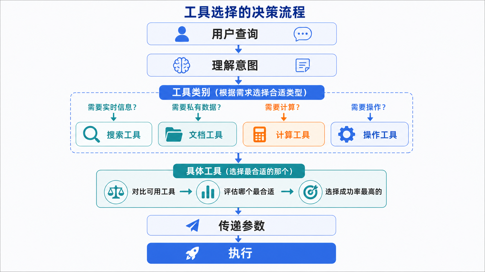

## 知识点讲解



### 1. 核心概念

Agent 的工具选择，本质上就是一个**条件概率推理**：给定用户的请求和当前上下文，哪个工具最能推进任务？

LLM 做这个判断的依据很直接——它读工具的 Schema（name + description + 参数说明），结合当前对话，在生成时选择"调工具"还是"直接回答"。

工具选择有两个层次的决策：

- 要不要调工具（vs 纯文本回答）
- 调哪个工具（当有多个可用时）

这两个决策都靠工具描述的质量来驱动。描述写得好，模型就能找准；描述模糊或重叠，就容易选错或者乱调。

### 2. 技术细节

#### 2.1 影响工具选择准确率的因素

| 因素 | 影响程度 | 说明 |
| --- | --- | --- |
| 工具描述质量 | 极高 | "何时用"写清楚，模型才能判断 |
| 工具名称 | 高 | 名称要自解释，避免 do_something 这种 |
| 参数说明 | 高 | 参数写清楚，生成的参数才准确 |
| 工具数量 | 中 | 超过 15 个工具，准确率会明显下降 |
| 功能重叠度 | 中 | 两个工具功能越像，越容易混淆 |
| few-shot 示例 | 中-高 | 给出具体调用例子，效果立竿见影 |

#### 2.2 工具描述的写法对比

描述的差距直接体现在选择准确率上：

**差的写法：**

```json
{
  "name": "search",
  "description": "搜索信息"
}
```

**好的写法：**

```json
{
  "name": "search_web",
  "description": "在互联网上搜索最新信息。适用于：查找新闻、当前事件、实时数据、近期发布的产品。不适用于：查询公司内部文档、历史存档数据。"
}
```

"何时用"和"不适用于"都写出来，LLM 就很少会选错。

#### 2.3 工具太多时的分组策略

工具超过 10 个，推荐按场景分组，只把当前任务相关的工具放进 prompt：

```latex
财务类任务 → 只提供 query_finance_db, export_report, send_email
IT 类任务 → 只提供 check_server_status, restart_service, query_logs
```

这种动态工具集的做法比把 50 个工具全塞进去效果好得多。

### 3. 对比与拓展

工具选择准确率的优化手段，按投入产出排：

| 优化手段 | 准确率提升 | 实施成本 |
| --- | --- | --- |
| 改进工具描述（加使用场景） | +20-30% | 低 |
| 添加 few-shot 示例 | +15-25% | 低 |
| 按场景动态限制工具集 | +10-20% | 中 |
| 工具名称语义化 | +10-15% | 低 |
| 换更强的基座模型 | +10-30% | 高 |

我自己一般先从描述下手，成本最低、收益最快。

## 代码示例

下面的例子对比了"描述模糊"和"描述清晰"两种定义，以及如何在运行时按场景动态限制工具集。

```python
from anthropic import Anthropic

client = Anthropic()

# 全量工具注册表
ALL_TOOLS = {
    "search_web": {
        "name": "search_web",
        "description": (
            "在互联网上搜索最新信息。"
            "适用场景：新闻、当前事件、实时行情、最新发布的内容。"
            "不要用来查询公司内部文档或历史数据库。"
        ),
        "input_schema": {
            "type": "object",
            "properties": {
                "query": {"type": "string", "description": "搜索关键词，3-5 个词最佳"}
            },
            "required": ["query"]
        }
    },
    "search_internal_docs": {
        "name": "search_internal_docs",
        "description": (
            "搜索公司内部文档、政策和知识库。"
            "适用场景：公司政策查询、产品手册、内部流程文档。"
            "不要用来搜索互联网或实时数据。"
        ),
        "input_schema": {
            "type": "object",
            "properties": {
                "query": {"type": "string", "description": "查询关键词"},
                "doc_type": {
                    "type": "string",
                    "enum": ["policy", "manual", "faq"],
                    "description": "文档类型，不确定可不填"
                }
            },
            "required": ["query"]
        }
    },
    "execute_sql": {
        "name": "execute_sql",
        "description": (
            "在业务数据库执行 SELECT 查询，返回结构化数据。"
            "适用场景：查询用户数据、订单信息、销售报表。"
            "只允许 SELECT，禁止 INSERT/UPDATE/DELETE。"
        ),
        "input_schema": {
            "type": "object",
            "properties": {
                "sql": {"type": "string", "description": "SQL SELECT 语句"}
            },
            "required": ["sql"]
        }
    }
}

# 按场景动态选工具集
SCENE_TOOL_GROUPS = {
    "customer_service": ["search_internal_docs", "execute_sql"],
    "research":         ["search_web", "search_internal_docs"],
    "data_analysis":    ["execute_sql"],
}

def get_tools_for_scene(scene: str) -> list:
    """根据场景返回对应工具集，避免把不相关工具塞进 prompt"""
    tool_names = SCENE_TOOL_GROUPS.get(scene, list(ALL_TOOLS.keys()))
    return [ALL_TOOLS[name] for name in tool_names if name in ALL_TOOLS]


def run_agent_with_scene(user_message: str, scene: str = "research") -> str:
    tools = get_tools_for_scene(scene)
    messages = [{"role": "user", "content": user_message}]

    for _ in range(10):
        response = client.messages.create(
            model="claude-opus-4-5",
            max_tokens=1024,
            tools=tools,
            messages=messages
        )

        if response.stop_reason == "end_turn":
            return next(
                (b.text for b in response.content if hasattr(b, "text")), ""
            )

        tool_calls = [b for b in response.content if b.type == "tool_use"]
        tool_results = []
        for tc in tool_calls:
            # 实际执行逻辑省略，重点看工具选择机制
            result = f"[{tc.name} 执行结果，参数: {tc.input}]"
            tool_results.append({
                "type": "tool_result",
                "tool_use_id": tc.id,
                "content": result
            })

        messages.append({"role": "assistant", "content": response.content})
        messages.append({"role": "user", "content": tool_results})

    return "超出最大步骤"


# 客服场景：只提供内部文档 + SQL，不给搜索引擎
answer = run_agent_with_scene("查一下我们公司的退款政策", scene="customer_service")
print(answer)
```

## 面试怎么答

Agent 的工具选择本质是 LLM 在推理时做的一个概率判断：给定用户请求和工具 Schema，模型决定"要不要调、调哪个"。

影响准确率最大的是工具描述的质量。描述里要写清楚"适用场景"和"不适用于哪里"，光写"搜索信息"这种太抽象，模型没法判断边界。工具名称也很关键，`search_web` 比 `search` 要好得多，名称本身就携带了语义。

工具太多是另一个常见问题。超过 10-15 个工具后，准确率会明显下降。我习惯按场景做动态工具集——客服任务只给内部文档和数据库工具，研究任务才给搜索引擎，避免工具之间互相干扰模型判断。

调优顺序：先改描述（成本最低）→ 加 few-shot 示例 → 按场景限制工具集 → 换更强模型。90% 的选错问题能在前两步解决。

## 高频追问 & 加分点

- **Q1：工具功能重叠时怎么区分？**  
    在描述里明确写出差异，加上各自的"适用"和"不适用"范围。实在分不清就合并成一个工具，用参数区分行为，比参数相同的两个工具更容易让模型选对。
- **Q2：few-shot 示例应该放在哪里？**  
    放在 system prompt 里，用具体的用户请求 + 工具调用对来展示。格式比文字描述更直观，模型一看就懂。
- **Q3：怎么评估工具选择的准确率？**  
    准备一批标注好"正确工具"的测试用例，跑一遍计算 top-1 准确率。失败案例按"工具描述问题"、"工具重叠问题"、"模型能力问题"分类，对症下药。
- **Q4：有没有让模型解释"为什么选这个工具"的方法？**  
    可以在 system prompt 里要求模型先输出思考过程（类似 ReAct 的 Thought 步骤），再给工具调用。这样有助于 debug，也能发现描述的盲区。
- **Q5：工具选择和检索增强（RAG）有什么关系？**  
    本质相似——都是"给 LLM 提供额外信息来源"。不同在于：RAG 是被动注入（检索后直接塞进 context），Tool Use 是主动调用（LLM 自己决定何时查、查什么）。复杂任务里两者可以配合：工具调用触发 RAG 检索。
