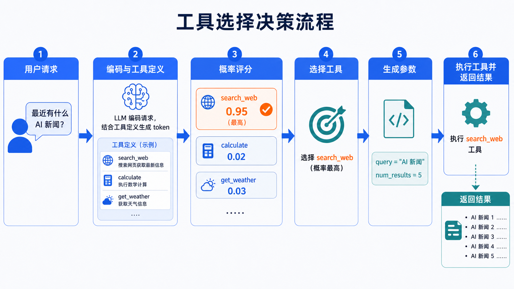

## 知识点讲解



### 1. 核心概念

工具选择的本质是**条件概率**——给定用户请求 R 和工具集合 T，LLM 计算 `P(tool_i | R, T_definitions)`，然后选 top-1。

这个过程不是什么神秘的"理解"，就是语言模型在生成 token 时，把"工具名称"当成一种特殊的输出格式，根据 context 分配概率，选概率最高的那个。

理解这一点很关键，因为这直接告诉我们：**优化工具选择 = 优化 LLM 生成工具名称的概率分布**。你能影响的手段，就是工具 Schema 的质量、Prompt 结构、few-shot 示例。

### 2. 技术细节

#### 2.1 工具选择的三个层次

工具调用不是一次决策，而是分层的：

| 层次 | 决策内容 | 影响因素 |
| --- | --- | --- |
| 工具层 | 要不要调工具？调哪个？ | 工具名称、description |
| 参数层 | 各参数填什么值？ | 参数的 description、类型约束 |
| 格式层 | 输出格式是否合规？ | JSON Schema 的 required / enum |

每一层都可能出错。工具选对了，参数填错，一样跑不通。

#### 2.2 工具描述对模型的影响路径

```latex
用户问："今天上海天气怎么样？"

LLM 内部推理（简化）：
  - 用户问的是实时天气（非历史数据）
  - 可用工具：search_web、get_weather、query_database
  - get_weather.description = "获取指定城市的实时天气数据" ← 语义最接近
  - P(get_weather | 上下文) >> P(其他工具 | 上下文)
  - → 输出 tool_use: get_weather, city="上海"
```

如果 `get_weather` 的描述写的是"搜索天气"，和 `search_web` 描述重叠，概率就会分散，选错概率大幅上升。

#### 2.3 工具呈现给 LLM 的实际格式

Anthropic 的 API 会把工具 Schema 以特定格式注入 system prompt（用户看不到，但模型看得到）。大概长这样：

```xml
<tools>
  <tool_description>
    <tool_name>get_weather</tool_name>

    <description>获取指定城市的实时天气。适用于用户询问当前天气状况时。</description>

    <parameters>
      <parameter>
        <name>city</name>

        <type>string</type>

        <description>城市名称，如「北京」「上海」</description>

      </parameter>

    </parameters>

  </tool_description>

</tools>
```

模型处理这段文本就像处理普通 prompt，理解工具语义、决定是否调用。

### 3. 对比与拓展

工具选择的底层机制，和 LLM 的 function calling fine-tuning 密切相关。OpenAI 和 Anthropic 都对模型做了专门训练，让它更可靠地输出结构化的工具调用格式（而不是随机生成 JSON）。开源模型如果没有针对 function calling 的微调，工具选择准确率会低很多，通常要用 prompt 工程来补偿。

## 代码示例

下面这段代码展示了三个关键点：观测工具选择行为、对比不同描述质量的效果、捕获工具调用的详细信息。

```python
from anthropic import Anthropic

client = Anthropic()

# 对比：模糊描述 vs 清晰描述
VAGUE_TOOLS = [
    {
        "name": "search",
        "description": "搜索信息",
        "input_schema": {
            "type": "object",
            "properties": {"q": {"type": "string"}},
            "required": ["q"]
        }
    },
    {
        "name": "query",
        "description": "查询数据",
        "input_schema": {
            "type": "object",
            "properties": {"input": {"type": "string"}},
            "required": ["input"]
        }
    }
]

CLEAR_TOOLS = [
    {
        "name": "search_web",
        "description": (
            "在互联网上搜索最新信息。"
            "适用于：新闻、实时数据、近期发布的内容、公开网页信息。"
            "不适用于：公司内部数据、历史归档文档。"
        ),
        "input_schema": {
            "type": "object",
            "properties": {
                "query": {
                    "type": "string",
                    "description": "搜索关键词，3-5 个词，简洁明确"
                }
            },
            "required": ["query"]
        }
    },
    {
        "name": "query_internal_db",
        "description": (
            "查询公司内部业务数据库。"
            "适用于：用户订单、账户信息、产品库存、销售报表。"
            "不适用于：公开网页信息、实时行情数据。"
        ),
        "input_schema": {
            "type": "object",
            "properties": {
                "table": {
                    "type": "string",
                    "enum": ["orders", "users", "products", "sales"],
                    "description": "要查询的数据表"
                },
                "filter": {
                    "type": "string",
                    "description": "过滤条件，如 'user_id=123'"
                }
            },
            "required": ["table"]
        }
    }
]


def probe_tool_selection(user_query: str, tools: list, label: str) -> dict:
    """
    探测 LLM 对给定查询的工具选择行为。
    返回选择的工具名称和参数，用于对比不同 Schema 的效果。
    """
    response = client.messages.create(
        model="claude-opus-4-5",
        max_tokens=512,
        tools=tools,
        messages=[{"role": "user", "content": user_query}]
    )

    tool_calls = [b for b in response.content if b.type == "tool_use"]
    result = {
        "label": label,
        "query": user_query,
        "stop_reason": response.stop_reason,
        "tool_calls": [{"name": tc.name, "input": tc.input} for tc in tool_calls]
    }
    print(f"\n[{label}]")
    print(f"  查询: {user_query}")
    print(f"  选择工具: {[tc['name'] for tc in result['tool_calls']] or '无（纯文本回答）'}")
    if tool_calls:
        print(f"  参数: {tool_calls[0].input}")
    return result


# 测试同一问题在不同工具定义下的行为差异
test_queries = [
    "查一下昨天的 iPhone 15 销售数量",
    "帮我搜搜最新的 AI 新闻",
    "2+2 等于几",  # 不需要工具的问题
]

for query in test_queries:
    probe_tool_selection(query, VAGUE_TOOLS, "模糊描述")
    probe_tool_selection(query, CLEAR_TOOLS, "清晰描述")
    print("-" * 50)
```

运行后可以直观看到：同一个查询，清晰描述版几乎总能选对工具，模糊描述版经常选错或者两个工具都不选。

## 面试怎么答

工具选择的底层就是 token 概率。LLM 把工具 Schema 当成 context 的一部分，在生成"我要调哪个工具"的 token 时，根据语义相似度分配概率，选概率最高的。所以优化工具选择，本质是优化 LLM 生成正确工具名称的概率分布。

具体来说，选择分三层：工具层（选哪个工具）、参数层（填什么值）、格式层（JSON 格式是否合规）。每层都可能出错，工具定义质量影响前两层，JSON Schema 约束影响第三层。

工具描述写"适用于"和"不适用于"这两句，是我见过性价比最高的优化。模型本来要靠自己推断边界，你把边界直接写出来，它就不用猜了，准确率立刻上来。

另外一个工程细节：各家模型（OpenAI、Anthropic）都对 function calling 做了专门的 fine-tuning，让模型更稳定地输出结构化格式。开源模型没有这个 fine-tuning，工具调用格式会更不稳定，需要额外的 prompt 工程来补偿。

## 高频追问 & 加分点

- **Q1：模型有时候明明应该调工具，但直接用文本回答了，怎么办？**  
    两个方向：一是工具描述里加上"当用户问 X 时，必须调用此工具"这样的强调语气；二是在 system prompt 里明确"不确定时优先尝试工具"。如果还不行，可以用 `tool_choice` 参数强制调用某个工具（Anthropic API 支持 `tool_choice: {type: "any"}` 强制调工具）。
- **Q2：两个工具功能高度相似，模型总分不清楚，怎么处理？**  
    最根本的解法是合并成一个工具，用参数区分行为。实在不能合并，就在 description 里写清楚"A 用于 X 场景，B 用于 Y 场景，两者的区别是 Z"，并在 few-shot 里各给一个示例。
- **Q3：工具选择能不能离线评估，不用每次都跑 API？**  
    可以。用一批标注好"正确工具"的测试集，把工具 Schema 和用户问题打包成 prompt，批量调用 API 计算 top-1 准确率。这个测试集 100-200 条就够做回归测试了。
- **Q4：有没有办法知道模型"有多确定"自己选对了？**  
    直接问模型不太可靠（自我评估偏高）。实践里更可靠的是：让模型输出 Thought 步骤（解释为什么选这个工具），观察推理是否合理；或者对同一问题多次采样，看工具选择的一致性（高一致性 = 高置信度）。
- **Q5：工具选择和 RAG 的区别是什么？**  
    RAG 是被动注入：系统提前检索、直接塞进 context；Tool Use 是主动调用：LLM 自己决定什么时候调、调什么参数。工具选择是 Tool Use 的前置决策，RAG 是工具执行的实现方式之一（把"检索文档"封装成一个工具就行）。
