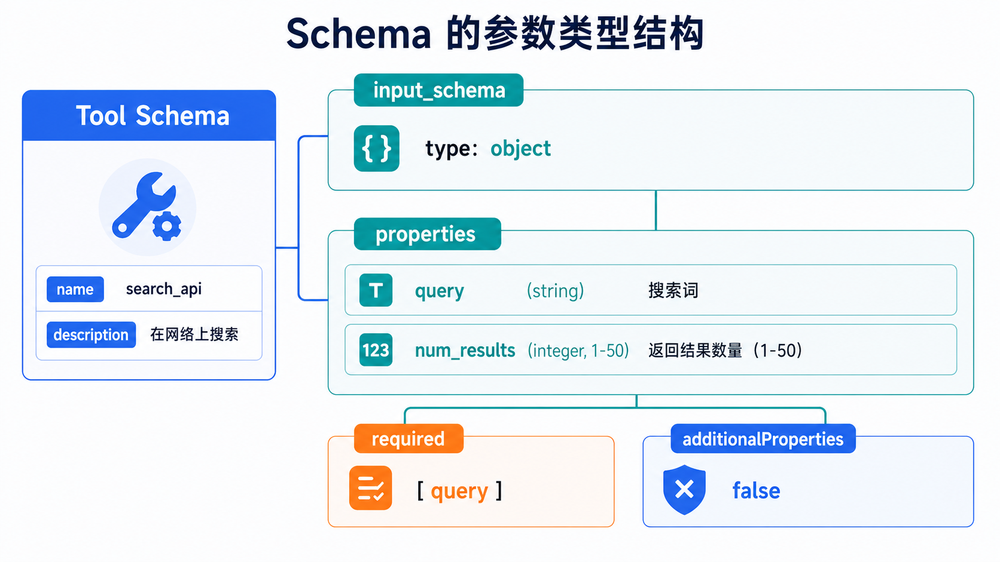

## 知识点讲解



### 1. 核心概念

工具 Schema 是 LLM 和外部工具之间的"合同"。模型看到 Schema，决定要不要调用这个工具，以及怎么填参数。Schema 设计得好，模型调用准确率能显著提升；Schema 设计得差，模型要么不知道什么时候用，要么参数填错。

说白了，Schema 就是给模型看的 API 文档。只不过这份文档的读者不是人，是语言模型。

每个工具 Schema 包含三个核心部分：

- `name`：工具的标识符，影响模型的调用决策
- `description`：一句话说清楚这个工具干什么、什么时候该用
- `input_schema`：JSON Schema 格式的参数定义

### 2. 技术细节

#### 2.1 Schema 的关键设计原则

**名称要能自解释**：`search_product_catalog` 比 `search` 好；`get_user_order_history` 比 `get_data` 好。模型在多工具场景里靠名称做初步筛选。

**description 要告诉模型"什么时候用"，不只是"能干什么"**：

差的写法："搜索产品"

好的写法："在用户询问产品信息、价格、库存时，搜索产品目录。不适合搜索订单状态或用户账户信息。"

加上负面说明（"不适合用于..."），能让模型在多工具场景里做出更精准的选择。

**参数描述要具体**：

```json
// 差：
"date": { "type": "string", "description": "日期" }

// 好：
"date": {
  "type": "string",
  "description": "查询日期，格式 YYYY-MM-DD，例如 2024-01-15"
}
```

格式、示例、约束条件都写进去，模型生成的参数值出错率会大幅下降。

#### 2.2 常用约束方式

| 约束类型 | JSON Schema 写法 | 作用 |
| --- | --- | --- |
| 枚举值 | `"enum": ["low", "medium", "high"]` | 限制合法值范围 |
| 数值范围 | `"minimum": 1, "maximum": 100` | 防止越界 |
| 字符串格式 | `"pattern": "^\\d{4}-\\d{2}-\\d{2}$"` | 格式校验 |
| 必填声明 | `"required": ["query", "limit"]` | 告诉模型哪些参数不能省 |
| 禁止额外参数 | `"additionalProperties": false` | 收口参数边界 |

#### 2.3 参数数量的控制

经验规律：一个工具的参数控制在 3-7 个。超过 10 个参数，模型的调用准确率会明显下降。

如果工具本身复杂，不要把所有选项都暴露出来，而是：

- 把高频选项作为参数，低频选项用默认值处理
- 把复杂的工具拆成几个功能明确的小工具

## 代码示例

**一个设计完整的工具 Schema**

```json
{
  "name": "search_product_catalog",
  "description": "在产品目录中搜索商品，适用于用户询问产品信息、价格、库存时。不适合查询订单状态。",
  "input_schema": {
    "type": "object",
    "properties": {
      "query": {
        "type": "string",
        "description": "搜索关键词，例如'蓝牙耳机'或'iPhone 15 保护壳'"
      },
      "category": {
        "type": "string",
        "enum": ["electronics", "clothing", "books", "home"],
        "description": "商品分类，不确定时省略此参数"
      },
      "max_price": {
        "type": "number",
        "minimum": 0,
        "description": "价格上限（元），不填则不限价格"
      },
      "limit": {
        "type": "integer",
        "minimum": 1,
        "maximum": 20,
        "description": "返回结果数量，默认 5"
      }
    },
    "required": ["query"],
    "additionalProperties": false
  }
}
```

**运行时参数校验**

```python
import json
from jsonschema import validate, ValidationError

class ToolSchemaValidator:
    def __init__(self, schema: dict):
        self.schema = schema
        self.input_schema = schema["input_schema"]

    def validate(self, params: dict) -> tuple[bool, str]:
        try:
            validate(instance=params, schema=self.input_schema)
            return True, "ok"
        except ValidationError as e:
            # 把 jsonschema 的错误信息转成可读的格式
            field = " -> ".join(str(p) for p in e.absolute_path) or "root"
            return False, f"参数 [{field}] 校验失败: {e.message}"

    def describe(self) -> str:
        """生成人可读的参数说明，用于调试"""
        lines = [f"工具：{self.schema['name']}", f"描述：{self.schema['description']}", "参数："]
        props = self.input_schema.get("properties", {})
        required = set(self.input_schema.get("required", []))
        for name, defn in props.items():
            flag = "必填" if name in required else "选填"
            lines.append(f"  {name} ({flag}): {defn.get('description', '')}")
        return "\n".join(lines)


# 使用示例
validator = ToolSchemaValidator(tool_schema)

# 正确的调用
ok, msg = validator.validate({"query": "蓝牙耳机", "max_price": 500})
# ok=True, msg="ok"

# 错误的调用：max_price 是负数
ok, msg = validator.validate({"query": "耳机", "max_price": -10})
# ok=False, msg="参数 [max_price] 校验失败: -10 is less than the minimum of 0"
```

**多工具注册中心**

```python
from dataclasses import dataclass
from typing import Callable

@dataclass
class Tool:
    schema: dict
    handler: Callable
    validator: ToolSchemaValidator

class ToolRegistry:
    def __init__(self):
        self._tools: dict[str, Tool] = {}

    def register(self, schema: dict, handler: Callable) -> None:
        name = schema["name"]
        self._tools[name] = Tool(
            schema=schema,
            handler=handler,
            validator=ToolSchemaValidator(schema),
        )

    def get_schemas(self) -> list[dict]:
        """返回所有工具的 schema，注入给 LLM"""
        return [t.schema for t in self._tools.values()]

    def call(self, name: str, params: dict) -> dict:
        if name not in self._tools:
            return {"error": f"未知工具: {name}"}

        tool = self._tools[name]
        ok, msg = tool.validator.validate(params)
        if not ok:
            return {"error": f"参数校验失败: {msg}"}

        try:
            result = tool.handler(**params)
            return {"result": result}
        except Exception as e:
            return {"error": f"执行失败: {str(e)}"}
```

## 面试怎么答

工具 Schema 是 LLM 决定"用不用这个工具、参数怎么填"的唯一依据，设计质量直接影响调用准确率。

几个核心原则：名称要自解释，description 要告诉模型"什么时候用、什么时候不用"——加上负面限定（"不适合用于..."）能在多工具场景里减少误调用；参数描述要包含类型、格式说明和示例值，不是写给人看的 README，而是给模型的精确指令；用 JSON Schema 的约束能力——enum 限定合法值、minimum/maximum 限定数值范围、required 声明必填项，这些约束不只是文档，运行时还能用来校验模型生成的参数是否合法。

参数数量控制在 3-7 个是个经验值，超过 10 个参数模型的调用准确率会明显下降。如果工具复杂，不如拆成几个职责单一的小工具。

## 高频追问 & 加分点

- **Q1：Schema 描述写得再好，模型还是选错工具怎么办？**  
    两个方向：一是在 description 里加负面说明，明确说"这个工具不适合 X 场景"；二是在系统 prompt 里加工具选择的指导原则，给几个 few-shot 示例，让模型看一遍"正确的工具选择是什么样的"。
- **Q2：工具参数校验放哪里最合适？**  
    两层都要：Schema 层（JSON Schema）做格式约束，让 LLM 第一关就能得到明确的参数规范；执行层做业务逻辑校验（比如 user_id 是否存在、权限是否足够）。模型生成的参数格式可能正确但业务无效，所以两层不能少。
- **Q3：工具 Schema 版本升级怎么管理？**  
    在工具名称里带版本号（`search_product_v2`），或者在 description 里注明"此版本支持 X，不支持 Y"。向前兼容：新增参数设默认值不要设必填，删除参数前先标注 deprecated。工具 Schema 变更要有评估集跑一遍，确认对模型调用准确率没有负面影响。
- **Q4：多语言场景下 Schema 怎么处理？**  
    description 用模型的主要工作语言写（中文系统写中文，英文系统写英文）。参数值（enum、pattern）用代码层的标准值（英文），不要为了用户展示而把枚举值写成中文——中文枚举值让代码侧处理复杂，而且模型填参数时也容易出现格式问题。
- **Q5：如何衡量 Schema 设计的质量？**  
    核心指标是工具调用准确率：构建一个测试集，每个测试用例包含用户 query 和期望的工具调用（工具名 + 参数值），跑 100 个用例看准确率。改 Schema 前后对比，量化改动效果。一般来说，把 description 从一句话改成带负面限定的三行描述，准确率能提升 10-20%。
