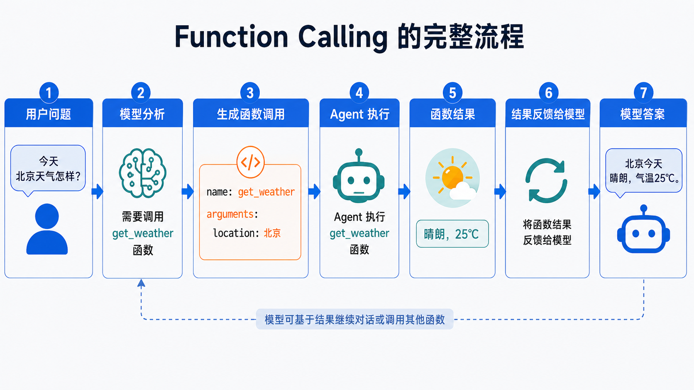

## 知识点讲解



### 1. 核心概念

Function Calling（函数调用）是 LLM 的一种能力：模型不直接生成文本答案，而是生成一个"我要调用这个函数，参数是这些"的结构化指令，由 Agent 框架解析并执行，再把结果返回给模型继续推理。

这是 Agent 能够操作外部世界的根本机制。没有 Function Calling，LLM 只能生成文本；有了它，LLM 可以查数据库、调 API、执行代码。

两大主流实现的格式略有差异：

**OpenAI Function Calling**：工具包在 `tools` 字段里，格式是 `{"type": "function", "function": {...}}`，模型触发时返回 `tool_calls` 字段。

**Anthropic Tool Use**：工具直接在 `tools` 数组里，格式稍微简洁，模型触发时 `stop_reason` 是 `"tool_use"`，在 `content` 里返回 `tool_use` block。

原理一样，就是 JSON 字段名不同，接入时注意格式即可。

### 2. 技术细节

#### 2.1 Function Calling 的四个设计原则

**① 最小化参数**：一个函数的参数控制在 3-7 个。参数越多，模型填错的概率越高，调用结果越不可预测。把可选的低频参数做成默认值，不要暴露给模型。

**② 单一职责**：一个工具只做一件事。`get_user_info_and_send_email` 这种合并工具会让模型困惑。拆成 `get_user_info` 和 `send_email` 两个工具，模型更容易知道什么时候该用哪个。

**③ 返回值结构固定**：工具的返回值格式要稳定，不能一次返回 `{"result": "..."}` 另一次返回字符串。模型需要理解并处理工具返回值，格式不稳定会让模型迷惑。

**④ 失败时给有意义的错误信息**：不要只返回 `{"error": true}`，要返回 `{"error": "用户 ID 不存在", "suggestion": "请检查用户 ID 是否正确"}`。模型需要这些信息来决定下一步怎么做——是重试、换参数还是告知用户。

#### 2.2 调用流程的五个阶段

```latex
① 定义：工具 Schema 注入 LLM 的 tools 参数
② 推理：LLM 分析问题，决定调用哪个工具、填什么参数
③ 调用：Agent 框架解析 LLM 响应，执行对应函数
④ 反馈：把执行结果作为 tool_result 放回 messages
⑤ 继续：LLM 读取结果，继续推理直到得出最终答案
```

这个循环可以持续多轮，直到 `stop_reason` 变成 `"end_turn"` 或 `"stop_sequence"`。

#### 2.3 并行工具调用

当用户问"帮我查一下北京和上海明天的天气"，模型可以在同一轮生成两个工具调用，Agent 并行执行，效率是串行的两倍。OpenAI 和 Anthropic 都支持这种模式，实现时需要收集所有 tool_calls 的结果，一起放回 messages。

## 代码示例

**Anthropic Tool Use 完整调用循环**

```python
import anthropic
import json

client = anthropic.Anthropic()

# 工具定义
tools = [
    {
        "name": "get_weather",
        "description": "获取指定城市的实时天气。用于回答关于天气状况的问题。",
        "input_schema": {
            "type": "object",
            "properties": {
                "city": {
                    "type": "string",
                    "description": "城市名称，例如'北京'或'上海'"
                },
                "unit": {
                    "type": "string",
                    "enum": ["celsius", "fahrenheit"],
                    "description": "温度单位，默认 celsius"
                }
            },
            "required": ["city"],
            "additionalProperties": False,
        },
    }
]

# 工具实现
def get_weather(city: str, unit: str = "celsius") -> dict:
    # 实际场景里调天气 API
    return {"city": city, "temperature": 22, "unit": unit, "condition": "晴"}

def dispatch_tool(name: str, params: dict) -> str:
    if name == "get_weather":
        result = get_weather(**params)
        return json.dumps(result, ensure_ascii=False)
    return json.dumps({"error": f"未知工具: {name}"})

# Agent 执行循环
def run_agent(user_message: str) -> str:
    messages = [{"role": "user", "content": user_message}]

    while True:
        response = client.messages.create(
            model="claude-3-5-sonnet-20241022",
            max_tokens=1024,
            tools=tools,
            messages=messages,
        )

        if response.stop_reason != "tool_use":
            # 模型直接生成文本，循环结束
            return next(
                (b.text for b in response.content if hasattr(b, "text")), ""
            )

        # 收集所有工具调用（可能是并行的多个）
        tool_calls = [b for b in response.content if b.type == "tool_use"]
        tool_results = []

        for call in tool_calls:
            result_text = dispatch_tool(call.name, call.input)
            tool_results.append({
                "type": "tool_result",
                "tool_use_id": call.id,
                "content": result_text,
            })

        # 把模型响应和工具结果都追加进 messages
        messages.append({"role": "assistant", "content": response.content})
        messages.append({"role": "user", "content": tool_results})
```

**OpenAI Function Calling 对比写法**

```python
from openai import OpenAI

client = OpenAI()

# OpenAI 格式的工具定义
openai_tools = [
    {
        "type": "function",
        "function": {
            "name": "get_weather",
            "description": "获取指定城市的实时天气",
            "parameters": {         # OpenAI 用 parameters，Anthropic 用 input_schema
                "type": "object",
                "properties": {
                    "city": {"type": "string", "description": "城市名称"},
                },
                "required": ["city"],
            },
        },
    }
]

def run_openai_agent(user_message: str) -> str:
    messages = [{"role": "user", "content": user_message}]

    while True:
        response = client.chat.completions.create(
            model="gpt-4o",
            tools=openai_tools,
            messages=messages,
        )

        msg = response.choices[0].message
        if not msg.tool_calls:
            return msg.content

        messages.append(msg)  # 追加 assistant 响应

        for call in msg.tool_calls:
            params = json.loads(call.function.arguments)
            result = dispatch_tool(call.function.name, params)
            messages.append({
                "role": "tool",
                "tool_call_id": call.id,
                "content": result,
            })
```

**统一封装层（屏蔽两家格式差异）**

```python
from enum import Enum

class LLMProvider(Enum):
    ANTHROPIC = "anthropic"
    OPENAI = "openai"

class UnifiedToolCaller:
    """统一接口，屏蔽 Anthropic 和 OpenAI 的格式差异"""

    def __init__(self, provider: LLMProvider, model: str):
        self.provider = provider
        self.model = model
        # 根据 provider 初始化各自 client...

    def _normalize_tools(self, tools: list[dict]) -> list[dict]:
        """把通用工具格式转换成各 provider 需要的格式"""
        if self.provider == LLMProvider.OPENAI:
            return [{"type": "function", "function": t} for t in tools]
        return tools  # Anthropic 格式就是通用格式

    def _extract_tool_calls(self, response) -> list[dict]:
        """从不同 provider 的响应里统一提取工具调用"""
        if self.provider == LLMProvider.ANTHROPIC:
            return [
                {"id": b.id, "name": b.name, "input": b.input}
                for b in response.content if b.type == "tool_use"
            ]
        # OpenAI
        return [
            {
                "id": c.id,
                "name": c.function.name,
                "input": json.loads(c.function.arguments),
            }
            for c in (response.choices[0].message.tool_calls or [])
        ]
```

## 面试怎么答

Function Calling 的核心是让 LLM 生成结构化的"调用指令"，而不是直接输出答案——模型说"我要调用 get_weather，参数是 city=北京"，Agent 框架执行后把结果返回给模型，模型继续推理。

设计原则上，最重要的四点：参数最小化（控制在 3-7 个，减少模型填错的概率）；单一职责（一个工具只做一件事，不要合并功能）；返回值格式固定（模型要读取并理解返回值，格式不稳定会让后续推理出错）；失败时返回有意义的错误（告诉模型"用户 ID 不存在"，而不只是"error: true"）。

OpenAI 和 Anthropic 的实现格式略有差异：OpenAI 在 `tools` 里包一层 `{"type": "function", ...}`，返回结果放在 `role: tool` 消息里；Anthropic 直接用 `tools` 数组，结果通过 `tool_result` block 回传。原理完全一样，接入时注意格式适配。

## 高频追问 & 加分点

- **Q1：模型选错了工具或者参数填错了怎么办？**  
    两个层面处理：Schema 层用 JSON Schema 约束参数格式（enum、type、required），模型生成不合法参数时直接校验拦截；执行层捕获异常，把错误信息格式化后作为 tool_result 返回给模型，让模型决定是重试还是换策略。
- **Q2：并行工具调用怎么实现？**  
    不需要额外实现——当模型在一轮返回多个 tool_use block（Anthropic）或多个 tool_calls（OpenAI）时，就是并行调用信号。Agent 侧用 `asyncio.gather` 或线程池并行执行这些工具，然后把所有结果统一放回 messages。注意：并行工具之间不能有数据依赖（A 的结果是 B 的输入时，只能串行）。
- **Q3：工具结果太长放进 messages 会超 token 吗？**  
    会。工具返回值要控制长度，特别是数据库查询结果或搜索摘要。实践方案：返回值截断（超过 N 字符自动截断）；只返回结构化摘要而不是完整原始数据；对长结果做二次压缩（让 LLM 先总结再传回）。
- **Q4：tool_choice 参数怎么用？**  
    OpenAI 和 Anthropic 都有这个参数，控制模型的工具使用行为。`auto`（默认）：模型自己决定；`required`：模型必须调用至少一个工具；指定工具名：强制调用某个特定工具。在某些场景里强制调用（比如数据提取任务）比依赖模型自主判断更可靠。
- **Q5：什么情况下不用 Function Calling，直接解析 JSON 输出？**  
    当工具调用是固定的、可预测的（比如始终需要提取特定字段），直接让模型输出 JSON 然后解析有时候更简单。Function Calling 的价值在于让模型自己决定调不调用、调哪个——当工具选择是确定的，多一层 Function Calling 只是增加复杂度。
