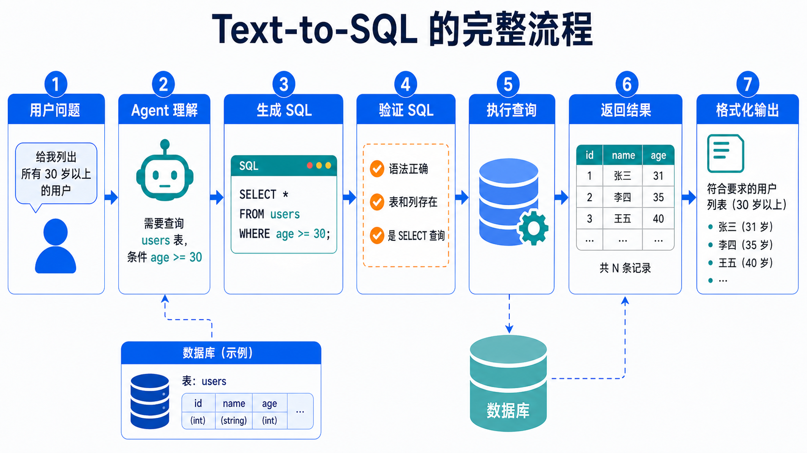

## 知识点讲解



### 1. 核心概念

Agent 调用数据库有两种主要方式：

**Text-to-SQL**：用户说自然语言，LLM 生成 SQL，Agent 执行后返回结果。灵活，但 SQL 生成准确率有上限，而且直接执行 LLM 生成的 SQL 有安全风险。

**预定义查询工具**：把常见查询封装成工具函数（`get_user_by_id`、`search_orders`），LLM 调用工具填参数，不接触 SQL 本身。安全可控，但灵活性低。

大多数生产场景用混合方案：高频、标准的查询用预定义工具；复杂的临时分析需求走 Text-to-SQL，但加严格的安全限制。

### 2. 技术细节

#### 2.1 Text-to-SQL 的核心难点

**SQL 生成质量取决于 Schema 描述质量**。给模型看的 Schema 不是 `CREATE TABLE` DDL，而是要加上每张表、每个字段的业务含义说明：

```latex
表 orders（订单表）：
- id (INTEGER)：订单唯一 ID
- user_id (INTEGER)：下单用户 ID，关联 users.id
- amount (DECIMAL)：订单金额（元）
- status (VARCHAR)：订单状态，可选值：pending/paid/shipped/completed/cancelled
- created_at (TIMESTAMP)：下单时间
```

加了业务描述，模型生成 SQL 的准确率能从 70% 提升到 85%+。

**Few-shot 示例是另一个关键手段**：在 prompt 里放 3-5 个自然语言到 SQL 的完整示例，模型能学到表达习惯，特别是 JOIN 写法、日期过滤格式这类细节。

#### 2.2 安全性是硬约束

直接执行 LLM 生成的 SQL 是高危操作。几个必须做的防线：

1. **只允许 SELECT**：在执行前检查 SQL 是否以 SELECT 开头（或通过 SQL 解析库判断语句类型），DROP、UPDATE、DELETE 一律拒绝
2. **只读数据库连接**：给 Agent 用的数据库账号只有 SELECT 权限，从连接层就拦住写操作
3. **表白名单**：只允许访问业务明确授权的表
4. **LIMIT 保底**：所有查询自动追加 `LIMIT 1000`，防止大查询打崩数据库

#### 2.3 错误修复循环

LLM 生成的 SQL 有时候语法正确但逻辑有误，或者表名列名写错了。实践中用"生成-执行-报错-修复"的循环：把执行错误信息返回给 LLM，让它修改 SQL 重试，最多 2-3 轮。超出重试次数则返回"无法生成有效查询"。

## 代码示例

**Text-to-SQL 执行器（带安全限制）**

```python
import sqlite3
import re
from dataclasses import dataclass

@dataclass
class QueryResult:
    success: bool
    rows: list[dict]
    error: str | None
    sql: str

class SafeSQLExecutor:
    ALLOWED_STMT_PATTERN = re.compile(r"^\s*SELECT\b", re.IGNORECASE)
    MAX_ROWS = 200

    def __init__(self, conn, allowed_tables: set[str]):
        self.conn = conn
        self.allowed_tables = allowed_tables

    def execute(self, sql: str) -> QueryResult:
        # 1. 只允许 SELECT
        if not self.ALLOWED_STMT_PATTERN.match(sql):
            return QueryResult(success=False, rows=[], sql=sql,
                               error="只允许 SELECT 查询，拒绝执行")

        # 2. 注入 LIMIT 保底（简单实现，生产环境用 SQL 解析库）
        if "LIMIT" not in sql.upper():
            sql = sql.rstrip(";") + f" LIMIT {self.MAX_ROWS}"

        try:
            cursor = self.conn.execute(sql)
            columns = [d[0] for d in cursor.description]
            rows = [dict(zip(columns, row)) for row in cursor.fetchall()]
            return QueryResult(success=True, rows=rows, sql=sql, error=None)
        except Exception as e:
            return QueryResult(success=False, rows=[], sql=sql, error=str(e))
```

**Text-to-SQL Agent 工具（带自动修复）**

```python
DB_SCHEMA_DESCRIPTION = """
数据库表结构：

表 users（用户）：
- id (INTEGER)：用户 ID
- name (VARCHAR)：用户姓名
- email (VARCHAR)：邮件地址
- created_at (TIMESTAMP)：注册时间

表 orders（订单）：
- id (INTEGER)：订单 ID
- user_id (INTEGER)：用户 ID，关联 users.id
- amount (DECIMAL)：金额（元）
- status (VARCHAR)：pending / paid / shipped / completed
- created_at (TIMESTAMP)：下单时间
"""

def text_to_sql_tool(
    natural_query: str,
    executor: SafeSQLExecutor,
    llm,
    max_retries: int = 2,
) -> dict:
    """
    把自然语言查询转换为 SQL 并执行，失败时自动修复重试
    """
    prompt = f"""{DB_SCHEMA_DESCRIPTION}

将以下问题转换为 SQL SELECT 语句，只输出 SQL，不要解释：
{natural_query}"""

    last_error = None
    for attempt in range(max_retries + 1):
        if attempt == 0:
            sql = llm.call(prompt).strip()
        else:
            # 把上一次的错误反馈给模型，让它修复
            fix_prompt = f"""{DB_SCHEMA_DESCRIPTION}

问题：{natural_query}
上次生成的 SQL：{sql}
执行错误：{last_error}

请修复 SQL，只输出修复后的 SQL："""
            sql = llm.call(fix_prompt).strip()

        result = executor.execute(sql)
        if result.success:
            return {
                "rows": result.rows,
                "count": len(result.rows),
                "sql": result.sql,
            }
        last_error = result.error

    return {"error": f"无法生成有效查询，最后错误：{last_error}"}
```

**预定义查询工具（更安全的方案）**

```python
# 把常见查询封装成工具，LLM 调用工具填参数，不接触 SQL

def get_user_orders(
    user_id: int,
    status: str | None = None,
    limit: int = 10,
) -> dict:
    """
    查询指定用户的订单。status 可选：pending/paid/shipped/completed
    """
    base_sql = "SELECT id, amount, status, created_at FROM orders WHERE user_id = ?"
    params = [user_id]

    if status:
        base_sql += " AND status = ?"
        params.append(status)

    base_sql += f" ORDER BY created_at DESC LIMIT {min(limit, 50)}"

    # 使用参数化查询，彻底防止 SQL 注入
    cursor = db_conn.execute(base_sql, params)
    columns = [d[0] for d in cursor.description]
    rows = [dict(zip(columns, row)) for row in cursor.fetchall()]
    return {"orders": rows, "count": len(rows)}


# 对应的 Schema（注册为工具）
get_user_orders_schema = {
    "name": "get_user_orders",
    "description": "查询指定用户的历史订单，可按状态筛选。用于回答'某用户有哪些订单'类问题。",
    "input_schema": {
        "type": "object",
        "properties": {
            "user_id": {"type": "integer", "description": "用户 ID"},
            "status": {
                "type": "string",
                "enum": ["pending", "paid", "shipped", "completed"],
                "description": "按状态筛选，不填则返回所有状态"
            },
            "limit": {
                "type": "integer",
                "minimum": 1,
                "maximum": 50,
                "description": "返回条数，默认 10"
            },
        },
        "required": ["user_id"],
        "additionalProperties": False,
    },
}
```

## 面试怎么答

Agent 调用数据库有两种路线：Text-to-SQL 让 LLM 直接生成并执行 SQL，灵活但有准确率和安全隐患；预定义查询工具把常见查询封装成函数，LLM 调用填参数，安全可控但灵活性低。

Text-to-SQL 的准确率核心取决于 Schema 描述质量——不是给模型看 DDL，而是要加业务含义说明（每个字段是什么，枚举值有哪些），再配几个 few-shot 示例，准确率能从 70% 提到 85%+。

安全上几个硬约束：只允许 SELECT，数据库账号只给只读权限，所有查询强制加 LIMIT。LLM 生成的 SQL 执行失败时可以做自动修复循环，把错误信息返回给模型让它重试，通常 1-2 次就能修好。

实际场景里我习惯用混合方案：把高频的标准查询封装成预定义工具，保证安全性；复杂的临时分析需求才走 Text-to-SQL，但控制权限和重试次数。

## 高频追问 & 加分点

- **Q1：Text-to-SQL 准确率不够高怎么办？**  
    几个方向：加强 Schema 描述，把每个字段的业务含义和枚举值都写清楚；加 few-shot 示例（3-5 个典型的自然语言到 SQL 的完整示例）；使用"生成-验证-修复"循环自动纠错；对于超高精度要求的场景，可以人工审核 SQL 后再执行。
- **Q2：如何防止 LLM 生成 DROP 或 UPDATE 语句？**  
    三层防御：正则检查 SQL 开头（最简单）；用 SQL 解析库（如 sqlglot）做语义级别的语句类型判断（更可靠）；数据库账号只有 SELECT 权限（从数据库层彻底拦截）。三层同时做，缺一不可。
- **Q3：数据库里有敏感字段（身份证号、手机号）怎么处理？**  
    从 Schema 描述里把敏感字段排除掉，模型就不知道这些字段存在；在执行层加字段白名单，允许 SELECT 的字段列表里不包含敏感字段；或者在数据库层用视图（VIEW）只暴露脱敏后的数据。
- **Q4：查询结果很多行怎么返回给 LLM？**  
    不要把几百行原始数据塞进上下文——先聚合（让 SQL 用 GROUP BY、COUNT、SUM），或者返回结果的统计摘要（"共 150 条，金额 top3 是..."），原始数据可以让用户在 UI 里查看，不用全部注入 LLM。
- **Q5：多数据库场景（MySQL + PostgreSQL + ElasticSearch）怎么处理？**  
    每个数据源注册成独立的工具，让模型选择路由：`query_mysql`、`query_postgres`、`search_elasticsearch`。在工具 description 里明确说"适合什么类型的查询"，模型会根据问题类型选择合适的数据源。
