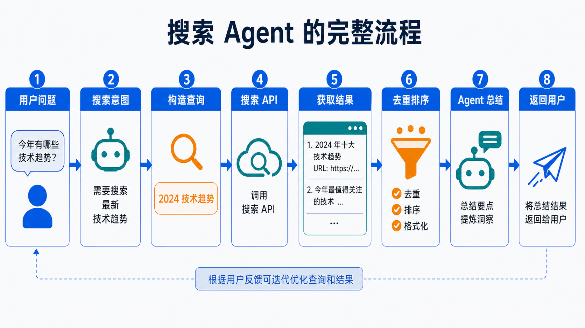

## 知识点讲解



### 1. 核心概念

Agent 调用搜索引擎的核心价值是**获取 LLM 训练数据截止日期之后的实时信息**，以及**从公开网络上获取 LLM 参数里没有的长尾知识**。

搜索不是直接把用户的问题扔给搜索引擎，而是需要一个"查询改写"的过程：把自然语言问题转成适合搜索引擎的关键词。"2024 年特斯拉的最新股价是多少"丢给搜索引擎，远不如"Tesla stock price 2024"效果好。

主流搜索工具选择：

| 工具 | 定位 | 适合场景 |
| --- | --- | --- |
| Tavily | 专为 AI Agent 设计，返回结构化摘要 | Agent 集成首选，结果质量高 |
| SerpAPI | 多搜索引擎封装（Google/Bing/百度） | 多引擎需求，结果丰富 |
| Brave Search API | 隐私友好，结果带 snippet | 成本敏感场景 |
| Bing Web Search API | 微软官方，文档完善 | 企业场景 |

Tavily 是目前 Agent 场景的首选：它不只返回 URL 列表，而是直接返回从页面提取的相关内容摘要，省掉了 Agent 自己抓页面内容的步骤。

### 2. 技术细节

#### 2.1 查询改写：让搜索更准

LLM 可以在调用搜索之前先做查询改写。原问题 → 搜索词转换的几个技巧：

- 去掉问句结构，保留名词和关键词
- 加上时间限定词（"2024"、"latest"）
- 拆解复合问题：一个复杂问题可能需要 2-3 个不同的搜索

```latex
用户问：最近 OpenAI 有什么新产品？
改写为：OpenAI new products 2024  （加时间关键词）
```

对于复杂问题，可以让模型生成多个搜索 query，分别搜索后合并结果。

#### 2.2 结果处理：过滤噪声

搜索引擎返回的结果质量参差不齐，不能全部塞进上下文：

1. **相关性过滤**：根据 score 字段（Tavily 自带）过滤掉相关性低的结果
2. **去重**：同一条信息可能来自多个不同的页面
3. **截断**：每条结果的 content 字段可能很长，按 token 截断
4. **格式化**：把多条结果整合成 LLM 能读的格式

结果注入 LLM 的 token 量要控制好——5 条结果，每条摘要 200 字，总共 1000 字左右，是比较合理的量级。

#### 2.3 成本和速率控制

搜索 API 按次计费（Tavily 免费层约 1000 次/月），生产环境要做两件事：

- **缓存**：相同的 query 在短时间内不重复搜索，用 Redis 或本地 LRU 缓存
- **速率限制**：防止 Agent 陷入循环大量触发搜索

## 代码示例

**Tavily 搜索工具封装**

```python
import json
import hashlib
from functools import lru_cache
from tavily import TavilyClient

tavily = TavilyClient(api_key="your-api-key")

class WebSearchTool:
    def __init__(self, cache_size: int = 128, max_results: int = 5):
        self.max_results = max_results
        self._cache: dict[str, list[dict]] = {}
        self._cache_size = cache_size

    def _cache_key(self, query: str) -> str:
        return hashlib.md5(query.lower().strip().encode()).hexdigest()

    def search(self, query: str, max_results: int | None = None) -> list[dict]:
        k = max_results or self.max_results
        cache_key = self._cache_key(query)

        if cache_key in self._cache:
            return self._cache[cache_key]

        response = tavily.search(
            query=query,
            max_results=k,
            include_answer=False,    # 只要原始结果，不要 Tavily 自己的摘要答案
            search_depth="basic",    # basic 够用，advanced 更贵
        )

        results = [
            {
                "title": r["title"],
                "url": r["url"],
                "content": r["content"][:500],  # 截断，控制 token
                "score": r.get("score", 0),
            }
            for r in response.get("results", [])
            if r.get("score", 0) > 0.3   # 过滤掉低相关性结果
        ]

        # 简单 LRU：超出大小时清掉第一个
        if len(self._cache) >= self._cache_size:
            self._cache.pop(next(iter(self._cache)))
        self._cache[cache_key] = results
        return results

    def format_for_llm(self, results: list[dict]) -> str:
        """把搜索结果格式化成 LLM 能读的字符串"""
        if not results:
            return "未找到相关搜索结果。"
        lines = []
        for i, r in enumerate(results, 1):
            lines.append(f"[{i}] {r['title']}\n来源：{r['url']}\n{r['content']}")
        return "\n\n".join(lines)
```

**完整 Agent 搜索调用循环**

```python
import anthropic

client = anthropic.Anthropic()
search_tool = WebSearchTool()

# 工具 Schema
search_schema = {
    "name": "search_web",
    "description": (
        "在互联网上搜索最新信息。适用于：需要实时数据、LLM 训练数据截止后的事件、"
        "具体数字或价格查询。不适用于：已有确定答案的通用知识问题。"
    ),
    "input_schema": {
        "type": "object",
        "properties": {
            "query": {
                "type": "string",
                "description": "搜索关键词，建议 3-6 个词，例如 'Tesla stock price 2024'",
            },
            "max_results": {
                "type": "integer",
                "minimum": 1,
                "maximum": 10,
                "description": "返回结果数，默认 5",
            },
        },
        "required": ["query"],
        "additionalProperties": False,
    },
}

def run_search_agent(user_message: str) -> str:
    messages = [{"role": "user", "content": user_message}]

    while True:
        response = client.messages.create(
            model="claude-3-5-sonnet-20241022",
            max_tokens=2048,
            tools=[search_schema],
            messages=messages,
        )

        if response.stop_reason != "tool_use":
            return next((b.text for b in response.content if hasattr(b, "text")), "")

        tool_calls = [b for b in response.content if b.type == "tool_use"]
        tool_results = []

        for call in tool_calls:
            query = call.input["query"]
            k = call.input.get("max_results", 5)

            results = search_tool.search(query, max_results=k)
            formatted = search_tool.format_for_llm(results)

            tool_results.append({
                "type": "tool_result",
                "tool_use_id": call.id,
                "content": formatted,
            })

        messages.append({"role": "assistant", "content": response.content})
        messages.append({"role": "user", "content": tool_results})
```

**多查询搜索（处理复杂问题）**

```python
def multi_query_search(question: str, llm, search_tool: WebSearchTool) -> str:
    """
    对复杂问题，先让 LLM 生成多个搜索 query，分别搜索后汇总结果
    """
    decompose_prompt = f"""将以下问题分解为 2-3 个独立的搜索查询（关键词形式，非问句）。
每行一个查询，不要编号。

问题：{question}"""

    queries_text = llm.call(decompose_prompt)
    queries = [q.strip() for q in queries_text.strip().split("\n") if q.strip()][:3]

    all_results = []
    seen_urls = set()

    for query in queries:
        results = search_tool.search(query, max_results=3)
        for r in results:
            if r["url"] not in seen_urls:
                seen_urls.add(r["url"])
                all_results.append(r)

    return search_tool.format_for_llm(all_results[:8])  # 控制总量
```

## 面试怎么答

Agent 调用搜索引擎的核心价值是弥补 LLM 训练数据的时效性缺口——知识截止日之后的事情、实时价格、最新新闻，都需要搜索来补充。

实现上几个要点：查询改写，不是把用户原话扔给搜索引擎，而是先转成关键词形式，加时间限定词，复杂问题拆分成多个 query；结果过滤，搜索回来的内容要按相关性过滤、截断长内容，控制注入 LLM 的 token 量；加缓存，相同 query 短时间内不重复打 API，降低成本。

工具选型上，Tavily 是目前 Agent 场景的首选，它专门为 AI 优化，直接返回页面内容摘要，省掉了自己抓页面的步骤。SerpAPI 支持多搜索引擎，结果更丰富但需要自己处理内容提取。

## 高频追问 & 加分点

- **Q1：搜索结果质量不稳定怎么办？**  
    几个手段：设置相关性分数阈值，低于阈值的结果丢弃（Tavily 的 score 字段，通常 0.3 以上算相关）；多搜几个 query 取交集；在 prompt 里明确告诉模型"参考资料仅供参考，如果来源可信度不明，请标注不确定"。
- **Q2：搜索 API 超出速率限制怎么处理？**  
    指数退避重试（与其他 API 一样）；本地缓存常见查询；设置 Agent 单次任务的最大搜索次数（比如 5 次），超过后返回"无法获取更多信息"而不是无限循环。
- **Q3：用户问的问题不需要搜索，但模型频繁触发搜索怎么办？**  
    在 description 里加"不适用于..."的限定（如"不适用于通用数学和逻辑问题"）；在 system prompt 里加搜索使用指南；调整 `tool_choice` 为 `auto`（而不是 `required`），让模型自己判断。
- **Q4：搜索结果包含错误信息怎么处理？**  
    这是搜索工具的固有风险。缓解方法：多来源交叉验证（同一信息在多个可信来源都出现，可信度更高）；在 system prompt 里要求模型对搜索结果保持批判态度；对高风险输出（金融、医疗）加人工审核。
- **Q5：国内场景如何选择搜索工具？**  
    Tavily 支持中文搜索但结果来自国际网页；百度搜索 API 面向国内内容更好；SerpAPI 支持百度引擎。实践中可以根据查询语言自动路由：中文 query 走百度，英文 query 走 Tavily/Google，通过工具描述引导模型选择或在 Agent 逻辑里做语言检测后路由。
