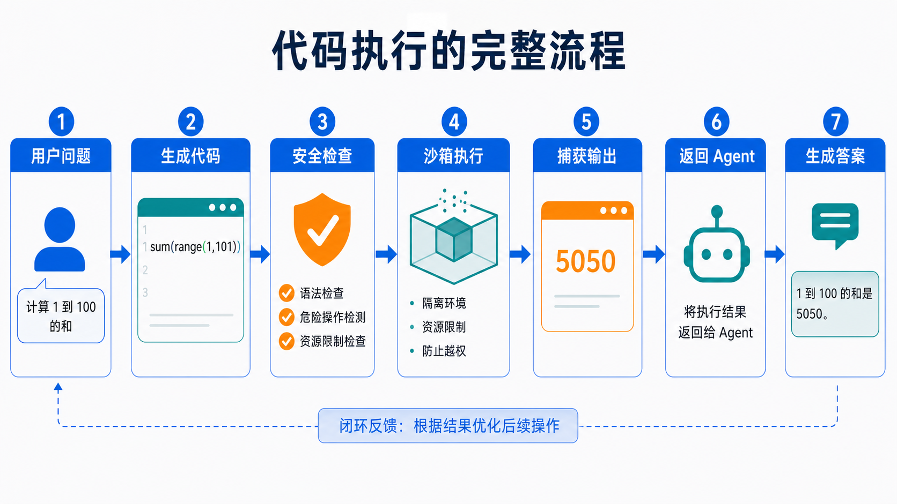

## 知识点讲解



### 1. 核心概念

代码执行是 Agent 能力里风险最高的一类工具——LLM 生成代码，Agent 直接执行，影响范围可以是本机文件系统、网络请求、外部系统。这比调用 API 风险大得多。

执行方案从低到高按安全性分三个档次：

| 方案 | 安全性 | 性能 | 适合场景 |
| --- | --- | --- | --- |
| 直接 `exec()` | 低，不隔离 | 最快 | 内部工具，完全可信的环境 |
| 受限沙箱（RestrictedPython / subprocess） | 中 | 快 | 半可信环境，限制了危险操作 |
| 容器（Docker） | 高 | 慢（启动有开销） | 生产环境，面向用户的系统 |

生产环境里，面向用户的代码执行必须用容器隔离或专用沙箱服务（如 E2B）。内部工具、只有工程师用的场景可以酌情降级。

### 2. 技术细节

#### 2.1 安全执行的三个要求

**隔离**：代码在隔离环境里执行，不能访问宿主机的文件系统、网络内网、环境变量中的密钥。Docker 容器是最常见方案；E2B 是专门为代码沙箱做的云服务，不需要自己运维容器。

**资源限制**：LLM 生成的代码可能有死循环、大内存分配。必须设置超时（5-30 秒）和内存上限（通常 256MB-1GB）。超出限制直接 kill，结果标记为超时。

**输出捕获**：代码的 stdout、stderr、返回值都要捕获并格式化返回给模型。输出要截断（超过 N 字符就截掉），防止大量输出撑爆上下文。

#### 2.2 静态分析作为预检

执行前用 AST 解析代码，检查危险操作（`import os`、`subprocess.run`、`open` 操作系统路径），可以在进容器之前就拦截掉明显恶意的代码，节省容器启动开销。

但静态分析不是万能的——攻击者可以用 `__import__('os')` 绕过简单的 import 检查。所以静态分析是第一层过滤，容器隔离是最后一道防线。

#### 2.3 状态管理

一次对话里可能执行多段代码，前一段代码定义的变量在后一段里还能用。这需要一个持久化的执行状态（namespace）。Jupyter kernel 就是这个模式——保持一个 Python 进程，跨多次执行共享状态。

如果不需要跨执行共享状态，每次执行用一个新进程反而更安全。

## 代码示例

**带 AST 预检和超时的安全执行器**

```python
import ast
import io
import sys
import signal
import textwrap
from dataclasses import dataclass

@dataclass
class ExecResult:
    success: bool
    stdout: str
    error: str | None
    timed_out: bool = False

BLOCKED_MODULES = {"os", "sys", "subprocess", "socket", "shutil", "pathlib"}
BLOCKED_BUILTINS = {"eval", "exec", "compile", "__import__", "open"}

def static_check(code: str) -> tuple[bool, str]:
    """用 AST 做静态安全检查，返回 (safe, reason)"""
    try:
        tree = ast.parse(code)
    except SyntaxError as e:
        return False, f"语法错误: {e}"

    for node in ast.walk(tree):
        # 检查 import 语句
        if isinstance(node, (ast.Import, ast.ImportFrom)):
            for alias in getattr(node, "names", []):
                mod = alias.name.split(".")[0]
                if mod in BLOCKED_MODULES:
                    return False, f"禁止导入模块: {mod}"
            if isinstance(node, ast.ImportFrom) and node.module:
                mod = node.module.split(".")[0]
                if mod in BLOCKED_MODULES:
                    return False, f"禁止导入模块: {node.module}"

        # 检查危险函数调用
        if isinstance(node, ast.Call):
            if isinstance(node.func, ast.Name) and node.func.id in BLOCKED_BUILTINS:
                return False, f"禁止调用: {node.func.id}"

    return True, "ok"

class SafeCodeExecutor:
    def __init__(self, timeout: int = 10, max_output_chars: int = 5000):
        self.timeout = timeout
        self.max_output_chars = max_output_chars
        self._namespace: dict = {}  # 跨执行共享状态

    def execute(self, code: str) -> ExecResult:
        # 1. 静态检查
        safe, reason = static_check(code)
        if not safe:
            return ExecResult(success=False, stdout="", error=f"静态检查拒绝: {reason}")

        # 2. 重定向输出
        buf = io.StringIO()
        old_stdout, old_stderr = sys.stdout, sys.stderr
        sys.stdout = sys.stderr = buf

        # 3. 超时控制（UNIX only）
        timed_out = False
        def _alarm_handler(signum, frame):
            raise TimeoutError()

        signal.signal(signal.SIGALRM, _alarm_handler)
        signal.alarm(self.timeout)

        try:
            exec(code, self._namespace)  # noqa: S102
            signal.alarm(0)
        except TimeoutError:
            timed_out = True
        except Exception as e:
            signal.alarm(0)
            sys.stdout, sys.stderr = old_stdout, old_stderr
            return ExecResult(success=False, stdout="", error=f"{type(e).__name__}: {e}")
        finally:
            sys.stdout, sys.stderr = old_stdout, old_stderr

        output = buf.getvalue()
        if len(output) > self.max_output_chars:
            output = output[:self.max_output_chars] + "\n... [输出截断]"

        if timed_out:
            return ExecResult(success=False, stdout=output, error=None, timed_out=True)
        return ExecResult(success=True, stdout=output, error=None)

    def reset_state(self) -> None:
        """重置执行状态，下一轮对话从空状态开始"""
        self._namespace = {}
```

**Docker 沙箱执行（生产级方案骨架）**

```python
import subprocess
import tempfile
import os

def docker_execute(code: str, timeout: int = 15) -> ExecResult:
    """
    在 Docker 容器里执行代码——隔离彻底，适合生产环境
    """
    with tempfile.NamedTemporaryFile(suffix=".py", mode="w", delete=False) as f:
        f.write(code)
        script_path = f.name

    try:
        result = subprocess.run(
            [
                "docker", "run", "--rm",
                "--network", "none",           # 禁止网络访问
                "--memory", "256m",            # 内存上限
                "--cpus", "0.5",               # CPU 上限
                "-v", f"{script_path}:/script.py:ro",  # 只读挂载脚本
                "python:3.11-slim",
                "python", "/script.py",
            ],
            capture_output=True,
            timeout=timeout,
            text=True,
        )

        stdout = result.stdout[:5000]
        stderr = result.stderr[:1000]

        if result.returncode != 0:
            return ExecResult(success=False, stdout=stdout, error=stderr)
        return ExecResult(success=True, stdout=stdout, error=None)

    except subprocess.TimeoutExpired:
        return ExecResult(success=False, stdout="", error=None, timed_out=True)
    finally:
        os.unlink(script_path)
```

**代码执行工具注册（供 LLM 调用）**

```python
code_exec_schema = {
    "name": "execute_python",
    "description": (
        "执行 Python 代码，用于数学计算、数据处理、算法实现。"
        "不适合执行文件操作、网络请求或系统命令。"
    ),
    "input_schema": {
        "type": "object",
        "properties": {
            "code": {
                "type": "string",
                "description": "要执行的 Python 代码，print() 的输出会被返回",
            }
        },
        "required": ["code"],
        "additionalProperties": False,
    },
}

executor = SafeCodeExecutor(timeout=10)

def handle_code_execution(code: str) -> str:
    result = executor.execute(code)
    if result.timed_out:
        return "执行超时（超过 10 秒），请检查代码是否有死循环"
    if not result.success:
        return f"执行失败：{result.error}"
    return result.stdout or "执行成功，无输出"
```

## 面试怎么答

Agent 代码执行的核心挑战是安全隔离——LLM 生成的代码不能信任，必须在受控环境里执行。

方案选型分三档：开发/内部场景可以用带 AST 静态检查 + 超时限制的进程内执行；面向用户的生产场景必须用 Docker 容器，断网（`--network none`）、限内存、限 CPU，宿主机上的数据文件不挂载进去；如果不想自己运维容器，E2B 是专为代码沙箱做的云服务，直接调 API。

几个必须做的保障：超时（防死循环）、内存上限（防 OOM）、输出截断（防大量输出撑爆上下文）、静态检查拦截明显危险的 import（作为第一道过滤）。静态检查不能替代容器隔离，但能在进容器之前就挡掉大量低水平的恶意代码。

## 高频追问 & 加分点

- **Q1：如何让 LLM 写出更可执行的代码？**  
    在 system prompt 里给代码执行的约定：用 print() 输出结果、不要写 input()、不要依赖未安装的库、代码要自包含（不依赖上一段的变量，除非明确说状态是共享的）。配合几个 few-shot 示例，LLM 生成的代码合格率会明显提升。
- **Q2：代码执行状态要不要保持跨轮次共享？**  
    取决于场景。数据分析场景（用户多轮逐步处理同一个 DataFrame）需要共享状态——用 Jupyter kernel 或进程内共享 namespace；多用户系统里每个用户、每次对话要隔离——每次执行新进程，不共享状态。状态共享和隔离是相互矛盾的，根据需求选择。
- **Q3：代码执行失败，让模型自动修复的机制怎么做？**  
    把错误信息格式化后作为 tool_result 返回给模型（不要只说"失败"，要把完整的 traceback 或错误消息返回）。设置最大重试次数（通常 2-3 次）。超过重试次数后，在 tool_result 里返回"已尝试 3 次，无法修复，需要人工介入"，让模型据此给用户明确的提示。
- **Q4：用 E2B 这类沙箱服务有什么优缺点？**  
    优点：不用自己运维容器，开箱即用，支持持久化 kernel 状态，延迟比自建 Docker 低（预热的容器池）；缺点：有数据安全顾虑（代码在第三方服务器执行）、有费用、依赖外部服务的可用性。内部系统或有合规要求的场景建议自建 Docker 方案。
- **Q5：如何限制代码只能操作特定文件或目录？**  
    Docker 方案里，只挂载允许访问的目录（`-v /allowed/path:/workspace`），其他路径不挂载，代码就看不到。进程内方案可以用 `chroot` 或 Python 的 `open` hook，但可靠性不如容器。实践中，只要需要文件操作权限，就应该上容器，不要用进程内方案。
