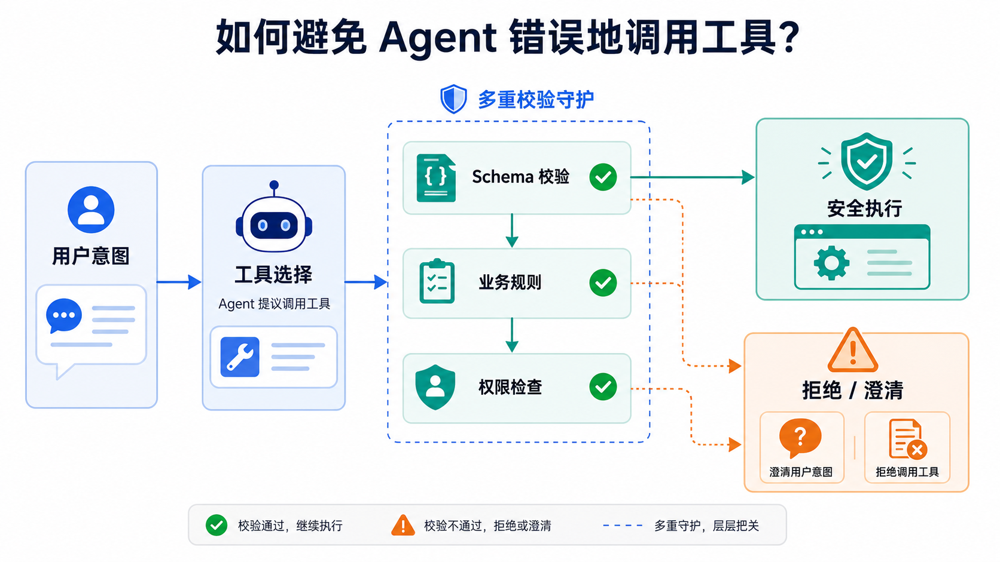

## 知识点讲解



### 1. 核心概念

Agent 错误地调用工具有四种形式：

- **选错工具**：有两个工具，模型选了不该用的那个
- **参数填错**：工具选对了，但参数值格式不对或逻辑有误
- **不该调就调**：问题用文字就能回答，模型非要调用工具
- **该调不调**：明明需要实时数据，模型用了训练数据里的过时信息

这四类错误的根本原因几乎都指向同一个地方——工具 Schema 定义不清晰，或者 Prompt 没有给出足够的使用指导。

### 2. 技术细节

#### 2.1 工具定义是第一道防线

**名称要区分度高**：`search`、`query`、`get` 这种模糊名称在多工具场景里会让模型困惑。`search_web_for_news`、`query_user_database`、`get_realtime_stock_price` 这种自解释的名称能让模型在不读 description 的情况下就做出大概正确的判断。

**description 要有负面限定**：告诉模型什么情况下"不用这个工具"和告诉模型"用这个工具干什么"同样重要。

```latex
差的 description：
"搜索信息"

好的 description：
"从互联网搜索最新新闻和实时数据。
适用于：需要 2024 年以后信息、实时价格、最新事件。
不适用于：查询用户数据、产品库存、订单信息（使用 query_database 工具）。"
```

**参数用 enum 和约束收口**：能用 `enum` 就用 `enum`，给模型明确的合法值范围，不让它自由发挥。

#### 2.2 Prompt 层面的引导

system prompt 里加工具使用指南，效果比改 description 更直接但成本更高（每次请求都要消耗 token）。适合工具数量多、容易混淆的场景：

```latex
【工具使用指南】
- 查询实时市场数据 → 使用 get_market_data
- 查询历史订单 → 使用 query_order_database
- 不确定用哪个时 → 优先用 query_order_database，外部信息次之
- 用户只需要解释时，不要调用工具，直接回答
```

Few-shot 示例是最有效的 Prompt 手段——把"正确的工具调用应该是什么样的"直接展示给模型，比抽象描述效果好得多。

#### 2.3 执行层验证

即使 Schema 和 Prompt 做得很好，也要在执行层加兜底校验。不是为了替代前两层，而是防止边缘情况：

- 参数类型是对的但业务逻辑不对（user_id 是正整数，但这个 user 不存在）
- 模型用工具做了超出预期的操作（应该读的工具被模型用来写）

把验证失败的原因告诉模型（而不是静默失败），让模型有机会修正。

## 代码示例

**Schema 层参数校验**

```python
from jsonschema import validate, ValidationError

def validate_tool_call(schema: dict, params: dict) -> tuple[bool, str]:
    """调用前校验 Schema，不合法直接返回错误，不执行工具"""
    try:
        validate(instance=params, schema=schema["input_schema"])
        return True, "ok"
    except ValidationError as e:
        field = " -> ".join(str(p) for p in e.absolute_path) or "root"
        return False, f"参数 [{field}] 不合法: {e.message}"
```

**业务逻辑层验证**

```python
from dataclasses import dataclass

@dataclass
class ToolCallValidationResult:
    allowed: bool
    reason: str
    suggested_alternative: str | None = None

class BusinessRuleValidator:
    """
    在 Schema 校验之后、工具执行之前，检查业务规则
    """

    def validate(self, tool_name: str, params: dict, user_context: dict) -> ToolCallValidationResult:
        if tool_name == "query_user_database":
            return self._validate_db_query(params, user_context)
        if tool_name == "send_email":
            return self._validate_email(params, user_context)
        return ToolCallValidationResult(allowed=True, reason="ok")

    def _validate_db_query(self, params: dict, ctx: dict) -> ToolCallValidationResult:
        # 非管理员不能查所有用户
        if params.get("query_all") and not ctx.get("is_admin"):
            return ToolCallValidationResult(
                allowed=False,
                reason="非管理员不允许查询所有用户",
                suggested_alternative="可以查询当前用户自己的信息",
            )
        return ToolCallValidationResult(allowed=True, reason="ok")

    def _validate_email(self, params: dict, ctx: dict) -> ToolCallValidationResult:
        # 发件人必须是当前登录用户
        if params.get("sender") != ctx.get("current_user_email"):
            return ToolCallValidationResult(
                allowed=False,
                reason=f"只能以 {ctx['current_user_email']} 的身份发邮件",
            )
        return ToolCallValidationResult(allowed=True, reason="ok")
```

**完整的工具调用执行器（多层防护）**

```python
import anthropic

client = anthropic.Anthropic()

class GuardedToolExecutor:
    def __init__(self, tool_registry: dict, biz_validator: BusinessRuleValidator):
        self.registry = tool_registry         # name -> (schema, handler)
        self.biz_validator = biz_validator

    def execute(self, tool_name: str, params: dict, user_context: dict) -> str:
        # 工具存在性检查
        if tool_name not in self.registry:
            return f"错误：未知工具 {tool_name}，请使用工具列表中的工具"

        schema, handler = self.registry[tool_name]

        # 第一层：Schema 格式校验
        ok, msg = validate_tool_call(schema, params)
        if not ok:
            return f"参数格式错误: {msg}。请检查参数格式后重试。"

        # 第二层：业务规则校验
        biz_result = self.biz_validator.validate(tool_name, params, user_context)
        if not biz_result.allowed:
            err = f"操作不允许: {biz_result.reason}"
            if biz_result.suggested_alternative:
                err += f"\n建议: {biz_result.suggested_alternative}"
            return err

        # 执行工具
        try:
            return handler(**params)
        except Exception as e:
            return f"工具执行异常: {type(e).__name__}: {e}"


def run_guarded_agent(
    user_message: str,
    tools_schemas: list[dict],
    executor: GuardedToolExecutor,
    user_context: dict,
) -> str:
    messages = [{"role": "user", "content": user_message}]

    for _ in range(10):  # 最大 10 轮
        response = client.messages.create(
            model="claude-3-5-sonnet-20241022",
            max_tokens=2048,
            tools=tools_schemas,
            messages=messages,
        )

        if response.stop_reason != "tool_use":
            return next((b.text for b in response.content if hasattr(b, "text")), "")

        tool_calls = [b for b in response.content if b.type == "tool_use"]
        tool_results = []

        for call in tool_calls:
            result = executor.execute(call.name, call.input, user_context)
            tool_results.append({
                "type": "tool_result",
                "tool_use_id": call.id,
                "content": result,
                # 注意：把错误信息返回给模型，让模型有机会修正，而不是静默失败
            })

        messages.append({"role": "assistant", "content": response.content})
        messages.append({"role": "user", "content": tool_results})

    return "执行轮次超限，无法完成任务"
```

## 面试怎么答

防止工具误调用有三层：定义层、Prompt 层、执行层，每层解决不同类型的问题。

定义层是最划算的：把工具名称改成自解释的、在 description 里加"不适用于..."的负面限定、用 enum 和 required 约束参数——这些改动成本低，但能把误调用率降下来很多。Prompt 层适合工具多、容易混淆的场景，在 system prompt 里加工具选择指南和 few-shot 示例，直接告诉模型"碰到 X 场景用哪个工具"。执行层是兜底——JSON Schema 校验格式、业务规则校验逻辑（权限、范围），校验失败把原因告诉模型，让它有机会修正。

最容易被忽视的点：校验失败的错误信息要有信息量。只返回"参数错误"，模型没法修正；返回"参数 [date] 格式不对，应为 YYYY-MM-DD，当前值为 2024/01/15"，模型下一轮能修好。

## 高频追问 & 加分点

- **Q1：工具太多时（20+ 个）怎么防止选错？**  
    工具分组：按功能域把工具分成几类（数据查询类、操作执行类、通知类），在 system prompt 里先说"这类任务用 X 组的工具"。超大工具集可以用动态工具加载——不是一次性把所有工具传给模型，而是根据当前任务上下文只加载相关的工具子集（LangChain 的 ToolRetriever 是这个思路）。
- **Q2：Few-shot 示例放 system prompt 还是 user prompt？**  
    放 system prompt 里，一直生效；对话历史里偶尔插入示例也有效，但占用 context 且不稳定。示例数量 2-5 个足够，太多反而让 system prompt 冗长、稀释了其他重要指令。
- **Q3：模型执意用错工具怎么办？**  
    两个思路：用 `tool_choice` 参数强制指定工具（如果场景是确定的）；或者把错误的工具调用结果返回时附上提示"建议使用 X 工具完成此操作"，引导模型下一轮换工具。不要在执行层静默修正——这会让模型以为它的决策是对的，下次还会犯同样的错。
- **Q4：如何量化工具选择的准确率？**  
    构建测试集：每个用例包含用户 query 和期望的工具名（以及期望的参数）。跑 100 个用例计算：工具选择准确率（选对了工具）、参数准确率（工具对了且参数也对）。这两个指标分开看，能帮助定位是定义问题还是 Schema 约束问题。
- **Q5：工具调用里有敏感参数（密码、密钥）怎么处理？**  
    永远不要把敏感参数作为工具参数让 LLM 填写——LLM 的推理过程可能会日志记录，存在泄露风险。正确做法：把敏感参数在 Agent 框架侧硬编码或从环境变量注入，工具 Schema 里不暴露这个参数，执行时由框架自动补充。
