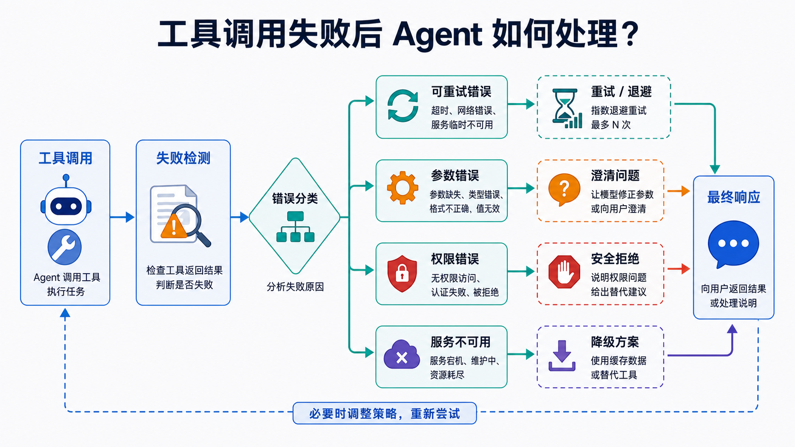

## 知识点讲解



### 1. 核心概念

工具调用失败是生产环境里的常态，不是例外。网络抖动、外部 API 限流、参数不合法、服务下线……每一类都有可能发生。Agent 处理失败的方式决定了系统的容错能力。

失败有不同的性质，处理方式完全不一样：

| 失败类型 | 特征 | 处理方式 |
| --- | --- | --- |
| 临时网络错误 | HTTP 5xx、超时、连接重置 | 指数退避重试 |
| 限流（Rate Limit） | HTTP 429 | 等待后重试（按 Retry-After 头） |
| 参数错误 | HTTP 400、参数校验失败 | 把错误返回模型，让它修正参数 |
| 权限错误 | HTTP 401/403 | 不重试，告知用户权限问题 |
| 业务数据不存在 | 查询结果为空 | 尝试其他参数，或告知"未找到" |
| 服务不可用 | 第三方服务宕机 | 切换备用工具，或降级回答 |

重试是应对临时错误的手段，但不是万能药。权限错误重试 10 次也没用；参数错误需要让模型改参数，不是原样重试。**正确分类才能选对策略**。

### 2. 技术细节

#### 2.1 指数退避重试

重试最忌立即重试——外部服务过载时，立即打回去只会加剧拥堵。标准做法是指数退避：第 1 次失败等 1 秒，第 2 次等 2 秒，第 3 次等 4 秒，加上随机 jitter（防止多个客户端同步重试造成峰值）。

重试次数通常控制在 2-3 次，不要设太高。超过 3 次还在失败，大概率是持续性问题，继续重试只是浪费时间和计费额度。

#### 2.2 告诉模型失败原因

工具失败时把什么放进 `tool_result` 至关重要：

**差的做法**：

```json
{"error": true, "message": "failed"}
```

**好的做法**：

```json
{
  "error": "参数 date 格式不对，应为 YYYY-MM-DD，当前值为 2024/01/15",
  "suggestion": "请用正确日期格式重新调用"
}
```

信息越具体，模型修正的成功率越高。"参数格式不对"让模型知道是参数问题，可以修正后重试。"服务暂时不可用"让模型知道是外部问题，应该告知用户或换备用工具。

#### 2.3 降级策略

当工具持续失败时，不应该让 Agent 无限循环或直接崩溃，而是要有降级方案：

- **换备用工具**：搜索 API 挂了，用另一个搜索服务
- **用缓存**：上次成功的结果仍然有参考价值
- **降级回答**：基于 LLM 的训练知识给出答案（同时告知用户"暂时无法获取实时信息"）
- **透明告知**：实在没办法，告诉用户"当前服务暂时不可用，请稍后重试"

## 代码示例

**工具失败分类与重试机制**

```python
import time
import random
from dataclasses import dataclass
from enum import Enum

class ToolErrorType(Enum):
    NETWORK = "network"          # 可重试
    RATE_LIMITED = "rate_limit"  # 等待后可重试
    BAD_PARAMS = "bad_params"    # 需要模型修正参数
    PERMISSION = "permission"    # 不可重试
    NOT_FOUND = "not_found"      # 可以换参数重试
    SERVICE_DOWN = "service_down" # 切换备用工具

@dataclass
class ToolFailure:
    error_type: ToolErrorType
    message: str
    retry_after_seconds: float | None = None  # 限流时 API 返回的等待时间
    should_retry: bool = True

def classify_http_error(status_code: int, response_body: str) -> ToolFailure:
    if status_code == 429:
        return ToolFailure(
            error_type=ToolErrorType.RATE_LIMITED,
            message="API 请求频率超限",
            retry_after_seconds=60.0,
            should_retry=True,
        )
    if status_code in (401, 403):
        return ToolFailure(
            error_type=ToolErrorType.PERMISSION,
            message=f"权限不足（HTTP {status_code}）",
            should_retry=False,
        )
    if status_code == 400:
        return ToolFailure(
            error_type=ToolErrorType.BAD_PARAMS,
            message=f"请求参数不合法: {response_body[:200]}",
            should_retry=False,
        )
    if status_code >= 500:
        return ToolFailure(
            error_type=ToolErrorType.NETWORK,
            message=f"服务端错误（HTTP {status_code}）",
            should_retry=True,
        )
    return ToolFailure(
        error_type=ToolErrorType.NETWORK,
        message=f"未知错误（HTTP {status_code}）",
        should_retry=True,
    )

def with_retry(func, max_retries: int = 3, base_delay: float = 1.0):
    """
    带指数退避的重试装饰器
    只重试 NETWORK 和 RATE_LIMITED 类型的失败
    """
    last_failure = None

    for attempt in range(max_retries):
        try:
            return func()
        except ToolFailure as f:
            last_failure = f

            if not f.should_retry:
                raise  # 权限/参数错误不重试，直接抛出

            if attempt == max_retries - 1:
                raise  # 已达到最大重试次数

            # 计算等待时间
            if f.retry_after_seconds is not None:
                wait = f.retry_after_seconds
            else:
                # 指数退避 + jitter
                wait = (base_delay * (2 ** attempt)) + random.uniform(0, 0.5)

            time.sleep(wait)

    raise last_failure
```

**工具执行器（返回对 LLM 友好的错误信息）**

```python
class ResilientToolExecutor:
    def __init__(self, handlers: dict, fallbacks: dict | None = None):
        self.handlers = handlers     # {tool_name: callable}
        self.fallbacks = fallbacks or {}  # {tool_name: fallback_tool_name}

    def run(self, tool_name: str, params: dict) -> str:
        """
        执行工具，失败时根据错误类型返回 LLM 可读的错误消息
        """
        if tool_name not in self.handlers:
            return f"未知工具 {tool_name}"

        try:
            result = with_retry(lambda: self.handlers[tool_name](**params))
            return str(result)

        except ToolFailure as f:
            return self._handle_failure(tool_name, params, f)

        except Exception as e:
            return f"工具执行异常: {type(e).__name__}: {e}。请检查参数后重试。"

    def _handle_failure(self, tool_name: str, params: dict, failure: ToolFailure) -> str:
        if failure.error_type == ToolErrorType.BAD_PARAMS:
            # 参数错误：返回具体错误让模型修正
            return (
                f"参数错误: {failure.message}\n"
                f"请检查参数格式后重新调用 {tool_name}。"
            )

        if failure.error_type == ToolErrorType.PERMISSION:
            return (
                f"权限不足: {failure.message}\n"
                f"此操作需要更高权限，请告知用户联系管理员。"
            )

        if failure.error_type == ToolErrorType.RATE_LIMITED:
            # 已重试完还是限流，尝试备用工具
            if tool_name in self.fallbacks:
                fallback_name = self.fallbacks[tool_name]
                if fallback_name in self.handlers:
                    try:
                        result = self.handlers[fallback_name](**params)
                        return f"[备用工具 {fallback_name}] {result}"
                    except Exception:
                        # ...
                        pass
            return f"工具 {tool_name} 当前不可用（限流），请告知用户稍后重试。"

        # NETWORK / SERVICE_DOWN
        return (
            f"工具 {tool_name} 暂时不可用: {failure.message}\n"
            f"如果问题持续，请基于已有信息给出答案，并告知用户实时数据暂时无法获取。"
        )
```

**在 Agent 循环中使用**

```python
import anthropic

client = anthropic.Anthropic()

def run_resilient_agent(user_message: str, tools_schemas: list, executor: ResilientToolExecutor) -> str:
    messages = [{"role": "user", "content": user_message}]

    for _ in range(8):
        response = client.messages.create(
            model="claude-3-5-sonnet-20241022",
            max_tokens=2048,
            tools=tools_schemas,
            messages=messages,
        )

        if response.stop_reason != "tool_use":
            return next((b.text for b in response.content if hasattr(b, "text")), "")

        tool_calls = [b for b in response.content if b.type == "tool_use"]
        tool_results = []

        for call in tool_calls:
            # executor.run 永远返回字符串，不会抛异常
            result_text = executor.run(call.name, call.input)
            tool_results.append({
                "type": "tool_result",
                "tool_use_id": call.id,
                "content": result_text,
                # 错误信息里有明确的下一步指引，模型能据此决策
            })

        messages.append({"role": "assistant", "content": response.content})
        messages.append({"role": "user", "content": tool_results})

    return "任务执行超出轮次限制，请简化问题后重试。"
```

## 面试怎么答

工具失败的处理核心是：先分类，再选策略。网络临时错误用指数退避重试（等 1s/2s/4s，不要立即打回去）；参数错误不重试，把具体原因返回给模型让它修正；权限错误不重试，直接告知用户；服务持续不可用时切换备用工具或降级回答。

最重要的一点是：失败信息要对 LLM 有信息量。返回"error: true"没用，模型不知道该怎么做。返回"参数 date 格式应为 YYYY-MM-DD，当前值 2024/01/15 格式不对，请修正后重试"，模型下一轮就能修好。同样，"服务暂时限流，请告知用户稍后重试"让模型知道应该转变策略，而不是无限循环。

降级设计也很关键：主搜索工具挂了有备用搜索；实在拿不到实时数据，基于 LLM 知识给答案并声明"当前无法获取实时数据"——比直接报错体验好很多。

## 高频追问 & 加分点

- **Q1：重试次数设多少合适？**  
    通常 2-3 次。设太多有两个问题：一是延迟会很高（指数退避下 3 次失败可能等了 7 秒）；二是大多数持续性问题重试 10 次也没用。限流（429）是例外，可以等更长时间后重试 1 次；但如果服务连续 5 分钟都在限流，说明架构有问题，不是重试能解决的。
- **Q2：如何区分"模型参数填错了"和"工具本身有 Bug"？**  
    参数错误通常是 HTTP 400 或 JSON Schema 校验失败，错误信息指向具体参数；工具 Bug 通常是 500 或 Python 异常，堆栈里有代码位置。在返回给模型的错误信息里也要区分："您的参数有误，请修正"vs"工具内部出现错误，请告知用户稍后重试"——让模型做出正确决策。
- **Q3：同一个工具短时间内反复失败如何防止无限重试？**  
    记录工具的最近失败次数和时间（Circuit Breaker 模式）：连续失败 N 次后，在 T 秒内直接返回"工具暂时不可用"，不再真正执行。T 秒后进入"半开"状态，允许一次探测性调用，成功则恢复正常，失败则继续断开。这样既防止了无效重试，又能自动恢复。
- **Q4：工具失败的日志应该记录什么？**  
    tool_name、params（注意脱敏）、error_type、error_message、attempt_count、latency_ms、是否触发了 fallback。这些字段能支撑线上问题排查（哪个工具失败率高、哪些参数常触发错误）和告警（某工具失败率超过阈值发 Slack 通知）。
- **Q5：Circuit Breaker 和普通重试怎么选？**  
    两者不矛盾，组合使用。普通重试处理单次的偶发错误（网络抖动）；Circuit Breaker 处理服务级别的持续故障（外部服务宕机）。当工具进入 Circuit Breaker 断开状态时，直接返回"工具不可用"，不触发重试，避免大量无效请求打到已经挂了的服务。
