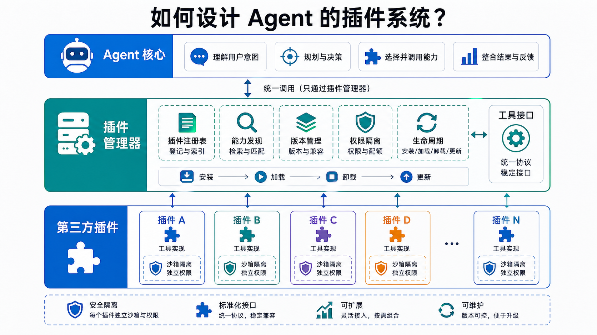

## 知识点讲解



### 1. 核心概念

插件系统解决的问题是**让 Agent 的工具集可以被外部扩展，而不需要修改核心代码**。插件是预定义的工具在扩展性上的升级版：工具是硬编码在 Agent 里的，插件是可以动态加载/卸载/更新的。

什么时候需要插件系统：

- 工具种类多、不同用户需要不同的工具组合
- 希望让第三方开发者贡献新工具
- 工具有独立的依赖和配置，需要隔离
- 工具需要独立更新，不能每次都升级整个 Agent

核心设计要求：

- **标准化接口**：所有插件实现同一套 ABC，核心系统不需要关心具体插件是什么
- **生命周期管理**：加载 → 初始化 → 运行 → 卸载，每个阶段都有对应的钩子
- **故障隔离**：一个插件崩溃不能影响其他插件和核心系统

### 2. 技术细节

#### 2.1 插件接口标准化

插件需要实现的最小接口：

- `get_manifest()`：返回插件元数据（名称、版本、描述、工具列表）
- `initialize(config)`：加载配置、建立连接、初始化状态
- `execute_tool(tool_name, params)`：实际执行工具
- `shutdown()`：清理资源（关闭连接、释放文件句柄等）

工具的 Schema 在 manifest 里声明，插件管理器根据 Schema 向 LLM 注册工具。

#### 2.2 两种加载方式

**进程内加载**：用 `importlib` 动态导入插件模块，性能好但隔离差——插件的 Bug 可能影响主进程。

**进程外加载**：插件运行在独立进程里，通过 IPC（Unix socket、gRPC）通信，隔离彻底，插件崩溃不影响主系统，代价是有通信开销。

生产环境里，第三方插件用进程外隔离，自有团队开发的内部插件可以用进程内。

#### 2.3 安全机制

插件加载时要验证：

- **清单完整性**：必填字段（name、version、tools）都存在
- **权限声明**：插件声明自己需要哪些权限（网络访问、文件读写、数据库），用户授权后才能激活
- **沙箱限制**：进程外插件可以用 Docker 容器进一步限制资源和网络访问

## 代码示例

**插件基类和 Manifest 定义**

```python
from abc import ABC, abstractmethod
from dataclasses import dataclass, field

@dataclass
class PluginManifest:
    name: str
    version: str
    description: str
    author: str
    tools: list[dict]              # 工具 Schema 列表
    required_permissions: list[str] = field(default_factory=list)
    # 例如 ["network", "database:read", "filesystem:read"]

class PluginBase(ABC):
    """所有插件必须继承并实现此基类"""

    @abstractmethod
    def get_manifest(self) -> PluginManifest:
        # ...
        pass

    @abstractmethod
    def initialize(self, config: dict) -> None:
        """加载配置、建立连接。失败时抛出异常，阻止插件注册。"""
        # ...
        pass

    @abstractmethod
    def execute_tool(self, tool_name: str, params: dict) -> str:
        """执行工具，必须返回字符串（LLM 能读的格式）"""
        # ...
        pass

    def shutdown(self) -> None:
        """可选：释放连接和资源"""
        # ...
        pass
```

**一个示例插件（天气查询）**

```python
import json
import requests

class WeatherPlugin(PluginBase):
    def get_manifest(self) -> PluginManifest:
        return PluginManifest(
            name="weather",
            version="1.0.0",
            description="实时天气查询，基于 OpenWeatherMap API",
            author="plugin-team",
            required_permissions=["network"],
            tools=[
                {
                    "name": "get_current_weather",
                    "description": "获取指定城市的当前天气，包括温度、湿度、天气状况。",
                    "input_schema": {
                        "type": "object",
                        "properties": {
                            "city": {
                                "type": "string",
                                "description": "城市名称，例如 'Beijing' 或 'Shanghai'"
                            },
                            "unit": {
                                "type": "string",
                                "enum": ["celsius", "fahrenheit"],
                                "description": "温度单位，默认 celsius"
                            }
                        },
                        "required": ["city"],
                        "additionalProperties": False,
                    }
                }
            ]
        )

    def initialize(self, config: dict) -> None:
        self.api_key = config.get("api_key")
        if not self.api_key:
            raise ValueError("WeatherPlugin 需要 api_key 配置")

    def execute_tool(self, tool_name: str, params: dict) -> str:
        if tool_name == "get_current_weather":
            return self._get_weather(**params)
        return f"未知工具: {tool_name}"

    def _get_weather(self, city: str, unit: str = "celsius") -> str:
        # 调用天气 API（示意）
        units_param = "metric" if unit == "celsius" else "imperial"
        resp = requests.get(
            "https://api.openweathermap.org/data/2.5/weather",
            params={"q": city, "appid": self.api_key, "units": units_param},
            timeout=10,
        )
        resp.raise_for_status()
        data = resp.json()
        temp = data["main"]["temp"]
        condition = data["weather"][0]["description"]
        return json.dumps({
            "city": city,
            "temperature": temp,
            "unit": unit,
            "condition": condition,
        }, ensure_ascii=False)
```

**插件管理器**

```python
import importlib.util
from pathlib import Path

class PluginManager:
    def __init__(self, granted_permissions: set[str] | None = None):
        self._plugins: dict[str, PluginBase] = {}
        self._tool_to_plugin: dict[str, PluginBase] = {}
        self.granted_permissions = granted_permissions or set()

    def load_from_file(self, plugin_path: str, config: dict | None = None) -> str:
        """从 .py 文件动态加载插件，返回插件名称"""
        path = Path(plugin_path)
        spec = importlib.util.spec_from_file_location(path.stem, path)
        module = importlib.util.module_from_spec(spec)
        spec.loader.exec_module(module)

        # 约定插件模块里有一个叫 Plugin 的类
        plugin: PluginBase = module.Plugin()
        return self._register(plugin, config or {})

    def _register(self, plugin: PluginBase, config: dict) -> str:
        manifest = plugin.get_manifest()

        # 权限检查：插件声明的权限是否都已获得授权
        missing = set(manifest.required_permissions) - self.granted_permissions
        if missing:
            raise PermissionError(
                f"插件 {manifest.name} 需要未授权的权限: {missing}"
            )

        # 初始化
        plugin.initialize(config)

        # 注册工具
        for tool_schema in manifest.tools:
            tool_name = tool_schema["name"]
            if tool_name in self._tool_to_plugin:
                raise ValueError(f"工具名称冲突: {tool_name} 已被其他插件注册")
            self._tool_to_plugin[tool_name] = plugin

        self._plugins[manifest.name] = plugin
        return manifest.name

    def get_all_tool_schemas(self) -> list[dict]:
        """聚合所有插件的工具 Schema，用于注入给 LLM"""
        schemas = []
        for plugin in self._plugins.values():
            manifest = plugin.get_manifest()
            schemas.extend(manifest.tools)
        return schemas

    def execute(self, tool_name: str, params: dict) -> str:
        """路由工具调用到对应插件"""
        if tool_name not in self._tool_to_plugin:
            return f"未知工具: {tool_name}，请检查工具名称"

        plugin = self._tool_to_plugin[tool_name]
        try:
            return plugin.execute_tool(tool_name, params)
        except Exception as e:
            # 插件异常隔离：不让它抛到外面，转成错误消息返回给 LLM
            return f"插件执行异常: {type(e).__name__}: {e}"

    def unload(self, plugin_name: str) -> None:
        """卸载插件，释放资源"""
        if plugin_name not in self._plugins:
            return
        plugin = self._plugins[plugin_name]
        plugin.shutdown()

        # 移除该插件注册的所有工具
        self._tool_to_plugin = {
            name: p for name, p in self._tool_to_plugin.items()
            if p is not plugin
        }
        del self._plugins[plugin_name]
```

## 面试怎么答

插件系统的核心价值是让工具集可以被外部扩展，不需要改 Agent 核心代码。设计上有三个要素：标准化接口、生命周期管理、故障隔离。

标准化接口是基础——所有插件实现同一个 ABC（get_manifest、initialize、execute_tool、shutdown），管理器不需要知道插件是什么，只需要调这四个方法。Manifest 里声明插件的元数据和工具 Schema，管理器统一汇总后注入给 LLM。

生命周期管理关键在 initialize 和 shutdown——initialize 失败要阻止插件注册（比如 API key 没有，不能假装加载成功再执行时报错）；shutdown 要保证资源释放（数据库连接、文件句柄）。

故障隔离是工程上最重要的：execute_tool 里的异常不能让插件崩溃传播到主系统。捕获异常，把错误信息作为字符串返回给 LLM，让模型决定下一步。进程外插件（独立进程）的隔离更彻底，但引入了通信开销。

## 高频追问 & 加分点

- **Q1：插件热更新（不重启 Agent 就更新插件）怎么实现？**  
    先卸载旧版本（调 shutdown 释放资源），再加载新版本（重新 import 模块，重新 initialize）。关键是处理正在进行中的工具调用——热更新前等待所有进行中的调用完成（或设超时）；更新失败要能回滚到旧版本。
- **Q2：插件的依赖管理怎么处理？**  
    每个插件声明自己的 Python 依赖（类似 requirements.txt），在插件安装时用 pip 安装到隔离的虚拟环境。进程外插件直接用独立的容器，天然隔离依赖。进程内插件的依赖冲突是个难题，尽量通过约束（"只用标准库"或"依赖版本不冲突"）来避免。
- **Q3：第三方插件的安全审查怎么做？**  
    几个层面：代码静态扫描（bandit 检测 Python 安全问题）；权限声明审查（插件需要什么权限，用户明确授权）；沙箱运行（进程外 + 资源限制）；可信来源（官方插件商店签名验证，非官方插件需要用户手动启用）。
- **Q4：插件的版本管理怎么做？**  
    语义化版本（SemVer）：Major 不兼容变更、Minor 向后兼容新功能、Patch 修 Bug。管理器记录已加载的版本，用户升级时比较版本，判断是否需要处理迁移（config 格式变了、工具接口变了）。
- **Q5：多个插件提供了同名工具怎么处理？**  
    注册时报冲突错误，不允许同名工具并存。解决方案：命名空间前缀（`weather.get_current` vs `airquality.get_current`）；或者让管理器自动加前缀（`pluginName_toolName`）。命名空间前缀在 Schema 设计时就要考虑进去，description 里也要注明所属插件。
