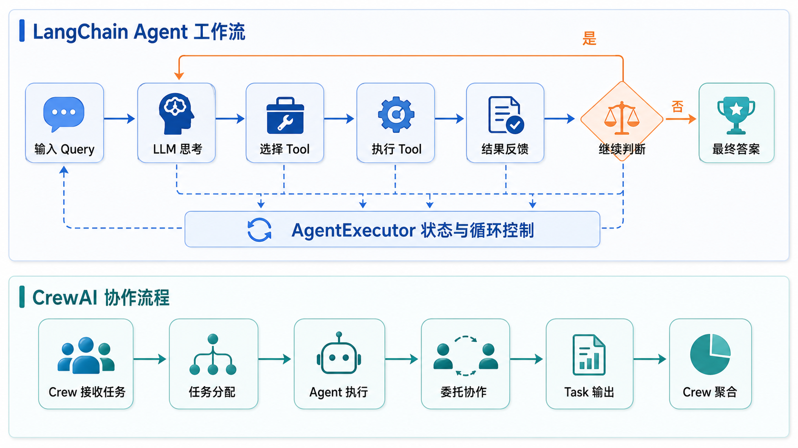

## 知识点讲解



### 1. 核心概念

Agent 框架本质上是一套脚手架——帮你把 LLM 调用、工具管理、状态维护、错误处理这些重复性工作打包好，让你专注在业务逻辑上。

目前市面上活跃的框架主要有五个：**LangChain、LangGraph、LlamaIndex、AutoGPT、CrewAI**。它们设计哲学差别很大——LangChain 强调链式组合的灵活性，LangGraph 专攻有状态/有循环/有分支的复杂工作流，LlamaIndex 专注 RAG 和知识检索，AutoGPT 走极端自主路线，CrewAI 把 Agent 拟人化成团队角色。

选框架不是选"谁最好"，是选"谁最适合你现在的场景"。

### 2. 技术细节

**LangChain**

- 优点：工具集成最全（200+ 整合）、LCEL Runnable 范式表达力强、社区大
- 缺点：v0.1 → v0.3 API 变化剧烈；抽象层多，每次调用额外 token 开销约 10-20%
- 适合：通用 Agent、RAG 应用、快速原型

**LangGraph**

- 优点：把 Agent 工作流建模成**状态图（StateGraph）**，节点是动作、边是条件转移，天然支持循环、分支、回退、人工介入；状态显式管理，每一步都能 checkpoint，崩了能恢复；和 LangChain 同源，复用工具/模型抽象无缝
- 缺点：学习曲线比 LangChain 陡，需要先理解"图编程"思维；调试图状态比调试链更费劲；文档比 LangChain 薄
- 适合：多步骤复杂任务、需要循环和回退的 Agent、多 Agent 协作（Supervisor/Swarm 模式）、要求生产级可观测性的系统——**当下大厂面试问 Agent 编排基本绕不开 LangGraph**

**LlamaIndex**

- 优点：RAG 专家，文档解析和向量检索成熟度高
- 缺点：Agent 编排能力相对薄弱，生态不如 LangChain 完整
- 适合：知识库问答、文档检索——通常和 LangChain 混用，前者做索引层、后者做编排层

**AutoGPT**

- 优点：开放目标、完全自主、展示了 LLM 的能力边界
- 缺点：成本难控、可靠性低、容易进入死循环
- 适合：实验和 demo，不推荐生产

**CrewAI**

- 优点：多 Agent 编排直观，角色-任务模型清晰，上手快
- 缺点：框架年轻，API 仍在变化，大规模调优能力有限
- 适合：多角色协作场景、流程自动化

| 框架 | 生态完整性 | 上手难度 | 性能 | 多 Agent | 状态/循环 | 推荐指数 |
| --- | --- | --- | --- | --- | --- | --- |
| LangChain | ★★★★★ | 中 | ★★★ | 需手写 | 弱 | ★★★★★ |
| LangGraph | ★★★★ | 中高 | ★★★★ | 原生 | **强（图编排）** | ★★★★★ |
| LlamaIndex | ★★★★ | 低 | ★★★★ | 弱 | 弱 | ★★★★ |
| AutoGPT | ★★★ | 中 | ★★ | 无 | 自由循环 | ★★ |
| CrewAI | ★★★ | 低 | ★★★ | 原生 | 弱 | ★★★★ |

### 3. 对比与拓展

实际项目很少单用一个框架。常见的混搭是两套：

- **轻量编排型**：LlamaIndex 做检索层 + LangChain 做 Agent 编排，适合 RAG-heavy 应用
- **复杂工作流型**：LlamaIndex 做检索 + LangGraph 做主干编排（节点里调 LangChain 的 tool 抽象），适合多步骤、需要回溯/分支的生产系统

**LangChain 和 LangGraph 怎么分？** 一句话：**简单链路（A→B→C）用 LangChain 的 LCEL 就够；只要出现循环、条件分支、需要 checkpoint，立刻切 LangGraph**。两个一起用没冲突，LangGraph 节点里可以直接调 LangChain 的 chain 和 tool。

框架只是起点。随着业务复杂度上升，你会发现框架的边界越来越明显——这时候要么做深度定制，要么在关键路径上自研，两者都行，但别在早期过度投入。

## 代码示例

```python
# ── LangChain：LCEL 链式 + Agent ──────────────────────────────────
from langchain_openai import ChatOpenAI
from langchain.agents import create_react_agent, AgentExecutor
from langchain_core.tools import tool
from langchain import hub

llm = ChatOpenAI(model="gpt-4o", temperature=0)

@tool
def search_web(query: str) -> str:
    """搜索网络，返回相关结果摘要"""
    return f"[Search] 关于 '{query}' 的结果：..."

@tool
def get_stock_price(ticker: str) -> str:
    """获取股票实时价格"""
    return f"[Stock] {ticker} 当前价格：$XXX"

tools = [search_web, get_stock_price]

# 用官方 hub 的 ReAct prompt，不用自己写
prompt = hub.pull("hwchase17/react")
agent = create_react_agent(llm, tools, prompt)
executor = AgentExecutor(agent=agent, tools=tools, verbose=True, max_iterations=10)

result = executor.invoke({"input": "查一下苹果公司最新消息，以及 AAPL 当前股价"})
print(result["output"])


# ── CrewAI：多 Agent 角色协作 ─────────────────────────────────────
from crewai import Agent, Task, Crew, Process

researcher = Agent(
    role="Research Analyst",
    goal="提供深入准确的市场研究",
    backstory="你是资深市场分析师，擅长从海量信息中提炼关键洞察",
    tools=[search_web],
    allow_delegation=False,
    verbose=True,
)

writer = Agent(
    role="Content Writer",
    goal="将研究结论转化为清晰的报告",
    backstory="你是商业写作专家，文字简洁有力",
    tools=[],
    allow_delegation=True,
    verbose=True,
)

research_task = Task(
    description="研究 AI Agent 框架 2024 年市场格局",
    expected_output="包含主要框架对比、市场份额、发展趋势的 500 字分析",
    agent=researcher,
)

writing_task = Task(
    description="基于研究结果撰写面向开发者的博客文章",
    expected_output="800 字结构清晰、可发布的技术博客",
    agent=writer,
    context=[research_task],  # 明确声明依赖
)

crew = Crew(
    agents=[researcher, writer],
    tasks=[research_task, writing_task],
    process=Process.sequential,
    verbose=True,
)

result = crew.kickoff()
print(result)


# ── LangGraph：状态图编排 ──────────────────────────────────────────
from typing import TypedDict, Literal
from langgraph.graph import StateGraph, END

class AgentState(TypedDict):
    query: str
    plan: list[str]
    results: list[str]
    retry_count: int

def planner(state: AgentState) -> AgentState:
    # LLM 生成执行计划
    state["plan"] = ["search", "analyze", "summarize"]
    return state

def executor(state: AgentState) -> AgentState:
    # 执行下一步动作
    step = state["plan"].pop(0)
    state["results"].append(f"[{step}] done")
    return state

def should_continue(state: AgentState) -> Literal["executor", "verifier", "end"]:
    # 关键：条件分支
    if state["plan"]:
        return "executor"
    return "verifier"

def verifier(state: AgentState) -> AgentState:
    # 验证结果，失败可触发重试
    if state["retry_count"] < 2 and not state["results"]:
        state["retry_count"] += 1
        state["plan"] = ["search"]  # 回退重试
    return state

graph = StateGraph(AgentState)
graph.add_node("planner", planner)
graph.add_node("executor", executor)
graph.add_node("verifier", verifier)

graph.set_entry_point("planner")
graph.add_edge("planner", "executor")
graph.add_conditional_edges("executor", should_continue, {
    "executor": "executor",   # 循环回到自己
    "verifier": "verifier",
    "end": END,
})
graph.add_conditional_edges("verifier", lambda s: "executor" if s["plan"] else "end", {
    "executor": "executor",
    "end": END,
})

app = graph.compile()
result = app.invoke({"query": "...", "plan": [], "results": [], "retry_count": 0})
```

注意 LangGraph 的关键点：**状态显式声明（TypedDict）**、**条件边（add_conditional_edges）让流程图能循环和分支**、**节点之间通过共享 state 通信**——这是它和 LangChain 线性链的根本差异。

## 面试怎么答

我用得最多的是 LangChain 和 LangGraph，多 Agent 场景用过 CrewAI，实验性的探过 AutoGPT。

框架选择这块，我的判断逻辑比较直接：单 Agent、快速验证就用 LangChain，它生态最全、社区问题解决率最高，虽然版本变化烦人但那是绕不开的代价；多 Agent 编排需要直觉可读性的用 CrewAI，角色-任务模型让非技术人员也能看懂工作流；需要精细控制状态和 DAG 的用 LangGraph；不在乎依赖、对成本和延迟要求极致的就自研。

老实讲，AutoGPT 那种完全开放循环的思路在生产里基本跑不起来，成本和可控性都是问题，更多是一个概念验证——但它确实推动了整个 Agent 框架往"更高自主性"方向演进，这个贡献是真实的。

实际项目里很少只用一个框架，常见的是 LlamaIndex 做检索、LangChain 做编排、关键路径上加自研逻辑，几个东西叠在一起用。

## 高频追问 & 加分点

- **Q1：LangChain v0.1 到 v0.3 变化有多大，实际影响是什么？**  
    非常大——核心范式从 Chain 转成了 LCEL Runnable，API 不向后兼容。实际影响是：网上大量教程和 Stack Overflow 的答案对 v0.3 都不管用，你得分清楚版本。建议生产项目锁死版本，升级前先跑回归测试。
- **Q2：LlamaIndex 和 LangChain 必须选一个吗？**  
    不用。这两个框架有明确的分工：LlamaIndex 专注数据索引和检索管道（解析 PDF、构建向量库、混合检索），LangChain 专注应用编排。混用是完全正常的做法，用 LlamaIndex 的 QueryEngine 做 RAG 工具，再挂进 LangChain Agent 里。
- **Q3：为什么 AutoGPT 没有成为主流？**  
    三个字：不可控。开放循环、无步数限制、工具权限过大——这三个设计在生产环境里是灾难。一个简单任务可以烧掉几美元，而且你不知道它到底在干什么。现代框架都在往受控自主的方向走，该做 Human-in-the-Loop 的地方绕不过去。
- **Q4：框架出 Bug 怎么办？**  
    分级处理：先看 GitHub Issues 和 Discussions，通常同类问题已经有人踩过；能用 workaround 绕开的先绕；如果是核心路径上的 Bug，就把那块逻辑替换成自己写的，别等框架修复；问题有价值的话提 PR，既解决问题也顺便深入理解框架源码。
- **Q5：LangGraph 和 LangChain 到底什么关系？什么时候切？**  
    同一团队出的两个东西，定位是分层互补。**LangChain 是"链"——线性执行，A 调 B、B 调 C，跑完就结束**；**LangGraph 是"图"——节点+边+状态，支持循环、分支、回退、人工 review**。判定规则我用一条：**只要任务里出现"如果失败就重试"、"根据 LLM 输出选不同分支"、"多个 Agent 来回对话"，立刻切 LangGraph，不要硬撑 LangChain**。两个能混用——LangGraph 节点内部直接调 LangChain 的 tool 和 chain，没冲突。这块是 2024 年之后大厂面 Agent 编排的核心考点，能讲清楚分层关系基本就过了。
- **Q6：选框架要不要考虑面试官期待？**  
    有时候要。LangChain 是面试里出现频率最高的基础盘；说自己深度用过 LangGraph 通常是明显加分项（证明你做过复杂工作流，不只是 demo 级）。但别为了面试背框架——真正拿分的是你能说出**什么时候该用它、什么时候不该用它，以及踩过哪些坑**。
