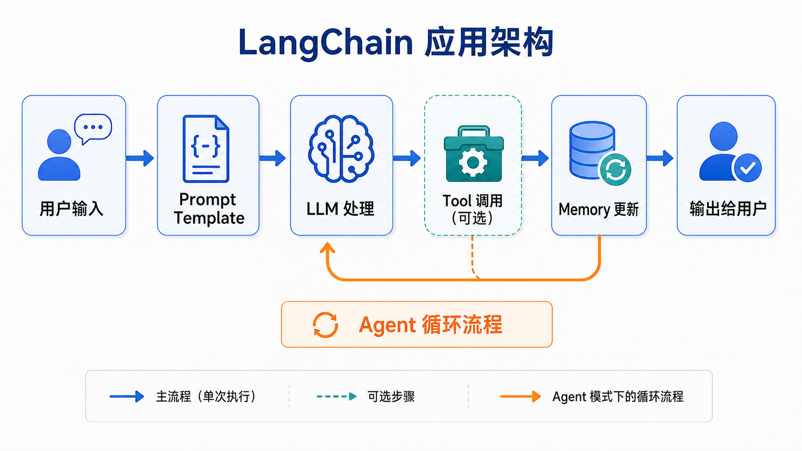

## 知识点讲解



### 1. 核心概念

LangChain 的设计理念是"组合优于配置"——把 LLM 应用拆成一组独立但可互拼的积木。组件分三层：

**底层：基础模块**

- **LLM / ChatModel**：统一的模型调用接口，屏蔽 OpenAI、Anthropic、本地模型的差异
- **Embeddings**：文本向量化，用于语义搜索和相似度计算
- **Retrievers**：从向量库或其他数据源拉取相关文档

**中层：组织模块**

- **Tools**：Agent 可以调用的外部操作，包含名称、描述、执行函数三要素
- **Memory**：管理对话历史和上下文，有多种策略
- **Chains / LCEL Runnable**：把多个组件串联成可执行的管道

**顶层：应用模块**

- **Agents**：基于 LLM 的推理引擎，能自主决定调用哪个工具、执行哪个步骤
- **RAG**：Retriever + LLM 组合，处理知识密集型问答

说白了，LangChain 就是个"组件超市"，你按需取货拼装。

### 2. 技术细节

**Tools 工具系统**

`@tool` 装饰器是最常用的定义方式，它会把函数的 docstring 自动提取为工具描述，这个描述直接影响 Agent 会不会选这个工具——写清楚很关键。

**Memory 记忆系统**

| 类型 | 策略 | 成本 | 适合场景 |
| --- | --- | --- | --- |
| ConversationBufferMemory | 保留全部历史 | 高 | 短会话 |
| ConversationSummaryMemory | 定期 LLM 总结 | 中 | 中长会话 |
| ConversationTokenBufferMemory | 按 token 数截断 | 中 | 成本敏感 |
| EntityMemory | 提取并追踪实体 | 中 | 含实体引用的长会话 |

**LCEL（LangChain Expression Language）**

v0.3 的核心范式，用 `|` 运算符把组件连接成链：

```latex
prompt | llm | output_parser
retriever | prompt | llm | StrOutputParser()
```

相比旧的 LLMChain，LCEL 支持流式输出、并行执行、更细粒度的错误处理。

**Agents vs Chains**

- Chains：流程预先写死，输入进去就按固定顺序跑——可预测、成本低
- Agents：每一步由 LLM 动态决定——灵活、成本高、可靠性较低

### 3. 对比与拓展

LangChain vs 原生 OpenAI SDK：原生 API 更轻量，手写工具调用其实并不复杂；LangChain 的价值在于生态和标准化抽象——如果你要对接 10 种工具、管理复杂状态，框架的收益就很明显了。

## 代码示例

```python
from langchain_openai import ChatOpenAI
from langchain_core.tools import tool
from langchain_core.prompts import ChatPromptTemplate, MessagesPlaceholder
from langchain.agents import create_tool_calling_agent, AgentExecutor
from langchain_core.messages import HumanMessage, AIMessage

# ── 1. 定义工具 ─────────────────────────────────────────────────────
@tool
def calculate(expression: str) -> str:
    """执行数学计算，如 '2 + 2 * 3'，直接返回数值结果"""
    try:
        return str(eval(expression))
    except Exception as e:
        return f"计算出错：{e}"

@tool
def query_db(sql: str) -> str:
    """查询业务数据库，传入 SQL 语句，返回查询结果"""
    # 真实场景接数据库
    return f"[DB] 执行 SQL: {sql} → 返回 10 行数据"

tools = [calculate, query_db]

# ── 2. 定义带 Memory 的 Agent ──────────────────────────────────────
llm = ChatOpenAI(model="gpt-4o", temperature=0)

# 包含对话历史占位符的 prompt
prompt = ChatPromptTemplate.from_messages([
    ("system", "你是一个数据分析助手，可以调用工具查询数据和做计算。"),
    MessagesPlaceholder("chat_history"),   # 注入历史
    ("human", "{input}"),
    MessagesPlaceholder("agent_scratchpad"),  # Agent 推理过程
])

agent = create_tool_calling_agent(llm, tools, prompt)
executor = AgentExecutor(
    agent=agent,
    tools=tools,
    verbose=True,
    max_iterations=8,
    handle_parsing_errors=True,  # 避免 LLM 输出格式错误时崩溃
)

# ── 3. 多轮对话——手动维护历史 ─────────────────────────────────────
chat_history = []

def chat(user_input: str) -> str:
    result = executor.invoke({
        "input": user_input,
        "chat_history": chat_history,
    })
    # 把这轮对话追加进历史
    chat_history.append(HumanMessage(content=user_input))
    chat_history.append(AIMessage(content=result["output"]))
    return result["output"]

# 第一轮
print(chat("查一下上周的销售总额"))
# 第二轮——Agent 能利用上一轮的上下文
print(chat("和上上周比，增长了多少百分比？"))


# ── 4. LCEL 组合：简单 RAG 链 ─────────────────────────────────────
from langchain_core.output_parsers import StrOutputParser
from langchain_core.runnables import RunnablePassthrough

def format_docs(docs):
    return "\n\n".join(doc.page_content for doc in docs)

rag_prompt = ChatPromptTemplate.from_template(
    "根据以下上下文回答问题。\n\n上下文：{context}\n\n问题：{question}"
)

# retriever 可以是向量库、BM25 等任意检索器
rag_chain = (
    {"context": retriever | format_docs, "question": RunnablePassthrough()}
    | rag_prompt
    | llm
    | StrOutputParser()
)
# result = rag_chain.invoke("什么是 LangGraph？")
```

## 面试怎么答

LangChain 的核心组件分三层：底层是 LLM/ChatModel、Embeddings、Retrievers，负责和模型、数据打交道；中层是 Tools、Memory、Chains/LCEL，负责组织逻辑；顶层是 Agents 和 RAG，是面向用户的应用形态。

这块我自己比较关注两个点。Memory 这块，不同策略的成本差异很大——全量 Buffer 在长对话里 token 费用会飙，生产上我倾向用 SummaryMemory 或者直接把历史压缩扔向量库做长期记忆。工具定义这块，docstring 写得好不好直接影响 Agent 的工具选择准确率，这是个细节但很实际。

另外 v0.3 之后的 LCEL 是值得认真学的——用管道运算符 `|` 把组件串联，支持流式、并行、异步，比老的 Chain 类好用很多，但网上很多教程还是旧 API，用的时候要分清版本。

我自己的经验：Chains 适合流程固定、要求稳定的任务；Agents 适合需要动态决策的任务，但要做好 max_iterations 和错误处理，否则很容易出问题。

## 高频追问 & 加分点

- **Q1：Chains 和 Agents 的本质区别是什么？**  
    控制权在哪。Chains 是流程写死的管道，每一步由工程师预定义；Agents 是把控制权交给 LLM，每步由模型动态决定。这也是 Chains 可靠性高、Agents 灵活性高的原因。
- **Q2：Memory 在多用户场景下怎么隔离？**  
    每个用户维护独立的 Memory 实例，或者用 session_id 做命名空间隔离。如果用数据库持久化（比如 RedisChatMessageHistory），key 设计成 `{user_id}:{session_id}` 就能天然隔离。
- **Q3：工具的 description 应该怎么写？**  
    写给 LLM 看的，要清晰说明：这个工具做什么、什么时候用、参数格式。一般结构是"[动词]+[对象]+[限制条件]"，比如"查询业务数据库，传入标准 SQL 语句，返回 JSON 格式的行数据"。描述越精确，Agent 选错工具的概率越低。
- **Q4：LangChain 的 token 开销真的高吗？**  
    相比裸 API 调用确实有额外开销，主要是 ReAct prompt 模板和 scratchpad 占空间。实测大概多 15-25%。如果成本敏感，可以精简 system prompt、限制 agent_scratchpad 长度，或者在简单任务上绕过 Agent 直接用 LCEL 链。
- **Q5：handle_parsing_errors 参数有什么用？**  
    LLM 有时候输出格式不对（比如 Action 部分乱写），这会导致 AgentExecutor 抛异常、整个请求失败。`handle_parsing_errors=True` 会把解析错误的情况回传给 LLM 重试，而不是直接崩溃，生产上建议默认开启。
