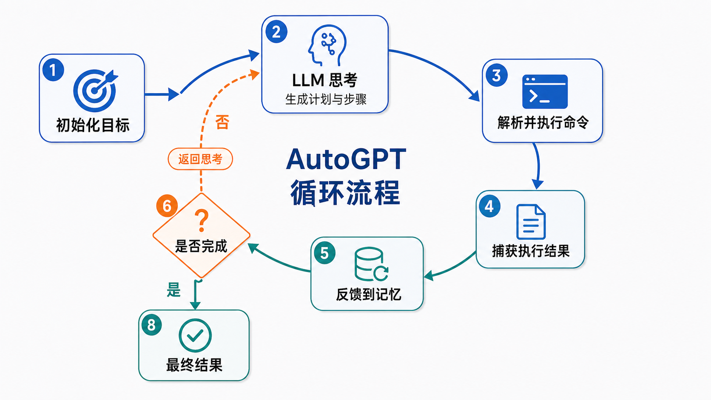

## 知识点讲解



### 1. 核心概念

AutoGPT 是 2023 年 4 月引爆 AI 圈的开源项目，它展示了一个令人震惊的可能性：给 GPT-4 一个目标，让它自己规划、自己执行，直到任务完成。

这背后的核心思路可以用一句话概括：**把 LLM 从"回答问题"变成"完成任务"**。传统 LLM 应用是人在驱动——用户问、模型答、用户再问。AutoGPT 反过来，给模型一个高层目标，让它自己驱动整个执行循环。

三个关键设计：

- **无限循环**：没有预设的最大步数，Agent 持续执行直到自己判断完成，或者达到设定的预算上限
- **开放工具集**：不只是几个预定义函数，而是文件读写、代码执行、网页搜索、API 调用全都有
- **长期记忆**：用向量数据库存储过去的执行结果，Agent 可以"记住"几十轮之前做了什么

和标准 ReAct 相比，最大的差异是**自主性的边界**：

| 维度 | 标准 ReAct | AutoGPT |
| --- | --- | --- |
| 工具集 | 预定义，受限 | 开放，包括系统命令 |
| 步数限制 | 有最大步数 | 无限制，LLM 自判断 |
| 目标定义 | 结构化输入 | 自然语言描述 |
| 可控性 | 相对可控 | 难以预测 |
| 成本 | 可预期 | 容易爆炸 |

### 2. 技术细节

#### 2.1 执行循环的结构

AutoGPT 的核心是一个 Thought → Action → Observation 的循环，但和 ReAct 不同的是，它在每次循环里还会做**自我评估**：这一步完成了吗？下一步应该做什么？

```
用户设定目标
    ↓
LLM 生成高层计划（5个子目标）
    ↓
循环：
  - LLM 思考当前状态和下一步
  - 选择并调用工具
  - 观察结果
  - 判断是否完成
    ↓
自行宣告任务完成
```

#### 2.2 AutoGPT 的工程教训

AutoGPT 失败的原因不是 ReAct 思路有问题，而是**走向了另一个极端**：

- **成本爆炸**：一个"研究 AI 市场"的任务，很容易触发 50+ 次 LLM 调用，花掉几十美元
- **不可预测**：同样的目标，两次执行可能产生完全不同的行为路径
- **缺乏可中断性**：Agent 在执行途中，没有很好的机制允许人类介入修正
- **工具过于强大**：能执行系统命令的 Agent + 不可控的规划 = 巨大的安全风险

现代 Agent 框架从 AutoGPT 学到的最重要一课：**自主性需要边界**。

### 3. 对比与拓展

AutoGPT 代表的是"最大自主性"，它之后的框架基本上都是在各个维度上加约束：

| 框架 | 相比 AutoGPT 的约束 |
| --- | --- |
| LangChain ReAct | 预定义工具集，有最大步数 |
| CrewAI | 每个 Agent 有明确角色边界，不能随意扩展 |
| LangGraph | 流程 DAG 预先定义，不能随意跳转 |
| 自研框架 | 完全可控，每步都有审批机制 |

## 代码示例

下面是 AutoGPT 风格执行循环的最小骨架，重点不是 API 而是**它和原版 AutoGPT 的差异**——加上了原版严重缺失的三个护栏：max_iterations、max_cost、tool_whitelist。

```python
from dataclasses import dataclass, field
from typing import List

@dataclass
class AutoGPTConfig:
    max_iterations: int = 10           # 没这个上限，循环可能永远不停
    max_tokens_total: int = 100_000    # 没这个上限，成本无法预测
    max_cost_usd: float = 5.0          # 成本护栏
    tool_whitelist: list = field(default_factory=lambda: ["search", "read_file"])

@dataclass
class ExecutionState:
    goal: str
    iteration: int = 0
    cost_usd: float = 0.0
    memory: List[str] = field(default_factory=list)
    completed: bool = False

class AutoGPTLoop:
    def __init__(self, llm, tools, config: AutoGPTConfig):
        self.llm = llm
        # 工具白名单：只暴露 config 允许的，原版 AutoGPT 缺这层
        self.tools = {t.name: t for t in tools if t.name in config.tool_whitelist}
        self.config = config

    def run(self, goal: str) -> str:
        state = ExecutionState(goal=goal)

        while not state.completed:
            # 三道护栏——原版 AutoGPT 都没有
            if state.iteration >= self.config.max_iterations:
                return f"达到最大迭代次数 {self.config.max_iterations}，停止"
            if state.cost_usd >= self.config.max_cost_usd:
                return f"达到成本上限 ${self.config.max_cost_usd}，停止"

            # LLM 决策：思考 + 选择行动
            prompt = self._build_prompt(state)
            response = self.llm.complete(prompt)

            # 更新资源消耗（计费按当前模型实际定价为准）
            state.cost_usd += response.usage.total_tokens * 2.5 / 1_000_000  # gpt-4o input 示例
            state.iteration += 1

            action = self._parse_action(response.text)

            if action.type == "FINISH":
                state.completed = True
                return action.result

            # 执行工具调用
            if action.tool_name in self.tools:
                observation = self.tools[action.tool_name].run(action.params)
            else:
                observation = f"工具 {action.tool_name} 不在白名单"

            state.memory.append(
                f"[迭代{state.iteration}] 行动: {action.tool_name}, 观察: {observation[:200]}"
            )

        return "任务完成"

    def _build_prompt(self, state: ExecutionState) -> str:
        recent_memory = "\n".join(state.memory[-5:])  # 只保留最近 5 条
        return f"目标: {state.goal}\n最近行动:\n{recent_memory}\n请决定下一步或输出 FINISH。"

    def _parse_action(self, response_text: str):
        # 实际实现需要解析 JSON 格式的行动指令
        # ...
        ...
```

## 面试怎么答

AutoGPT 的核心思路是把 LLM 从"回答问题"升级成"完成任务"——给一个高层目标，让模型自己规划执行步骤、选择工具、判断完成条件，形成一个自驱动的循环。这在 2023 年展示了 LLM 自主行动的可能性，是很有价值的概念验证。

但 AutoGPT 走向了"自主性最大化"的极端：无步数限制、开放工具集、没有人工干预点。实际使用里，成本完全不可控（一个任务轻松花掉几十美元），行为也难以预测。这让它在生产环境里基本不可用。

AutoGPT 的价值更多是让整个行业看清楚了什么该做、什么不该做。之后的 LangGraph、CrewAI 这些框架，核心都是在"给 Agent 设置清晰的边界"——预定义工具集、有限步数、DAG 约束流程、人工审批点。自主性很重要，但边界同样重要。

## 高频追问 & 加分点

- **Q1：AutoGPT 和 ReAct 的关系是什么？**  
    AutoGPT 的每一步其实就是 ReAct 的 Thought→Action→Observation。区别在于 ReAct 通常有明确的最大步数和预定义工具集，而 AutoGPT 把这两个约束都去掉了，追求最大自主性。可以说 AutoGPT 是 ReAct 的"无边界版本"。
- **Q2：AutoGPT 的无限循环靠什么停止？**  
    两种情况：一是 LLM 自己输出 FINISH 指令（但 LLM 可能永远输不出来）；二是触发外部约束（最大迭代数、成本预算、时间限制）。工程实践里必须加所有这些约束，不能指望 LLM 自己判断完成。
- **Q3：为什么说 AutoGPT 是"概念验证"而不是"生产工具"？**  
    三点：成本不可控（没有预算上限，一次任务可能花几十美元）；行为不可预测（同一目标两次运行路径完全不同，没法测试和审计）；安全风险高（能执行系统命令的开放工具集，加上不可控的规划，是巨大的安全漏洞）。生产系统需要的确定性、可测性、成本可控性，AutoGPT 全都给不了。
- **Q4：现代框架从 AutoGPT 学到了什么？**  
    核心教训是：自主性需要边界。具体体现在：工具集预定义（不能随意调用任何东西）；步数和成本有硬上限；流程用 DAG 约束（不能随意跳转节点）；关键决策要有人工审批点。AutoGPT 的自由度换来了不可用，现代框架把自由度收回来一部分，换来了可用性。
- **Q5：如果要在实际项目里用 AutoGPT 的思路，怎么改造它？**  
    保留核心的自主执行思路，但加上四个护栏：最大步数（比如 20 步）、成本预算（比如 $2）、时间限制（比如 5 分钟）、工具白名单（只允许业务必要的工具，不开放系统命令）。加上这四个约束，AutoGPT 的灵活性和可控性就能取得平衡，可以用于实际场景。
