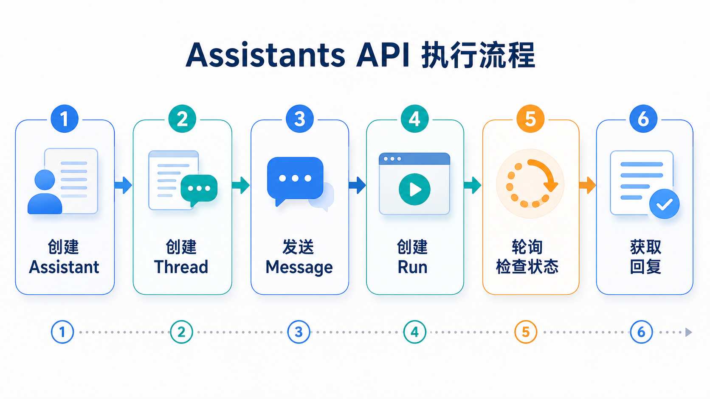

## 知识点讲解



### 1. 核心概念

OpenAI Assistants API 是 OpenAI 在 2023 年推出的 Agent 即服务产品。它把自建 Agent 系统里最麻烦的几件事——工具调用、对话历史管理、文件处理、知识检索——都打包成了托管服务，开发者不用自己维护这套基础设施。

可以把 Assistants API 理解成一个"Agent 云服务"：你定义好 Agent 的角色和工具，OpenAI 帮你运行、存储对话历史、执行代码、检索文件。

核心抽象分四层：

| 概念 | 类比 | 职责 |
| --- | --- | --- |
| **Assistant** | 岗位配置 | 定义 Agent 的 instructions、model、可用工具 |
| **Thread** | 对话窗口 | 一次完整的对话历史，可以跨多次会话持久化 |
| **Message** | 对话消息 | Thread 里的单条消息（用户或 Assistant） |
| **Run** | 执行实例 | Assistant 处理一次 Thread 的过程，有状态机 |

这四层的关系：一个 Assistant 可以关联多个 Thread（不同用户），一个 Thread 可以有多次 Run（用户多次提问），每次 Run 处理当前 Thread 里的所有 Messages。

### 2. 技术细节

#### 2.1 三大内置工具

**Code Interpreter**：在沙箱环境里运行 Python 代码，处理数据分析、文件处理、数学计算等任务。它能自动生成图表，支持上传 CSV/Excel 等文件。

**File Search**（原 Retrieval）：向量化存储文件内容，用户提问时自动检索相关片段。支持多种格式（PDF、Word、代码文件），免去了自建 RAG pipeline 的麻烦。

**Function Calling**：调用开发者定义的自定义函数——这是和外部系统集成的主要方式，比如查数据库、调内部 API。

#### 2.2 完整调用流程

```python
from openai import OpenAI
import time

client = OpenAI()

# 第一步：创建 Assistant（通常只做一次，ID 可以保存复用）
assistant = client.beta.assistants.create(
    name="数据分析助手",
    instructions="""你是一个专业的数据分析师。
    - 收到数据时，先理解数据结构
    - 用 Python 做分析，给出可视化图表
    - 用简洁的语言解释分析结论""",
    tools=[
        {"type": "code_interpreter"},
        {"type": "file_search"},
        {
            "type": "function",
            "function": {
                "name": "query_database",
                "description": "查询业务数据库获取实时数据",
                "parameters": {
                    "type": "object",
                    "properties": {
                        "sql": {"type": "string", "description": "SQL 查询语句"},
                        "database": {"type": "string", "description": "数据库名称"}
                    },
                    "required": ["sql"]
                }
            }
        }
    ],
    model="gpt-4o"
)

# 第二步：创建 Thread（每个用户会话创建一个）
thread = client.beta.threads.create()

# 第三步：添加用户消息
client.beta.threads.messages.create(
    thread_id=thread.id,
    role="user",
    content="分析一下这个月的销售数据，找出增长最快的产品类别"
)

# 第四步：创建 Run（触发 Assistant 处理）
run = client.beta.threads.runs.create(
    thread_id=thread.id,
    assistant_id=assistant.id
)

# 第五步：等待完成（Run 是异步的，需要轮询或用 stream）
def wait_for_run(client, thread_id, run_id, timeout=120):
    """轮询 Run 状态直到完成"""
    start_time = time.time()
    
    while time.time() - start_time < timeout:
        run = client.beta.threads.runs.retrieve(
            thread_id=thread_id,
            run_id=run_id
        )
        
        if run.status == "completed":
            return run
        
        elif run.status == "requires_action":
            # Function Calling 需要我们提供执行结果
            tool_outputs = []
            for tool_call in run.required_action.submit_tool_outputs.tool_calls:
                if tool_call.function.name == "query_database":
                    import json
                    args = json.loads(tool_call.function.arguments)
                    # 实际执行数据库查询
                    result = execute_sql(args["sql"])
                    tool_outputs.append({
                        "tool_call_id": tool_call.id,
                        "output": str(result)
                    })
            
            # 把函数执行结果提交回去
            client.beta.threads.runs.submit_tool_outputs(
                thread_id=thread_id,
                run_id=run_id,
                tool_outputs=tool_outputs
            )
        
        elif run.status in ["failed", "cancelled", "expired"]:
            raise RuntimeError(f"Run 失败: {run.status}, {run.last_error}")
        
        time.sleep(1)  # 轮询间隔
    
    raise TimeoutError("Run 超时")

run = wait_for_run(client, thread.id, run.id)

# 第六步：读取回复
messages = client.beta.threads.messages.list(
    thread_id=thread.id,
    order="desc",
    limit=1
)
print(messages.data[0].content[0].text.value)
```

#### 2.3 Run 的状态机

```
created → queued → in_progress → completed
                              ↘ requires_action → (提交结果) → in_progress → completed
                              ↘ failed
                              ↘ cancelled
                              ↘ expired
```

`requires_action` 是 Function Calling 的关键状态——Run 在等待开发者执行自定义函数并把结果提交回来。这个交互是同步阻塞的，Run 在超时前必须收到提交。

### 3. 对比与拓展

| 维度 | Assistants API | 自建 Agent（LangChain 等） |
| --- | --- | --- |
| 对话历史 | OpenAI 托管，自动持久化 | 自己管理，要存数据库 |
| 代码执行 | 内置沙箱，免配置 | 自己搭沙箱（Docker 等） |
| 文件检索 | 内置 RAG，免配置 | 自建向量库 + 检索链路 |
| 灵活性 | 受限于 OpenAI 提供的能力 | 完全自定义 |
| 供应商依赖 | 强依赖 OpenAI | 可多供应商 |
| 成本 | 偏高（工具调用额外计费） | 可优化空间大 |

## 面试怎么答

Assistants API 是 OpenAI 的 Agent 托管服务，核心解决了自建 Agent 最麻烦的几个问题：对话历史不用自己存，代码执行不用搭沙箱，文件检索不用自建 RAG。

它的四层抽象——Assistant 定义角色和工具，Thread 是持久化的对话窗口，Message 是单条消息，Run 是每次 Assistant 处理的执行实例——这套模型很清晰，照着写代码很快就能上手。

最需要理解的是 Run 的状态机。特别是 `requires_action` 状态：用了 Function Calling 时，Run 会暂停等你执行自定义函数并提交结果，这个步骤是同步的，需要轮询或流式监听。选 Assistants API 的主要场景是：团队没精力维护 RAG 和代码沙箱基础设施，或者可靠性要求高（交给 OpenAI 维护）；不适合的场景是成本敏感、需要用非 OpenAI 模型、或者有复杂的自定义工作流。

## 高频追问 & 加分点

- **Q1：Assistants API 和 Chat Completions API 的本质区别是什么？**  
    Chat Completions 是"一问一答"——你发消息，模型返回，状态管理全靠自己。Assistants API 是"持续的任务执行环境"——Thread 持久化对话历史，Run 管理执行状态，工具调用由框架协调。Chat Completions 更轻量灵活，Assistants API 更开箱即用但重量级。
- **Q2：Assistants API 如何控制成本？**  
    几个关键点：文件存储按大小计费，不用的文件及时删除；Code Interpreter 每次 Run 都会计费，按需开启；对话 Thread 会积累历史，context 很长时成本高，可以定期开新 Thread；用 `max_prompt_tokens` 和 `max_completion_tokens` 给每次 Run 设置 token 上限。
- **Q3：多用户场景下如何用 Assistants API？**  
    最佳实践是"一个用户一个 Thread"：用户第一次对话时创建 Thread，把 Thread ID 和用户 ID 关联存在自己的数据库里，后续对话都在同一个 Thread 里继续。Assistant 是共用的（所有用户用同一个 assistant_id），只有 Thread 是用户私有的。
- **Q4：Assistants API 的数据隐私问题怎么处理？**  
    Assistants API 会把文件内容和对话历史存在 OpenAI 的服务器上。对于有严格数据合规要求的场景（医疗、金融等），这是红线——数据不能出境或不能存第三方。这种情况要么用本地部署方案，要么自建 Agent 配本地向量库。
- **Q5：用 streaming 替代轮询有什么好处？**  
    轮询每秒发一次请求，有延迟也有额外网络开销。streaming 模式（`client.beta.threads.runs.stream()`）可以实时接收事件流，包括 token 生成、工具调用、状态变更等，响应更快，也能实现打字机效果的流式输出。生产环境建议用 streaming，轮询只适合简单的同步场景。
