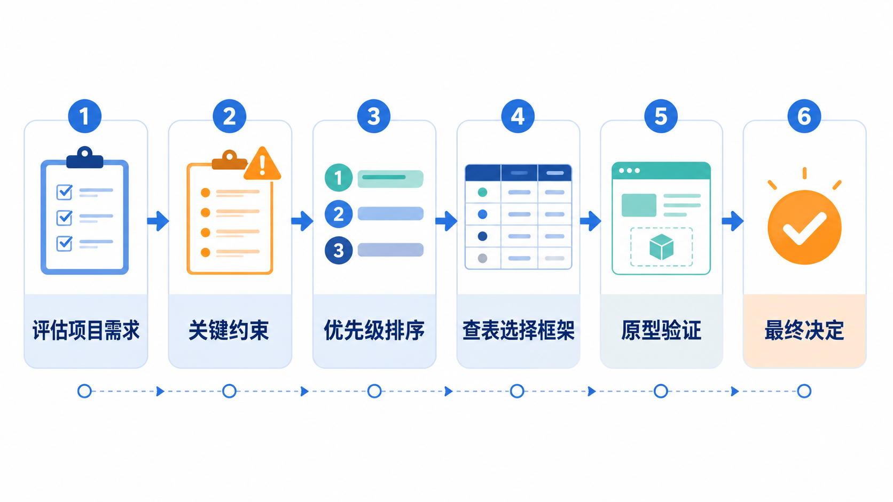

## 知识点讲解



### 1. 核心概念

框架选择是一道工程决策题，没有绝对正确答案，只有"当前阶段最合适的选择"。关键是想清楚几个核心问题：

**这个 Agent 的主要价值是什么？** 如果是快速验证一个想法，上手快比功能全重要；如果是要跑几年的生产系统，可维护性和灵活性才是主要考量。

**团队的技术栈和经验是什么？** 强行引入一个团队没人熟悉的框架，前期的学习成本会吃掉很多时间。

**业务的核心约束是什么？** 成本敏感，还是延迟敏感？需不需要多 Agent 协作？有没有复杂的条件分支？

### 2. 技术细节

#### 2.1 主流框架的能力对比

| 框架 | 多 Agent | 流程灵活性 | 上手难度 | 成本控制 | 供应商依赖 |
| --- | --- | --- | --- | --- | --- |
| LangChain | 有限 | 中 | 低 | 中 | 低 |
| CrewAI | 原生支持 | 中 | 低 | 中 | 低 |
| LangGraph | 原生支持 | 高 | 高 | 中 | 低 |
| Assistants API | 单 Agent | 低 | 低 | 高 | 强依赖 OpenAI |
| 自研 | 完全自定义 | 最高 | 最高 | 最优 | 无 |

#### 2.2 决策框架

```python
def select_agent_framework(requirements: dict) -> str:
    """框架选型决策逻辑"""
    
    # 快速原型 / MVP 阶段：上手速度优先
    if requirements.get("phase") == "prototype":
        if requirements.get("multi_agent"):
            return "CrewAI — 多 Agent 场景上手最快"
        return "LangChain — 单 Agent 原型首选"
    
    # 有复杂工作流：需要精细控制流程
    if requirements.get("complex_workflow"):
        # 有复杂条件分支 / 循环
        if requirements.get("conditional_branches") or requirements.get("loops"):
            return "LangGraph — 图结构表达复杂流程"
        # 多角色协作，流程相对线性
        if requirements.get("role_based_collaboration"):
            return "CrewAI — 角色分工清晰的协作场景"
    
    # 需要内置的 RAG + 代码执行，不想自建基础设施
    if requirements.get("managed_tools") and not requirements.get("data_privacy_strict"):
        return "Assistants API — 开箱即用，OpenAI 托管"
    
    # 极致性能 / 成本 / 安全要求
    if (requirements.get("extreme_performance") 
            or requirements.get("cost_critical")
            or requirements.get("strict_security")):
        return "自研 — 完全掌控，代价是开发成本"
    
    # 默认：LangChain 作为起点
    return "LangChain — 生态最成熟，可以先跑起来再说"

# 典型场景示例
scenarios = [
    {
        "name": "客服机器人 MVP",
        "phase": "prototype",
        "multi_agent": False
    },
    {
        "name": "研究报告生成系统",
        "phase": "production",
        "multi_agent": True,
        "role_based_collaboration": True,
        "complex_workflow": True
    },
    {
        "name": "金融合规分析",
        "phase": "production",
        "complex_workflow": True,
        "conditional_branches": True,
        "strict_security": True
    }
]

for s in scenarios:
    recommendation = select_agent_framework(s)
    print(f"{s['name']}: → {recommendation}")
```

#### 2.3 常见的选型陷阱

**过早自研**：功能验证阶段花 3 个月自研框架，结果发现需求方向错了，白费了。

**迷信最热门的框架**：框架流行不代表适合你的场景，LangChain 的生态最成熟，但不是每个项目都该用 LangChain。

**低估迁移成本**：从 CrewAI 换到 LangGraph 不是改几行代码，可能是重写核心逻辑。选型时就要考虑"如果业务增长，这个框架能撑住吗"。

**只看框架不看模型成本**：框架本身不收费（除了 Assistants API），大头是 LLM API 费用。选框架的同时要估算模型成本。

### 3. 对比与拓展

框架选择不是一次性决定，应该随项目阶段动态调整：

- **MVP 阶段**：选最熟悉的，能最快跑起来验证假设
- **成长阶段**：遇到框架瓶颈时评估是否迁移，不要因为沉没成本硬撑
- **成熟阶段**：性能和成本压力大了，考虑局部自研替换框架核心路径

混合策略也是常见选择：用 LangChain 做通用编排，自研关键工具层，Assistants API 处理对话历史——取各框架的优势，规避各自的短板。

## 面试怎么答

选框架没有标准答案，关键是看几个维度：项目阶段（MVP 还是成熟产品），是否需要多 Agent 协作，流程是否复杂，数据隐私和供应商依赖的约束，以及团队已有的技术栈。

我的选型思路是：如果要快速出原型，优先 LangChain 或 CrewAI，上手快生态成熟；如果有复杂的条件分支和循环逻辑，用 LangGraph，图结构能更清晰地表达流程；如果不想维护 RAG 和代码沙箱的基础设施，且数据不涉及严格隐私，Assistants API 是省事的选择；如果有极致的性能、成本或安全要求，才考虑自研。

还有一点很重要：框架选择应该随项目阶段调整。MVP 阶段选的框架不一定适合规模化阶段，要留意技术债，在合适的时候做迁移。

## 高频追问 & 加分点

- **Q1：LangChain 和 LangGraph 的关系是什么，该用哪个？**  
    LangGraph 是 LangChain 生态里专门用于有状态、有循环的 Agent 工作流的框架。LangChain 更适合简单的链式调用（A → B → C）；LangGraph 适合有分支、循环、状态回溯的复杂流程。两者可以配合使用，LangGraph 管理流程，LangChain 的工具生态照样用。
- **Q2：如果项目一开始选错了框架，迁移代价有多大？**  
    取决于耦合深度。如果业务逻辑和框架 API 强耦合（比如到处用了 LangChain 的 chain 对象），迁移就是重写。好的设计是让业务逻辑和框架解耦——工具函数是纯 Python，数据格式是标准 dict，框架只是"胶水"。这样迁移只改胶水层，代价小很多。
- **Q3：CrewAI 和 LangGraph 能一起用吗？**  
    可以。有人用 LangGraph 做顶层流程控制（决定什么时候调用 Crew），用 CrewAI 执行具体的多 Agent 协作任务。但这会引入两个框架的复杂性，只在确实需要时才这样做。一般选一个主框架，另一个作为辅助。
- **Q4：团队第一次做 Agent 项目，建议从哪个框架入手？**  
    建议从 LangChain 开始，原因：文档最完善、社区最活跃、踩坑的人最多（遇到问题容易搜到答案）、工具生态最丰富。先用 LangChain 的 ReAct agent 做一个能跑起来的原型，理解 Agent 的基本工作方式，再根据实际需求考虑是否换框架或引入 LangGraph。
- **Q5：如何评估一个开源框架是否成熟可用？**  
    看四个指标：GitHub star 和最近的 commit 频率（判断活跃程度）；issue 的响应时间（判断维护者的重视程度）；在 PyPI 的周下载量（判断实际使用量）；有没有知名公司的生产用例。star 多但长期没人维护的框架要小心，可能随时烂掉。
