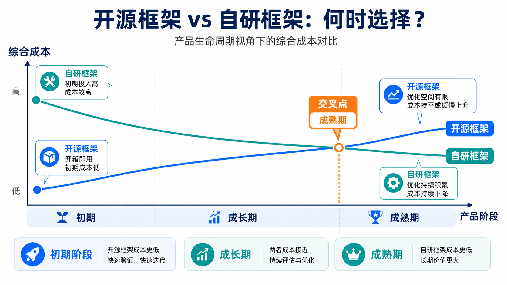

## 知识点讲解



### 1. 核心概念

这是 AI 工程里的"构建 vs 购买"问题，但有一个重要的时间维度——**不同阶段的最优解不一样**。

早期用框架是正确的：需求还没稳定，用框架快速迭代比自研更重要。但随着产品规模扩大，开源框架的边界开始显现：性能瓶颈（框架的通用性带来额外开销）、成本瓶颈（框架会引入一些不必要的 LLM 调用）、灵活性瓶颈（改不了框架核心行为）。

所以这不是一个非此即彼的选择，而是随业务阶段动态调整的决策。

### 2. 技术细节

#### 2.1 真实成本的计算

框架成本不只是"免费/付费"，真实的成本公式：

```
开源框架的真实成本 = 学习成本 + 集成调试成本 + 版本升级成本 
                   + 绕过框架限制的开发成本 + LLM API 成本
                   
自研框架的真实成本 = 开发成本 + 测试成本 + 长期维护成本
                   + 新人上手培训成本 + LLM API 成本
```

早期阶段，自研成本远大于框架成本（开发一个能用的 Agent 框架需要数周时间）。随着规模增长，框架的 LLM 调用效率劣势被放大，自研的边际成本下降，两条曲线会在某个时间点交叉。

#### 2.2 全生命周期的策略

```python
from enum import Enum
from typing import Tuple

class ProjectStage(Enum):
    IDEA = "idea"           # 概念验证
    MVP = "mvp"             # 最小可用产品
    PMF = "pmf"             # 寻找产品市场契合
    GROWTH = "growth"       # 规模化增长
    MATURE = "mature"       # 成熟期

def recommend_strategy(
    stage: ProjectStage,
    monthly_agent_calls: int,
    team_size: int,
    has_special_requirements: bool
) -> Tuple[str, str]:
    """
    返回 (推荐策略, 推荐理由)
    """
    
    if stage in [ProjectStage.IDEA, ProjectStage.MVP]:
        return (
            "使用成熟开源框架（LangChain / CrewAI）",
            "需求未稳定，框架快速迭代节省 2-4 周开发时间"
        )
    
    if stage == ProjectStage.PMF:
        if has_special_requirements:
            return (
                "框架 + 局部自研（混合方案）",
                "框架满足通用需求，自研解决特殊场景"
            )
        return (
            "继续使用框架，但开始评估瓶颈",
            "记录框架带来的痛点，为后续决策积累数据"
        )
    
    if stage == ProjectStage.GROWTH:
        if monthly_agent_calls > 100_000:
            # 大量调用时，框架的效率损耗被放大
            return (
                "核心路径自研，辅助功能保留框架",
                f"每月 {monthly_agent_calls} 次调用，优化效率可显著降低成本"
            )
        return (
            "框架 + 性能优化（缓存、批处理）",
            "规模还不够大，自研收益不覆盖成本"
        )
    
    if stage == ProjectStage.MATURE:
        if team_size >= 5 and monthly_agent_calls > 500_000:
            return (
                "核心引擎自研",
                "团队规模和调用量支撑自研的边际成本，长期收益明确"
            )
        return (
            "继续使用框架，重点优化 LLM 调用效率",
            "自研成本超过预期收益"
        )
    
    return ("使用开源框架", "默认建议")


# 混合方案的架构示意
class HybridAgentSystem:
    """混合方案：框架做编排，核心路径自研优化"""
    
    def __init__(self):
        # 通用编排用 LangGraph（框架）
        from langgraph.graph import StateGraph
        self.orchestrator = StateGraph  
        
        # 高频核心路径自研（比如快速工具选择）
        self.fast_tool_selector = self._build_custom_selector()
        
        # 对话历史存储自研（控制成本和隐私）
        self.memory_store = self._build_custom_memory()
    
    def _build_custom_selector(self):
        """
        自研的轻量级工具选择器：
        用 embedding 相似度代替 LLM 调用选工具
        成本降低约 70%，延迟从 500ms 降到 50ms
        """
        # 预先计算每个工具描述的 embedding
        # 用户请求来了，计算请求 embedding，选最相似的工具
        # 不需要每次都调 LLM
        pass
    
    def _build_custom_memory(self):
        """
        自研的记忆管理：
        按用户 ID 隔离，支持 GDPR 删除
        框架默认不支持这个粒度的控制
        """
        pass
```

#### 2.3 需要自研的明确信号

不要为了自研而自研，但这几个信号出现时，要认真评估：

| 信号 | 说明 |
| --- | --- |
| 框架引入了不必要的 LLM 调用 | 比如每次选工具都要调 LLM，而你的场景可以用规则替代 |
| 有安全/隐私要求框架无法满足 | 比如数据不能传出去，框架的内部调用链里有泄露风险 |
| 框架的版本升级破坏了生产 | 过度依赖框架的内部 API，维护成本开始上升 |
| 性能优化被框架设计限制 | 想用批处理或流式处理，但框架不支持 |

### 3. 对比与拓展

混合方案的最佳实践：用框架做编排（LangGraph 的图结构、CrewAI 的角色管理），自研关键组件（工具选择算法、缓存层、记忆存储）。框架负责"把各部分串起来"，自研部分负责"做得足够高效和合规"。

关键原则：**业务逻辑和框架解耦**。工具函数写成纯 Python 函数，数据格式用标准 dict/dataclass，框架只是胶水。这样将来换框架或者自研，只改胶水层，核心逻辑不动。

## 面试怎么答

框架还是自研，我觉得这是一个"随项目阶段动态调整"的问题，不是一次性选择。早期，框架是必须的——需求没稳定，用框架快速迭代比什么都重要，省下来的时间用来验证业务假设。

随着规模增长，框架的边界会慢慢显现：效率损耗被放大、安全和隐私需求框架满足不了、框架版本升级开始影响稳定性。这时候才是认真评估自研的时机。自研不是全部推倒重来，而是分层替换——核心路径自研（比如工具选择逻辑），通用编排继续用框架。

最重要的设计原则是：从一开始就让业务逻辑和框架解耦。工具函数写成标准 Python，不要用框架的 decorator 把业务逻辑包死。这样将来不管是换框架还是自研，改的只是胶水层，风险可控。

## 高频追问 & 加分点

- **Q1：哪些部分适合自研，哪些继续用框架？**  
    适合自研的：高频核心路径（工具选择、记忆检索）、有特殊安全/隐私要求的部分、需要深度优化的性能热点。继续用框架的：通用编排逻辑（LangGraph 的图结构很难比框架做得更好）、工具生态（直接用框架的现成工具集成）、评估和测试（框架有现成的 eval 工具）。
- **Q2：如何说服团队接受自研的额外开发成本？**  
    用数据说话。记录框架带来的痛点（额外的 API 调用次数、延迟、无法支持的需求），换算成实际成本和业务损失，再和自研的开发成本对比。如果自研 2 个月能节省每月 $5000 的 API 费用，ROI 很容易算出来。不要用"我们应该更专业"这种理由，要用具体数字。
- **Q3：开源框架的版本升级带来了 breaking change，怎么应对？**  
    这是选用开源框架要接受的风险。应对策略：锁定框架版本（不自动升级）；升级前在 staging 环境完整测试；业务逻辑和框架解耦（减少受 breaking change 影响的范围）；评估框架的维护状况，如果升级频率和破坏性高，考虑 fork 或者自研替换。
- **Q4：自研框架如何保证质量？**  
    自研失去了社区背书，质量完全靠自己。三件事必须做：完整的单元测试（特别是工具调用、错误处理这些边缘情况）；集成测试覆盖主要业务场景；监控和告警（让问题在影响用户之前被发现）。另外要建立内部的文档规范，新人接手不能靠"问老员工"。
- **Q5：从框架迁移到自研，有没有相对平滑的方案？**  
    有，叫"绞杀者模式"（Strangler Fig Pattern）：先在框架旁边搭建自研版本，新功能都走自研，旧功能逐步迁移，直到框架被"绞杀"干净。全量切换风险太高，这种方式让系统一直在运行，每次迁移只影响一部分功能，出了问题范围可控。
