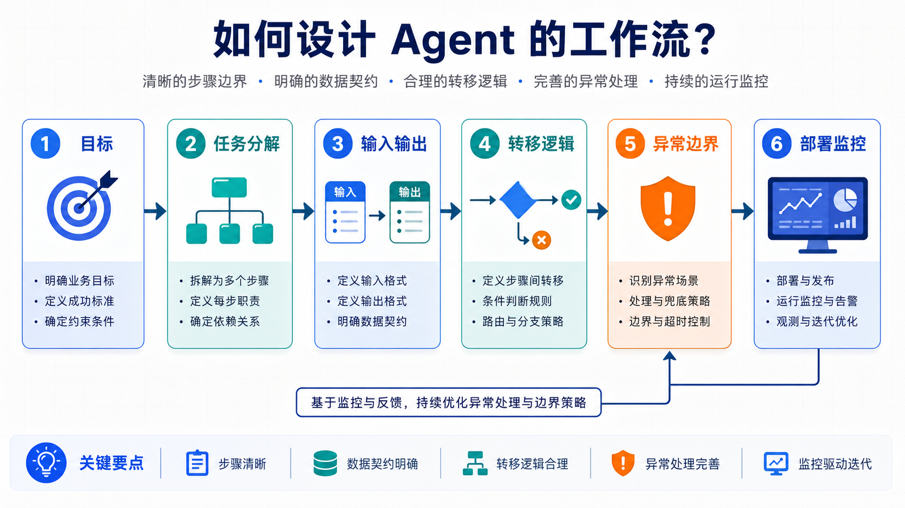

## 知识点讲解



### 1. 核心概念

Agent 工作流设计的核心问题是：如何把一个模糊的目标拆解成一系列可执行的步骤，并让这些步骤可靠地连接起来？

这和传统软件的函数设计有相似之处，但 Agent 有一个特殊的挑战——每个步骤都可能失败，而且失败方式千奇百怪（LLM 输出格式不对、工具返回空结果、上下文超长被截断）。好的工作流设计不只是"把步骤连起来"，更要考虑每个步骤的容错边界。

工作流设计的三个核心决策：

- **粒度**：步骤切多细？太粗容易失败，太细循环太多
- **结构**：线性链？条件分支？还是局部循环？
- **容错**：单步失败时怎么处理？重试、降级、还是人工介入？

### 2. 技术细节

#### 2.1 任务分解的四个原则

| 原则 | 说明 | 反面教材 |
| --- | --- | --- |
| 单一职责 | 每步只做一件事，输出格式明确 | 第三步"分析数据并生成报告并发送邮件" |
| 输出可验证 | 每步产出能被下一步或人类校验 | 输出"一些分析结果"而不是结构化 JSON |
| 步骤解耦 | 步骤间通过 State 传数据，不共享全局变量 | 步骤 B 直接读取步骤 A 的内部变量 |
| 合适粒度 | 一个步骤大约对应 1-3 次 LLM 调用 | 一步做完所有事 / 拆成 20 个微步骤 |

#### 2.2 用 LangGraph 实现带条件分支的工作流

```python
from langgraph.graph import StateGraph, END
from typing import TypedDict, List, Literal
from dataclasses import dataclass

# 定义工作流的全局状态
class ResearchState(TypedDict):
    query: str                    # 输入查询
    search_results: List[str]     # 搜索结果
    result_quality: str           # 结果质量评估："sufficient" | "insufficient"
    analysis: str                 # 分析结论
    final_report: str             # 最终报告
    retry_count: int              # 重试次数

# 各步骤函数：接收 State，返回需要更新的字段
def search_step(state: ResearchState) -> dict:
    """搜索信息"""
    results = web_search(state["query"])
    return {"search_results": results, "retry_count": state.get("retry_count", 0)}

def evaluate_results(state: ResearchState) -> dict:
    """评估搜索结果是否足够"""
    results = state["search_results"]
    
    # 简单评估：结果数量和质量
    if len(results) >= 3 and any(len(r) > 100 for r in results):
        quality = "sufficient"
    else:
        quality = "insufficient"
    
    return {"result_quality": quality}

def analyze_step(state: ResearchState) -> dict:
    """分析搜索结果"""
    analysis = llm.analyze(state["search_results"])
    return {"analysis": analysis}

def generate_report(state: ResearchState) -> dict:
    """生成最终报告"""
    report = llm.generate_report(
        query=state["query"],
        analysis=state["analysis"]
    )
    return {"final_report": report}

# 条件路由函数：决定下一步走哪条边
def route_after_evaluate(state: ResearchState) -> Literal["analyze", "search"]:
    """根据质量评估结果决定是继续分析还是重新搜索"""
    if state["result_quality"] == "sufficient":
        return "analyze"
    
    # 最多重试 2 次
    if state.get("retry_count", 0) >= 2:
        return "analyze"  # 重试次数到了，强制继续
    
    return "search"  # 重新搜索

# 构建工作流图
def build_research_workflow() -> StateGraph:
    graph = StateGraph(ResearchState)
    
    # 注册所有节点
    graph.add_node("search", search_step)
    graph.add_node("evaluate", evaluate_results)
    graph.add_node("analyze", analyze_step)
    graph.add_node("report", generate_report)
    
    # 定义边：固定边 + 条件边
    graph.set_entry_point("search")
    graph.add_edge("search", "evaluate")
    
    # 条件分支：evaluate → analyze 或 → search（重搜）
    graph.add_conditional_edges(
        "evaluate",
        route_after_evaluate,
        {
            "analyze": "analyze",
            "search": "search"
        }
    )
    
    graph.add_edge("analyze", "report")
    graph.add_edge("report", END)
    
    return graph.compile()

# 使用
workflow = build_research_workflow()
result = workflow.invoke({
    "query": "2024年中国AI大模型市场竞争格局",
    "search_results": [],
    "result_quality": "",
    "analysis": "",
    "final_report": "",
    "retry_count": 0
})
print(result["final_report"])
```

#### 2.3 容错设计模式

工作流的容错不是"加个 try-catch"那么简单，要针对不同的失败类型选择不同的处理策略：

| 失败类型 | 处理策略 | 说明 |
| --- | --- | --- |
| 工具返回空/异常 | 重试（最多 3 次，指数退避） | 网络问题、临时故障 |
| LLM 输出格式不对 | 重新调用（带格式修正提示） | 提示词不够清晰 |
| 上下文超长 | 摘要压缩后继续 | Context window 限制 |
| 多次重试后仍失败 | 人工介入 / 降级到简单方案 | 超出系统能力边界 |

### 3. 对比与拓展

工作流设计的一个常见误区是"过度设计"——为所有可能的失败情况都设计分支，结果工作流图复杂得没人能维护。

更实用的原则：先做最简单的线性流程，跑起来以后观察实际失败点，针对性地加容错，而不是预先把所有边界情况都设计进去。

## 面试怎么答

工作流设计的核心是任务分解，把模糊目标拆成一系列输出格式明确、步骤边界清晰的小任务。我的设计思路是：先画最简单的线性流程（A → B → C），能跑通以后再识别哪些地方需要条件分支（比如搜索结果不足时重搜）、哪些地方需要循环（比如质量不达标时重生成）。

工具选择上，LangGraph 的 StateGraph 是目前表达能力最强的框架之一——节点是处理函数，边是数据流，条件边是业务逻辑路由，State 是在整个流程里传递的共享状态。整个工作流的结构一目了然，也容易测试每个步骤。

容错不能忽视。每个步骤都要考虑：如果失败了下一步怎么走？一般的原则是：可以重试的（网络问题、格式错误）加重试逻辑；重试也不行的，要么降级到简单方案，要么触发人工介入。不要让单点失败把整个工作流搞崩。

## 高频追问 & 加分点

- **Q1：步骤的粒度怎么拿捏？**  
    经验上，一个步骤对应 1-3 次 LLM 调用比较合适。太粗（一步搞定所有事），LLM 做复杂任务容易出错，而且失败了不知道哪里出问题；太细（每个小操作都是一步），步骤间的状态传递开销大，调试也麻烦。如果一个步骤经常失败，通常是因为它做的事太多了，需要拆开。
- **Q2：如何在工作流中加入人工审批节点？**  
    LangGraph 支持 `interrupt_before` 和 `interrupt_after`——在指定节点前后暂停执行，等待外部输入（人工确认/修改）再继续。这对高风险操作很重要，比如发邮件、写数据库之前让人确认一下。实现上是把中间状态序列化保存，人工操作完成后恢复执行。
- **Q3：工作流里如何处理并行步骤？**  
    LangGraph 支持从一个节点出发多条边到不同节点，这些节点可以并行执行（需要显式配置）。比如搜索结束后，可以同时启动"分析市场数据"和"分析竞争对手"两个并行节点，都完成后再汇合到"生成报告"。并行能降低总延迟，但要注意下游节点等待所有上游完成才能继续。
- **Q4：工作流的测试怎么做？**  
    分三层：单步测试（每个节点函数单独测试，mock 工具调用）；集成测试（固定输入的完整流程，验证最终输出）；边界测试（工具返回空结果、LLM 输出格式错误等异常情况）。LangGraph 支持把 graph 序列化，也可以在测试里 replay 特定的执行路径，不用每次真的调 LLM。
- **Q5：工作流版本升级怎么做到平滑迁移？**  
    主要考虑两个问题：存量任务（旧版工作流正在执行的任务如何完成）和新旧版兼容（State 结构变了，旧的序列化状态还能用吗）。实践上：State 字段只加不减（加新字段给默认值），不改已有字段的语义；新旧版本并行跑一段时间，观察新版行为正常后再下线旧版。
