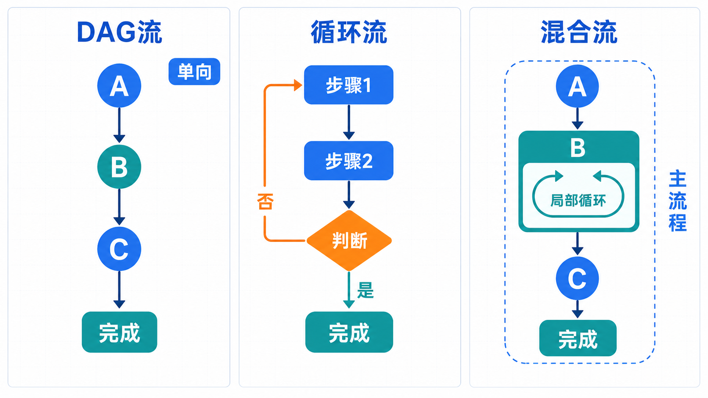

## 知识点讲解



### 1. 核心概念

DAG（有向无环图）和循环流是描述 Agent 工作流拓扑结构的两种基本模式，选哪种本质上是在**可预测性**和**灵活性**之间取舍。

**DAG 的思维模型**：提前规划好所有路径。就像写一张地图——从哪里出发，可能经过哪些路口，可以走哪些分支，但不允许走回头路。整个执行路径在写代码时就确定了，运行时只是沿着预设的路走。

**循环流的思维模型**：边做边调整。就像人解决一道难题——试一次，看看结果，不满意就再试一次，直到满意为止。执行了几次、走了哪条路，要到运行时才能知道。

这个区别直接影响系统的可测性、成本可控性和调试难度。

### 2. 技术细节

#### 2.1 DAG 的实现模式

DAG 在 LangGraph 里的表达非常自然——节点、边、条件边，一旦定义好就固定了：

```python
from langgraph.graph import StateGraph, END
from typing import TypedDict, Literal

class DocumentState(TypedDict):
    content: str
    language: str
    summary: str
    translation: str

# DAG：固定流程，无循环
def detect_language(state: DocumentState) -> dict:
    """检测文档语言"""
    lang = language_detector(state["content"])
    return {"language": lang}

def summarize(state: DocumentState) -> dict:
    """生成摘要"""
    summary = llm.summarize(state["content"])
    return {"summary": summary}

def translate_to_english(state: DocumentState) -> dict:
    """翻译为英语"""
    translation = llm.translate(state["content"], target="en")
    return {"translation": translation}

def route_by_language(state: DocumentState) -> Literal["summarize", "translate_first"]:
    """根据语言决定是否需要翻译"""
    if state["language"] == "zh":
        return "translate_first"
    return "summarize"

# 构建 DAG
dag = StateGraph(DocumentState)
dag.add_node("detect", detect_language)
dag.add_node("summarize", summarize)
dag.add_node("translate", translate_to_english)

dag.set_entry_point("detect")
dag.add_conditional_edges("detect", route_by_language, {
    "summarize": "summarize",
    "translate_first": "translate"
})
dag.add_edge("translate", "summarize")  # 翻译完还是要摘要
dag.add_edge("summarize", END)

dag_workflow = dag.compile()
# 执行路径在编译时就固定了，运行时不会有意外
```

#### 2.2 循环流的实现模式

循环流适合"不知道要试几次"的场景，比如迭代优化、重试搜索、多轮对话：

```python
class WritingState(TypedDict):
    topic: str
    draft: str
    feedback: str
    quality_score: float
    iteration: int

def write_draft(state: WritingState) -> dict:
    """生成文章草稿"""
    prompt = f"写一篇关于 {state['topic']} 的文章"
    if state.get("feedback"):
        prompt += f"\n\n上一版的反馈：{state['feedback']}\n请根据反馈改进"
    
    draft = llm.generate(prompt)
    return {"draft": draft, "iteration": state.get("iteration", 0) + 1}

def evaluate_draft(state: WritingState) -> dict:
    """评估草稿质量"""
    evaluation = llm.evaluate(
        f"评估这篇文章的质量（0-10分）和改进建议：\n{state['draft']}"
    )
    # 解析评分和反馈
    score = parse_score(evaluation)
    feedback = parse_feedback(evaluation)
    return {"quality_score": score, "feedback": feedback}

def should_continue(state: WritingState) -> Literal["write", "finish"]:
    """决定是否继续优化"""
    if state["quality_score"] >= 8.0:
        return "finish"  # 质量达标
    if state.get("iteration", 0) >= 3:
        return "finish"  # 防止无限循环：最多迭代 3 次
    return "write"       # 继续优化

# 循环流
loop = StateGraph(WritingState)
loop.add_node("write", write_draft)
loop.add_node("evaluate", evaluate_draft)

loop.set_entry_point("write")
loop.add_edge("write", "evaluate")
loop.add_conditional_edges("evaluate", should_continue, {
    "write": "write",   # 回到 write 节点 → 形成循环
    "finish": END
})

loop_workflow = loop.compile()
```

#### 2.3 混合方案：DAG 作主结构，局部循环作优化

```python
# 混合方案：外层是 DAG，内层某些节点包含循环逻辑
class ResearchState(TypedDict):
    query: str
    search_results: list
    search_attempts: int     # 搜索尝试次数
    analysis: str
    report: str

def search_with_retry(state: ResearchState) -> dict:
    """
    这个节点内部包含重试逻辑（小循环），
    但对外层 DAG 来说，它就是一个普通节点
    """
    max_attempts = 3
    results = []
    
    for attempt in range(max_attempts):
        results = web_search(state["query"])
        if len(results) >= 3:
            break
        # 搜索结果不足，调整关键词重试
        state = {**state, "query": refine_query(state["query"], attempt)}
    
    return {
        "search_results": results,
        "search_attempts": max_attempts
    }

# 外层是清晰的 DAG，不受内部循环影响
hybrid = StateGraph(ResearchState)
hybrid.add_node("search", search_with_retry)  # 内部有循环，但对外是黑盒
hybrid.add_node("analyze", analyze_step)
hybrid.add_node("report", generate_report)
hybrid.set_entry_point("search")
hybrid.add_edge("search", "analyze")
hybrid.add_edge("analyze", "report")
hybrid.add_edge("report", END)
```

#### 2.4 选型判断标准

| 场景特征 | 推荐结构 |
| --- | --- |
| 流程步骤固定，无需回头 | DAG |
| 有明确的质量标准，需要迭代优化 | 循环流 |
| 需要精确控制成本和延迟 | DAG（执行路径可预测） |
| 处理开放式、结果不确定的任务 | 循环流（带终止条件） |
| 流程复杂但部分步骤需要重试 | 混合（DAG 主结构 + 节点内部循环） |

### 3. 对比与拓展

一个常见的实践是：**先用 DAG 设计，发现哪些节点需要重试/迭代，再局部引入循环**。而不是一开始就用完全开放的循环流——循环流的成本和执行时间难以预测，线上系统的 SLA 可能无法保证。

## 面试怎么答

DAG 和循环流的核心区别是可预测性：DAG 的执行路径在设计时就能推断出来，成本和延迟有边界；循环流的执行路径是运行时决定的，要试几次才知道。

选型原则：流程固定、对延迟和成本有明确要求，用 DAG；任务是开放式的、需要迭代优化直到满足某个标准，用循环流——但一定要有硬终止条件（最大迭代次数或成本预算），不加的话生产上很容易出问题。

实际工程里用混合方案最多：外层是 DAG，某些节点内部包含小循环（比如搜索不到结果就换关键词再搜），这样外层流程可预测，内层有一定的自适应能力。

## 高频追问 & 加分点

- **Q1：循环流如何保证一定会终止？**  
    三道防线：最大迭代次数（比如最多循环 5 次，到了就强制停止）；成本预算（累计 token 超过上限就停）；时间限制（超过 N 秒强制终止）。三个条件任意一个触发都终止，不能只靠 LLM 自己判断完成——LLM 可能永远输不出"完成"信号。
- **Q2：DAG 能处理"失败了重试"的场景吗？**  
    能，但需要在节点内部做，而不是在 DAG 层面做。DAG 节点可以内部实现重试逻辑（try 3 次），对外仍然是一个节点。如果 3 次都失败，节点可以抛出异常或返回降级结果。DAG 结构本身不变，可预测性不受影响。
- **Q3：LangGraph 支持真正的无限循环吗？**  
    支持，但不建议用于生产。LangGraph 允许条件边指向已经执行过的节点（形成循环），没有框架层面的硬限制。所以终止条件完全靠开发者在路由函数里实现。最佳实践是在 State 里记录迭代次数，路由函数检查迭代次数作为退出条件。
- **Q4：如何估算循环流的平均成本？**  
    用统计方法：跑 100 次典型任务，记录每次的实际迭代次数，算出均值和 P95。然后用"平均迭代次数 × 单次迭代成本"估算平均成本，用 P95 迭代次数估算最坏情况成本。这个数据也是设置"最大迭代次数"的参考依据——如果 P95 是 4 次，设置上限 6 次是合理的。
- **Q5：有没有不适合用 DAG 也不适合用循环流的场景？**  
    有——真正的多 Agent 并发协作（多个 Agent 同时工作、相互通信、动态协调）用 DAG 和单一循环流都很难表达，需要更复杂的编排机制（消息队列、事件驱动）。这类场景通常需要自研或者用专门支持并发 Agent 的框架（比如 Microsoft AutoGen 的 GroupChat 模式）。
