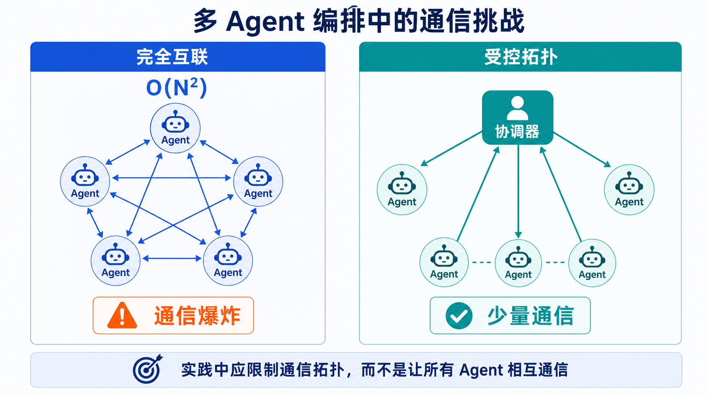

## 知识点讲解



### 1. 核心概念

多 Agent 系统把分布式系统的复杂性引入到了 AI 领域。单 Agent 出问题，最多是一个任务失败；多 Agent 出问题，可能是一连串的级联失败——A 的输出是 B 的输入，B 挂了 C 也挂了。

多 Agent 编排的核心挑战不是"怎么让 Agent 协作"，而是**如何在 Agent 协作的同时控制复杂性**。典型的复杂性来源：

- **通信成本**：Agent 间的每次交互都是 LLM 调用，成本快速累积
- **状态一致性**：多个 Agent 各自维护局部视角，全局状态可能不一致
- **依赖管理**：Agent A 完成之前，Agent B 不能开始——怎么表达和管理这种依赖？
- **错误传播**：上游 Agent 输出了错误结果，下游 Agent 可能把错误放大

### 2. 技术细节

#### 2.1 四种编排拓扑的对比

```
顺序编排：A → B → C → D
并行编排：A → [B, C, D] → E
分层编排：Manager → [Worker1, Worker2, Worker3]
消息队列：Agent 通过消息异步协作，没有固定拓扑
```

| 模式 | 延迟 | 成本 | 复杂度 | 适用场景 |
| --- | --- | --- | --- | --- |
| 顺序 | 高（串行） | 低（通信少） | 低 | 有明确依赖的线性流程 |
| 并行 | 低（并发） | 中 | 中 | 相互独立的子任务 |
| 分层 | 中 | 高（Manager 额外开销） | 高 | 可递归分解的复杂任务 |
| 消息队列 | 低 | 中 | 最高 | 高并发实时系统 |

#### 2.2 顺序编排与并行编排的实现

```python
from crewai import Agent, Task, Crew, Process
from typing import List
import asyncio

# ===== 顺序编排：简单可靠，有明确依赖 =====

researcher = Agent(
    role="市场研究员",
    goal="收集市场数据",
    tools=[web_search_tool],
    allow_delegation=False
)

analyst = Agent(
    role="数据分析师", 
    goal="分析研究结果，输出洞察",
    tools=[data_analysis_tool],
    allow_delegation=False
)

writer = Agent(
    role="报告撰写",
    goal="把分析结论写成可读的报告",
    tools=[],
    allow_delegation=False
)

# Task 用 context 声明依赖关系
research_task = Task(
    description="调研 AI 编程工具市场",
    expected_output="结构化的市场数据（JSON 格式）",
    agent=researcher
)

analysis_task = Task(
    description="分析研究员收集的市场数据，找出关键趋势",
    expected_output="3-5 个核心洞察，含数据支持",
    agent=analyst,
    context=[research_task]  # 依赖研究任务的输出
)

writing_task = Task(
    description="把分析结果写成 800 字的市场简报",
    expected_output="完整的市场简报文档",
    agent=writer,
    context=[analysis_task]  # 依赖分析任务的输出
)

sequential_crew = Crew(
    agents=[researcher, analyst, writer],
    tasks=[research_task, analysis_task, writing_task],
    process=Process.sequential,
    verbose=True
)


# ===== 并行编排：独立任务同时跑，降低总延迟 =====

async def run_parallel_agents(queries: List[str]) -> List[str]:
    """
    对多个独立查询并行执行 Agent，
    总延迟 = max(单个延迟) 而不是 sum(所有延迟)
    """
    
    async def run_single_agent(query: str) -> str:
        """单个 Agent 执行"""
        # 每个查询独立的 Agent（避免状态共享）
        agent = create_research_agent()
        task = Task(
            description=f"研究: {query}",
            expected_output="500字的研究摘要",
            agent=agent
        )
        crew = Crew(agents=[agent], tasks=[task])
        return crew.kickoff().raw
    
    # 并发执行所有查询
    tasks = [run_single_agent(q) for q in queries]
    results = await asyncio.gather(*tasks, return_exceptions=True)
    
    # 处理部分失败
    final_results = []
    for i, result in enumerate(results):
        if isinstance(result, Exception):
            final_results.append(f"查询 {i+1} 失败: {str(result)}")
        else:
            final_results.append(result)
    
    return final_results
```

#### 2.3 多 Agent 的成本控制

多 Agent 的成本不只是 Agent 数量的线性增长，还有通信开销：

```
总成本 = Σ(每个 Agent 的执行成本) + Σ(Agent 间通信成本)

通信成本 = 通信次数 × 平均 context 长度 × token 单价

# 以 3 个 Agent 顺序执行为例：
# - Researcher: 2000 tokens
# - Analyst（含 researcher 输出）: 3000 tokens  
# - Writer（含 analyst 输出）: 2500 tokens
# 总计: 7500 tokens，约 $0.23（GPT-4o 价格）

# 如果用低成本模型分配：
# - Researcher: GPT-4o（需要搜索判断能力）
# - Analyst: GPT-4o-mini（结构化分析，能力要求低）
# - Writer: GPT-4o-mini（文本生成）
# 混合成本可降低 40-60%
```

#### 2.4 错误传播的防御

```python
class RobustAgentOrchestrator:
    """带错误隔离的多 Agent 编排"""
    
    def run_with_fallback(
        self, 
        primary_agent,
        fallback_fn,
        task_input: str
    ) -> str:
        """
        主 Agent 失败时自动降级到 fallback
        防止单点故障级联
        """
        try:
            result = primary_agent.run(task_input)
            
            # 验证输出质量（不只是"没有抛异常"）
            if not self._validate_output(result):
                raise ValueError(f"输出质量不达标: {result[:100]}")
            
            return result
            
        except Exception as e:
            print(f"主 Agent 失败: {e}，触发 fallback")
            return fallback_fn(task_input)  # 比如用更简单的方法
    
    def _validate_output(self, output: str) -> bool:
        """验证 Agent 输出是否满足最低质量要求"""
        if not output or len(output) < 50:
            return False
        # 可以加更多验证：格式检查、关键词检查等
        return True
```

### 3. 对比与拓展

多 Agent 编排的一个常被忽视的问题是**"经理 Agent"的瓶颈**——在分层架构里，Manager Agent 要协调所有 Worker，它的每次决策都是 LLM 调用，整个系统的吞吐量被 Manager 限制住了。小规模（3-5 个 Agent）时不明显，大规模时需要考虑分层或去中心化的协作方式。

## 面试怎么答

多 Agent 编排的核心挑战是：把单 Agent 的不确定性放大了 N 倍，同时引入了 Agent 间的通信成本和错误传播问题。一个 Agent 输出有问题，下游 Agent 可能把这个问题放大；多个 Agent 的 LLM 调用累积起来，成本也很可观。

四种编排拓扑各有取舍：顺序编排最简单可控，但延迟高；并行编排降低延迟，适合独立子任务；分层编排灵活，但 Manager Agent 是瓶颈；消息队列适合高并发，但复杂度最高。实践里通常从顺序开始，识别出哪些步骤可以并行再做优化。

成本控制上，两个重要手段：按 Agent 的任务复杂度选模型（不是所有 Agent 都要用 GPT-4），以及减少不必要的通信（Agent 间的消息要精简，不要把完整历史都传下去）。

## 高频追问 & 加分点

- **Q1：多 Agent 系统里如何做错误隔离，防止级联失败？**  
    每个 Agent 的输出要做质量校验，不能无条件传给下游。对高风险 Agent（写数据库、发邮件的）加人工确认点。上游失败时，下游有 fallback 方案（降级到更简单的处理方式），而不是直接报错。同时，关键操作要有幂等性，失败后可以安全重试。
- **Q2：如何决定一个任务用单 Agent 还是多 Agent？**  
    判断标准：任务能否被清晰分解成独立的子任务？子任务之间的依赖是否简单明确？单 Agent 是否会因为要做太多事而质量下降？如果这三个问题的答案都是"是"，多 Agent 才有价值。否则，单 Agent 加更好的工具集通常更简单可靠。
- **Q3：多 Agent 系统怎么调试？出了问题怎么定位？**  
    可观测性是关键：每个 Agent 的输入输出要完整日志，每次通信要有 trace_id 贯穿始终，这样一个问题能追溯到是哪个 Agent 的哪次调用。另外要做 Agent 级别的单元测试——给定固定输入，验证每个 Agent 的输出是否符合预期，把多 Agent 问题拆解为单 Agent 问题来调试。
- **Q4：Agent 间的信息传递应该传多少上下文？**  
    最少够用原则：只传下游 Agent 完成任务所需的信息，不把上游的完整对话历史都传下去。过多的上下文不只增加成本，还可能引入噪声（LLM 在很长的 context 里可能忽略关键信息）。通常用一段结构化的摘要代替原始对话历史传给下游。
- **Q5：多 Agent 系统的并发控制怎么做？**  
    主要防两个问题：资源竞争（多个 Agent 同时写同一份文档）和 API 限流（并发 LLM 调用触发速率限制）。前者用锁或者设计无竞争的数据流（每个 Agent 有独立的工作空间）；后者用信号量控制并发数（比如最多同时跑 5 个 Agent），超出的排队等待。
