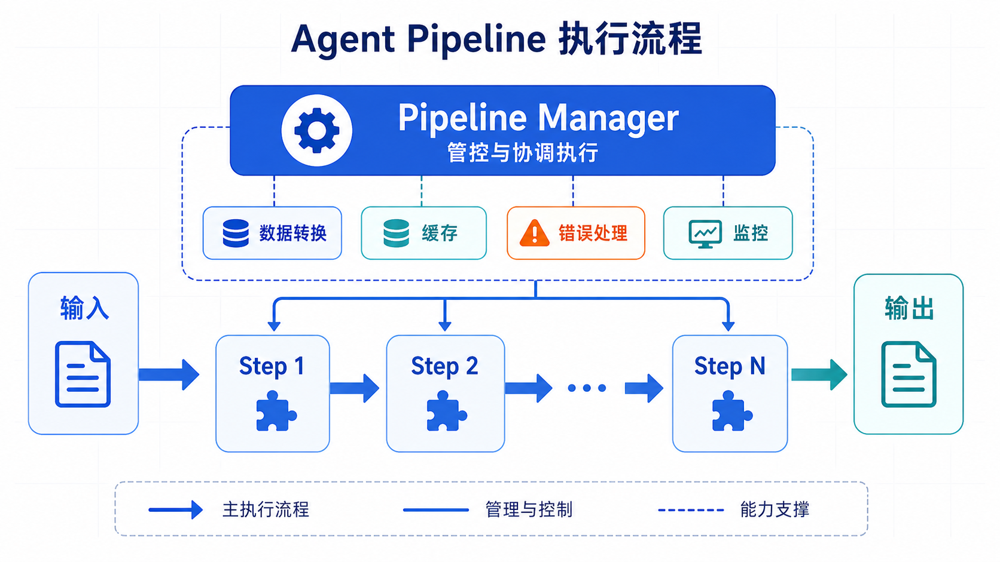

## 知识点讲解



### 1. 核心概念

Agent Pipeline 是把多个处理步骤串联起来的数据流架构：每个步骤产出一个结果，作为下一步的输入，最终形成完整的输出。

和工作流（Workflow）的区别：Pipeline 强调**单向数据流动**，通常是线性或 DAG 结构；工作流可以包含循环、人工介入、状态回溯等更复杂的控制流。Pipeline 是工作流的一种简化形式，适合流程清晰、数据流向确定的场景。

构建可靠 Pipeline 的关键不是代码多复杂，而是**把每个步骤的输入输出格式定义清楚**——格式清晰了，步骤之间的契约就清晰了，测试和调试才容易。

### 2. 技术细节

#### 2.1 四种 Pipeline 模式

```
线性 Pipeline：    A → B → C → D
扇出扇入：         A → [B, C, D] → E
条件分支：         A → 路由 → B 或 C → D
带重试：           A → B（失败→重试）→ C
```

#### 2.2 完整 Pipeline 实现

```python
from langgraph.graph import StateGraph, END
from typing import TypedDict, List, Optional, Literal
from dataclasses import dataclass
import hashlib

# 用 TypedDict 强制定义每个字段的类型
class ContentPipelineState(TypedDict):
    # 输入
    raw_url: str
    
    # 各步骤的输出（初始为空，逐步填充）
    raw_content: Optional[str]
    cleaned_content: Optional[str]
    summary: Optional[str]
    key_points: Optional[List[str]]
    
    # 控制字段
    content_type: Optional[str]    # "article" | "product" | "unknown"
    error: Optional[str]           # 出错时记录原因
    retry_count: int

# ---- 步骤函数 ----

def fetch_content(state: ContentPipelineState) -> dict:
    """步骤1：抓取网页内容"""
    try:
        content = http_get(state["raw_url"])
        return {"raw_content": content, "error": None}
    except Exception as e:
        return {"error": f"抓取失败: {e}", "raw_content": None}

def clean_content(state: ContentPipelineState) -> dict:
    """步骤2：清洗内容（去广告、去无用HTML）"""
    if state.get("error"):
        return {}  # 有错误就跳过，不改变状态
    
    raw = state["raw_content"]
    cleaned = html_cleaner(raw)
    return {"cleaned_content": cleaned}

def detect_content_type(state: ContentPipelineState) -> dict:
    """步骤3：检测内容类型，决定后续处理路径"""
    if state.get("error"):
        return {}
    
    prompt = f"判断这段内容是什么类型（article/product/unknown）：\n{state['cleaned_content'][:500]}"
    content_type = llm.classify(prompt)
    return {"content_type": content_type.strip()}

def route_by_content_type(state: ContentPipelineState) -> Literal["summarize_article", "extract_product", "handle_unknown"]:
    """路由函数：根据内容类型选择处理路径"""
    if state.get("error"):
        return "handle_unknown"
    
    ct = state.get("content_type", "unknown")
    if ct == "article":
        return "summarize_article"
    elif ct == "product":
        return "extract_product"
    return "handle_unknown"

def summarize_article(state: ContentPipelineState) -> dict:
    """文章类型：生成摘要 + 提取关键点"""
    content = state["cleaned_content"]
    
    summary = llm.summarize(f"用200字概括这篇文章：\n{content}")
    key_points_text = llm.extract(f"从这篇文章提取5个关键点，用列表格式：\n{content}")
    key_points = [p.strip() for p in key_points_text.split("\n") if p.strip()]
    
    return {"summary": summary, "key_points": key_points}

def extract_product(state: ContentPipelineState) -> dict:
    """商品类型：提取产品信息"""
    content = state["cleaned_content"]
    
    product_info = llm.extract(
        f"从这个商品页面提取：名称、价格、规格、评分。用JSON格式：\n{content}"
    )
    return {"summary": product_info, "key_points": []}

def handle_unknown(state: ContentPipelineState) -> dict:
    """兜底处理：未知类型或有错误"""
    if state.get("error"):
        return {"summary": f"处理失败: {state['error']}", "key_points": []}
    return {"summary": "无法识别内容类型", "key_points": []}

# ---- 构建 Pipeline ----

def build_content_pipeline() -> StateGraph:
    graph = StateGraph(ContentPipelineState)
    
    # 注册所有节点
    graph.add_node("fetch", fetch_content)
    graph.add_node("clean", clean_content)
    graph.add_node("detect_type", detect_content_type)
    graph.add_node("summarize_article", summarize_article)
    graph.add_node("extract_product", extract_product)
    graph.add_node("handle_unknown", handle_unknown)
    
    # 线性段
    graph.set_entry_point("fetch")
    graph.add_edge("fetch", "clean")
    graph.add_edge("clean", "detect_type")
    
    # 条件分支
    graph.add_conditional_edges(
        "detect_type",
        route_by_content_type,
        {
            "summarize_article": "summarize_article",
            "extract_product": "extract_product",
            "handle_unknown": "handle_unknown"
        }
    )
    
    # 所有分支汇聚到 END
    graph.add_edge("summarize_article", END)
    graph.add_edge("extract_product", END)
    graph.add_edge("handle_unknown", END)
    
    return graph.compile()

pipeline = build_content_pipeline()

# ---- 使用 ----
result = pipeline.invoke({
    "raw_url": "https://example.com/article",
    "raw_content": None,
    "cleaned_content": None,
    "summary": None,
    "key_points": None,
    "content_type": None,
    "error": None,
    "retry_count": 0
})

print(f"摘要: {result['summary']}")
print(f"关键点: {result['key_points']}")
```

#### 2.3 性能优化：缓存和并行

```python
import asyncio
from functools import lru_cache
import hashlib

class CachedPipeline:
    """带缓存的 Pipeline，避免重复处理相同内容"""
    
    def __init__(self, pipeline):
        self.pipeline = pipeline
        self.cache = {}  # 生产里用 Redis
    
    def _cache_key(self, url: str) -> str:
        return hashlib.md5(url.encode()).hexdigest()
    
    def run(self, url: str) -> dict:
        key = self._cache_key(url)
        
        # 缓存命中
        if key in self.cache:
            return self.cache[key]
        
        # 执行 Pipeline
        result = self.pipeline.invoke({"raw_url": url, ...})
        
        # 缓存结果（URL 内容不变时有效）
        self.cache[key] = result
        return result

async def run_batch_pipeline(urls: List[str]) -> List[dict]:
    """批量并行执行，降低总延迟"""
    pipeline = build_content_pipeline()
    
    async def run_one(url: str) -> dict:
        return pipeline.invoke({"raw_url": url, ...})
    
    # 并发执行，最多 5 个并发（避免触发 LLM API 限流）
    semaphore = asyncio.Semaphore(5)
    
    async def run_with_limit(url: str) -> dict:
        async with semaphore:
            return await run_one(url)
    
    results = await asyncio.gather(
        *[run_with_limit(url) for url in urls],
        return_exceptions=True
    )
    return list(results)
```

### 3. 对比与拓展

Pipeline 设计的关键原则：**格式契约优先**。步骤之间的数据格式（TypedDict 或 Pydantic）要先定义清楚，再实现步骤逻辑。格式清晰后，每个步骤可以独立开发和测试，也容易替换某个步骤的实现而不影响其他步骤。

## 面试怎么答

Agent Pipeline 的核心是单向数据流——每个步骤接收上游的输出，做自己的处理，把结果传给下游。构建 Pipeline 最重要的是先定义好每个步骤的输入输出格式，用 TypedDict 或 Pydantic 强制约束，这样步骤之间的契约就清晰了。

LangGraph 的 StateGraph 是目前构建 Pipeline 最合适的工具：节点是处理函数，边是数据流，条件边可以实现分支路由，整个 Pipeline 的结构一目了然。

性能优化上两个主要手段：缓存（相同输入不重复处理）和并行（独立的步骤或批量任务并发执行）。另外，每个步骤要有错误处理和降级逻辑——不能让一个步骤的失败把整个 Pipeline 搞崩。

## 高频追问 & 加分点

- **Q1：Pipeline 里如何做流式输出，让用户实时看到进度？**  
    LangGraph 支持 `.stream()` 模式，每个节点完成时会发出一个事件，可以通过 Server-Sent Events 推送到前端。前端可以实时显示"正在搜索..."、"正在分析..."这样的进度状态。关键是 Pipeline 的步骤边界和前端的 UI 状态要对应，用户能看到有意义的进度，而不只是一个转圈圈。
- **Q2：Pipeline 的步骤失败后如何重试？**  
    两种方式：步骤内部重试（try 3 次，指数退避）和 Pipeline 级别重试（把整个 Pipeline 重新跑，从失败的步骤开始）。后者需要 Pipeline 支持"从某个检查点恢复"，LangGraph 支持 checkpointing，可以保存中间状态，失败后从最近的检查点恢复，而不用从头跑。
- **Q3：多个 Pipeline 实例并发时，如何避免资源竞争？**  
    每个 Pipeline 实例有独立的 State 对象，不共享状态，所以数据层面没有竞争。资源竞争主要在外部：LLM API 的速率限制（用信号量控制并发数）、共享数据库的写入（用乐观锁或队列串行化写入）、缓存的读写（用带 TTL 的分布式缓存，不用本地缓存）。
- **Q4：如何测试 Pipeline 的各个步骤？**  
    分层测试：单元测试每个步骤函数（mock 掉 LLM 调用和外部工具，输入固定，验证输出格式和关键内容）；集成测试跑完整 Pipeline（用便宜的模型，固定测试用例，验证端到端结果）；回归测试（每次修改 Pipeline 都跑完整测试集，防止改坏了之前好的场景）。
- **Q5：Pipeline 的版本管理怎么做？**  
    Pipeline 的变更主要有三类：加新步骤（通常向后兼容）、改现有步骤逻辑（需要完整测试）、改 State 字段结构（最危险，可能破坏存量数据）。建议用语义化版本号标记 Pipeline（v1.0、v1.1），State 结构变更要有迁移脚本，同时支持新旧两个版本并行运行一段时间，确认新版没问题后再下线旧版。
