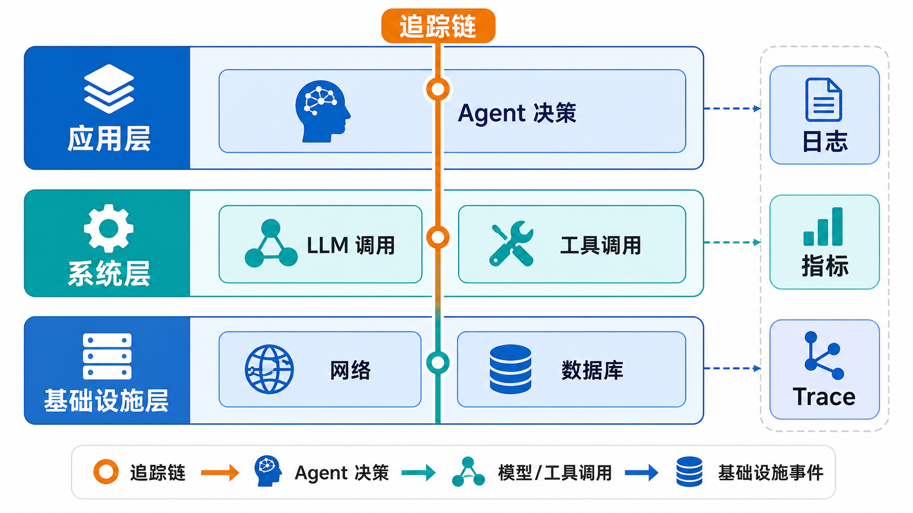

## 知识点讲解



### 1. 核心概念

可观测性（Observability）是回答"这个系统现在怎么了"的能力。对传统 Web 服务，可观测性已经有成熟的方法论：Logs + Metrics + Traces。Agent 系统同样需要这三层，但有 Agent 特有的复杂性。

Agent 可观测性为什么更难：

- **非确定性**：同样的输入可能产生不同的执行路径，"这次为什么走了这条路"很难事后复原
- **执行跨度大**：一次 Agent 任务可能调用 10 个工具、产生 30 次 LLM 调用，链路很长
- **成本可见**：LLM 调用有直接的货币成本，必须实时追踪，不然账单来了才发现炸了

### 2. 技术细节

#### 2.1 三层可观测性的 Agent 实现

**Logs（日志）**：记录每次执行的详细过程，用于事后调试

**Metrics（指标）**：持续收集聚合数据，用于趋势分析和告警

**Traces（追踪）**：串起一次完整任务的所有步骤，用于跨系统的链路分析

```python
import uuid
import time
import logging
from typing import Any, Dict, Optional, List
from dataclasses import dataclass, field
from datetime import datetime

# ---- 结构化日志 ----

@dataclass
class AgentLogEntry:
    """每次执行步骤的标准化日志格式"""
    trace_id: str           # 贯穿整个任务的唯一 ID
    step_id: str            # 当前步骤的 ID
    step_type: str          # "llm_call" | "tool_call" | "decision" | "error"
    timestamp: float
    duration_ms: float
    
    # LLM 调用的关键字段
    model: Optional[str] = None
    prompt_tokens: Optional[int] = None
    completion_tokens: Optional[int] = None
    cost_usd: Optional[float] = None
    
    # 工具调用的关键字段
    tool_name: Optional[str] = None
    tool_input: Optional[str] = None
    tool_output: Optional[str] = None
    
    # 错误信息
    error: Optional[str] = None
    
    # 通用字段
    metadata: Dict[str, Any] = field(default_factory=dict)


class AgentObserver:
    """Agent 可观测性的核心实现"""
    
    def __init__(self, service_name: str):
        self.service_name = service_name
        self.logger = logging.getLogger(service_name)
        
        # 指标累积（生产里用 Prometheus）
        self._metrics: Dict[str, Any] = {
            "total_tasks": 0,
            "successful_tasks": 0,
            "failed_tasks": 0,
            "total_tokens": 0,
            "total_cost_usd": 0.0,
            "tool_call_counts": {},       # 每个工具的调用次数
            "latency_p50_ms": 0,
            "latency_p95_ms": 0
        }
        
        # 当前追踪（生产里用 OpenTelemetry）
        self._current_traces: Dict[str, List[AgentLogEntry]] = {}
    
    def start_task(self, task_description: str) -> str:
        """开始一次 Agent 任务，返回 trace_id"""
        trace_id = str(uuid.uuid4())
        self._current_traces[trace_id] = []
        self._metrics["total_tasks"] += 1
        
        self.logger.info(
            "task_started",
            extra={
                "trace_id": trace_id,
                "task": task_description[:200]  # 截断防止日志过长
            }
        )
        return trace_id
    
    def record_llm_call(
        self,
        trace_id: str,
        model: str,
        prompt_tokens: int,
        completion_tokens: int,
        duration_ms: float
    ) -> None:
        """记录一次 LLM 调用"""
        # GPT-4o 定价（示例）
        cost_per_token = {
            "gpt-4o": {"input": 0.000005, "output": 0.000015},
            "gpt-4o-mini": {"input": 0.0000006, "output": 0.0000012}
        }
        pricing = cost_per_token.get(model, {"input": 0.000005, "output": 0.000015})
        cost = (prompt_tokens * pricing["input"] + 
                completion_tokens * pricing["output"])
        
        entry = AgentLogEntry(
            trace_id=trace_id,
            step_id=str(uuid.uuid4()),
            step_type="llm_call",
            timestamp=time.time(),
            duration_ms=duration_ms,
            model=model,
            prompt_tokens=prompt_tokens,
            completion_tokens=completion_tokens,
            cost_usd=cost
        )
        
        self._current_traces[trace_id].append(entry)
        
        # 更新全局指标
        self._metrics["total_tokens"] += (prompt_tokens + completion_tokens)
        self._metrics["total_cost_usd"] += cost
        
        self.logger.debug(
            "llm_call",
            extra={
                "trace_id": trace_id,
                "model": model,
                "tokens": prompt_tokens + completion_tokens,
                "cost_usd": round(cost, 6),
                "duration_ms": round(duration_ms, 1)
            }
        )
    
    def record_tool_call(
        self,
        trace_id: str,
        tool_name: str,
        tool_input: str,
        tool_output: str,
        duration_ms: float,
        success: bool = True
    ) -> None:
        """记录一次工具调用"""
        entry = AgentLogEntry(
            trace_id=trace_id,
            step_id=str(uuid.uuid4()),
            step_type="tool_call",
            timestamp=time.time(),
            duration_ms=duration_ms,
            tool_name=tool_name,
            tool_input=tool_input[:500],    # 截断
            tool_output=tool_output[:1000], # 截断
            error=None if success else tool_output
        )
        
        self._current_traces[trace_id].append(entry)
        
        # 更新工具调用统计
        counts = self._metrics["tool_call_counts"]
        counts[tool_name] = counts.get(tool_name, 0) + 1
    
    def end_task(
        self,
        trace_id: str,
        success: bool,
        total_duration_ms: float
    ) -> Dict[str, Any]:
        """结束任务，返回任务摘要"""
        if success:
            self._metrics["successful_tasks"] += 1
        else:
            self._metrics["failed_tasks"] += 1
        
        trace = self._current_traces.pop(trace_id, [])
        
        # 计算任务级别的汇总
        total_cost = sum(e.cost_usd or 0 for e in trace)
        total_tokens = sum(
            (e.prompt_tokens or 0) + (e.completion_tokens or 0) 
            for e in trace
        )
        llm_calls = sum(1 for e in trace if e.step_type == "llm_call")
        tool_calls = sum(1 for e in trace if e.step_type == "tool_call")
        
        summary = {
            "trace_id": trace_id,
            "success": success,
            "total_duration_ms": total_duration_ms,
            "llm_calls": llm_calls,
            "tool_calls": tool_calls,
            "total_tokens": total_tokens,
            "total_cost_usd": round(total_cost, 6)
        }
        
        self.logger.info(
            "task_completed" if success else "task_failed",
            extra=summary
        )
        
        return summary
    
    def get_metrics_snapshot(self) -> Dict[str, Any]:
        """获取当前全局指标快照"""
        total = self._metrics["total_tasks"]
        success = self._metrics["successful_tasks"]
        
        return {
            **self._metrics,
            "success_rate": success / total if total > 0 else 0,
            "avg_cost_usd": (self._metrics["total_cost_usd"] / total 
                           if total > 0 else 0)
        }
```

#### 2.2 关键指标监控清单

| 指标 | 监控频率 | 告警阈值参考 | 用途 |
| --- | --- | --- | --- |
| 任务成功率 | 实时 | &lt; 95% 告警 | 质量基准 |
| P95 延迟 | 实时 | > 30s 告警 | SLA 保障 |
| 单次任务成本 | 实时 | > $1 告警 | 成本控制 |
| LLM API 错误率 | 实时 | > 1% 告警 | 供应商可用性 |
| 工具调用失败率 | 5 分钟 | > 5% 告警 | 工具健康度 |
| Token 日消耗 | 每日 | 环比 > 20% 告警 | 异常使用检测 |

### 3. 对比与拓展

可观测性工具选型：日志用结构化格式（JSON）+ ELK/Loki；指标用 Prometheus + Grafana；链路追踪用 OpenTelemetry（厂商无关，支持 Jaeger/Zipkin/DataDog）。Agent 专属的工具有 LangSmith（LangChain 生态）和 Weights & Biases（更偏 ML 实验追踪）。

## 面试怎么答

Agent 可观测性和传统服务一样，围绕 Logs、Metrics、Traces 三层，但有 Agent 特有的内容。Logs 要记录每次 LLM 调用的 prompt/completion、每次工具调用的输入输出，用 trace_id 串联整个任务链路；Metrics 要追踪成功率、延迟、token 消耗和成本——成本是 Agent 特有的，传统服务没有这个；Traces 要跨多个 Agent、多个工具，形成完整的调用链。

实现上，我会用一个 AgentObserver 类封装所有可观测性逻辑，在 Agent 的关键点注入（任务开始/结束、每次 LLM 调用、每次工具调用）。这样可观测性和业务逻辑解耦，改业务不影响监控，换监控后端也不影响业务。

最容易忽视的是成本监控——每次 LLM 调用要实时累积成本，设置告警阈值。没有成本监控的 Agent 系统，等月底账单来了才知道哪里炸了，已经晚了。

## 高频追问 & 加分点

- **Q1：日志里包含 prompt 内容会不会有隐私风险？**  
    会。处理方式：写日志前脱敏（用正则把手机号、邮箱、身份证号替换掉）；只记录 prompt 的摘要或哈希而不是全文；区分不同日志级别（DEBUG 级别记全量，INFO 级别记摘要，INFO 才推送到集中日志系统）；对日志存储做访问控制（只有有需要的人才能看完整日志）。
- **Q2：可观测性工具本身会不会影响 Agent 性能？**  
    会，但可以控制。同步写日志影响最大，要改成异步写（把日志条目放队列，后台线程写）；指标采集用内存聚合（不每次都写 DB）；链路追踪用采样（比如只记录 10% 的请求的完整 trace）。性能敏感的路径只做轻量监控，重量级可观测性只对采样出来的请求做。
- **Q3：如何发现 Agent 的"慢"在哪里？**  
    在每个步骤加计时。通常 Agent 的延迟分布是：等 LLM 响应（最大头，通常 1-10 秒）、工具执行（差异大，网络工具几秒，计算工具可能几十秒）、框架开销（通常 &lt; 100ms，不是瓶颈）。有了步骤级别的计时数据，P95 延迟高的话，能直接定位到哪个步骤是瓶颈。
- **Q4：多 Agent 系统的 trace 如何串联？**  
    关键是 trace_id 的传播：Orchestrator Agent 生成 trace_id，把它传给每个 Worker Agent；Worker Agent 的所有日志都带上这个 trace_id。这样查日志时，搜 trace_id 就能看到整个多 Agent 任务的完整执行链路，不需要靠时间戳猜哪些日志属于同一次任务。
- **Q5：如何设置合理的成本告警阈值？**  
    用历史数据确定基准：跑 1000 次典型任务，计算平均成本和 P95 成本。告警阈值设在 P95 的 1.5-2 倍（允许一定波动，但异常增长时触发告警）。另外设置总量告警（比如单日总成本超过预算的 80% 时告警），这样能发现系统性的异常而不只是单次请求的异常。
