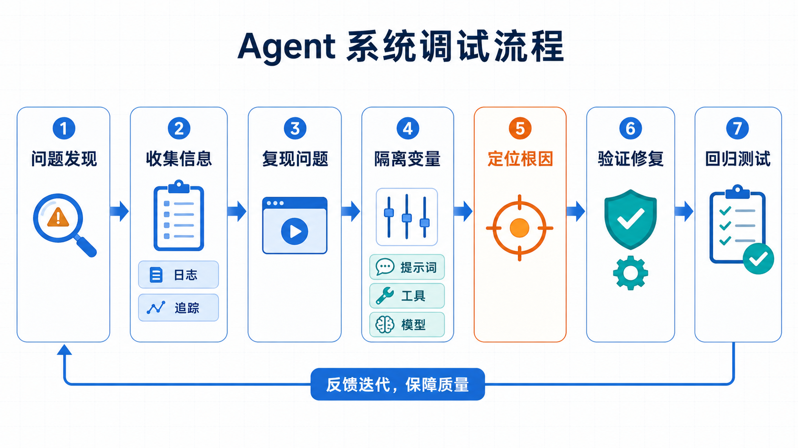

## 知识点讲解



### 1. 核心概念

Agent 调试和传统软件调试有一个根本性的区别：传统软件是确定性的，同样的输入保证同样的输出；Agent 有 LLM 在里面，同样的输入可能产生不同的输出，而且你不知道为什么。

这意味着 Agent 调试不能靠"设个断点，看变量值"。需要一套不同的思维方式：**把不确定性当成已知条件来设计调试流程**，而不是试图消除它。

Agent 调试的四大挑战：

| 挑战 | 具体表现 | 应对策略 |
| --- | --- | --- |
| 非确定性 | 同一问题有时对有时错 | 多次运行统计，降低 temperature |
| 黑盒性 | LLM 为什么这么决策不透明 | 强制输出推理过程，对比不同 prompt |
| 复杂依赖 | 工具 A 的输出影响 LLM B 的决策 | 隔离变量，逐步排查 |
| 高调试成本 | 每次调试都要调 LLM，烧钱 | 用 mock 工具，用便宜模型先定位 |

### 2. 技术细节

#### 2.1 调试的基本流程

```
1. 收集信息 → 2. 复现问题 → 3. 隔离变量 → 4. 定位根因 → 5. 修复并验证
```

关键是**步骤 3：隔离变量**。Agent 出问题，可能是 prompt 写得不清楚、工具返回格式不对、模型理解偏差、或者多步骤里某一步的中间结果有问题。一次改多个变量，不知道是哪个生效了。

#### 2.2 可调试的 Agent 实现

```python
import json
import uuid
import time
from typing import Any, Dict, List, Optional, Callable
from dataclasses import dataclass, field
from enum import Enum

class StepType(Enum):
    LLM_CALL = "llm_call"
    TOOL_CALL = "tool_call"
    DECISION = "decision"
    OBSERVATION = "observation"

@dataclass
class ExecutionStep:
    """执行步骤的完整记录"""
    step_id: str
    step_type: StepType
    timestamp: float
    input_data: Any
    output_data: Any
    duration_ms: float
    forced: bool = False  # 是否是 mock/强制输入（用于调试）
    error: Optional[str] = None

class DebugAgent:
    """带完整调试能力的 Agent"""
    
    def __init__(self, llm, tools: Dict[str, Callable], verbose: bool = True):
        self.llm = llm
        self.tools = tools
        self.verbose = verbose
        self.execution_trace: List[ExecutionStep] = []
    
    def run(self, query: str, debug_config: Optional[Dict] = None) -> str:
        """
        运行 Agent，支持调试配置
        debug_config 示例：
        {
            "mock_tools": {"web_search": "预设的搜索结果"},
            "force_actions": ["web_search('AI市场规模')", "FINISH"],
            "temperature": 0,  # 降低随机性
            "max_steps": 5
        }
        """
        debug_config = debug_config or {}
        trace_id = str(uuid.uuid4())
        
        self._log(f"=== 开始执行 [trace_id: {trace_id[:8]}] ===")
        self._log(f"查询: {query}")
        
        mock_tools = debug_config.get("mock_tools", {})
        force_actions = debug_config.get("force_actions", [])
        max_steps = debug_config.get("max_steps", 15)
        
        state = {"query": query, "history": []}
        step_count = 0
        
        while step_count < max_steps:
            step_count += 1
            self._log(f"\n--- 步骤 {step_count} ---")
            
            # 决定这一步的行动（LLM 决策 or 强制指定）
            if force_actions and step_count <= len(force_actions):
                action_str = force_actions[step_count - 1]
                forced = True
                self._log(f"[调试] 强制行动: {action_str}")
            else:
                action_str, llm_duration = self._llm_decide(state, debug_config)
                forced = False
                
                # 记录 LLM 调用
                self.execution_trace.append(ExecutionStep(
                    step_id=str(uuid.uuid4()),
                    step_type=StepType.LLM_CALL,
                    timestamp=time.time(),
                    input_data={"state_summary": str(state)[:200]},
                    output_data=action_str,
                    duration_ms=llm_duration,
                    forced=False
                ))
            
            self._log(f"行动: {action_str}")
            
            # 检查是否完成
            if action_str.strip().upper().startswith("FINISH"):
                result = action_str.replace("FINISH:", "").strip()
                self._log(f"任务完成，结果: {result}")
                return result
            
            # 解析并执行工具调用
            tool_name, tool_input = self._parse_action(action_str)
            
            if tool_name not in self.tools and tool_name not in mock_tools:
                observation = f"错误：工具 '{tool_name}' 不存在，可用工具: {list(self.tools.keys())}"
                self._log(f"[错误] {observation}")
            elif tool_name in mock_tools:
                # 用 mock 结果替代真实工具（调试用）
                observation = mock_tools[tool_name]
                self._log(f"[Mock] 工具 {tool_name} 返回预设结果")
            else:
                # 调用真实工具
                start = time.time()
                try:
                    observation = self.tools[tool_name](tool_input)
                except Exception as e:
                    observation = f"工具执行出错: {e}"
                duration = (time.time() - start) * 1000
                
                self.execution_trace.append(ExecutionStep(
                    step_id=str(uuid.uuid4()),
                    step_type=StepType.TOOL_CALL,
                    timestamp=time.time(),
                    input_data={"tool": tool_name, "input": tool_input},
                    output_data=observation,
                    duration_ms=duration,
                    forced=forced
                ))
            
            self._log(f"观察: {str(observation)[:300]}")
            
            # 更新状态
            state["history"].append({
                "action": action_str,
                "observation": observation
            })
        
        return f"达到最大步数 {max_steps}，未完成任务"
    
    def _llm_decide(self, state: dict, config: dict):
        """调用 LLM 决策"""
        start = time.time()
        # 实际调用 LLM，这里省略具体实现
        response = self.llm.complete(self._build_prompt(state))
        duration = (time.time() - start) * 1000
        return response.text, duration
    
    def _build_prompt(self, state: dict) -> str:
        history_text = "\n".join([
            f"行动: {h['action']}\n观察: {h['observation']}"
            for h in state["history"][-5:]  # 只保留最近 5 条
        ])
        return f"查询: {state['query']}\n\n历史:\n{history_text}\n\n下一步行动:"
    
    def _parse_action(self, action_str: str):
        """解析 'tool_name(input)' 格式"""
        import re
        match = re.match(r'(\w+)\((.+)\)', action_str.strip())
        if match:
            return match.group(1), match.group(2)
        return "unknown", action_str
    
    def print_trace(self) -> None:
        """打印完整执行追踪（调试用）"""
        print("\n=== 执行追踪 ===")
        for i, step in enumerate(self.execution_trace, 1):
            print(f"\n[{i}] {step.step_type.value} | {step.duration_ms:.0f}ms"
                  f"{'(强制)' if step.forced else ''}")
            print(f"  输入: {json.dumps(step.input_data, ensure_ascii=False)[:200]}")
            print(f"  输出: {str(step.output_data)[:200]}")
            if step.error:
                print(f"  错误: {step.error}")
    
    def _log(self, msg: str) -> None:
        if self.verbose:
            print(msg)


# ---- 使用示例：调试一个失败的场景 ----

def debug_failing_case():
    """
    场景：Agent 本来应该搜索 'AI市场规模' 然后算增长，
    但实际上工具选错了，用了 calculator 而不是 web_search
    """
    
    agent = DebugAgent(
        llm=your_llm,
        tools={
            "web_search": lambda q: f"搜索 '{q}' 的结果...",
            "calculator": lambda expr: str(eval(expr))
        }
    )
    
    # 正常运行（可能工具选错）
    print("=== 正常运行 ===")
    agent.run("2024年AI市场规模是多少？增长20%后是多少？")
    agent.print_trace()
    
    # 调试运行：强制指定行动，验证每一步的输出
    print("\n=== 调试运行（强制行动） ===")
    debug_agent = DebugAgent(llm=your_llm, tools={
        "web_search": lambda q: f"2024年AI市场规模约2000亿美元",
        "calculator": lambda expr: str(eval(expr))
    })
    
    result = debug_agent.run(
        "2024年AI市场规模是多少？增长20%后是多少？",
        debug_config={
            "force_actions": [
                "web_search(2024年AI市场规模)",       # 强制第1步用搜索
                "calculator(2000 * 1.2)",              # 强制第2步用计算器
                "FINISH: 2024年约2000亿，增长后约2400亿"
            ]
        }
    )
```

#### 2.3 常见问题的调试方法

| 问题类型 | 诊断步骤 | 常见根因 |
| --- | --- | --- |
| 工具被误选 | 打印 LLM 的完整输出，查看 Thought | 工具描述不清晰，或相似工具让 LLM 混淆 |
| 无限循环 | 检查状态更新逻辑，看每次循环状态是否有变化 | 完成条件不明确，或工具返回了无用信息 |
| 中间结果丢失 | 打印每步 State，确认关键字段是否正确传递 | State 字段拼写错误，或更新时漏掉字段 |
| 成本异常 | 查看 token 计数，找出哪次调用的 prompt 特别长 | Context 没有截断，把全量历史都传了进去 |

### 3. 对比与拓展

降低调试成本的核心手段：用 mock 工具替代真实工具调用（不花 API 费用），用便宜的模型（GPT-4o-mini）先定位问题类型，确认是 prompt 问题还是工具问题，再用强模型验证。

## 面试怎么答

Agent 调试的核心挑战是 LLM 的非确定性——同样的输入有时对有时错，不能像传统软件一样打断点复现。我的调试思路是分步骤隔离：先复现失败（多跑几次，确认是稳定失败还是偶发），再隔离变量（是 prompt 的问题、还是工具的问题、还是某个中间步骤的输出格式有问题）。

关键的工程实践是把 Agent 设计成可调试的：完整的执行追踪（每步输入输出都有记录）、支持 mock 工具（用预设结果替代真实工具调用，零成本复现）、支持强制行动（指定某步的行动是什么，验证后续行为）。有了这些能力，调试才有抓手。

成本控制也很重要——每次调试都真的调 GPT-4 会很贵。实践上先用 mock 工具确认调试思路，用便宜模型缩小问题范围，最后才用正式模型验证修复。

## 高频追问 & 加分点

- **Q1：如何提高 Agent 结果的可复现性？**  
    三个手段：降低 temperature（到 0 完全确定性）；在 prompt 里给出格式严格的 few-shot 示例；工具调用结果缓存（同样的搜索词返回同样的结果）。这三个结合，虽然不能 100% 消除非确定性，但能让绝大多数情况下结果稳定可预期，方便回归测试。
- **Q2：如何用单元测试覆盖 Agent 的关键路径？**  
    核心是 mock LLM。给 LLM 调用写一个 mock，让它按你的预期返回固定的 action；然后验证工具是否被正确调用、State 是否被正确更新、最终输出是否符合预期。这样不调真实 LLM，测试速度快、成本低、结果确定。真实 LLM 的测试留给集成测试，占比 10-20%。
- **Q3：Agent 出现"无限循环"如何快速定位？**  
    先看执行追踪，找是否有重复的步骤序列（比如一直在调用 web_search）。然后看两个方向：状态是否在更新（每次循环后 State 里的字段有没有变化）；观察结果是否提供了有效信息（如果工具总是返回"未找到"，LLM 可能不知道怎么推进）。通常是这两种情况之一，对应的修复是加状态检查或改工具返回格式。
- **Q4：线上的 Agent 出了问题，怎么快速定位而不影响用户？**  
    靠可观测性：trace_id 贯穿整个执行链路，出了问题能从日志系统搜到完整链路；关键的中间状态要记录（不只是输入输出，还有每步的 token 数、延迟、工具选择）。定位后，要有"快速止血"的能力：能关闭某个出问题的工具（功能降级），能对特定类型请求触发人工审核，而不是让有问题的请求继续跑。
- **Q5：如何建立 Agent 的回归测试？**  
    维护一个"黄金测试集"：覆盖核心场景的输入，以及对应的预期输出（不一定是完全一致，可以是关键内容检查）。每次修改 Agent（改 prompt、改工具、换模型）都跑一遍测试集，对比通过率。通过率下降说明修改引入了退步。这比单次测试有效得多——一次对不代表总是对，回归测试发现的是稳定性问题。
