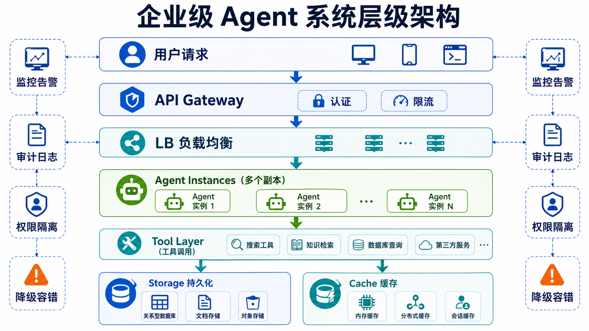

## 知识点讲解



### 1. 核心概念

企业级系统和个人玩具项目的本质区别只有一条：**可靠性和可维护性要排在功能完整性前面**。功能不够后面加，系统烂了就很难救。

我习惯用一句话描述企业级 Agent 系统的设计目标：

**7×24 跑得起来、出了问题能快速恢复、成本算得清楚、数据不能混。**

具体落下来，五个原则：

- **可靠性第一**：故障要自动恢复或优雅降级，不能靠人盯着
- **成本可控**：每个请求都有 token 预算，有监控，能报警
- **安全隔离**：多租户之间数据严格隔离，不同用户的 quota 独立
- **可观测性**：每个请求可追踪，性能瓶颈可定位
- **可维护性**：代码和流程要让接手的人能读懂

### 2. 技术细节

#### 2.1 分层架构

企业级 Agent 系统通常分五层，层与层之间职责清晰、可以独立扩展：

```
API 层       ← 请求接入、认证、限流、日志
    ↓
编排层       ← 工作流管理（LangGraph / 自研 DAG）
    ↓
Agent 层     ← 单个 Agent 实现（ReAct / Plan-and-Execute）
    ↓
工具层       ← 对接外部系统（数据库、API、文件系统）
    ↓
存储层       ← 状态、日志、缓存（Redis + PostgreSQL）
```

**分层的好处**：API 层扛高并发可以单独扩容；工具层加新工具不影响 Agent 层；存储层换方案不用动业务逻辑。

#### 2.2 关键组件清单

| 组件 | 职责 | 常见技术选型 |
| --- | --- | --- |
| API Gateway | 请求限流、认证、全链路日志 | Kong、Nginx、AWS ALB |
| Workflow Engine | 编排多 Agent 协作 | LangGraph、自研 |
| Agent Pool | 管理 Agent 实例生命周期 | 自研或 K8s Job |
| Tool Registry | 注册、路由、权限管理工具 | 自研 |
| State Store | 保存 Agent 跨步骤状态 | Redis（短期）+ PostgreSQL（长期） |
| Message Queue | 异步任务、解耦 Agent 调用链 | Kafka、RabbitMQ |
| Observability | 监控、日志、链路追踪 | Prometheus + ELK + Jaeger |

#### 2.3 三个核心设计决策

**① 同步 vs 异步**

Agent 任务通常耗时 5-60 秒，直接同步等待对用户体验很差。我一般的做法是：立即返回任务 ID，用 WebSocket 或轮询推送进度。任务本身扔进消息队列异步处理。

**② 单 Agent vs 多 Agent**

单 Agent 够用的时候别乱上多 Agent，复杂度会指数上升。判断标准：任务是否可以自然拆分成几个独立子领域、子任务间依赖关系是否清晰。清晰了再拆，不清晰先跑通单 Agent。

**③ 状态存哪里**

短期状态（当前步骤、工具调用结果）放 Redis，TTL 设 1-2 小时；长期状态（任务历史、用户记忆）写 PostgreSQL，方便查询和审计。两层分开，不要全塞 Redis 省事。

## 代码示例

下面这段是企业级 Agent 的核心执行骨架，重点是**限流 + 熔断 + 指标采集**三件套同时在场：

```python
import asyncio
from dataclasses import dataclass, field
from typing import Any, Optional
import time

@dataclass
class AgentRequest:
    user_id: str
    task_type: str
    payload: dict
    priority: int = 1  # 0=high, 1=medium, 2=low

class TokenBucket:
    """令牌桶限流：允许突发，适合 Agent 场景"""
    def __init__(self, capacity: int, refill_rate: float):
        self.capacity = capacity
        self.tokens = capacity
        self.refill_rate = refill_rate  # tokens per second
        self.last_refill = time.time()

    def allow(self, user_id: str, cost: int = 1) -> bool:
        now = time.time()
        elapsed = now - self.last_refill
        self.tokens = min(self.capacity, self.tokens + elapsed * self.refill_rate)
        self.last_refill = now

        if self.tokens >= cost:
            self.tokens -= cost
            return True
        return False

class CircuitBreaker:
    """熔断器：防止级联故障"""
    CLOSED = "CLOSED"
    OPEN = "OPEN"
    HALF_OPEN = "HALF_OPEN"

    def __init__(self, failure_threshold: int = 5, timeout: int = 60):
        self.failure_threshold = failure_threshold
        self.timeout = timeout
        self.failure_count = 0
        self.last_failure_time = 0
        self.state = self.CLOSED

    def is_available(self) -> bool:
        if self.state == self.OPEN:
            if time.time() - self.last_failure_time > self.timeout:
                self.state = self.HALF_OPEN
                return True
            return False
        return True

    def record_success(self):
        self.failure_count = 0
        self.state = self.CLOSED

    def record_failure(self):
        self.failure_count += 1
        self.last_failure_time = time.time()
        if self.failure_count >= self.failure_threshold:
            self.state = self.OPEN

class MetricsCollector:
    """轻量指标采集，生产里对接 Prometheus"""
    def __init__(self):
        self.counters: dict[str, int] = {}
        self.latencies: dict[str, list[float]] = {}

    def inc(self, key: str, delta: int = 1):
        self.counters[key] = self.counters.get(key, 0) + delta

    def record_latency(self, key: str, latency_ms: float):
        self.latencies.setdefault(key, []).append(latency_ms)

    def p99(self, key: str) -> Optional[float]:
        vals = sorted(self.latencies.get(key, []))
        if not vals:
            return None
        return vals[int(len(vals) * 0.99)]

class EnterpriseAgent:
    def __init__(self):
        self.rate_limiter = TokenBucket(capacity=100, refill_rate=10)
        self.circuit_breaker = CircuitBreaker(failure_threshold=5, timeout=60)
        self.metrics = MetricsCollector()

    async def run(self, request: AgentRequest) -> dict:
        # 1. 限流检查
        if not self.rate_limiter.allow(request.user_id):
            self.metrics.inc("rate_limit_exceeded")
            return {"error": "rate_limit_exceeded", "retry_after": 5}

        # 2. 熔断检查
        if not self.circuit_breaker.is_available():
            self.metrics.inc("circuit_open")
            return await self._fallback(request)

        start = time.time()
        try:
            result = await self._execute(request)
            self.circuit_breaker.record_success()
            self.metrics.inc(f"success.{request.task_type}")
            return result
        except Exception as e:
            self.circuit_breaker.record_failure()
            self.metrics.inc(f"failure.{request.task_type}")
            # 失败不崩溃，走降级
            return await self._fallback(request)
        finally:
            latency_ms = (time.time() - start) * 1000
            self.metrics.record_latency(request.task_type, latency_ms)

    async def _execute(self, request: AgentRequest) -> dict:
        # 真正的 Agent 执行逻辑在这里
        await asyncio.sleep(0.1)  # 模拟 LLM 调用
        return {"status": "success", "result": "..."}

    async def _fallback(self, request: AgentRequest) -> dict:
        # 降级策略：返回缓存/简化结果/提示用户稍后再试
        self.metrics.inc("fallback_triggered")
        return {"status": "degraded", "message": "服务繁忙，已返回简化结果"}
```

## 面试怎么答

企业级 Agent 系统和个人项目最大的区别不在功能，在**可靠性和可维护性**。我设计时会先定五个目标：7×24 可用、成本可见、数据隔离、全链路可观测、代码可维护——这五个对齐了，技术方案才好选。

架构上分五层：API 层做限流认证，编排层管工作流，Agent 层跑具体逻辑，工具层对接外部系统，存储层分短期（Redis）和长期（PostgreSQL）两块。层与层职责清晰，扩容和换方案互不影响。

执行层有三件套必须在场：**令牌桶限流**（防止用户滥用）、**熔断器**（防止级联故障）、**指标采集**（支撑告警和优化）。三个少一个都会在生产里踩坑。

任务模型我习惯做成异步的——用户请求返回 task_id，后台异步跑，用 WebSocket 推送进度。Agent 跑几十秒是常态，同步等着用户体验会很差。多 Agent 要克制，能单 Agent 搞定的别拆，拆了复杂度很难降回来。

## 高频追问 & 加分点

- **Q1：多租户隔离怎么做？**  
    数据层按 user_id 分区，Redis 的 key 加命名空间前缀；quota 独立计算、独立告警。敏感场景上 VPC 隔离、加密存储。别光靠应用层隔离，数据库层也要有权限控制。
- **Q2：怎么保证 7×24 高可用？**  
    三板斧：多副本部署（至少两 AZ）、健康检查 + 自动摘除故障实例、熔断 + 降级。LLM 服务挂了不能导致整个系统挂，一定要有 fallback 路径。
- **Q3：Agent 系统的成本怎么做预算和管控？**  
    每个请求估算 token 用量，跑之前做预算检查；跑完记录实际消耗；对账差异超阈值告警。用户级和系统级都要有 quota，缺一个都会被刷。
- **Q4：工具调用失败怎么处理？**  
    分级处理：单次失败先重试（最多 2-3 次），重试还失败换备用工具或走降级，整条链路超过失败阈值触发熔断。关键工具调用要记审计日志，方便事后复盘。
- **Q5：可观测性具体要做哪些？**  
    四层：Trace（全链路追踪，trace_id 贯穿整个请求）、Metric（成功率/延迟/token 成本）、Log（结构化 JSON，方便聚合）、Alert（异常延迟、错误率、成本超支自动报警）。生产里用 Prometheus + Jaeger + ELK 组合基本够用。
- **Q6：什么时候考虑上微服务拆分？**  
    单体 Agent 服务日调用量到百万级、或者不同业务模块的部署频率/扩容需求差异很大的时候，才值得拆。过早拆微服务会让运维复杂度暴增，Agent 系统的网络跳数本来就多，别再人为加跳了。
