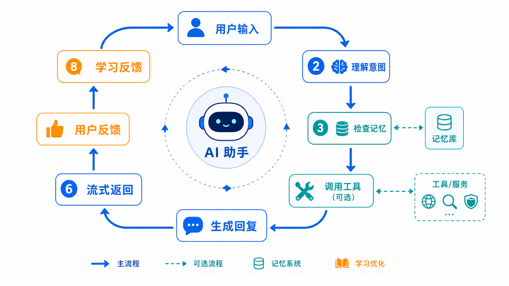

## 知识点讲解



### 1. 核心概念

AI 助理和 Agent 的核心区别在于**交互方式**：Agent 强调自主执行任务，尽量少打扰人；Assistant 强调和用户一起完成任务，用户全程可以介入和修正。

设计 AI 助理产品，绕不开一个词：**信任**。用户愿不愿意长期用，取决于他信不信这个产品——信它的能力、信它的安全、信它不会乱来。

产品层面，四个核心设计原则：

- **响应性**：用户体感不能卡，首 token 延迟目标 &lt;500ms，超过 1s 要给进度反馈
- **可预测性**：相似问题输出不能差太多，让用户建立预期
- **学习性**：能记住用户的偏好、历史、常用信息
- **可控性**：用户随时能打断、修正、重试，不能让用户感觉系统在"失控"

### 2. 技术细节

#### 2.1 能力分层

AI 助理的能力可以按成本和风险分四层，从下往上叠加：

| 层级 | 能力 | Token 成本 | 业务风险 |
| --- | --- | --- | --- |
| 基础层 | 文本生成、FAQ 问答 | 低 | 低 |
| 增强层 | RAG 知识库集成、个性化召回 | 中 | 低 |
| 智能层 | 工具调用、流程自动化 | 高 | 中 |
| 自主层 | 完整 Agent、多步骤自动执行 | 很高 | 高 |

实际产品不需要一上来就做到第四层。把基础层做稳、增强层做准，80% 场景就能覆盖了。

#### 2.2 关键体验指标

| 指标 | 含义 | 目标值 |
| --- | --- | --- |
| TTFT（首 token 延迟） | 用户提问到看见第一个字的时间 | &lt;500ms |
| 端到端延迟 | 完整回答生成时间 | 根据内容长度，P95 &lt;8s |
| 自助解决率 | 不需要转人工就解决的比例 | >70% |
| 用户满意度（CSAT） | 对话后用户主动评分 | >80% |
| 留存率 | 7 日/30 日回来再用的比例 | 核心产品指标 |

#### 2.3 记忆系统设计

AI 助理要"记住"用户，有四类记忆要处理：

1. **短期记忆（Session Memory）**：当前对话上下文，放在 LLM context window 里，对话结束就清
2. **长期记忆（Long-term Memory）**：用户的偏好、历史结论、常用信息，存向量库 + 摘要
3. **工作记忆（Working Memory）**：当前任务的中间状态，Redis 短存
4. **外部记忆（External Memory）**：用户连接的知识库、文档，RAG 检索

长期记忆的挑战是**写入时机**：不能每轮对话都写，信噪比会很低。我一般的策略是：对话结束时由 LLM 提取 2-3 条"值得记住的事实"，打分后写入。

## 代码示例

下面是 AI 助理的核心对话流程，重点展示**流式输出 + 记忆管理 + 成本追踪**三块：

```python
import asyncio
import hashlib
import time
from typing import AsyncIterator, Optional
from dataclasses import dataclass, field

@dataclass
class UserProfile:
    user_id: str
    preferences: dict = field(default_factory=dict)
    long_term_memories: list = field(default_factory=list)
    session_budget_tokens: int = 50000  # 每日 token 预算

class ConversationMemory:
    """短期记忆：管理当前会话上下文"""
    def __init__(self, max_turns: int = 20, max_tokens: int = 8000):
        self.turns: list[dict] = []
        self.max_turns = max_turns
        self.max_tokens = max_tokens

    def add_turn(self, role: str, content: str, tokens: int):
        self.turns.append({"role": role, "content": content, "tokens": tokens})
        self._trim()

    def _trim(self):
        """超出限制时，删最早的几轮，但保留 system prompt"""
        while len(self.turns) > self.max_turns:
            self.turns.pop(1)  # 保留 index 0 的 system prompt

    def to_messages(self) -> list[dict]:
        return [{"role": t["role"], "content": t["content"]} for t in self.turns]

class CostTracker:
    """实时成本追踪，超预算前告警"""
    PRICE_PER_1K_INPUT = 0.0005   # $0.0005 / 1k input tokens
    PRICE_PER_1K_OUTPUT = 0.0015  # $0.0015 / 1k output tokens

    def __init__(self):
        self.daily_usage: dict[str, dict] = {}

    def record(self, user_id: str, input_tokens: int, output_tokens: int) -> float:
        cost = (input_tokens / 1000) * self.PRICE_PER_1K_INPUT + \
               (output_tokens / 1000) * self.PRICE_PER_1K_OUTPUT
        if user_id not in self.daily_usage:
            self.daily_usage[user_id] = {"tokens": 0, "cost": 0.0}
        self.daily_usage[user_id]["tokens"] += input_tokens + output_tokens
        self.daily_usage[user_id]["cost"] += cost
        return cost

    def exceeded_budget(self, user_id: str, budget_usd: float = 1.0) -> bool:
        return self.daily_usage.get(user_id, {}).get("cost", 0) >= budget_usd

class MemoryExtractor:
    """对话结束后提取值得长期记忆的信息"""
    async def extract(self, turns: list[dict], llm_client) -> list[str]:
        if len(turns) < 4:  # 太短的对话不值得提取
            return []

        conversation_text = "\n".join(
            f"{t['role']}: {t['content']}" for t in turns[-10:]
        )
        prompt = f"""从以下对话中提取 1-3 条关于用户的重要信息（偏好、需求、背景）。
只提取明确的信息，不要猜测。如果没有值得记录的，返回空列表。
格式：每条信息一行，不加序号。

对话：
{conversation_text}"""

        # 实际调用 LLM，这里用注释代替
        # response = await llm_client.generate(prompt)
        # return [line.strip() for line in response.strip().split('\n') if line.strip()]
        return []  # 占位

class AIAssistant:
    def __init__(self, llm_client=None):
        self.llm = llm_client
        self.cost_tracker = CostTracker()
        self.memory_extractor = MemoryExtractor()
        self.sessions: dict[str, ConversationMemory] = {}
        self.profiles: dict[str, UserProfile] = {}

    def _get_or_create_session(self, user_id: str) -> ConversationMemory:
        if user_id not in self.sessions:
            self.sessions[user_id] = ConversationMemory()
        return self.sessions[user_id]

    def _build_system_prompt(self, profile: UserProfile) -> str:
        base = "你是一个专业的 AI 助理，简洁、准确、有帮助。"
        if profile.long_term_memories:
            memories = "\n".join(f"- {m}" for m in profile.long_term_memories[-10:])
            base += f"\n\n关于用户的背景信息：\n{memories}"
        return base

    async def chat_stream(
        self, user_id: str, message: str
    ) -> AsyncIterator[str]:
        """主对话接口：流式输出，低首 token 延迟"""

        # 1. 预算检查
        if self.cost_tracker.exceeded_budget(user_id):
            yield "今日用量已达上限，明天再来吧～"
            return

        # 2. 取用户档案和会话记忆
        profile = self.profiles.setdefault(user_id, UserProfile(user_id=user_id))
        session = self._get_or_create_session(user_id)

        # 3. 组装 messages（system + 历史 + 当前）
        system_prompt = self._build_system_prompt(profile)
        if not session.turns:
            session.add_turn("system", system_prompt, tokens=len(system_prompt) // 4)
        session.add_turn("user", message, tokens=len(message) // 4)

        messages = session.to_messages()

        # 4. 流式生成（模拟）
        # 实际：async for chunk in self.llm.stream(messages): yield chunk.text
        full_response = ""
        mock_response = "这是助理的回复，会逐 token 流式推送给用户，首字符延迟极低。"
        for char in mock_response:
            yield char
            full_response += char
            await asyncio.sleep(0.01)  # 模拟流速

        # 5. 记录本轮到会话记忆
        output_tokens = len(full_response) // 4
        session.add_turn("assistant", full_response, tokens=output_tokens)

        # 6. 成本记录（异步，不阻塞流式）
        input_tokens = sum(t["tokens"] for t in session.turns)
        self.cost_tracker.record(user_id, input_tokens, output_tokens)

    async def end_session(self, user_id: str):
        """会话结束时提取长期记忆"""
        session = self.sessions.get(user_id)
        if not session:
            return
        new_memories = await self.memory_extractor.extract(session.turns, self.llm)
        if user_id in self.profiles:
            self.profiles[user_id].long_term_memories.extend(new_memories)
        # 清理短期会话
        del self.sessions[user_id]
```

## 面试怎么答

AI 助理产品设计的核心词只有一个：**信任**。用户信任助理的能力才会长期用，信任数据安全才会敢于分享个人信息，信任系统稳定才不会被一次超时吓跑。所有设计决策都绕这个词转。

体验上三个必须做好的：**流式输出**（首 token 延迟要控制在 500ms 内，用户感知很敏感）、**记忆管理**（短期记忆放上下文窗口，长期记忆用向量库+LLM 提取，两层分开）、**可中断可修正**（用户随时能打断、重新表述，系统不能卡着等）。

成本方面，我一般做两层控制：单个请求的 token 预算检查（跑之前估算）+ 用户每日 quota（跑完记账）。缺一个都会被刷。流式输出同时做成本实时累计，快要超预算时提前告警或截断，不能等跑完再算。

记忆系统容易踩的坑是写太多——每轮都提取、什么都存，很快噪声就会盖过有效信息。我的策略是对话结束时才触发提取，LLM 只提取 1-3 条"明确的用户背景信息"，打低分的就丢弃。

## 高频追问 & 加分点

- **Q1：首 token 延迟怎么压到 500ms 以内？**  
    两条路：一是用更快的模型（在质量和速度之间取平衡），二是做 prompt 缓存（把 system prompt 前缀缓存在 LLM 侧，Anthropic 的 prompt caching 命中率到 60%+ 时效果很显著）。另外，用户打字过程中可以提前做 RAG 检索，等用户按发送时上下文已经准备好了。
- **Q2：用户的个性化偏好怎么学习？**  
    分显式和隐式两种。显式：用户直接告诉你的偏好（"我喜欢简短回答"）直接存。隐式：从用户行为推断——用户反复点"重新生成"说明不满意，点"有帮助"说明满意，这些信号都可以用来调整输出风格。别太激进，慢慢迭代。
- **Q3：如何处理敏感数据和隐私？**  
    原则是**最小化采集**：只存完成功能必须的数据，不要图方便什么都存。存储加密，传输用 HTTPS/TLS。让用户可以查看、导出、删除自己的数据，这是合规的底线，也是建立信任的基础。
- **Q4：AI 助理 vs 搜索引擎，设计上有什么核心差别？**  
    搜索引擎返回文档列表，用户自己综合；助理直接给答案，用户期望的是"帮我想好了"。这意味着助理对准确性的要求更高（用户不会自己再核实），对个性化的要求更强（相同问题不同人可能需要不同深度的答案）。设计评估指标时要把"准确性"和"适配性"都纳入，不能只看用户满意度。
- **Q5：产品冷启动阶段记忆系统怎么做？**  
    新用户没有历史数据，长期记忆是空的。冷启动可以做两件事：一是在引导流程里问几个关键问题（职业、使用场景、偏好风格），显式初始化用户档案；二是用行业通用的偏好模板兜底，等积累足够数据后再用个性化的覆盖。
