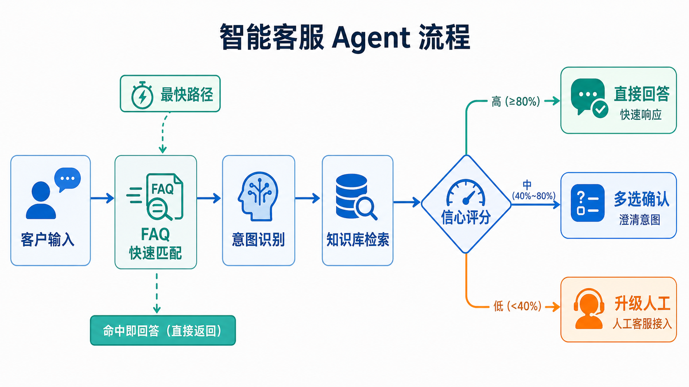

## 知识点讲解



### 1. 核心概念

智能客服系统的设计，本质上是在**成本和用户体验**之间找平衡点。让所有问题走人工，体验好但成本高；让所有问题走 AI，成本低但容易翻车。

一个经过验证的平衡点是：**自助解决率 70-80%**。这意味着大多数标准问题 AI 处理，少数复杂问题或负面情绪场景升级人工。这个比例在大多数 ToC 产品里是可以实现的。

核心工作流分三层：

- **自助解决层**：识别常见问题，直接给答案（FAQ 匹配 + RAG）
- **辅助解决层**：推荐相关知识，用户选择，或 AI 给草稿让客服修改后发送
- **人工升级层**：无法自动解决时转人工，带上完整上下文

关键指标：

| 指标 | 含义 | 目标值 |
| --- | --- | --- |
| 自助解决率 | AI 独立解决，不需要人工 | 70-80% |
| 首次解决率 | 一次对话就解决，不需要追问 | >60% |
| 客户满意度（CSAT） | 用户主动打分 | >80% |
| 平均处理时间 | 从提问到解决的总时长 | &lt;5min |
| 升级率 | 转人工的比例 | &lt;30% |

### 2. 技术细节

#### 2.1 核心决策流水线

```
客户输入
    ↓
① FAQ 快速匹配（规则 + 相似度，最便宜）
    ├─ 命中（置信度 > 0.95）→ 直接返回
    └─ 未命中 ↓
② 意图识别（轻量分类器或小模型）
    ↓
③ 知识库 RAG 检索（向量 + BM25 混合）
    ↓
④ 置信度评分
    ├─ 高（>0.8）→ AI 直接回答
    ├─ 中（0.5-0.8）→ 展示候选答案，用户确认
    └─ 低（<0.5）→ 升级人工 / 创建工单
```

**为什么第一步要先走 FAQ 而不是直接走 LLM？**  
成本和速度。FAQ 命中是毫秒级、几乎零成本；一次 LLM 调用至少几百毫秒 + 几分钱。对于重复度高的问题（退款政策、密码重置……），先过 FAQ 能省掉 40-60% 的 LLM 调用。

#### 2.2 知识库组织策略

| 知识类型 | 特点 | 检索方式 |
| --- | --- | --- |
| FAQ（常见问题） | 高频、标准化 | 精确匹配 + 语义相似度 |
| 产品知识 | 结构化、更新频繁 | RAG（分块 + 向量检索） |
| 故障排除 | 步骤化、场景多 | RAG + 结构化规则 |
| 政策规则 | 严格、不能出错 | 精确匹配，不走 LLM 生成 |

政策类问题（退款标准、隐私条款）不建议让 LLM 直接生成答案，容易幻觉出"35天无理由退换"这种不存在的政策，引发客诉。检索到原文后直接展示，或让 LLM 只做格式化不做内容修改。

#### 2.3 升级规则设计

升级判断要综合多个信号，不能只看置信度：

- **内容信号**：涉及退款 / 投诉 / 赔偿 / 法律，强制升级
- **情绪信号**：检测到负面情绪（"太差了"、"投诉"、"曝光"），优先升级
- **轮次信号**：同一问题超过 3 轮还没解决，触发升级
- **用户信号**：用户主动要求人工，立即执行

## 代码示例

```python
import asyncio
from dataclasses import dataclass, field
from typing import Optional
from enum import Enum

class EscalationReason(Enum):
    LOW_CONFIDENCE = "low_confidence"
    SENSITIVE_TOPIC = "sensitive_topic"
    NEGATIVE_EMOTION = "negative_emotion"
    USER_REQUESTED = "user_requested"
    TOO_MANY_TURNS = "too_many_turns"

@dataclass
class ConversationContext:
    customer_id: str
    session_id: str
    turns: int = 0
    unresolved_turns: int = 0  # 连续未解决轮次

class FAQMatcher:
    """第一道关卡：快速匹配常见问题"""
    def __init__(self):
        # 实际用向量库 + BM25
        self.faq_db: dict[str, str] = {
            "怎么退款": "订单页面点击申请退款，3个工作日到账。",
            "忘记密码": "点击登录页的'忘记密码'，用手机号验证后重置。",
        }

    def match(self, query: str) -> Optional[tuple[str, float]]:
        """返回 (answer, confidence)，未命中返回 None"""
        for pattern, answer in self.faq_db.items():
            if pattern in query:
                return answer, 0.97
        # 实际还有语义相似度检索，这里简化
        return None

class IntentClassifier:
    """意图分类：用小模型，不用大模型，省成本"""
    SENSITIVE_INTENTS = {"refund_complaint", "legal_threat", "data_privacy"}

    def classify(self, query: str) -> tuple[str, float]:
        """返回 (intent, confidence)"""
        # 实际调用分类器，这里用关键词模拟
        if any(kw in query for kw in ["投诉", "举报", "曝光", "律师"]):
            return "complaint", 0.95
        if any(kw in query for kw in ["退款", "退钱", "赔偿"]):
            return "refund_request", 0.90
        return "general_inquiry", 0.70

    def is_sensitive(self, intent: str) -> bool:
        return intent in self.SENSITIVE_INTENTS or "complaint" in intent

class EmotionDetector:
    """情绪检测：负面情绪提前升级，别让用户等到火大"""
    NEGATIVE_SIGNALS = ["太差", "垃圾", "骗人", "投诉", "退钱", "曝光", "差评"]

    def is_negative(self, text: str) -> bool:
        return any(signal in text for signal in self.NEGATIVE_SIGNALS)

class KnowledgeRetriever:
    """RAG 检索：向量 + BM25 混合召回，重排序"""
    async def search(self, query: str, intent: str, top_k: int = 3) -> list[dict]:
        # 实际调用向量库 + BM25，这里模拟返回
        await asyncio.sleep(0.05)  # 模拟检索延迟
        return [
            {"content": f"关于'{intent}'的知识片段", "score": 0.85},
        ]

class TicketSystem:
    async def create_ticket(self, customer_id: str, query: str,
                            reason: EscalationReason, context: dict) -> str:
        ticket_id = f"TICKET_{customer_id}_{int(asyncio.get_event_loop().time())}"
        # 实际写工单系统
        print(f"[工单创建] {ticket_id}: {reason.value}")
        return ticket_id

class CustomerServiceAgent:
    def __init__(self):
        self.faq = FAQMatcher()
        self.intent_cls = IntentClassifier()
        self.emotion = EmotionDetector()
        self.kb = KnowledgeRetriever()
        self.ticket = TicketSystem()

    async def handle(self, ctx: ConversationContext, query: str) -> dict:
        ctx.turns += 1

        # Step 1: 负面情绪检测（早于一切，避免用户等太久）
        if self.emotion.is_negative(query):
            ticket_id = await self.ticket.create_ticket(
                ctx.customer_id, query, EscalationReason.NEGATIVE_EMOTION,
                context={"turns": ctx.turns, "query": query}
            )
            return {
                "type": "escalate",
                "message": "已为您转接人工客服，稍候 30 秒内有专员接待。",
                "ticket_id": ticket_id,
                "reason": EscalationReason.NEGATIVE_EMOTION.value,
            }

        # Step 2: 用户主动要求人工
        if any(kw in query for kw in ["人工", "真人", "客服"]):
            ticket_id = await self.ticket.create_ticket(
                ctx.customer_id, query, EscalationReason.USER_REQUESTED,
                context={"turns": ctx.turns}
            )
            return {"type": "escalate", "message": "正在为您转接人工客服…",
                    "ticket_id": ticket_id}

        # Step 3: 轮次过多判断
        if ctx.unresolved_turns >= 3:
            ticket_id = await self.ticket.create_ticket(
                ctx.customer_id, query, EscalationReason.TOO_MANY_TURNS,
                context={"turns": ctx.turns}
            )
            return {"type": "escalate",
                    "message": "看起来我没能很好地解答您的问题，已为您安排人工跟进。",
                    "ticket_id": ticket_id}

        # Step 4: FAQ 快速命中
        faq_result = self.faq.match(query)
        if faq_result:
            answer, confidence = faq_result
            ctx.unresolved_turns = 0
            return {"type": "answer", "source": "faq", "confidence": confidence,
                    "message": answer}

        # Step 5: 意图识别
        intent, intent_conf = self.intent_cls.classify(query)
        if self.intent_cls.is_sensitive(intent):
            ticket_id = await self.ticket.create_ticket(
                ctx.customer_id, query, EscalationReason.SENSITIVE_TOPIC,
                context={"intent": intent}
            )
            return {"type": "escalate",
                    "message": "您的问题需要专属客服处理，正在转接…",
                    "ticket_id": ticket_id}

        # Step 6: 知识库 RAG 检索
        kb_results = await self.kb.search(query, intent)
        if not kb_results:
            ctx.unresolved_turns += 1
            return {"type": "unknown", "message": "抱歉暂时没有找到相关信息，"
                    "我已记录您的问题，稍后会有跟进。"}

        top_score = kb_results[0]["score"]

        if top_score > 0.80:
            # 置信度够，直接回答
            ctx.unresolved_turns = 0
            return {"type": "answer", "source": "rag", "confidence": top_score,
                    "message": self._generate_response(kb_results, query)}
        elif top_score > 0.55:
            # 中等置信度，给候选让用户选
            ctx.unresolved_turns += 1
            return {"type": "candidates", "confidence": top_score,
                    "options": [r["content"] for r in kb_results[:3]],
                    "message": "以下几个方向，您看哪个更符合您的问题？"}
        else:
            # 置信度低，升级
            ctx.unresolved_turns += 1
            ticket_id = await self.ticket.create_ticket(
                ctx.customer_id, query, EscalationReason.LOW_CONFIDENCE,
                context={"top_score": top_score}
            )
            return {"type": "escalate",
                    "message": "这个问题我需要帮您转接专业客服来解答。",
                    "ticket_id": ticket_id}

    def _generate_response(self, kb_results: list[dict], query: str) -> str:
        # 实际调用 LLM，基于检索结果生成回答
        return f"根据我们的资料：{kb_results[0]['content']}"
```

## 面试怎么答

智能客服系统的设计核心是找准**成本和体验的平衡点**，经验值是自助解决率 70-80%。这意味着大多数标准问题走 AI，复杂问题和负面情绪场景升级人工。

处理流水线我会这样设计：第一道是 FAQ 快速匹配（规则+相似度），命中就不调 LLM，能省掉将近一半的 LLM 成本；第二道是意图识别（用轻量分类器），过滤敏感意图直接升级；第三道才是 RAG 检索，根据置信度决定直接回答、给候选还是升级人工。

升级规则要综合多个信号，不能只看置信度：涉及退款投诉必升级、检测到负面情绪优先升级、同一问题超过 3 轮未解决触发升级、用户主动要求人工立即响应。这几个规则少一个在生产里都会踩坑。

政策类的问题（退款标准、隐私条款）我不让 LLM 生成答案，检索到原文直接展示，LLM 只做格式化。这类内容一旦幻觉就是客诉，风险太高。

## 高频追问 & 加分点

- **Q1：如何评估智能客服的实际效果？**  
    看四个数：**自助解决率**（AI 独立解决的比例）、**首次解决率**（一次对话解决不追问）、**CSAT 分**（用户评分）、**升级率**（转人工比例）。这四个指标要同时看，只看 CSAT 不看升级率容易被误导。
- **Q2：知识库怎么保持更新？**  
    建立三个通道：①产品变更时触发知识库更新 pipeline；②每周分析"低置信度 query"，人工补充缺失知识；③收集客服接线内容，高频问题自动进入 FAQ 候选。知识库不更新，半年后命中率就会明显下降。
- **Q3：多轮对话怎么保持上下文？**  
    在会话级别维护短期记忆（最近 10 轮），每轮 RAG 检索时把意图 + 前几轮摘要一起带上，让检索更精准。长对话要做摘要压缩，防止 context 超窗口。
- **Q4：如何处理同时涌来的大量咨询（比如大促期间）？**  
    三板斧：**优先级队列**（VIP 客户和已升级工单优先）、**自动扩容**（提前根据流量预测扩 Agent 节点）、**降级策略**（极端情况下 AI 先回"已记录，稍后跟进"，保住不丢单）。
- **Q5：情绪检测误判怎么处理？**  
    误判分两种：该升的没升（漏报，更危险），不该升的升了（误报，多了人工成本）。我倾向于把阈值调得稍松，情绪词多包几个，误报可以接受，漏报代价更大。同时在人工接线后收集反馈，持续优化情绪模型。
