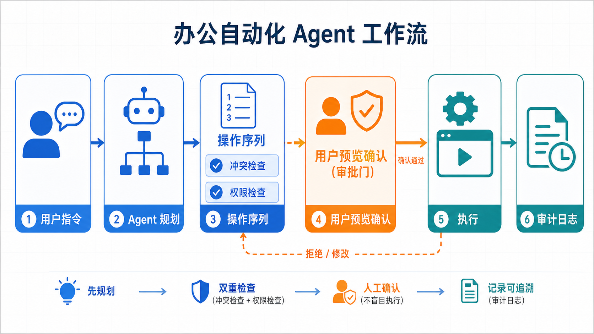

## 知识点讲解



### 1. 核心概念

办公自动化 Agent 最容易踩的坑，是把"自动化程度"当成设计目标。实际上用户真正要的是**可信赖的帮手**——Agent 帮我做了事，我能看到它做了什么、有没有做对、不对的时候能不能撤回。

所以这类系统的设计核心是两个词：**安全**和**审计**。

典型的自动化任务场景：

- 邮件分类、摘要、草稿起草
- 日历管理、会议安排、冲突检测
- 文档起草、格式调整、报告生成
- 任务追踪、截止日期提醒
- 跨系统数据同步和汇总

### 2. 技术细节

#### 2.1 权限分级模型

不是所有操作都需要人工审批，但高风险操作一定要有人在链路上。我习惯用四级权限模型：

| 权限级别 | 典型操作 | 需要人工审批 | 原因 |
| --- | --- | --- | --- |
| L1 只读 | 读邮件、查日历、拉数据 | 否 | 不改变任何状态 |
| L2 推荐 | 生成草稿、建议日程、汇总信息 | 否 | 用户看到后自己决定是否发送 |
| L3 执行 | 发邮件、创建日历事件、提交表单 | 是 | 影响外部，需确认 |
| L4 管理 | 删除、修改他人、批量操作 | 是 + 记录 | 高风险，必须可追溯 |

L1 和 L2 可以完全自动；L3 用"一键确认"模式（给用户看预览，一个按钮确认）；L4 强制走审批流，并且留审计日志。

#### 2.2 OAuth 集成注意点

办公系统集成（Google Workspace、Microsoft 365、飞书等）都走 OAuth2，有几个坑：

- **Token 过期**：access token 通常 1 小时过期，要做 refresh token 自动续期逻辑
- **Scope 最小化**：只申请任务真正需要的权限，别图省事申请全部 scope——审计时会被问到
- **速率限制**：Google API 有每用户每秒的限制，批量操作要做限速和重试

#### 2.3 操作可撤销性设计

高风险操作要尽量设计成可撤销的：

- 邮件发送：支持"撤回发送"（30 秒内）
- 日历事件：创建前保存原始状态，删除时先移到草稿区
- 文档修改：所有改动记录 diff，支持版本回滚
- 不可撤销的操作（如彻底删除）要二次确认

## 代码示例

```python
import asyncio
from dataclasses import dataclass, field
from typing import Optional, Any
from enum import Enum
import time

class PermissionLevel(Enum):
    READ_ONLY = 1
    SUGGEST = 2
    EXECUTE = 3
    ADMIN = 4

@dataclass
class Operation:
    op_type: str          # "send_email", "create_calendar", "delete_file"...
    payload: dict
    permission_level: PermissionLevel
    user_id: str
    agent_id: str
    description: str      # 给用户看的自然语言描述
    reversible: bool = True
    op_id: str = field(default_factory=lambda: f"op_{int(time.time() * 1000)}")

class AuditLog:
    """审计日志：每个操作都要有记录"""
    def __init__(self):
        self.records: list[dict] = []

    def log(self, status: str, op: Operation, detail: str = ""):
        record = {
            "timestamp": time.time(),
            "op_id": op.op_id,
            "op_type": op.op_type,
            "user_id": op.user_id,
            "agent_id": op.agent_id,
            "permission_level": op.permission_level.name,
            "status": status,
            "description": op.description,
            "detail": detail,
        }
        self.records.append(record)
        print(f"[AUDIT] {status}: {op.description} ({op.op_id})")

class ApprovalGate:
    """人工审批门控：L3/L4 操作必须过这里"""
    async def request_approval(self, op: Operation, timeout: float = 120.0) -> bool:
        """
        实际实现：推送通知到用户（钉钉/Slack/邮件），
        用户点击确认/拒绝，回调这里。
        这里用 asyncio.sleep 模拟等待。
        """
        print(f"\n[审批请求] 操作: {op.description}")
        print(f"  类型: {op.op_type}")
        print(f"  内容: {op.payload}")
        print(f"  风险级别: {op.permission_level.name}")
        print(f"  可撤销: {op.reversible}")

        # 实际是等用户点击，这里模拟用户同意
        await asyncio.sleep(0.1)
        return True  # 模拟用户批准

class CalendarAPI:
    """日历 API 的 wrapper，含 conflict 检测"""
    async def check_conflicts(self, start_time: str, end_time: str,
                               attendees: list[str]) -> list[dict]:
        await asyncio.sleep(0.05)
        # 实际查询 Google Calendar / 飞书日历 API
        return []  # 模拟无冲突

    async def create_event(self, title: str, start_time: str,
                            end_time: str, attendees: list[str]) -> dict:
        await asyncio.sleep(0.1)
        return {"event_id": "evt_12345", "url": "https://calendar.example.com/evt_12345"}

    async def delete_event(self, event_id: str):
        await asyncio.sleep(0.05)

class EmailAPI:
    async def send(self, to: list[str], subject: str, body: str) -> dict:
        await asyncio.sleep(0.1)
        return {"message_id": "msg_67890", "sent_at": time.time()}

    async def recall(self, message_id: str) -> bool:
        """撤回：有时间窗口限制"""
        await asyncio.sleep(0.05)
        return True

class OfficeAutomationAgent:
    def __init__(self, user_id: str, agent_id: str):
        self.user_id = user_id
        self.agent_id = agent_id
        self.audit = AuditLog()
        self.approval = ApprovalGate()
        self.calendar = CalendarAPI()
        self.email = EmailAPI()
        # 记录已执行操作，支持撤销
        self._executed_ops: list[dict] = []

    def _make_op(self, op_type: str, payload: dict, level: PermissionLevel,
                 description: str, reversible: bool = True) -> Operation:
        return Operation(
            op_type=op_type,
            payload=payload,
            permission_level=level,
            user_id=self.user_id,
            agent_id=self.agent_id,
            description=description,
            reversible=reversible,
        )

    async def _execute_op(self, op: Operation,
                          executor) -> Optional[Any]:
        """执行操作的统一入口：权限检查 → 审批 → 执行 → 审计"""

        # L1/L2 无需审批，直接执行
        if op.permission_level.value <= 2:
            try:
                result = await executor()
                self.audit.log("EXECUTED", op)
                return result
            except Exception as e:
                self.audit.log("FAILED", op, detail=str(e))
                raise

        # L3/L4 需要审批
        approved = await self.approval.request_approval(op)
        if not approved:
            self.audit.log("REJECTED", op, detail="用户拒绝")
            return None

        try:
            result = await executor()
            self.audit.log("EXECUTED", op)
            if op.reversible:
                self._executed_ops.append({"op": op, "result": result})
            return result
        except Exception as e:
            self.audit.log("FAILED", op, detail=str(e))
            raise

    async def schedule_meeting(self, title: str, attendees: list[str],
                               start_time: str, end_time: str) -> dict:
        """安排会议：先检查冲突，再请求审批，再创建"""

        # Step 1: 只读检查冲突（L1，不需要审批）
        conflicts = await self.calendar.check_conflicts(start_time, end_time, attendees)
        if conflicts:
            return {"success": False,
                    "message": f"发现时间冲突：{conflicts}，请选择其他时间。"}

        # Step 2: 创建日历事件（L3，需要审批）
        payload = {"title": title, "attendees": attendees,
                   "start_time": start_time, "end_time": end_time}
        op = self._make_op(
            op_type="create_calendar_event",
            payload=payload,
            level=PermissionLevel.EXECUTE,
            description=f"创建会议「{title}」，参与者：{', '.join(attendees)}，时间：{start_time}",
        )

        result = await self._execute_op(
            op,
            executor=lambda: self.calendar.create_event(
                title, start_time, end_time, attendees
            )
        )

        if result:
            return {"success": True, "event_url": result["url"],
                    "event_id": result["event_id"]}
        return {"success": False, "message": "操作已取消"}

    async def send_email(self, to: list[str], subject: str, body: str) -> dict:
        """发送邮件：展示预览 → 审批 → 发送"""
        op = self._make_op(
            op_type="send_email",
            payload={"to": to, "subject": subject, "body_preview": body[:200]},
            level=PermissionLevel.EXECUTE,
            description=f"发送邮件给 {', '.join(to)}，主题：{subject}",
            reversible=True,  # 支持 30 秒内撤回
        )

        result = await self._execute_op(
            op,
            executor=lambda: self.email.send(to, subject, body)
        )

        if result:
            return {"success": True, "message_id": result["message_id"],
                    "recall_window_seconds": 30}
        return {"success": False, "message": "发送已取消"}

    async def undo_last_operation(self) -> dict:
        """撤销最近一次可撤销操作"""
        if not self._executed_ops:
            return {"success": False, "message": "没有可撤销的操作"}

        last = self._executed_ops[-1]
        op: Operation = last["op"]
        result = last["result"]

        if not op.reversible:
            return {"success": False, "message": f"操作 {op.op_type} 不支持撤销"}

        # 根据操作类型执行撤销
        if op.op_type == "create_calendar_event":
            await self.calendar.delete_event(result["event_id"])
            self.audit.log("UNDONE", op, detail="用户主动撤销")
        elif op.op_type == "send_email":
            success = await self.email.recall(result["message_id"])
            if not success:
                return {"success": False, "message": "邮件撤回失败，可能已超过时间窗口"}
            self.audit.log("UNDONE", op, detail="邮件已撤回")

        self._executed_ops.pop()
        return {"success": True, "message": f"已撤销：{op.description}"}
```

## 面试怎么答

办公自动化 Agent 的设计，最容易犯的错误是把自动化程度当成唯一目标。其实用户要的是**可信赖**——知道 Agent 做了什么、做对没有、不对了能撤回。所以核心设计是安全和审计。

权限模型我用四级：只读（L1）和推荐（L2）完全自动，执行（L3）走"一键确认"模式，管理（L4）强制审批并留审计日志。这四级的本质是：**操作的不可逆程度决定了审批的力度**。

几个工程细节很重要：OAuth 的 refresh token 自动续期要做好，access token 1 小时过期，忘了续会静默失败，查起来很麻烦；操作能撤销的要设计撤销路径，邮件发送支持 30 秒内撤回，日历事件删除前先保存快照；API 的速率限制要做好限速和重试，大批量操作容易被限频。

审计日志是这类系统的必须品，不是可选项。每个操作记录：谁触发的、Agent 做了什么、用户是否审批、结果是成功还是失败。法律合规时要靠这个，出了问题靠这个复盘。

## 高频追问 & 加分点

- **Q1：用户不审批怎么办？超时了怎么处理？**  
    审批请求要设超时（比如 2 分钟），超时后自动取消操作，记录"用户未响应"到审计日志。别让 Agent 超时后自动执行——用户没批就是没批，不能猜测用户意图。
- **Q2：怎么处理多个办公系统之间的数据一致性？**  
    建一个统一适配层，屏蔽各系统 API 差异。操作跨系统时用"两阶段提交"思路：先 prepare（检查各系统是否可操作），再 commit（统一执行）。任何一步失败，走补偿逻辑回滚已完成的操作。
- **Q3：Agent 做了错误决策怎么办（比如发错邮件）？**  
    事前：高风险操作必须过审批，Agent 生成的草稿给用户 preview。事中：执行时记录原始状态，支持撤销。事后：审计日志让每个操作可追溯，帮助复盘和改进。这三层做到位，错了也不会一塌糊涂。
- **Q4：用户习惯如何个性化学习？**  
    分两步走：先做好显式规则（用户说"每周一上午不排会议"就直接存），再做隐式学习（用户 3 次拒绝某类操作建议，降低这类建议的优先级）。隐式学习要克制，别过拟合到用户某次的特殊情况。
- **Q5：多人协作场景下，Agent 操作是否会冲突？**  
    这是容易忽视的场景。比如两个用户的 Agent 同时尝试修改同一个文档。解决方式是操作前加分布式锁（资源级别的 mutex），或利用版本号做乐观锁，写入前检查版本，版本不匹配就告知冲突让用户决定。
