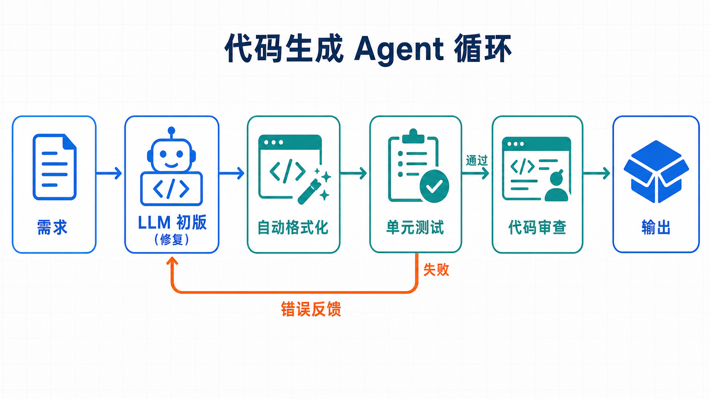

## 知识点讲解



### 1. 核心概念

代码生成 Agent 和代码补全工具（Copilot）有本质区别：代码补全是"用户打字时给建议"，是实时的、片段级的；代码生成 Agent 是"给定需求，生成可运行的完整代码，并验证它能工作"，是任务级的、带有反馈循环的。

代码生成 Agent 的核心循环是**生成 → 执行 → 验证 → 修复**。一次生成通常不够——LLM 生成的代码可能有语法错误、逻辑 Bug、测试用例没通过。Agent 需要把执行结果（错误信息、测试失败）反馈给 LLM，让它在下一轮迭代里修复。

这个循环和人类程序员写代码的方式很像：写一段 → 跑一下 → 看报错 → 改 → 再跑。不同的是 Agent 可以自动化整个过程。

### 2. 技术细节

#### 2.1 设计分层

代码生成 Agent 的四层架构：

**规划层**：理解需求，拆解任务。"写一个 RESTful API" 需要先规划出：实体模型、路由设计、错误处理、测试用例。LLM 在这一层做高层规划，不直接输出代码。

**生成层**：按规划逐步生成代码。增量生成比一次性生成更可靠——先生成函数签名和接口定义，再生成实现，再生成测试。

**验证层**：运行代码、执行测试、做静态分析（类型检查、代码风格）。这是代码生成 Agent 和普通代码补全最大的区别——有自动化的反馈机制。

**修复层**：验证失败时，把错误信息回传给 LLM，LLM 理解错误后生成修复方案。

#### 2.2 代码执行的安全隔离

代码生成 Agent 必须有安全的代码执行环境。LLM 生成的代码不可信，必须在沙箱里运行：Docker 容器（生产环境）、进程内限制执行（开发环境）。执行有超时和内存限制。

#### 2.3 上下文管理

代码生成的上下文包含：用户需求、已生成的代码文件、测试结果、历史错误信息。随着迭代增加，上下文会越来越长。需要选择性地保留：当前文件的代码、最近 N 次的错误信息，而不是全部历史。

## 代码示例

**代码生成 Agent 核心循环**

````python
import anthropic
import subprocess
import tempfile
import os
from dataclasses import dataclass

client = anthropic.Anthropic()

@dataclass
class CodeGenResult:
    code: str
    passed: bool
    error: str | None
    attempts: int

def run_code_safely(code: str, timeout: int = 10) -> tuple[bool, str]:
    """在临时文件里运行 Python 代码，返回 (成功, 输出/错误)"""
    with tempfile.NamedTemporaryFile(suffix=".py", mode="w", delete=False) as f:
        f.write(code)
        script_path = f.name
    try:
        result = subprocess.run(
            ["python", script_path],
            capture_output=True, text=True, timeout=timeout
        )
        if result.returncode == 0:
            return True, result.stdout
        return False, result.stderr
    except subprocess.TimeoutExpired:
        return False, f"执行超时（{timeout}s）"
    finally:
        os.unlink(script_path)

def generate_code(requirement: str, max_attempts: int = 3) -> CodeGenResult:
    """
    生成 → 执行 → 失败就修复的完整循环
    """
    messages = [
        {
            "role": "user",
            "content": (
                f"请根据以下需求生成 Python 代码。"
                f"只输出代码，不需要解释。确保代码可以直接运行并打印验证结果。\n\n"
                f"需求：{requirement}"
            )
        }
    ]

    last_code = ""

    for attempt in range(1, max_attempts + 1):
        response = client.messages.create(
            model="claude-3-5-sonnet-20241022",
            max_tokens=2048,
            messages=messages,
        )

        # 提取代码块
        raw = response.content[0].text
        code = extract_code_block(raw)
        last_code = code

        # 执行验证
        passed, output = run_code_safely(code)

        if passed:
            return CodeGenResult(code=code, passed=True, error=None, attempts=attempt)

        # 失败：把错误信息反馈给模型，让它修复
        messages.append({"role": "assistant", "content": raw})
        messages.append({
            "role": "user",
            "content": (
                f"代码执行失败（第 {attempt} 次尝试）：\n"
                f"```\n{output}\n```\n"
                f"请修复代码，只输出修复后的代码。"
            )
        })

    return CodeGenResult(code=last_code, passed=False, error=output, attempts=max_attempts)

def extract_code_block(text: str) -> str:
    """从 markdown 代码块里提取代码"""
    import re
    pattern = r"```(?:python)?\n(.*?)\n```"
    match = re.search(pattern, text, re.DOTALL)
    return match.group(1).strip() if match else text.strip()
````

**带测试用例的代码生成**

````python
def generate_with_tests(
    requirement: str,
    test_cases: list[dict],  # [{"input": ..., "expected": ...}]
    max_attempts: int = 3,
) -> CodeGenResult:
    """
    生成代码，并用提供的测试用例验证正确性
    比纯运行验证更精确——能发现逻辑 Bug
    """
    test_code_template = "\n".join([
        f"assert {case['input']} == {case['expected']!r}, "
        f"f'测试失败: {case[\"input\"]} 期望 {case[\"expected\"]!r}, 实际 {{result}}'"
        for case in test_cases
    ])

    prompt = (
        f"需求：{requirement}\n\n"
        f"必须通过以下测试用例：\n"
        f"```\n{test_code_template}\n```\n\n"
        f"请生成满足以上测试的 Python 函数，只输出代码。"
    )

    return generate_code(prompt, max_attempts=max_attempts)
````

**代码审查（生成后的质量检查）**

````python
def code_review(code: str, language: str = "python") -> dict:
    """
    用 LLM 做代码审查：发现潜在 Bug、安全问题、代码风格问题
    """
    review_prompt = f"""审查以下 {language} 代码，重点检查：
1. 潜在 Bug 或边界条件未处理
2. 安全隐患（注入攻击、资源泄露等）
3. 性能问题
4. 可读性问题

代码：
```{language}
{code}
````

输出 JSON：  
{{  
  "issues": [  
    {{"severity": "high/medium/low", "description": "...", "line_hint": "..."}}  
  ],  
  "overall_quality": "good/acceptable/needs_improvement",  
  "summary": "一句话总结"  
}}"""

```
response = client.messages.create(
    model="claude-3-5-sonnet-20241022",
    max_tokens=1024,
    messages=[{"role": "user", "content": review_prompt}],
)

import json
try:
    return json.loads(response.content[0].text)
except json.JSONDecodeError:
    return {"issues": [], "overall_quality": "unknown", "summary": "审查解析失败"}
```

```

## 面试怎么答

> 代码生成 Agent 的核心不是"能生成代码"，而是"能验证并修复代码"。一次生成通常不可靠，关键是建立"生成 → 执行 → 验证 → 修复"的自动化循环。
>
> 架构上分四层：规划层（LLM 理解需求，拆解任务，不直接输出代码）；生成层（按规划增量生成，函数签名先、实现后、测试最后）；验证层（沙箱运行代码、执行单元测试、静态分析）；修复层（把错误信息回传给 LLM，让它理解错误后修复）。
>
> 两个工程上必须做的事：代码执行的安全隔离（沙箱，不能直接 exec()）；设置最大迭代次数（通常 2-3 次，超出就报告失败让人工介入）。不要让 Agent 无限循环修复——有些 Bug 需要从头重新理解需求，而不是反复修补。

## 高频追问 & 加分点

- **Q1：代码生成准确率怎么衡量？**
  功能正确率（Pass@K）：K 次生成里至少有一次通过测试的概率。Pass@1 是最严格的（一次就过），Pass@3 是常见基准（3 次内能过）。工程评估上，用预设的单元测试集跑，比人工评估更客观可重复。

- **Q2：如何让 LLM 生成符合项目代码风格的代码？**
  在 system prompt 里提供代码风格指南（缩进规范、命名约定、注释要求）；提供 2-3 个项目里真实代码的示例（Few-shot）；生成后用 linter（flake8、pylint）自动检查并把结果反馈给 LLM。

- **Q3：LLM 无法修复的 Bug 怎么处理？**
  设置最大重试次数（3 次），超出后返回"生成失败，需要人工介入"，同时附上最后一次生成的代码和错误信息，方便工程师快速定位问题。不要让 Agent 无限循环——有些问题根本原因在需求不清晰，靠修复代码无法解决。

- **Q4：代码生成 Agent 和 Cursor/GitHub Copilot 的区别是什么？**
  Copilot 是实时补全，在用户打字时给出建议，反应必须在几百毫秒内；代码生成 Agent 是异步任务，可以花几秒到几分钟，有完整的测试-修复循环。两者定位不同：Copilot 降低打字摩擦，代码生成 Agent 完成更大的任务单元（实现一个完整功能模块）。

- **Q5：如何处理多文件、多模块的代码生成？**
  先生成模块的接口定义（函数签名、类接口），确认接口正确后再逐文件生成实现。不要一次性让 LLM 生成所有文件——上下文太长，质量会下降。每个文件生成后独立验证，文件间集成测试放在最后。
```
