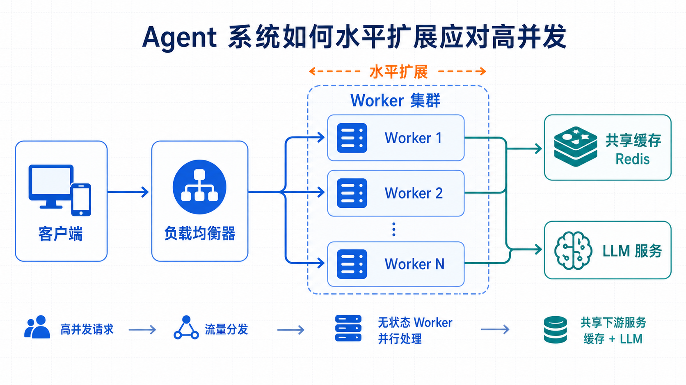

## 知识点讲解



### 1. 核心概念

Agent 系统的扩展问题和普通 Web 服务不一样，主要体现在两点：

**单次请求耗时长**：LLM 推理通常需要 1-10 秒，Agent 多轮工具调用可能需要 30-60 秒。这意味着同等 QPS 下，Agent 系统需要维持的并发连接数比普通 API 多 10-100 倍。

**Token 成本线性叠加**：并发量增加，成本同比增加，没有规模经济。更高效的扩展方案不只是"加机器"，还要考虑减少不必要的 LLM 调用。

扩展有三条路：

- **水平扩展**：增加 Agent 服务实例，通过负载均衡分散流量
- **垂直扩展**：加大单机资源（GPU 显存）——有天花板，不是主要方向
- **应用级优化**：缓存、批处理、异步化——单机提升吞吐，降成本

实践中三者组合：先做应用级优化（收益大，成本低），再做水平扩展（成本随流量线性增长）。

### 2. 技术细节

#### 2.1 水平扩展的关键：无状态设计

Agent 服务要做到无状态（Stateless），才能水平扩展——任何实例都能处理任何请求，负载均衡器随意路由。

Agent 的状态（对话历史、工具调用记录）必须存在外部（Redis、数据库），不能存在进程内存里。每次请求从外部加载状态，处理完再写回去。

这和传统有状态服务（Sticky Session）完全不同，是扩展能力的前提。

#### 2.2 请求队列和优先级

高并发场景里，请求队列是必须的：

- 超过系统容量的请求进入队列等待，而不是直接报错
- 不同优先级的请求（付费用户 > 免费用户）分队列处理
- 队列设置超时（排队超过 30 秒就告知用户"当前繁忙，请稍后"）

#### 2.3 模型级别优化

自建模型时，批推理（Batching）是提升 GPU 吞吐最有效的手段：把多个请求合并成一个 batch 一起推理，GPU 利用率从 20% 提升到 80%+。vLLM、TGI 等框架的 Continuous Batching 会自动管理这个过程。

使用 API（OpenAI/Anthropic）时，批推理不直接可控，但可以用并发请求 + asyncio 最大化吞吐。

## 代码示例

**优先级请求队列**

```python
import asyncio
import heapq
from dataclasses import dataclass, field
from enum import IntEnum
from typing import Any, Callable

class Priority(IntEnum):
    HIGH = 0     # 付费用户、重要业务
    MEDIUM = 1   # 普通用户
    LOW = 2      # 后台任务、批处理

@dataclass(order=True)
class QueuedRequest:
    priority: int
    timestamp: float
    request_id: str = field(compare=False)
    payload: Any = field(compare=False)
    future: asyncio.Future = field(compare=False)

class PriorityRequestQueue:
    def __init__(self, max_concurrent: int = 20, max_queue_size: int = 1000):
        self._heap: list[QueuedRequest] = []
        self._semaphore = asyncio.Semaphore(max_concurrent)
        self._max_queue = max_queue_size
        self._worker_task: asyncio.Task | None = None

    async def submit(
        self,
        request_id: str,
        payload: Any,
        priority: Priority = Priority.MEDIUM,
        timeout: float = 30.0,
    ) -> Any:
        if len(self._heap) >= self._max_queue:
            raise RuntimeError("队列已满，请稍后重试")

        import time
        future = asyncio.get_event_loop().create_future()
        item = QueuedRequest(
            priority=priority.value,
            timestamp=time.time(),
            request_id=request_id,
            payload=payload,
            future=future,
        )
        heapq.heappush(self._heap, item)

        try:
            return await asyncio.wait_for(future, timeout=timeout)
        except asyncio.TimeoutError:
            raise RuntimeError(f"请求 {request_id} 排队超时（{timeout}s）")

    async def _worker_loop(self, handler: Callable):
        """从队列取请求，并发执行"""
        while True:
            if not self._heap:
                await asyncio.sleep(0.01)
                continue

            item = heapq.heappop(self._heap)

            async def process(req: QueuedRequest):
                async with self._semaphore:
                    try:
                        result = await handler(req.payload)
                        req.future.set_result(result)
                    except Exception as e:
                        req.future.set_exception(e)

            asyncio.create_task(process(item))

    def start(self, handler: Callable) -> None:
        self._worker_task = asyncio.create_task(self._worker_loop(handler))
```

**无状态 Agent 服务（从 Redis 加载状态）**

```python
import json
import redis.asyncio as redis
import anthropic

client = anthropic.Anthropic()
redis_client = redis.Redis(host="localhost", port=6379)

STATE_TTL = 3600  # 会话状态保存 1 小时

async def load_session(session_id: str) -> list[dict]:
    """从 Redis 加载对话历史"""
    data = await redis_client.get(f"session:{session_id}")
    if data:
        return json.loads(data)
    return []

async def save_session(session_id: str, messages: list[dict]) -> None:
    """把对话历史写回 Redis"""
    await redis_client.setex(
        f"session:{session_id}",
        STATE_TTL,
        json.dumps(messages, ensure_ascii=False),
    )

async def handle_agent_request(session_id: str, user_message: str, tools: list[dict]) -> str:
    """
    无状态 Agent 请求处理器：
    - 从 Redis 加载历史
    - 处理当前请求
    - 把新状态写回 Redis
    任何实例都能处理任何会话，支持水平扩展
    """
    messages = await load_session(session_id)
    messages.append({"role": "user", "content": user_message})

    for _ in range(10):
        response = client.messages.create(
            model="claude-3-5-sonnet-20241022",
            max_tokens=2048,
            tools=tools,
            messages=messages,
        )

        if response.stop_reason != "tool_use":
            answer = next((b.text for b in response.content if hasattr(b, "text")), "")
            messages.append({"role": "assistant", "content": answer})
            await save_session(session_id, messages)
            return answer

        # 处理工具调用（略）
        tool_results = []
        messages.append({"role": "assistant", "content": response.content})
        messages.append({"role": "user", "content": tool_results})

    await save_session(session_id, messages)
    return "任务执行超出轮次限制"
```

**负载均衡健康检查（供 Kubernetes/Nginx 使用）**

```python
from fastapi import FastAPI
import psutil

app = FastAPI()

@app.get("/health")
async def health_check():
    """
    健康检查端点，负载均衡器用来判断实例是否可接受流量
    返回不健康时，LB 会停止向该实例路由请求
    """
    cpu_percent = psutil.cpu_percent(interval=1)
    memory = psutil.virtual_memory()

    # 自定义健康标准：CPU < 90%，内存使用 < 85%
    is_healthy = cpu_percent < 90 and memory.percent < 85

    status_code = 200 if is_healthy else 503
    return {
        "status": "healthy" if is_healthy else "overloaded",
        "cpu_percent": cpu_percent,
        "memory_percent": memory.percent,
    }, status_code
```

## 面试怎么答

Agent 系统扩展和普通 Web 服务有两个关键差异：请求耗时长（秒级到分钟级），需要维持的并发连接数更多；Token 成本随并发线性增长，加机器不能解决成本问题。

扩展的正确顺序是先优化再扩展：应用级优化（缓存高频 LLM 响应、批处理、减少不必要的工具调用）往往能降低 50% 以上的负载；之后再做水平扩展，前提是服务必须无状态——对话历史、会话状态存在 Redis，不存在进程内存，任何实例都能处理任何请求。

流量控制上，优先级队列是必须的：高优先级请求（付费用户、关键业务）优先处理，低优先级请求在后面等；队列设置超时，超时返回"服务繁忙"，而不是让请求无限等下去。

## 高频追问 & 加分点

- **Q1：如何判断系统需要扩展了？**  
    核心指标：请求队列长度（持续 > 0 说明系统满载）、P99 延迟（超出 SLA 阈值）、错误率（限流拒绝比例上升）。设置告警，当这三个指标触发时自动扩容（Kubernetes HPA）或人工介入。
- **Q2：Kubernetes HPA 自动扩容怎么配置？**  
    对于 Agent 服务，基于 CPU 使用率的 HPA 不够准——LLM 推理的 CPU 不一定高（如果用 API 的话）。更好的指标是自定义指标：队列深度（Prometheus metric `agent_queue_depth`）超过阈值时扩容。通过 KEDA（Kubernetes Event-driven Autoscaling）可以基于任意自定义指标做 HPA。
- **Q3：会话状态存 Redis 有什么风险？**  
    Redis 单点故障会让所有会话状态丢失。缓解方案：Redis Sentinel 或 Redis Cluster 做高可用；对话历史同时异步写入数据库（持久化），Redis 只做缓存层；设置会话 TTL，对话历史不是永久存储的。
- **Q4：使用 API（Claude/OpenAI）时如何做批量并发？**  
    asyncio + aiohttp 并发多个 API 请求，但注意 API 有速率限制（Requests Per Minute 和 Tokens Per Minute 两个维度）。用令牌桶控制并发请求速度，在速率限制边界内最大化吞吐。申请更高的速率限制也是扩展的一部分。
- **Q5：多区域部署时的状态同步怎么做？**  
    用户请求路由到最近的区域（降低延迟）。会话状态用区域内 Redis 存储，不做跨区域同步（延迟太高）。问题在于用户切换区域时会话历史丢失——解决方案：在会话开始时把 session_id 存 Cookie，如果 Redis 里找不到就让用户重新开始对话，或者从数据库里恢复（降级方案）。
