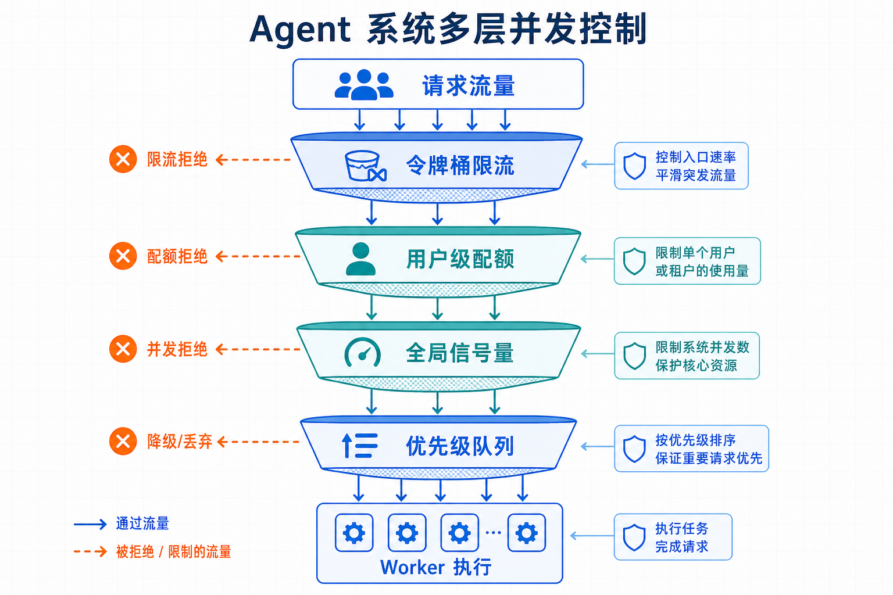

## 知识点讲解



### 1. 核心概念

Agent 系统的并发控制比普通 Web 服务复杂，原因在于它的资源消耗不是均匀的：一个简单问答调用一次 LLM，一个复杂分析任务可能调用 10 次 LLM + 5 次工具。如果以"请求数"做并发控制，重量级请求会把轻量级请求挤垮；如果不做控制，突发的重量级请求会把系统打崩。

并发控制有四个层面：

**全局层**：整个系统同时处理的请求总数上限——保护系统不过载。

**用户层**：单个用户在时间窗口内的请求频率——保证公平性，防止单个用户独占资源。

**资源层**：对外部依赖（LLM API、数据库）的并发访问控制——防止超出第三方的速率限制。

**任务层**：Agent 内部的工具并行调用控制——防止单个任务消耗过多并发资源。

### 2. 技术细节

#### 2.1 限流算法选择

**令牌桶（Token Bucket）**：桶里有 N 个令牌，消耗速率有上限，但允许短时突发（把积累的令牌一次性用掉）。适合 Agent 系统——用户偶尔的短时高频请求可以通过，持续超速会被限制。

**漏桶（Leaky Bucket）**：无论多少请求进来，都以固定速率处理（多余的排队或丢弃）。适合对下游 API 调用的速率控制——防止打爆外部 API 的速率限制。

**滑动窗口**：统计最近 N 分钟内的请求总数，比固定窗口边界更平滑。适合用户级别的限流（"每分钟最多 60 次"）。

#### 2.2 分布式限流

单机限流（Python Semaphore）只保护单个进程。多实例部署时需要分布式限流——各实例共享同一个计数器。Redis 是标准方案：原子操作（INCR、EXPIRE）实现计数，性能足够高。

#### 2.3 优先级队列

不同用户、不同任务类型的优先级不同。用 `asyncio.PriorityQueue` 或 Redis Sorted Set 实现：高优先级任务先出队处理，低优先级任务在后面等待。等待超时时返回错误而不是无限等待。

## 代码示例

**令牌桶限流器**

```python
import time
import threading
from dataclasses import dataclass

@dataclass
class TokenBucket:
    """
    令牌桶：允许突发流量，但平均速率受控
    capacity: 桶容量（最大突发量）
    refill_rate: 每秒补充的令牌数（平均速率）
    """
    capacity: float
    refill_rate: float
    _tokens: float = None
    _last_refill: float = None
    _lock: threading.Lock = None

    def __post_init__(self):
        self._tokens = self.capacity
        self._last_refill = time.monotonic()
        self._lock = threading.Lock()

    def _refill(self) -> None:
        now = time.monotonic()
        elapsed = now - self._last_refill
        self._tokens = min(self.capacity, self._tokens + elapsed * self.refill_rate)
        self._last_refill = now

    def acquire(self, cost: float = 1.0) -> bool:
        """尝试获取 cost 个令牌，成功返回 True"""
        with self._lock:
            self._refill()
            if self._tokens >= cost:
                self._tokens -= cost
                return True
            return False

    def wait_and_acquire(self, cost: float = 1.0, max_wait: float = 5.0) -> bool:
        """等待直到有足够令牌，超过 max_wait 秒返回 False"""
        deadline = time.monotonic() + max_wait
        while time.monotonic() < deadline:
            if self.acquire(cost):
                return True
            time.sleep(0.05)
        return False
```

**分布式限流（Redis 滑动窗口）**

```python
import redis
import time

redis_client = redis.Redis(host="localhost", port=6379, decode_responses=True)

def is_rate_limited(
    user_id: str,
    window_seconds: int = 60,
    max_requests: int = 60,
) -> bool:
    """
    基于 Redis 的滑动窗口限流
    每个用户在 window_seconds 内最多 max_requests 次请求
    多实例部署下也能正确工作
    """
    key = f"rate_limit:{user_id}"
    now = time.time()
    window_start = now - window_seconds

    pipe = redis_client.pipeline()
    # 移除窗口之外的旧记录
    pipe.zremrangebyscore(key, 0, window_start)
    # 统计窗口内的请求数
    pipe.zcard(key)
    # 记录本次请求
    pipe.zadd(key, {str(now): now})
    # 设置 key 过期（防止内存泄露）
    pipe.expire(key, window_seconds * 2)
    results = pipe.execute()

    current_count = results[1]
    return current_count >= max_requests  # True = 需要限流
```

**多层并发控制器**

```python
import asyncio
from contextlib import asynccontextmanager

class AgentConcurrencyController:
    """
    四层并发控制：
    1. 全局并发上限
    2. 用户级请求速率
    3. LLM API 调用速率（防止超出 Provider 限制）
    4. 单次 Agent 任务的工具并发
    """

    def __init__(
        self,
        max_global_concurrent: int = 50,
        llm_calls_per_minute: int = 100,
    ):
        self._global_semaphore = asyncio.Semaphore(max_global_concurrent)
        self._llm_bucket = TokenBucket(
            capacity=min(llm_calls_per_minute, 20),
            refill_rate=llm_calls_per_minute / 60,
        )
        # 用户级 Token Bucket（每个用户独立）
        self._user_buckets: dict[str, TokenBucket] = {}

    def _get_user_bucket(self, user_id: str, plan: str = "free") -> TokenBucket:
        if user_id not in self._user_buckets:
            capacity = 5 if plan == "free" else 20
            rate = 1 if plan == "free" else 5  # 每秒令牌补充速率
            self._user_buckets[user_id] = TokenBucket(capacity=capacity, refill_rate=rate)
        return self._user_buckets[user_id]

    @asynccontextmanager
    async def agent_request(self, user_id: str, plan: str = "free"):
        """
        上下文管理器：进入时申请资源，退出时释放
        用法：
            async with controller.agent_request(user_id):
                await run_agent(...)
        """
        # 用户级限流
        user_bucket = self._get_user_bucket(user_id, plan)
        if not user_bucket.acquire():
            raise RuntimeError("请求频率超限，请稍后重试")

        # 全局并发控制
        try:
            await asyncio.wait_for(
                self._global_semaphore.acquire(),
                timeout=10.0
            )
        except asyncio.TimeoutError:
            raise RuntimeError("系统繁忙，请稍后重试")

        try:
            yield
        finally:
            self._global_semaphore.release()

    async def llm_call(self, llm_func, *args, **kwargs):
        """
        包装 LLM 调用：确保不超出 Provider 的速率限制
        """
        if not self._llm_bucket.wait_and_acquire(max_wait=30.0):
            raise RuntimeError("LLM 调用速率超限")
        return await llm_func(*args, **kwargs)


# 使用示例
controller = AgentConcurrencyController(max_global_concurrent=50)

async def handle_request(user_id: str, message: str):
    async with controller.agent_request(user_id, plan="pro"):
        # 在这个 context 里，并发控制已生效
        response = await controller.llm_call(
            call_llm_api,
            message=message,
        )
        return response
```

## 面试怎么答

Agent 系统的并发控制需要分层处理——不能只用一个全局的信号量了事，因为 Agent 的资源消耗差异巨大（简单问答 vs 复杂多轮分析）。

四层控制：全局层（整个系统的并发上限，保护服务不崩）；用户层（每个用户在时间窗口内的频率限制，保证公平性）；资源层（对 LLM API 的调用速率，防止超出 Provider 的限制触发 429）；任务层（单个 Agent 任务内的工具并行调用数，防止一个任务独占所有资源）。

算法上，令牌桶适合用户侧（允许短时突发，平均速率受控）；漏桶适合对外调用（对下游 LLM API 做均匀速率控制）；Redis 滑动窗口做分布式限流（多实例部署时必须用分布式计数，不能依赖单进程状态）。

## 高频追问 & 加分点

- **Q1：限流被触发了，用户端看到什么？**  
    返回 HTTP 429 Too Many Requests，附上 `Retry-After` 响应头（多少秒后可以重试）。前端收到 429 后自动等待 `Retry-After` 指定的时间后重试，而不是立即重试（立即重试会让限流更严重）。
- **Q2：不同计划（Free/Pro/Enterprise）的限流参数怎么管理？**  
    在用户表里存 plan 字段，限流参数从配置表动态读取（不要硬编码），方便调整。Pro 用户可以配置更大的令牌桶容量和更高的补充速率；Enterprise 用户可以配置专属的资源配额，不和其他用户共享。
- **Q3：怎么防止限流参数设得太保守导致用户体验差？**  
    分阶段调整：先设一个偏保守的值，收集真实流量分布数据（P50/P90/P99 用户请求频率），找出"大部分正常用户不会被限流"的阈值，再调整到合理值。另外分层：全局限流设宽松一些，用户级限流设严格一些——阻止"暴力用户"，允许正常使用。
- **Q4：并发控制和排队的关系？**  
    限流（Rate Limiting）是说"你请求太频繁了，现在不能处理"；排队（Queuing）是说"系统现在满了，你先等一会"。两者互补：限流保护用户侧公平性，排队保护服务侧稳定性。达到并发上限时，新请求进入优先级队列等待，而不是直接返回错误——在等待时间内可能有正在进行的请求完成，让队列里的请求有机会被处理。
- **Q5：如何检测并处理"僵尸请求"（长时间没有响应的 Agent 任务）？**  
    给每个 Agent 任务设置最大执行时间（比如 5 分钟）。超时后主动取消任务，释放占用的 Semaphore 资源，给调用方返回超时错误。可以用 `asyncio.wait_for` 包装执行逻辑，超时时自动取消。同时记录超时事件到日志，分析是哪类任务容易超时（可能需要优化 Agent 的工具调用策略）。
