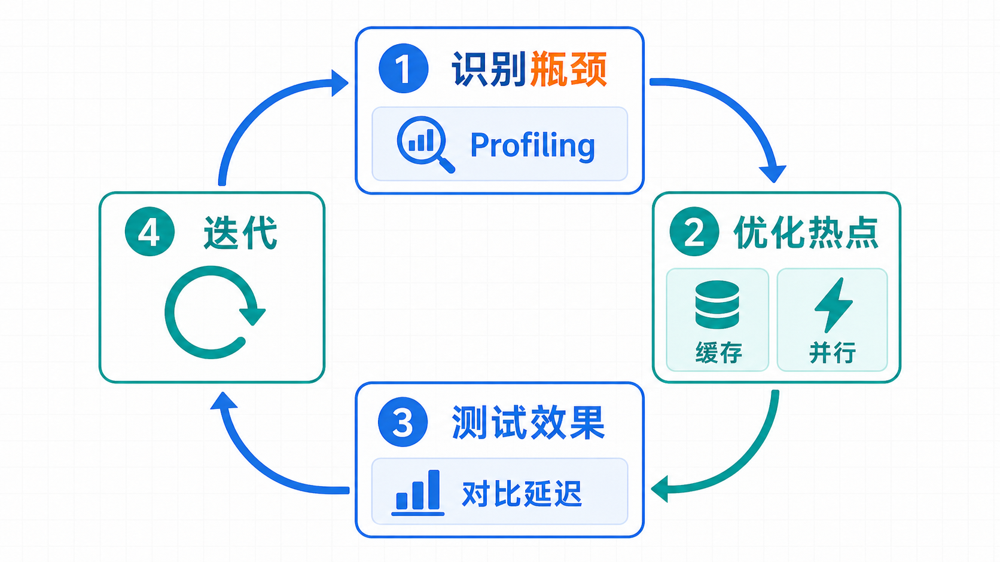

## 知识点讲解



### 1. 核心概念

Agent 系统的延迟和普通 Web 请求不一样，它的瓶颈高度集中：

```latex
LLM 推理延迟    ████████████████████████ 70-80%
I/O 延迟        ████ 10-15%（工具调用、数据库）
编排延迟        ██ 5-10%（Agent 循环开销）
队列等待        █ 0-5%（系统过载时）
```

70-80% 的延迟在 LLM 推理，这决定了优化重点——不是优化数据库查询，不是优化网络，而是减少 LLM 调用次数、减少每次调用的 token 量、让用户感知到流式输出的"第一个 token"来得更快。

### 2. 技术细节

#### 2.1 流式输出：改变延迟感知

流式输出（Streaming）不减少总延迟，但把用户看到第一个字从"等完整响应"变成"等第一个 token"——通常从 3-5 秒降到 200-500ms。

对于对话类 Agent，这是最有效的用户体验优化。技术上用 SSE（Server-Sent Events）或 WebSocket 推送。

#### 2.2 缓存：最高性价比的优化

LLM 响应缓存：对于相同（或语义相近）的请求，直接返回缓存结果，跳过 LLM 调用。适合高重复率的场景（FAQ、客服）。

Prompt Cache：Claude 和 OpenAI 都支持 Prompt Cache——长 system prompt 首次计算后缓存，后续请求只需要计算用户消息部分的增量 token，延迟可以降低 50-80%。

工具结果缓存：对于搜索、数据库这类工具调用，相同参数的结果缓存一段时间，避免重复打外部 API。

#### 2.3 并行化工具调用

多轮 Agent 里，如果某一轮需要调用多个无依赖关系的工具，用 asyncio 并行执行，总耗时从各工具串行之和降为最慢工具的耗时。

## 代码示例

**流式输出 Agent**

```python
import anthropic
from typing import AsyncIterator

client = anthropic.Anthropic()

async def stream_agent_response(
    user_message: str,
    tools: list[dict],
) -> AsyncIterator[str]:
    """
    流式 Agent：第一个 token 快速到达用户，体验更好
    工具调用阶段是非流式的（需要等工具执行完），但 LLM 文本生成阶段流式输出
    """
    messages = [{"role": "user", "content": user_message}]

    for _ in range(10):
        # 检查是否需要工具调用（非流式，快速判断）
        response = client.messages.create(
            model="claude-3-5-sonnet-20241022",
            max_tokens=2048,
            tools=tools,
            messages=messages,
        )

        if response.stop_reason == "tool_use":
            # 执行工具（并行）
            tool_calls = [b for b in response.content if b.type == "tool_use"]
            tool_results = await execute_tools_parallel(tool_calls)
            messages.append({"role": "assistant", "content": response.content})
            messages.append({"role": "user", "content": tool_results})
            continue

        # 最终文字回答：用流式输出
        with client.messages.stream(
            model="claude-3-5-sonnet-20241022",
            max_tokens=2048,
            messages=messages,
        ) as stream:
            for text in stream.text_stream:
                yield text   # 逐 token 推送给用户
        return

import asyncio
from concurrent.futures import ThreadPoolExecutor

async def execute_tools_parallel(tool_calls: list) -> list[dict]:
    """并行执行多个工具，总耗时 = max(各工具耗时)"""
    loop = asyncio.get_event_loop()
    with ThreadPoolExecutor(max_workers=len(tool_calls)) as pool:
        futures = [
            loop.run_in_executor(pool, execute_tool, call.name, call.input)
            for call in tool_calls
        ]
        results = await asyncio.gather(*futures)

    return [
        {"type": "tool_result", "tool_use_id": call.id, "content": str(result)}
        for call, result in zip(tool_calls, results)
    ]

def execute_tool(name: str, params: dict) -> str:
    # 工具调度器（略）
    # ...
    pass
```

**LLM 响应缓存（语义缓存）**

```python
import hashlib
import json
import redis
from sentence_transformers import SentenceTransformer
import numpy as np

redis_client = redis.Redis(decode_responses=True)
embed_model = SentenceTransformer("all-MiniLM-L6-v2")

class SemanticCache:
    """
    语义缓存：不只缓存完全相同的请求，也能命中语义相近的请求
    适合 FAQ、客服场景
    """

    def __init__(self, similarity_threshold: float = 0.95, ttl: int = 3600):
        self.threshold = similarity_threshold
        self.ttl = ttl
        self._cache_index: list[tuple[np.ndarray, str]] = []  # (embedding, cache_key)

    def _make_key(self, query: str) -> str:
        return hashlib.md5(query.encode()).hexdigest()

    def get(self, query: str) -> str | None:
        """查找语义相似的缓存命中"""
        query_emb = embed_model.encode(query)

        for cached_emb, cache_key in self._cache_index:
            similarity = float(np.dot(query_emb, cached_emb) /
                              (np.linalg.norm(query_emb) * np.linalg.norm(cached_emb)))
            if similarity >= self.threshold:
                cached = redis_client.get(f"llm_cache:{cache_key}")
                if cached:
                    return json.loads(cached)

        return None

    def set(self, query: str, response: str) -> None:
        """缓存查询和 LLM 响应"""
        key = self._make_key(query)
        query_emb = embed_model.encode(query)

        redis_client.setex(
            f"llm_cache:{key}",
            self.ttl,
            json.dumps(response, ensure_ascii=False),
        )
        self._cache_index.append((query_emb, key))

semantic_cache = SemanticCache(similarity_threshold=0.95)

def cached_llm_call(query: str, llm_func) -> str:
    cached = semantic_cache.get(query)
    if cached:
        return cached  # 跳过 LLM 调用

    response = llm_func(query)
    semantic_cache.set(query, response)
    return response
```

**Prompt Cache（利用 Claude/OpenAI 原生缓存）**

```python
import anthropic

client = anthropic.Anthropic()

# 长 system prompt 只需要计算一次，后续请求从缓存读
# Claude 用 cache_control 标记哪些内容可以缓存
SYSTEM_PROMPT = """你是一个专业的法律助手，熟悉中国法律法规。

以下是你需要了解的背景信息：
[这里是几千字的法律条文和规范...]
"""  # 假设这是 2000 token 的 system prompt

def call_with_prompt_cache(user_message: str) -> str:
    response = client.messages.create(
        model="claude-3-5-sonnet-20241022",
        max_tokens=1024,
        system=[
            {
                "type": "text",
                "text": SYSTEM_PROMPT,
                "cache_control": {"type": "ephemeral"},  # 标记为可缓存
            }
        ],
        messages=[{"role": "user", "content": user_message}],
    )
    # 第一次调用：完整计算 2000 token system prompt
    # 后续调用：system prompt 从缓存读，只计算用户消息的增量 token
    # 延迟降低 50-80%，成本降低 90%（缓存 token 费率更低）
    return response.content[0].text
```

## 面试怎么答

Agent 系统延迟 70-80% 来自 LLM 推理，所以优化要集中在这里。

几个有效的手段，按优先级排：流式输出——不降低总延迟，但把用户看到第一个字的时间从 3-5 秒降到几百毫秒，用户感知完全不同；Prompt Cache——长 system prompt 首次计算后缓存，后续请求只算增量，Claude 和 OpenAI 都支持，缓存命中时延迟降 50-80%，费用也大幅降低；工具并行调用——同一轮里多个无依赖工具并行执行，而不是串行等待；语义缓存——高重复率场景（FAQ、客服）缓存 LLM 响应，完全跳过推理。

最容易被忽视的是 Prompt Cache。很多系统有几千 token 的 system prompt，每次请求都重新计算，这是不必要的开销。开启 Prompt Cache 是改一行配置的事，但延迟和成本的改善非常显著。

## 高频追问 & 加分点

- **Q1：流式输出和工具调用怎么结合？**  
    工具调用阶段（Agent 决定调用工具、等工具执行完）是非流式的，这段时间前端可以展示"正在查询..."。工具执行完之后，LLM 生成最终文本回答时再开启流式。这样用户感知的是"短暂等待 + 文字快速流出"，比"长时间等待 + 一次性展示所有文字"体验好很多。
- **Q2：什么情况下缓存不适用？**  
    用户问的是实时信息（"现在股价是多少"、"今天天气怎么样"）；需要个性化回答（包含用户的具体账户信息）；低重复率的长尾问题（缓存命中率低于 20% 时，维护缓存的成本高于收益）。
- **Q3：自建模型怎么优化 LLM 推理速度？**  
    vLLM 的 Continuous Batching 是首选——把多个请求合并批推理，GPU 利用率从 20% 提到 80%+；量化（INT8/INT4）降低显存占用和推理时间，精度损失可接受；speculative decoding（草稿模型先生成候选，大模型验证）对生成速度提升明显但实现复杂。
- **Q4：缓存命中率低怎么办？**  
    提升语义缓存的阈值精度（调整 similarity threshold）；对高频 query 做聚类，手动标注"这类问题的标准回答"作为缓存种子；分析 cache miss 的 query 类型，找规律后优化 cache key 设计。
- **Q5：延迟优化的先后顺序怎么定？**  
    先测量，找到最大的瓶颈。用分布式追踪（OpenTelemetry）给 Agent 的每个环节打时间戳：LLM 调用、工具调用、编排逻辑各自耗时多少。80% 的延迟集中在哪里就优先优化哪里，不要凭直觉猜。
