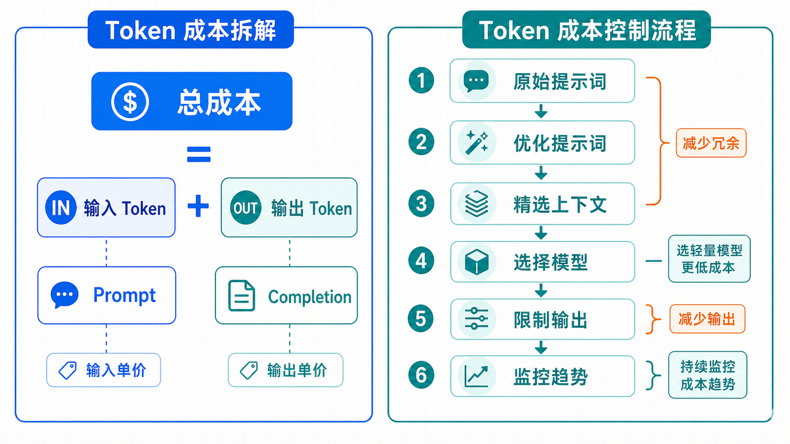

## 知识点讲解



### 1. 核心概念

Token 成本是 Agent 系统区别于传统软件系统的特有成本——每次 LLM 调用都要花钱，而且成本随使用量线性增长，没有太多规模效应。

成本由四个因素决定：

1. **输入 token 数**：system prompt + 对话历史 + 工具定义 + 工具结果
2. **输出 token 数**：LLM 生成的文本（比输入贵 3-5 倍）
3. **模型选择**：Claude 3.5 Sonnet 和 Claude Haiku 价格差 10-20 倍
4. **调用次数**：Agent 多轮循环，每轮都是一次计费

优化的优先级：调用次数 > 缓存 > 模型选择 > 上下文精简 > 输出控制。先减少不必要的 LLM 调用，再考虑降低单次调用的 token 数。

### 2. 技术细节

#### 2.1 模型分层使用

不是所有任务都需要最贵最强的模型。按任务复杂度分层：

| 任务类型 | 推荐模型 | 说明 |
| --- | --- | --- |
| 意图判断、分类 | Claude Haiku / GPT-4o-mini | 轻量任务，便宜模型够用 |
| 结构化信息提取 | Claude Haiku | 不需要推理，精确即可 |
| 复杂多步推理 | Claude Sonnet / GPT-4o | 需要大模型能力 |
| 代码生成、分析 | Claude Sonnet | 代码质量要求高 |

路由逻辑：先用便宜模型判断"这个问题复杂不复杂"，复杂的再升级到大模型。分类判断本身很便宜，但能把 50-70% 的简单问题路由到便宜模型处理。

#### 2.2 上下文精简

Agent 多轮对话里，历史消息累积是 token 增长的主要来源。几个控制手段：

**摘要压缩**：当历史超过阈值时，用 LLM 把早期对话压缩成摘要，只保留关键信息。代价是多一次 LLM 调用，但节省的 token 远多于这次调用的成本。

**工具定义精简**：只在当前阶段需要某些工具时才把它注入 tools 参数。50 个工具的 Schema 可能有 3000+ token，如果每轮都全量注入，成本很高。按需注入，当前阶段只注入可能用到的 5-10 个工具。

**工具结果截断**：搜索结果、数据库查询结果通常很长。只把前 N 个字符注入上下文，丢弃冗余部分。

#### 2.3 Prompt Cache

Claude 和 OpenAI 都支持 Prompt Cache：标记 system prompt 可缓存后，后续请求里 system prompt 部分不重新计算，缓存 token 的费率是原价的 10-20%。

长 system prompt（法律条文、产品规范、工具说明）特别适合缓存——这些内容每次都一样，但 token 数量多。

## 代码示例

**模型路由：按任务复杂度选模型**

```python
import anthropic
from enum import Enum

client = anthropic.Anthropic()

class TaskComplexity(Enum):
    SIMPLE = "simple"    # 分类、提取、是否题
    MEDIUM = "medium"    # 一般问答、简单推理
    COMPLEX = "complex"  # 多步推理、长文本分析

# 模型成本比（相对值，用于决策）
MODEL_CONFIG = {
    TaskComplexity.SIMPLE:  {"model": "claude-haiku-4-5",          "relative_cost": 1},
    TaskComplexity.MEDIUM:  {"model": "claude-3-5-sonnet-20241022", "relative_cost": 15},
    TaskComplexity.COMPLEX: {"model": "claude-3-5-sonnet-20241022", "relative_cost": 15},
}

def classify_complexity(user_message: str) -> TaskComplexity:
    """
    用极低成本的规则或轻量模型判断任务复杂度
    不用大模型做分类——那样分类本身的成本就不合算了
    """
    # 规则分类（零成本）
    simple_patterns = ["是什么", "是否", "有没有", "哪个", "多少"]
    complex_patterns = ["分析", "比较", "总结所有", "给我详细的", "写一份报告"]

    for pattern in complex_patterns:
        if pattern in user_message:
            return TaskComplexity.COMPLEX

    for pattern in simple_patterns:
        if pattern in user_message and len(user_message) < 50:
            return TaskComplexity.SIMPLE

    return TaskComplexity.MEDIUM

def cost_aware_llm_call(user_message: str, system: str = "") -> str:
    """
    根据任务复杂度选择模型，简单任务用便宜模型
    """
    complexity = classify_complexity(user_message)
    config = MODEL_CONFIG[complexity]

    response = client.messages.create(
        model=config["model"],
        max_tokens=1024 if complexity == TaskComplexity.SIMPLE else 2048,
        system=system,
        messages=[{"role": "user", "content": user_message}],
    )
    return response.content[0].text
```

**上下文精简：对话历史摘要压缩**

```python
MAX_MESSAGES_BEFORE_SUMMARY = 20  # 超过 20 条消息就触发压缩
SUMMARY_TOKEN_TARGET = 500        # 摘要控制在 500 token 左右

def compress_history(messages: list[dict], llm_func) -> list[dict]:
    """
    把早期对话历史压缩成摘要，只保留最近几轮
    用于控制长对话的 token 成本
    """
    if len(messages) <= MAX_MESSAGES_BEFORE_SUMMARY:
        return messages

    # 保留最近 6 条消息（3 轮对话），压缩之前的
    recent = messages[-6:]
    to_compress = messages[:-6]

    history_text = "\n".join([
        f"{m['role'].upper()}: {m['content'] if isinstance(m['content'], str) else '[工具调用]'}"
        for m in to_compress
    ])

    summary_prompt = f"""请用 300 字以内概括以下对话的关键信息，保留所有重要事实和用户需求：

{history_text}

概括："""

    summary = llm_func(summary_prompt)

    # 把压缩后的摘要 + 最近消息拼成新的历史
    compressed = [
        {"role": "user", "content": f"[对话历史摘要]\n{summary}"},
        {"role": "assistant", "content": "好的，我了解了之前的对话背景。"},
    ] + recent

    return compressed
```

**工具按需注入（减少无用工具 token）**

```python
from typing import Callable

# 工具分组：按场景分类
TOOL_GROUPS = {
    "search": ["search_web", "search_knowledge_base"],
    "data":   ["query_database", "query_analytics"],
    "action": ["send_email", "create_ticket", "update_record"],
    "code":   ["execute_python", "run_sql"],
}

def select_relevant_tools(
    user_message: str,
    all_tools: dict[str, dict],
) -> list[dict]:
    """
    根据用户意图，只注入当前可能用到的工具
    而不是每次都把所有工具的 Schema 全量注入
    """
    message_lower = user_message.lower()
    needed_groups = set()

    if any(w in message_lower for w in ["搜索", "查找", "最新", "新闻"]):
        needed_groups.add("search")
    if any(w in message_lower for w in ["数据", "订单", "用户", "统计"]):
        needed_groups.add("data")
    if any(w in message_lower for w in ["发邮件", "创建", "更新", "执行"]):
        needed_groups.add("action")
    if any(w in message_lower for w in ["代码", "计算", "sql", "分析数据"]):
        needed_groups.add("code")

    if not needed_groups:
        # 默认只注入搜索和数据工具
        needed_groups = {"search", "data"}

    selected_tool_names = set()
    for group in needed_groups:
        selected_tool_names.update(TOOL_GROUPS.get(group, []))

    return [all_tools[name] for name in selected_tool_names if name in all_tools]
```

**成本监控**

```python
from dataclasses import dataclass, field
from datetime import datetime

# 各模型的 token 价格（USD per 1K tokens）
# 注：模型 ID 用别名（如 "claude-haiku-4-5"）便于阅读，生产建议锁定完整 ID（如 "claude-haiku-4-5-20251001"）
# 价格仅示例，定期会调整，以 Anthropic / OpenAI 官网为准
PRICING = {
    "claude-haiku-4-5":          {"input": 0.00025, "output": 0.00125},
    "claude-3-5-sonnet-20241022": {"input": 0.003,  "output": 0.015},
}

@dataclass
class CostTracker:
    total_cost: float = 0.0
    by_model: dict = field(default_factory=dict)
    requests: int = 0

    def record(self, model: str, input_tokens: int, output_tokens: int) -> float:
        pricing = PRICING.get(model, {"input": 0.003, "output": 0.015})
        cost = (input_tokens / 1000 * pricing["input"] +
                output_tokens / 1000 * pricing["output"])
        self.total_cost += cost
        self.requests += 1
        self.by_model.setdefault(model, 0.0)
        self.by_model[model] += cost
        return cost

    def report(self) -> dict:
        return {
            "total_cost_usd": round(self.total_cost, 4),
            "requests": self.requests,
            "avg_cost_per_request": round(self.total_cost / max(1, self.requests), 4),
            "by_model": {k: round(v, 4) for k, v in self.by_model.items()},
        }
```

## 面试怎么答

Token 成本控制的核心是"用最少 token 完成任务"，优化有几个层次。

最高效的是模型分层：不是所有任务都需要大模型——意图分类、结构化提取这类任务，Claude Haiku 这类便宜模型完全够用，成本是大模型的 1/10-1/20。用简单规则或便宜模型先判断任务复杂度，再路由到合适的模型，能把 50-70% 的简单任务从贵模型上转走。

上下文精简是第二个大头：多轮对话里历史消息会不断累积。超过阈值时用 LLM 把早期历史压缩成摘要（多一次便宜的 LLM 调用，但节省的 token 远多于这次调用成本）；工具定义按需注入，只给当前步骤可能用到的工具，而不是每次把所有工具的 Schema 全量注入。

Prompt Cache 是最容易被忽视的优化——长 system prompt 开启缓存后，费率降到原价的 10-20%，改一行代码就能生效。

## 高频追问 & 加分点

- **Q1：怎么知道当前哪里 token 消耗最多？**  
    在每次 LLM 调用后记录 usage 字段（input_tokens、output_tokens），按调用类型（system prompt、工具调用、对话历史）分别统计。建个 dashboard，一眼看出哪块消耗最大，再针对性优化。Anthropic 和 OpenAI 的 API 响应里都会返回详细的 token 用量。
- **Q2：摘要压缩会丢失信息吗？**  
    会有损失，但可以通过优化摘要 prompt 减少损失（让 LLM 保留所有数字、日期、专有名词、用户的具体需求）；同时只压缩"不太可能被再次引用"的早期历史，最近几轮保持完整。对于关键信息（用户名、订单号、重要决策），可以显式在 prompt 里要求摘要必须保留这些字段。
- **Q3：工具结果很长，截断会影响准确性吗？**  
    取决于截断位置和工具类型。搜索结果截断前几段通常是最相关的内容；数据库查询结果如果结构化可以只返回关键字段而不是所有字段；实在需要完整结果的，可以分页——先返回第一页，模型决定是否需要更多数据再继续取。
- **Q4：如何对 Agent 系统做成本预算管理？**  
    为每次会话设置 token 预算上限（比如单次对话最多 50K token）；在执行循环里实时累计用量，接近上限时主动结束任务并告知用户；按用户计划（Free/Pro）设置不同的预算上限；月度总成本超过阈值时发告警，防止超出云账户预算。
- **Q5：使用 Batch API 能节省多少成本？**  
    OpenAI 和 Anthropic 都提供 Batch API，成本是实时 API 的 50%，但响应时间从秒级变成小时级。适合：离线数据处理、批量文档分析、非实时的评估任务。不适合：实时对话、有延迟要求的任务。对于有大量离线处理需求的 Agent 系统，Batch API 是很好的成本优化手段。
