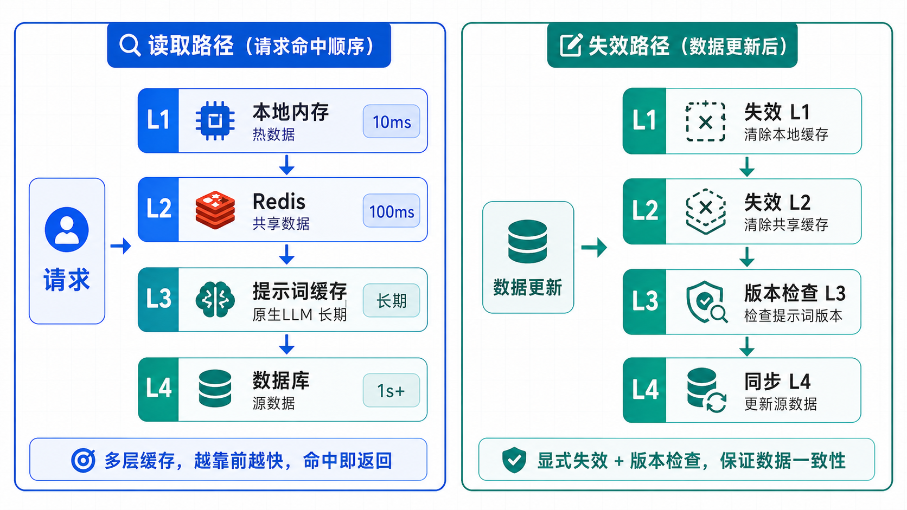

## 知识点讲解



### 1. 核心概念

Agent 系统的缓存和普通 Web 服务的缓存有一个关键区别：Agent 的"请求"成本极不均匀。一次 LLM 调用可能花几分钟和几千 token，一次工具结果可能已经被三个不同用户问过了。所以缓存不只是"加速"，更是"减少不必要的 LLM 调用"。

Agent 系统的缓存通常分三层：

| 层级 | 存储位置 | TTL | 命中成本 |
| --- | --- | --- | --- |
| L1 本地内存（LRU） | 进程内 | 60 秒 | 极低，纳秒级 |
| L2 分布式缓存（Redis） | 跨进程共享 | 1 小时 | 低，毫秒级 |
| L3 Prompt Cache（LLM 原生） | LLM 服务端 | 按会话 | 中，节省计算费用 |

命中率和成本的关系不是线性的——从 50% 提到 70% 很容易，从 70% 提到 90% 需要大得多的缓存容量，不一定划算。一般 60-80% 命中率是最佳区间。

### 2. 技术细节

#### 2.1 LRU + TTL 缓存

LRU（最近最少使用）是 Agent 系统最常用的淘汰策略：热数据留着，冷数据挤出去。配合 TTL 过期，避免返回陈旧结果。

**缓存 key 的设计**是关键——key 要能区分"内容不同的请求"，同时又不能太细（太细了什么都缓存不到）。对于 LLM 调用，用 `hash(model + sorted_messages)` 做 key；对于工具调用，用 `hash(tool_name + normalized_params)` 做 key。

#### 2.2 多级缓存

多级缓存的查找顺序：L1（本地内存）→ L2（Redis）→ 回源（调用 LLM 或工具）。命中哪一层就从那一层返回，同时把结果回填到更快的层。

这样做的好处是：频繁访问的数据自然"上浮"到 L1，L1 满了自然淘汰冷数据到 L2，不需要手动干预热度管理。

#### 2.3 Prompt Cache

Claude 和 OpenAI 都原生支持 Prompt Cache：在 system prompt 里打上 `cache_control: ephemeral` 标记，后续请求里这段内容不重新计算，费率降到原价的 10-20%。

适合缓存的内容：固定的法律条文、产品规范、工具说明——这些每次都一样但 token 数量多。不适合缓存的：包含用户信息、时间戳、动态数据的 prompt 片段。

## 代码示例

**LRU + TTL 本地缓存**

```python
import time
from collections import OrderedDict
from typing import Any

class LRUCache:
    """
    带 TTL 的 LRU 缓存
    用于 L1 层：进程内热数据缓存
    """
    def __init__(self, capacity: int = 500, ttl: int = 60):
        self.capacity = capacity
        self.ttl = ttl
        self._cache: OrderedDict[str, tuple[Any, float]] = OrderedDict()
        self.hits = 0
        self.misses = 0

    def get(self, key: str) -> Any | None:
        if key not in self._cache:
            self.misses += 1
            return None

        value, ts = self._cache[key]
        if time.time() - ts > self.ttl:
            del self._cache[key]
            self.misses += 1
            return None

        self._cache.move_to_end(key)  # 标记为最近使用
        self.hits += 1
        return value

    def put(self, key: str, value: Any) -> None:
        if key in self._cache:
            self._cache.move_to_end(key)
        self._cache[key] = (value, time.time())
        if len(self._cache) > self.capacity:
            self._cache.popitem(last=False)  # 淘汰最久未使用

    def hit_rate(self) -> float:
        total = self.hits + self.misses
        return self.hits / total if total > 0 else 0.0
```

**多级缓存**

```python
import hashlib
import json
import redis

redis_client = redis.Redis(host="localhost", port=6379, decode_responses=True)

class MultiLevelCache:
    """
    三级缓存：L1 本地 LRU → L2 Redis → 回源
    命中任一层都回填上级缓存
    """

    def __init__(self):
        self.l1 = LRUCache(capacity=500, ttl=60)    # 本地，60 秒
        self.l2_ttl = 3600                           # Redis，1 小时

    def _make_key(self, namespace: str, params: dict) -> str:
        content = namespace + json.dumps(params, sort_keys=True)
        return hashlib.md5(content.encode()).hexdigest()

    def get(self, namespace: str, params: dict) -> Any | None:
        key = self._make_key(namespace, params)

        # L1 本地缓存
        value = self.l1.get(key)
        if value is not None:
            return value

        # L2 Redis
        raw = redis_client.get(f"agent_cache:{key}")
        if raw:
            value = json.loads(raw)
            self.l1.put(key, value)  # 回填 L1
            return value

        return None  # 全部未命中，需要回源

    def set(self, namespace: str, params: dict, value: Any) -> None:
        key = self._make_key(namespace, params)
        self.l1.put(key, value)
        redis_client.setex(
            f"agent_cache:{key}",
            self.l2_ttl,
            json.dumps(value, ensure_ascii=False),
        )

cache = MultiLevelCache()

def cached_tool_call(tool_name: str, params: dict, tool_func) -> Any:
    """
    工具调用结果缓存：相同参数的工具不重复执行
    适合搜索、数据库查询这类幂等工具
    """
    result = cache.get(tool_name, params)
    if result is not None:
        return result

    result = tool_func(**params)
    cache.set(tool_name, params, result)
    return result
```

**Prompt Cache（利用 Claude 原生缓存）**

```python
import anthropic

client = anthropic.Anthropic()

# 长 system prompt 标记为可缓存
# 首次请求完整计算，后续请求复用缓存，费率降到原价 10-20%
SYSTEM_PROMPT = """你是专业的法律助手，熟悉以下法规：
[这里是 2000 token 的法律条文...]
"""

def call_with_prompt_cache(user_message: str) -> str:
    response = client.messages.create(
        model="claude-3-5-sonnet-20241022",
        max_tokens=1024,
        system=[
            {
                "type": "text",
                "text": SYSTEM_PROMPT,
                "cache_control": {"type": "ephemeral"},  # 标记可缓存
            }
        ],
        messages=[{"role": "user", "content": user_message}],
    )
    # 通过 response.usage 可以看到 cache_read_input_tokens
    # 命中缓存时，这部分 token 费率是原价的 10%
    return response.content[0].text
```

## 面试怎么答

Agent 缓存不只是"加速"，核心是减少不必要的 LLM 调用。我会分三层来设计。

L1 是进程内的 LRU 缓存，TTL 60 秒，容量 500 条——热数据留着，冷数据自动淘汰，命中延迟纳秒级。L2 是 Redis，跨进程共享，TTL 1 小时——多实例部署时 L1 各自独立，Redis 确保所有实例能共享热数据。L3 是 Prompt Cache，Claude 和 OpenAI 都原生支持，长 system prompt 打上 `cache_control` 标记，后续请求不重新计算，费率降到原价 10-20%，改一行代码就能生效。

缓存 key 的设计很关键：工具调用用 `hash(工具名 + 参数)`，LLM 调用用 `hash(model + 消息列表)`。命中率目标是 60-80%——再高的话缓存容量成本可能超过节省的 LLM 费用，不划算。

## 高频追问 & 加分点

- **Q1：缓存如何处理数据更新？数据变了缓存还是旧的怎么办？**  
    TTL 是最简单的方案——数据库/搜索结果这类工具设 5 分钟 TTL，过期自动失效；如果对实时性要求高（股价、库存），就不走缓存，直接回源。另一种方案是主动失效：数据更新时同步删掉对应的缓存 key，但需要知道"数据变了要清哪些 key"，适合关系明确的场景。
- **Q2：缓存雪崩和缓存穿透怎么防？**  
    缓存雪崩（大量 key 同时过期导致回源压力暴增）：给 TTL 加随机抖动，比如 3600 + random(0, 300)。缓存穿透（查一个根本不存在的 key，每次都回源）：对空结果也缓存，TTL 短一点，比如 60 秒；或者用布隆过滤器预判。
- **Q3：Prompt Cache 命中率低怎么提升？**  
    Prompt Cache 只缓存 prompt 的前缀部分，关键是要保持 system prompt 稳定——不要在 system prompt 里加时间戳或用户信息，这些内容每次不一样会导致前缀不匹配。把动态内容放到 user 消息里，system prompt 保持固定。
- **Q4：缓存层怎么监控？**  
    每层缓存记录 hit 和 miss 计数，计算命中率。Redis 用 `INFO stats` 命令看 keyspace_hits 和 keyspace_misses。另外监控缓存内存使用量和 eviction（被淘汰的 key 数）——eviction 太多说明容量不够，需要扩容或调整 TTL。
