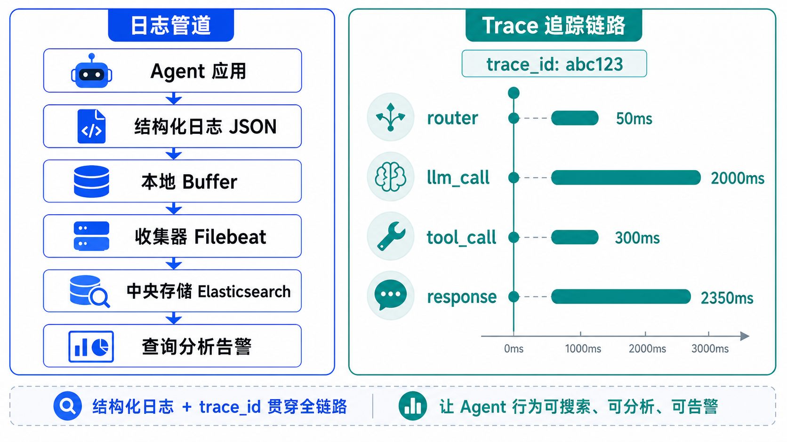

## 知识点讲解



### 1. 核心概念

Agent 系统的日志比普通 Web 服务复杂很多——一个用户请求可能触发 10 次 LLM 调用、5 次工具调用，跨越多个进程。出了问题要能快速回答：这个请求在哪一步失败的？LLM 输出了什么？工具返回了什么？

日志有三个核心用途：

1. **问题排查**：出错时能还原现场，找到哪一步出了问题
2. **性能优化**：哪个工具最慢？LLM 调用平均耗时多少？P99 是多少？
3. **监控告警**：错误率突然升高、某个工具失败率异常，要能实时发现

Agent 系统日志设计的核心原则是**结构化 + 链路追踪**：用 JSON 格式输出（机器可解析），每个请求生成唯一 `trace_id`，所有子步骤都带上这个 ID——这样一个 `trace_id` 就能串起整条链路的所有日志。

### 2. 技术细节

#### 2.1 结构化日志格式

自由文本日志难以机器解析，用 JSON 格式统一输出：

```json
{
  "timestamp": "2025-04-27T10:23:45.123Z",
  "level": "INFO",
  "trace_id": "abc123def456",
  "user_id": "user_001",
  "action": "llm_call",
  "model": "claude-3-5-sonnet-20241022",
  "input_tokens": 1200,
  "output_tokens": 300,
  "latency_ms": 2340,
  "status": "success"
}
```

字段设计：`trace_id`（请求链路唯一标识）、`action`（发生了什么）、`latency_ms`（耗时）、`status`（成功/失败）是必须有的。

#### 2.2 链路追踪

在请求入口生成 `trace_id`，后续的每一步——LLM 调用、工具调用、错误处理——都带上这个 ID。多实例部署时，只要日志都汇到一个地方（ELK、CloudWatch），用 `trace_id` 过滤就能看到完整链路。

#### 2.3 采样和分级

Agent 系统日志量很大，全量存储成本高。合理的策略：

- 正常请求按 5-10% 采样详细日志
- 错误请求 100% 保留
- LLM 输入输出内容只在 DEBUG 模式下记录（涉及用户隐私）

## 代码示例

**结构化日志 + 链路追踪**

```python
import json
import uuid
import time
import logging
from dataclasses import dataclass, field
from typing import Any

# 配置 logging 输出 JSON 格式
logging.basicConfig(level=logging.INFO, format="%(message)s")
_logger = logging.getLogger("agent")

class StructuredLogger:
    """
    结构化日志：所有日志都是 JSON，机器可解析
    每个 action 统一格式：trace_id + action + 结果
    """

    def __init__(self, service: str):
        self.service = service

    def _emit(self, level: str, action: str, trace_id: str, **kwargs) -> None:
        entry = {
            "timestamp": time.strftime("%Y-%m-%dT%H:%M:%SZ", time.gmtime()),
            "level": level,
            "service": self.service,
            "trace_id": trace_id,
            "action": action,
            **kwargs,
        }
        msg = json.dumps(entry, ensure_ascii=False)
        getattr(_logger, level.lower(), _logger.info)(msg)

    def info(self, action: str, trace_id: str, **kwargs) -> None:
        self._emit("INFO", action, trace_id, **kwargs)

    def warn(self, action: str, trace_id: str, **kwargs) -> None:
        self._emit("WARNING", action, trace_id, **kwargs)

    def error(self, action: str, trace_id: str, **kwargs) -> None:
        self._emit("ERROR", action, trace_id, **kwargs)


logger = StructuredLogger(service="agent_service")


class RequestTracer:
    """
    请求级链路追踪：生成 trace_id，记录关键步骤
    一个 trace_id 能串起整条链路的所有日志
    """

    def __init__(self, user_id: str):
        self.trace_id = str(uuid.uuid4())[:16]
        self.user_id = user_id
        self._start_time = time.time()

    def start(self) -> str:
        logger.info("request_started", self.trace_id, user_id=self.user_id)
        return self.trace_id

    def step(self, action: str, **kwargs) -> None:
        logger.info(action, self.trace_id, user_id=self.user_id, **kwargs)

    def finish(self, status: str) -> None:
        latency_ms = int((time.time() - self._start_time) * 1000)
        logger.info(
            "request_completed",
            self.trace_id,
            user_id=self.user_id,
            status=status,
            latency_ms=latency_ms,
        )


class PerformanceMonitor:
    """
    性能监控：记录各组件的延迟分布，提供 P50/P99 统计
    识别系统瓶颈，找出哪个工具/LLM 调用最慢
    """

    def __init__(self):
        self._latencies: dict[str, list[float]] = {}

    def record(self, component: str, latency_ms: float, trace_id: str = "") -> None:
        self._latencies.setdefault(component, []).append(latency_ms)

        # 超过 5 秒就记录告警日志
        if latency_ms > 5000:
            logger.warn(
                "high_latency_detected",
                trace_id or "system",
                component=component,
                latency_ms=latency_ms,
            )

    def stats(self, component: str) -> dict[str, Any]:
        data = sorted(self._latencies.get(component, []))
        if not data:
            return {}
        n = len(data)
        return {
            "count": n,
            "p50_ms": data[n // 2],
            "p95_ms": data[int(n * 0.95)],
            "p99_ms": data[int(n * 0.99)],
            "avg_ms": round(sum(data) / n, 1),
        }

    def report_all(self) -> dict[str, Any]:
        return {comp: self.stats(comp) for comp in self._latencies}


monitor = PerformanceMonitor()


# -------- 使用示例 --------

def handle_request(user_id: str, query: str) -> str:
    tracer = RequestTracer(user_id)
    tracer.start()

    try:
        # LLM 调用
        t0 = time.time()
        result = call_llm(query)
        llm_latency = int((time.time() - t0) * 1000)

        monitor.record("llm_call", llm_latency, tracer.trace_id)
        tracer.step(
            "llm_call_completed",
            model="claude-3-5-sonnet-20241022",
            latency_ms=llm_latency,
            input_tokens=result.get("input_tokens"),
        )

        tracer.finish("success")
        return result["text"]

    except Exception as e:
        logger.error(
            "request_failed",
            tracer.trace_id,
            user_id=user_id,
            error=str(e),
        )
        tracer.finish("error")
        raise

def call_llm(query: str) -> dict:
    # 实际 LLM 调用（略）
    # ...
    pass
```

## 面试怎么答

Agent 日志设计有两个核心：结构化输出和链路追踪。

结构化输出就是用 JSON 格式替代自由文本——`timestamp`、`trace_id`、`action`、`latency_ms`、`status` 这几个字段每条日志都有，这样出问题了可以直接用 `trace_id` 过滤，或者按 `action` 聚合统计，不需要人工解析日志。

链路追踪是关键：请求进来时生成一个 `trace_id`，后续所有 LLM 调用、工具调用都带上这个 ID。出问题的时候，一个 `trace_id` 就能把整条链路的日志全部捞出来——LLM 输入了什么、工具返回了什么、哪一步超时了，一目了然。

成本控制上，正常请求按 5-10% 采样详细日志，错误请求 100% 保留；LLM 的输入输出内容只在排查问题时开启 DEBUG 日志，正常情况下只记录 token 数和延迟，避免日志量爆炸。

## 高频追问 & 加分点

- **Q1：trace_id 怎么在分布式系统里传递？**  
    HTTP 请求放在 header 里（`X-Trace-ID`），微服务之间传递时每一层都从请求里读出来、写进自己的日志、再传给下游。如果用消息队列，`trace_id` 放在消息的 metadata 字段里。Python 里可以用 `contextvars.ContextVar` 在同一个异步任务链里隐式传递，不需要每个函数都手动传参。
- **Q2：日志量太大怎么控制？**  
    采样是最直接的手段——正常流量 10% 采样，错误流量全量保留。分级存储：最近 7 天的日志放在 Elasticsearch（查询快），7-90 天的压缩归档到 S3（便宜），90 天以上删掉。另外按 action 分级：LLM 调用详情只在 DEBUG 级别记录，INFO 级别只记录摘要。
- **Q3：Agent 日志和普通 Web 日志有什么不同？**  
    Agent 日志需要记录"中间过程"：LLM 的每次调用（不只是最终结果）、每次工具调用的参数和返回、Agent 的决策（为什么选择这个工具）。普通 Web 只需要记录请求和响应，Agent 需要记录整个 ReAct 循环的每一步。这让日志量大很多，但问题排查也容易很多——能回放 Agent 的决策过程。
- **Q4：性能监控指标怎么设告警阈值？**  
    先跑一段时间收集基线数据，找出 P99 延迟正常值。告警阈值一般设在基线 P99 的 2-3 倍。错误率告警设在 1%（超过就触发）。LLM 调用失败率单独统计——因为 LLM API 偶发超时是正常的，但如果 5 分钟内失败率超过 10% 就说明有系统性问题了。
- **Q5：日志里要不要记录用户输入？**  
    这是个隐私问题。生产环境默认不记录用户的原始输入内容，只记录摘要（比如长度、意图分类结果）。需要排查问题时，用加密存储的详细日志，访问需要审计。欧盟 GDPR、中国个保法都要求用户数据有明确的存储和删除规则——日志里的用户数据也在约束范围内。
