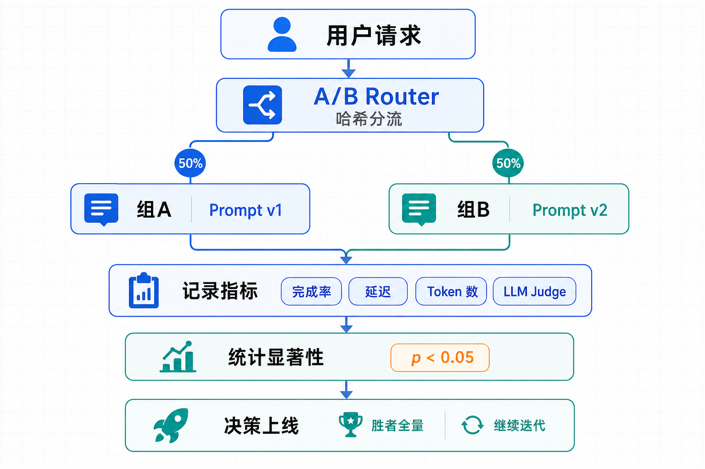

## 知识点讲解



### 1. 核心概念

Agent 的 A/B 测试和传统 Web 的 A/B 测试有一个本质区别：传统 Web 测的是点击率、转化率这种二值指标，很容易自动化判断；Agent 的输出是自然语言，"这个回答好不好"很难用规则判断，需要 LLM-as-Judge 来自动评分。

Agent 系统里常见的测试对象：

| 测试对象 | 示例 |
| --- | --- |
| Prompt 模板 | ReAct 提示 vs 结构化 CoT 提示 |
| 基础模型 | GPT-4o vs Claude 3.5 Sonnet |
| 工具策略 | 单轮工具调用 vs 多轮规划 |
| RAG 检索策略 | BM25 vs 向量检索 vs 混合检索 |
| 对话历史策略 | 全量历史 vs 摘要压缩历史 |

**核心挑战**：Agent 对话是多轮的，不能只看单轮的指标——第一轮回答得好不代表整个任务完成得好。实验单元必须是**完整的对话会话**，而不是单次请求。

### 2. 技术细节

#### 2.1 流量分配：一致性哈希

同一个用户在整个实验期间必须始终进入同一组，否则用户体验会割裂（这次用 A 版本，下次用 B 版本，对话历史都乱了）。

用一致性哈希实现：`hash(user_id + experiment_name) % 100`，结果固定，同一用户每次分配结果相同。

#### 2.2 指标体系

Agent 指标从高到低分四层：

- **L1 业务指标**：任务完成率、用户满意度（CSAT）——最重要，但需要用户显式反馈
- **L2 质量指标**：回答准确率（LLM-as-Judge）、幻觉率——可自动化
- **L3 效率指标**：平均轮次、端到端延迟——容易采集
- **L4 成本指标**：每次会话 token 消耗——容易采集

优先看 L1，L1 数据不够时用 L2 替代，L3/L4 辅助决策。

#### 2.3 统计显著性

必须在实验开始前计算需要多少样本量，不能"跑着看"——持续看数据然后决定要不要停，会导致 p-hacking（假阳性率远超 5%）。

## 代码示例

**A/B 测试路由器**

```python
import hashlib
import time
from dataclasses import dataclass, field
from typing import Any
from collections import defaultdict

@dataclass
class Experiment:
    name: str
    traffic_ratio: float    # 实验组（B）的流量比例，0-1
    variant_a: dict         # 控制组配置
    variant_b: dict         # 实验组配置

@dataclass
class ExperimentRecord:
    experiment_name: str
    group: str              # "A" 或 "B"
    config: dict
    start_time: float = field(default_factory=time.time)
    success: bool | None = None
    latency_ms: float | None = None
    tokens_used: int | None = None
    quality_score: float | None = None  # LLM-as-Judge 打分


class ABTestRouter:
    """
    一致性哈希路由：同一用户始终进同一实验组
    记录每次实验的结果，支持统计显著性分析
    """

    def __init__(self):
        self.experiments: dict[str, Experiment] = {}
        self.records: list[ExperimentRecord] = []

    def register(self, experiment: Experiment) -> None:
        self.experiments[experiment.name] = experiment

    def assign(self, experiment_name: str, user_id: str) -> ExperimentRecord:
        """分配用户到实验组，同一用户结果固定"""
        exp = self.experiments[experiment_name]

        # 一致性哈希：user_id + experiment_name 固定 → 分组固定
        key = f"{experiment_name}:{user_id}"
        hash_val = int(hashlib.md5(key.encode()).hexdigest(), 16) % 100
        in_variant_b = hash_val < exp.traffic_ratio * 100

        group = "B" if in_variant_b else "A"
        config = exp.variant_b if in_variant_b else exp.variant_a

        record = ExperimentRecord(
            experiment_name=experiment_name,
            group=group,
            config=config,
        )
        self.records.append(record)
        return record

    def report(self, experiment_name: str) -> dict[str, Any]:
        """汇总各组的关键指标"""
        records = [
            r for r in self.records
            if r.experiment_name == experiment_name and r.success is not None
        ]

        groups: dict[str, list[ExperimentRecord]] = defaultdict(list)
        for r in records:
            groups[r.group].append(r)

        result = {}
        for group, recs in groups.items():
            n = len(recs)
            success_rate = sum(1 for r in recs if r.success) / n
            avg_latency = sum(r.latency_ms for r in recs if r.latency_ms) / n
            result[group] = {
                "n": n,
                "success_rate": round(success_rate, 4),
                "avg_latency_ms": round(avg_latency, 1),
            }
        return result


# -------- 使用示例 --------

router = ABTestRouter()
router.register(Experiment(
    name="prompt_v2",
    traffic_ratio=0.5,
    variant_a={"prompt_template": "react_v1", "model": "claude-haiku-4-5"},
    variant_b={"prompt_template": "cot_v2",   "model": "claude-haiku-4-5"},
))

async def handle_request(user_id: str, query: str) -> str:
    record = router.assign("prompt_v2", user_id)

    t0 = time.time()
    try:
        result = await call_agent(query, **record.config)
        record.success = True
        record.tokens_used = result.get("tokens", 0)
        return result["answer"]
    except Exception:
        record.success = False
        raise
    finally:
        record.latency_ms = (time.time() - t0) * 1000

async def call_agent(query: str, prompt_template: str, model: str) -> dict:
    # 实际 Agent 调用（略）
    # ...
    pass
```

**统计显著性检验**

```python
import numpy as np
from scipy import stats

def ab_significance_test(
    control_success: int, control_total: int,
    variant_success: int, variant_total: int,
) -> dict[str, Any]:
    """
    双边 z 检验：判断 A/B 两组的成功率差异是否显著
    p_value < 0.05 说明差异不是随机波动
    """
    p_a = control_success / control_total
    p_b = variant_success / variant_total
    p_pool = (control_success + variant_success) / (control_total + variant_total)

    se = np.sqrt(p_pool * (1 - p_pool) * (1 / control_total + 1 / variant_total))
    z = (p_b - p_a) / se
    p_value = 2 * (1 - stats.norm.cdf(abs(z)))

    return {
        "success_rate_A": round(p_a, 4),
        "success_rate_B": round(p_b, 4),
        "lift": round((p_b - p_a) / p_a, 4),  # 相对提升
        "p_value": round(p_value, 4),
        "significant": p_value < 0.05,
    }


def required_sample_size(
    baseline_rate: float,
    min_detectable_effect: float,  # 希望能检测到的最小提升（绝对值）
    alpha: float = 0.05,
    power: float = 0.8,
) -> int:
    """
    计算每组需要的最小样本量
    实验开始前先算好，不要"跑着看"
    示例：基准完成率 70%，希望检测到 5% 的提升 → 每组约 2100 个
    """
    from statsmodels.stats.power import NormalIndPower
    analysis = NormalIndPower()
    effect_size = min_detectable_effect / np.sqrt(
        baseline_rate * (1 - baseline_rate)
    )
    n = analysis.solve_power(
        effect_size=effect_size,
        alpha=alpha,
        power=power,
        alternative="two-sided",
    )
    return int(n) + 1
```

**LLM-as-Judge 自动评分**

```python
import anthropic

client = anthropic.Anthropic()

def llm_judge(question: str, answer: str, reference: str = None) -> float:
    """
    用 LLM 评估 Agent 回答质量，归一化到 0-1
    适用于无法自动判断 success 的开放式问答场景
    """
    ref_text = f"参考答案：{reference}\n\n" if reference else ""
    prompt = f"""你是一个严格的评估者。对以下回答打分（0-10）。

问题：{question}
{ref_text}回答：{answer}

评分标准：
- 10 分：完全正确，清晰完整
- 7-9 分：基本正确，有小瑕疵
- 4-6 分：部分正确，有明显不足
- 0-3 分：错误或无关

只输出数字，不要解释。"""

    response = client.messages.create(
        model="claude-haiku-4-5",   # 评估任务用便宜模型
        max_tokens=10,
        messages=[{"role": "user", "content": prompt}],
    )
    score = float(response.content[0].text.strip())
    return score / 10.0
```

## 面试怎么答

Agent A/B 测试和传统 Web A/B 测试有两个关键差异：实验单元是完整对话会话（不是单次请求），评估指标需要 LLM-as-Judge（不能靠规则判断质量）。

流量分配用一致性哈希——`hash(user_id + 实验名) % 100`，保证同一用户整个实验期间始终在同一组，避免体验割裂。指标体系分四层：任务完成率/用户满意度（最重要）→ 回答准确率（LLM-as-Judge）→ 延迟/轮次 → Token 成本。

统计显著性这块很多团队会踩坑——不要"跑着看，差不多就停"，这会导致假阳性率远超 5%。正确的做法是实验开始前就用样本量公式算好每组需要多少样本，达到样本量才做分析。

## 高频追问 & 加分点

- **Q1：Agent 对话中间步骤需要纳入评估吗？**  
    需要，而且很重要。工具调用的成功率、中间推理的质量直接影响最终结果——有时候最终回答看起来对，但是通过了错误的推理路径，下次类似问题就会失败。在每个工具调用后记录子指标，最终聚合成会话级指标，这样能更早发现哪类任务的中间步骤有问题。
- **Q2：样本量不够怎么办？**  
    两种方案：一是拉长实验时间；二是改用贝叶斯 A/B 测试——贝叶斯方法不需要固定样本量，任何时候都能给出"B 优于 A 的概率"，适合 Agent 这种低流量场景。但贝叶斯方法需要设定先验，有一定的主观性。
- **Q3：Shadow Testing 和 A/B 测试怎么选？**  
    Shadow Testing（影子测试）是把生产流量同时发给新版本，只记录结果不展示给用户。适合高风险变更的预验证——比如换了新模型，不确定是否会有严重质量问题，先在影子模式下跑几天，确认无异常再开 A/B 测试。A/B 测试适合已经确认基本安全、需要用数据决定要不要全量上线的场景。
- **Q4：多个实验同时跑会互相干扰吗？**  
    会，这叫实验间干扰。解决方案是分层实验设计（Layer-based）：把实验分到不同的层，同一用户在同一层只参加一个实验，不同层之间正交。比如"Prompt 层"和"模型层"分开，用户在 Prompt 层参加实验 A，在模型层参加实验 B，两个实验不会互相影响。
- **Q5：LLM-as-Judge 自身有偏见怎么办？**  
    LLM-as-Judge 存在已知的偏见：倾向于给长答案更高分、对自家模型的输出评分更高（自我偏袒）。缓解方法：用不同厂商的模型做评估（比如 OpenAI 评估 Claude 的输出）；提供参考答案，让 LLM 对比而不是绝对打分；对同一个答案用不同 prompt 打分两次取平均，减少随机性。
