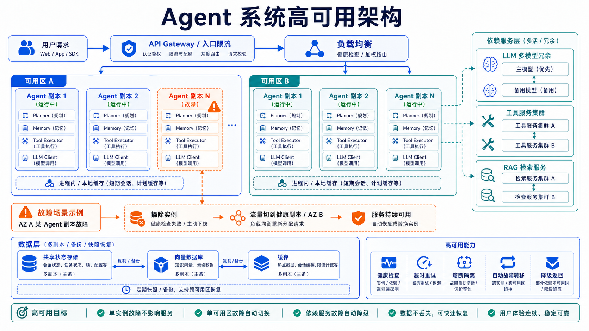

## 知识点讲解



### 1. 核心概念

高可用（High Availability）的目标是把系统停机时间降到最低。99.9%（三个九）意味着一年最多停机 8.76 小时，99.99% 是 52.6 分钟，每提升一个九成本和复杂度都会大幅上升。

| 等级 | 可用性 | 年停机时间 |
| --- | --- | --- |
| 99%（2 个九） | 99% | 87.6 小时 |
| 99.9%（3 个九） | 99.9% | 8.76 小时 |
| 99.99%（4 个九） | 99.99% | 52.6 分钟 |
| 99.999%（5 个九） | 99.999% | 5.26 分钟 |

Agent 系统高可用面临一个特殊挑战：依赖外部 LLM API（Claude、OpenAI），这个依赖本身就不是 100% 可用的——API 会有超时、限流、偶发故障。所以不能只考虑自己服务的高可用，还要考虑对外部依赖的容错。

高可用设计的四个核心原则：

1. **冗余**：关键组件多副本，没有单点故障
2. **隔离**：一个组件的故障不传播到其他组件（熔断器）
3. **快速故障转移**：发现故障后自动切换，不需要人工介入
4. **可观测**：能快速发现和定位故障（监控、告警）

### 2. 技术细节

#### 2.1 无状态设计 + 多副本

Agent 服务必须无状态：会话状态存 Redis，不存进程内存。这样任何一个实例挂掉，负载均衡直接把流量切到其他实例，用户无感知。

#### 2.2 健康检查

三层健康检查：

- **进程存活**：能响应 HTTP 请求
- **功能正常**：能成功调用 LLM（发一个简单测试请求）
- **依赖可达**：Redis、数据库连接正常

负载均衡器（Nginx、Kubernetes）每 10 秒发一次健康检查，连续 3 次失败就把实例摘出去，停止向它路由流量。

#### 2.3 熔断器（Circuit Breaker）

熔断器防止级联故障：当某个下游服务（LLM API、数据库）开始大量报错时，不要继续把请求打过去——一来请求都会失败浪费时间，二来可能把下游压垮。

三个状态：

- **CLOSED**（正常）：请求正常通过，统计错误率
- **OPEN**（熔断）：错误率超过阈值，直接拒绝请求，不打下游
- **HALF_OPEN**（探测）：熔断一段时间后，放少量请求过去试探，成功则恢复，失败则继续 OPEN

## 代码示例

**健康检查 + 负载均衡故障转移**

```python
import asyncio
import time
from enum import Enum
from dataclasses import dataclass

class HealthStatus(Enum):
    HEALTHY = "healthy"
    UNHEALTHY = "unhealthy"
    UNKNOWN = "unknown"

@dataclass
class ServiceInstance:
    instance_id: str
    url: str
    status: HealthStatus = HealthStatus.UNKNOWN
    consecutive_failures: int = 0   # 连续失败次数

class HealthChecker:
    """
    定期对所有实例做健康检查
    连续失败超过阈值 → 标记为 UNHEALTHY，不再路由流量
    """

    def __init__(self, failure_threshold: int = 3, check_interval: int = 10):
        self.instances: list[ServiceInstance] = []
        self.failure_threshold = failure_threshold
        self.check_interval = check_interval

    def register(self, instance: ServiceInstance) -> None:
        self.instances.append(instance)

    async def _check_one(self, instance: ServiceInstance) -> None:
        try:
            # 实际应该发 HTTP GET /health 到 instance.url
            await asyncio.sleep(0.05)  # 模拟网络请求
            instance.consecutive_failures = 0
            instance.status = HealthStatus.HEALTHY
        except Exception:
            instance.consecutive_failures += 1
            if instance.consecutive_failures >= self.failure_threshold:
                instance.status = HealthStatus.UNHEALTHY
            else:
                instance.status = HealthStatus.UNKNOWN

    async def run_forever(self) -> None:
        """后台周期性健康检查"""
        while True:
            await asyncio.gather(*[self._check_one(i) for i in self.instances])
            await asyncio.sleep(self.check_interval)


class LoadBalancerWithFailover:
    """
    带故障转移的负载均衡：
    优先选 HEALTHY 实例，全部不健康时降级到 UNKNOWN
    """

    def __init__(self, checker: HealthChecker):
        self.checker = checker
        self._rr_index = 0  # Round-robin 索引

    def _get_instance(self) -> ServiceInstance | None:
        healthy = [i for i in self.checker.instances
                   if i.status == HealthStatus.HEALTHY]
        if not healthy:
            # 降级：试试状态未知的实例
            healthy = [i for i in self.checker.instances
                       if i.status == HealthStatus.UNKNOWN]
        if not healthy:
            return None

        # Round-robin 轮询
        inst = healthy[self._rr_index % len(healthy)]
        self._rr_index += 1
        return inst

    async def call(self, request: dict) -> dict:
        """
        自动故障转移：当前实例失败就换下一个
        """
        tried = set()
        for _ in range(len(self.checker.instances)):
            instance = self._get_instance()
            if instance is None or instance.instance_id in tried:
                break
            tried.add(instance.instance_id)
            try:
                return await self._send_request(instance, request)
            except Exception:
                instance.consecutive_failures += 1
                # 继续循环，尝试下一个实例

        raise RuntimeError("所有实例均不可用")

    async def _send_request(self, instance: ServiceInstance, request: dict) -> dict:
        # 实际的 HTTP 调用（略）
        # ...
        pass
```

**熔断器（Circuit Breaker）**

```python
class CircuitBreaker:
    """
    熔断器：防止级联故障
    CLOSED → (错误率过高) → OPEN → (等待超时) → HALF_OPEN → (恢复) → CLOSED
    """

    def __init__(self, failure_threshold: int = 5, recovery_timeout: int = 60):
        self.failure_threshold = failure_threshold
        self.recovery_timeout = recovery_timeout
        self._failure_count = 0
        self._last_failure_time = 0.0
        self._state = "CLOSED"  # CLOSED / OPEN / HALF_OPEN

    @property
    def state(self) -> str:
        if self._state == "OPEN":
            # 超过恢复超时时间 → 进入探测状态
            if time.time() - self._last_failure_time > self.recovery_timeout:
                self._state = "HALF_OPEN"
        return self._state

    async def call(self, func, *args, **kwargs):
        if self.state == "OPEN":
            raise RuntimeError("熔断器开启，服务不可用，请稍后重试")

        try:
            result = await func(*args, **kwargs)
            if self._state == "HALF_OPEN":
                # 探测成功，恢复正常
                self._state = "CLOSED"
                self._failure_count = 0
            return result

        except Exception as e:
            self._failure_count += 1
            self._last_failure_time = time.time()
            if self._failure_count >= self.failure_threshold:
                self._state = "OPEN"   # 触发熔断
            raise


# 使用示例
llm_breaker = CircuitBreaker(failure_threshold=5, recovery_timeout=60)

async def call_llm_with_breaker(prompt: str) -> str:
    """
    LLM 调用包一层熔断器：
    连续 5 次失败 → 熔断 60 秒 → 自动探测恢复
    """
    async def _call():
        # 实际 LLM 调用（略）
        # ...
        pass

    return await llm_breaker.call(_call)
```

**FastAPI 健康检查端点**

```python
from fastapi import FastAPI
import anthropic
import redis.asyncio as aioredis
import psutil

app = FastAPI()
redis_client = aioredis.Redis(host="localhost", port=6379)

@app.get("/health")
async def health_check():
    """
    多维度健康检查：进程资源 + 关键依赖
    负载均衡器用这个端点判断实例是否可接受流量
    """
    issues = []

    # 1. 资源检查
    cpu = psutil.cpu_percent(interval=0.5)
    mem = psutil.virtual_memory().percent
    if cpu > 90:
        issues.append(f"CPU 过高: {cpu}%")
    if mem > 85:
        issues.append(f"内存过高: {mem}%")

    # 2. Redis 连通性
    try:
        await redis_client.ping()
    except Exception:
        issues.append("Redis 不可达")

    is_healthy = len(issues) == 0
    return {
        "status": "healthy" if is_healthy else "degraded",
        "cpu_percent": cpu,
        "memory_percent": mem,
        "issues": issues,
    }, 200 if is_healthy else 503
```

## 面试怎么答

Agent 系统的高可用要从两个层面考虑：自己服务的高可用，以及对外部 LLM API 依赖的容错。

自己服务的高可用：无状态设计是前提——会话状态存 Redis，任何实例挂掉都可以无感知切换；多副本部署，Kubernetes 维持副本数量，实例挂掉自动拉起；健康检查三维度——进程存活、功能正常（能调 LLM）、依赖可达（Redis 通），连续 3 次失败就摘出去不再路由流量。

对 LLM API 的容错：熔断器是核心——LLM API 连续 5 次超时或报错就触发熔断，后续请求直接返回错误而不是再打 API，60 秒后自动探测恢复。熔断期间可以返回降级回答（"系统繁忙，请稍后再试"），比让用户等到超时体验要好。

## 高频追问 & 加分点

- **Q1：依赖的 LLM API 挂了怎么办？**  
    多 Provider 备份是最可靠的方案：主 Claude，备 GPT-4o，Claude 报错超过阈值自动切换到备用。前提是两个 Provider 的 API 调用方式要统一抽象，切换时应用层感知不到。如果两个都挂了，降级到规则型回答（FAQ 匹配）或者直接告知用户"AI 服务暂时不可用"。
- **Q2：熔断器的参数（失败阈值、恢复超时）怎么设？**  
    失败阈值设在 5-10 次——太小容易误触发（LLM API 偶发超时很正常），太大容易放太多失败请求过去。恢复超时设 30-120 秒，取决于下游服务的恢复速度。实际要根据真实的 API 故障特征调整：收集历史故障数据，看平均恢复时间是多少，比那个时间短一点设 timeout。
- **Q3：Redis 挂了会怎样？怎么保证 Redis 本身高可用？**  
    Redis 挂了会话状态丢失，用户要重新开始对话。缓解方案：Redis Sentinel（主从 + 自动主从切换）或 Redis Cluster（分片 + 高可用）。对于最关键的数据，Redis 只做缓存层，持久化存 PostgreSQL，Redis 挂了从 DB 恢复。另外设 Redis 的 TTL 和内存上限，防止内存打满导致雪崩。
- **Q4：多可用区部署的数据一致性怎么保证？**  
    强一致性（同步复制）延迟高，一般用最终一致性。会话状态用 Redis（同一区域内），如果用户请求切换到了另一个区域，会话历史短暂不可用——降级策略是让用户重新开始对话。跨区域同步适合低频的重要数据（用户配置、权限）而不是高频的会话数据。
- **Q5：可用性 SLA 怎么和业务对齐？**  
    计算年停机预算：99.9% 是 8.76 小时。把这个小时数分配给不同原因：计划维护（比如 4 小时），故障（比如 4.76 小时）。基于此设计故障检测 + 恢复的时间目标：MTTD（平均检测时间）要在 5 分钟内，MTTR（平均恢复时间）要在 30 分钟内——这样大部分故障的停机时间在 35 分钟以内，一年几次故障加起来不超过 4.76 小时的预算。
