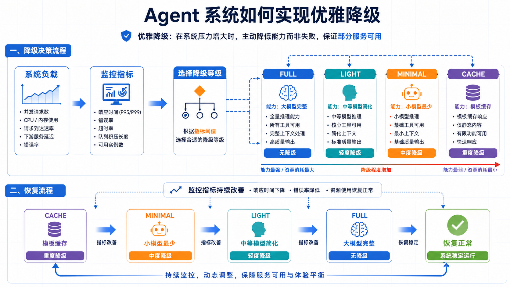

## 知识点讲解



### 1. 核心概念

优雅降级（Graceful Degradation）的核心思路是：系统过载或依赖出问题时，主动降低服务质量，而不是直接拒绝或崩溃。说白了，就是"给不了最好的，至少给一个能用的"。

降级和熔断是两个不同的概念：熔断是"直接不处理了，返回错误"；降级是"用更简单的方式处理，给个质量低一点的结果"。能降级尽量降级，降级不了再熔断。

Agent 系统的降级分三个层次：

| 层次 | 触发条件 | 降级手段 |
| --- | --- | --- |
| 质量降级 | LLM API 慢/贵 | 换便宜小模型，或用缓存结果 |
| 功能降级 | 系统负载高 | 禁用工具调用，只用纯 LLM 回答 |
| 流量降级 | 并发超限 | 拒绝低优先级请求，保障高优先级 |

触发降级的信号：CPU 超过 85%、内存超过 90%、LLM 调用延迟 P99 超过阈值、外部工具失败率超过 20%——这些都应该有监控，触发时自动切换降级策略。

### 2. 技术细节

#### 2.1 降级策略的执行顺序

降级不是二元的（要么正常要么崩溃），而是有层次的：

1. **正常**：完整功能，大模型 + 所有工具
2. **轻度降级**：禁用耗时工具（搜索、数据库），只用 LLM + 本地知识
3. **中度降级**：换成便宜的小模型（Haiku 替代 Sonnet）
4. **重度降级**：直接返回缓存结果，不调用 LLM
5. **最终降级**：返回固定模板回答（"系统繁忙，请稍后重试"）

#### 2.2 上下文截断

对话历史过长时也可以降级处理：保留最近 N 轮对话，丢弃早期历史。这比直接拒绝请求要好——用户至少能继续对话，只是 Agent 对早期内容的记忆变短了。

#### 2.3 自动恢复

降级不是永久的。持续监控系统指标，当指标恢复正常后自动升级回高质量处理。不需要人工介入，但要有告警通知（"系统已从降级模式恢复"）。

## 代码示例

**降级级别判断器**

```python
import time
import psutil
from enum import IntEnum
from dataclasses import dataclass

class DegradationLevel(IntEnum):
    FULL    = 0   # 完整功能：大模型 + 全部工具
    LIGHT   = 1   # 轻度降级：禁用慢工具
    MEDIUM  = 2   # 中度降级：换小模型
    MINIMAL = 3   # 重度降级：纯缓存
    REJECT  = 4   # 拒绝请求

class SystemHealthMonitor:
    """
    实时监控系统指标，自动判断当前应该处于哪个降级级别
    """

    def __init__(
        self,
        llm_latency_p99_threshold_ms: float = 5000,
    ):
        self.llm_latency_p99_threshold = llm_latency_p99_threshold_ms
        self._recent_llm_latencies: list[float] = []

    def record_llm_latency(self, latency_ms: float) -> None:
        self._recent_llm_latencies.append(latency_ms)
        if len(self._recent_llm_latencies) > 100:
            self._recent_llm_latencies.pop(0)

    def _llm_p99(self) -> float:
        if not self._recent_llm_latencies:
            return 0.0
        sorted_data = sorted(self._recent_llm_latencies)
        return sorted_data[int(len(sorted_data) * 0.99)]

    def get_level(self) -> DegradationLevel:
        cpu = psutil.cpu_percent(interval=0.1)
        mem = psutil.virtual_memory().percent
        llm_p99 = self._llm_p99()

        if cpu > 95 or mem > 95:
            return DegradationLevel.REJECT
        if cpu > 90 or mem > 90:
            return DegradationLevel.MINIMAL
        if llm_p99 > self.llm_latency_p99_threshold:
            return DegradationLevel.MEDIUM
        if cpu > 80 or mem > 85:
            return DegradationLevel.LIGHT
        return DegradationLevel.FULL
```

**可降级的 Agent 处理器**

```python
import anthropic

client = anthropic.Anthropic()
monitor = SystemHealthMonitor(llm_latency_p99_threshold_ms=5000)

# 各降级级别对应的模型和工具配置
LEVEL_CONFIG = {
    DegradationLevel.FULL: {
        "model": "claude-3-5-sonnet-20241022",
        "max_tokens": 2048,
        "enable_tools": True,
    },
    DegradationLevel.LIGHT: {
        "model": "claude-3-5-sonnet-20241022",
        "max_tokens": 1024,
        "enable_tools": False,     # 禁用工具，减少延迟
    },
    DegradationLevel.MEDIUM: {
        "model": "claude-haiku-4-5",  # 换小模型
        "max_tokens": 512,
        "enable_tools": False,
    },
    DegradationLevel.MINIMAL: None,   # 仅从缓存返回
}

FALLBACK_RESPONSE = "系统当前负载较高，暂时无法处理您的请求，请稍后重试。"

def handle_request(
    user_message: str,
    tools: list[dict],
    response_cache: dict[str, str],
) -> dict[str, str]:
    """
    根据当前系统状态自动选择处理策略
    降级是透明的——用户始终能得到一个回复
    """
    level = monitor.get_level()

    # 重度降级：直接返回缓存或固定回复
    if level == DegradationLevel.REJECT:
        return {"text": FALLBACK_RESPONSE, "degraded": True, "level": "reject"}

    if level == DegradationLevel.MINIMAL:
        cached = response_cache.get(user_message)
        return {
            "text": cached or FALLBACK_RESPONSE,
            "degraded": True,
            "level": "minimal",
        }

    # 正常/轻/中度降级：调用 LLM，但用不同配置
    config = LEVEL_CONFIG[level]
    active_tools = tools if config["enable_tools"] else []

    t0 = time.time()
    response = client.messages.create(
        model=config["model"],
        max_tokens=config["max_tokens"],
        tools=active_tools or [],
        messages=[{"role": "user", "content": user_message}],
    )
    latency_ms = (time.time() - t0) * 1000
    monitor.record_llm_latency(latency_ms)

    text = next((b.text for b in response.content if hasattr(b, "text")), "")
    return {
        "text": text,
        "degraded": level != DegradationLevel.FULL,
        "level": level.name.lower(),
        "model": config["model"],
    }
```

**上下文截断降级**

```python
def truncate_messages_if_needed(
    messages: list[dict],
    max_messages: int = 20,
) -> tuple[list[dict], bool]:
    """
    对话历史超长时截断，保留最近的对话
    返回 (截断后的消息列表, 是否触发了截断)
    """
    if len(messages) <= max_messages:
        return messages, False

    # 保留最近 max_messages 条，丢弃早期历史
    truncated = messages[-max_messages:]

    # 在第一条消息前插入说明，让 LLM 知道历史被截断了
    truncated = [
        {"role": "user", "content": "[注：早期对话历史因长度限制已省略]"},
        {"role": "assistant", "content": "好的，我会基于当前可见的对话继续协助您。"},
    ] + truncated

    return truncated, True
```

## 面试怎么答

优雅降级的核心思路是：系统压力大时，主动降低质量而不是直接拒绝。我会设计四个降级层次。

最轻的是功能降级——禁用慢工具（搜索、数据库查询），只用 LLM 自身知识回答，延迟能从 5 秒降到 1 秒。然后是模型降级——把 Sonnet 换成 Haiku，成本降 10 倍，延迟也更低。再然后是缓存降级——相同问题直接返回缓存结果，跳过 LLM 调用。最后是拒绝——系统实在承受不了了，返回"稍后重试"。

触发条件要有自动监控：CPU 超过 85%、LLM 调用 P99 超过阈值、工具失败率超过 20%——这些指标超标时自动切换，指标恢复后自动升级回正常。降级对用户要透明（能得到回复），但在日志里要记录当前在哪个降级级别，方便运维分析。

## 高频追问 & 加分点

- **Q1：降级后用户感知到质量变差怎么处理？**  
    可以主动告知用户当前处于简化模式："由于系统繁忙，我暂时无法查询实时数据，以下回答基于我的知识库..."。这比悄悄降级又不告知要好——用户知道结果可能有限制，不会对错误结果产生错误信任。
- **Q2：降级会不会形成恶性循环？**  
    会有这个风险：降级后用户重试频率增加，反而加剧负载。防范方式：降级时同时触发限流，减少新请求进入；另外降级后的小模型处理更快，吞吐量实际上比大模型高，有自我缓解效果。
- **Q3：怎么测试降级路径有没有问题？**  
    混沌工程（Chaos Engineering）：在测试环境人为注入故障——模拟 LLM API 超时、Redis 断连、CPU 打高——验证每条降级路径的行为是否符合预期。每次上线前把关键故障场景跑一遍，确保降级路径不会出现意外错误（比如降级路径里也有一个调用出错，导致降级本身也失败了）。
- **Q4：优雅降级和熔断器是什么关系？**  
    配合使用。熔断器负责"要不要向下游发请求"——连续失败超阈值就熔断，不再发；优雅降级负责"不发下游请求的情况下给用户什么回复"——是返回缓存、小模型回答、还是固定文案。熔断决定了流量走向，降级决定了用户体验。
- **Q5：降级策略需要产品和业务一起参与设计吗？**  
    必须的。哪些功能是核心、不能降级（比如金融交易的风险检查）；哪些可以牺牲（比如对话的上下文长度）——这个优先级排序必须有业务侧确认，不能纯粹由工程侧自己定。另外降级后的用户提示文案也需要产品文案团队一起写，不能直接暴露技术术语给用户。
