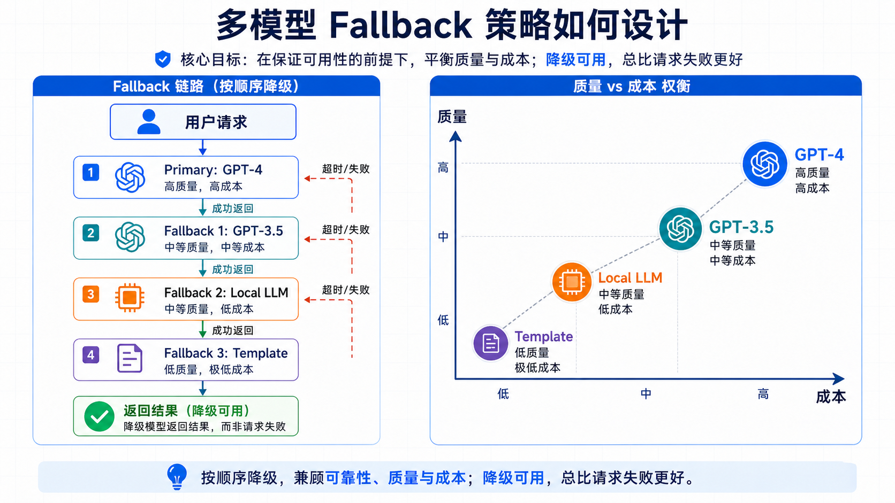

## 知识点讲解



### 1. 核心概念

多模型 Fallback 解决的是一个现实问题：没有任何一个 LLM Provider 能保证 100% 可用。Claude API 会有偶发超时，OpenAI 也会有 503。如果系统只依赖一个 Provider，那可用性上限就是那个 Provider 的可用性——通常是 99.9%，意味着一年可能有 8 小时不可用。

多模型 Fallback 的思路是建立一个模型链：主模型失败了，自动切换到备用模型，用户基本无感知。

Fallback 有两类触发条件：

- **硬失败**：API 超时、返回 5xx 错误、限流 429——这类立即 Fallback
- **软失败**：输出质量不满足要求（格式错误、长度太短）——这类可以先重试，重试失败再 Fallback

Fallback 链的设计原则：越靠前的模型质量越高、成本越高，越靠后的越便宜快速，最后是兜底的规则型回答。

### 2. 技术细节

#### 2.1 典型的模型链

```
主：Claude Sonnet（质量高，成本中）
  ↓ 超时或 5xx
备用 1：GPT-4o-mini（便宜，速度快）
  ↓ 也失败
备用 2：Claude Haiku（极便宜，延迟低）
  ↓ 也失败
兜底：规则型模板回答
```

#### 2.2 超时策略

不同模型设置不同的超时时间：主模型可以等 10 秒，备用模型只等 5 秒，因为切到备用说明系统已经有压力了，不能再慢了。

#### 2.3 失败统计和自动禁用

如果某个模型在最近 5 分钟内失败率超过 50%，就临时禁用它，等一段时间后再尝试恢复。不要在一个已经大概率失败的模型上反复重试。

## 代码示例

**多模型 Fallback 链**

```python
import asyncio
import time
from dataclasses import dataclass, field
from enum import Enum
import anthropic
from openai import AsyncOpenAI

class FailureType(Enum):
    TIMEOUT      = "timeout"
    API_ERROR    = "api_error"      # 5xx / 429
    BAD_OUTPUT   = "bad_output"     # 输出格式不对
    DISABLED     = "disabled"       # 失败率过高，临时禁用

@dataclass
class ModelStats:
    """记录每个模型的成功/失败次数，用于动态禁用失败模型"""
    success: int = 0
    failure: int = 0
    disabled_until: float = 0.0   # 临时禁用到这个时间戳

    def is_available(self) -> bool:
        return time.time() > self.disabled_until

    def failure_rate(self) -> float:
        total = self.success + self.failure
        return self.failure / total if total > 0 else 0.0

    def maybe_disable(self, disable_seconds: int = 300) -> None:
        """失败率超过 50% 时临时禁用"""
        if self.failure_rate() > 0.5 and self.failure >= 5:
            self.disabled_until = time.time() + disable_seconds


class ModelFallbackChain:
    """
    多模型 Fallback 链：主模型失败自动切到备用
    每个模型有独立的超时和失败统计
    """

    def __init__(self):
        self._anthropic = anthropic.AsyncAnthropic()
        self._openai = AsyncOpenAI()

        # Fallback 链：按优先级排列
        self._chain = [
            {"name": "claude-sonnet",  "timeout": 10.0},
            {"name": "gpt-4o-mini",    "timeout": 5.0},
            {"name": "claude-haiku",   "timeout": 5.0},
        ]
        self._stats: dict[str, ModelStats] = {
            m["name"]: ModelStats() for m in self._chain
        }

    async def _call_claude_sonnet(self, messages: list[dict], max_tokens: int) -> str:
        response = await self._anthropic.messages.create(
            model="claude-3-5-sonnet-20241022",
            max_tokens=max_tokens,
            messages=messages,
        )
        return response.content[0].text

    async def _call_gpt4o_mini(self, messages: list[dict], max_tokens: int) -> str:
        response = await self._openai.chat.completions.create(
            model="gpt-4o-mini",
            max_tokens=max_tokens,
            messages=messages,
        )
        return response.choices[0].message.content

    async def _call_claude_haiku(self, messages: list[dict], max_tokens: int) -> str:
        response = await self._anthropic.messages.create(
            model="claude-haiku-4-5",
            max_tokens=max_tokens,
            messages=messages,
        )
        return response.content[0].text

    _CALLERS = {
        "claude-sonnet": _call_claude_sonnet,
        "gpt-4o-mini":   _call_gpt4o_mini,
        "claude-haiku":  _call_claude_haiku,
    }

    async def call(
        self,
        messages: list[dict],
        max_tokens: int = 1024,
    ) -> dict[str, str]:
        """
        按 Fallback 链依次尝试，返回第一个成功结果
        同时记录用的是哪个模型（用于监控）
        """
        last_error = None

        for model_cfg in self._chain:
            name = model_cfg["name"]
            stats = self._stats[name]

            if not stats.is_available():
                continue  # 临时禁用，跳过

            caller = self._CALLERS[name]
            try:
                text = await asyncio.wait_for(
                    caller(self, messages, max_tokens),
                    timeout=model_cfg["timeout"],
                )
                stats.success += 1
                return {"text": text, "model": name, "fallback": name != "claude-sonnet"}

            except asyncio.TimeoutError:
                stats.failure += 1
                stats.maybe_disable()
                last_error = f"{name} 超时"

            except Exception as e:
                stats.failure += 1
                stats.maybe_disable()
                last_error = f"{name} 报错: {e}"

        # 所有模型都失败，返回兜底回复
        return {
            "text": "当前服务暂时不可用，请稍后重试。",
            "model": "fallback_template",
            "fallback": True,
            "error": last_error,
        }

    def stats_report(self) -> dict:
        return {
            name: {
                "success": s.success,
                "failure": s.failure,
                "failure_rate": round(s.failure_rate(), 3),
                "available": s.is_available(),
            }
            for name, s in self._stats.items()
        }
```

**带重试的 Fallback（区分软硬失败）**

```python
async def call_with_retry_then_fallback(
    chain: ModelFallbackChain,
    messages: list[dict],
    validate_output,           # 函数：str -> bool，检查输出是否合格
    max_retries: int = 2,
) -> dict[str, str]:
    """
    软失败（输出不合格）先重试，重试失败再 Fallback
    硬失败（超时/API 错误）直接 Fallback，不重试
    """
    for attempt in range(max_retries):
        result = await chain.call(messages)

        if result["model"] == "fallback_template":
            # 硬失败，直接返回
            return result

        if validate_output(result["text"]):
            return result

        # 软失败：输出不合格，加提示重试
        messages = messages + [
            {"role": "assistant", "content": result["text"]},
            {"role": "user", "content": "请检查输出格式，确保按要求输出，再试一次。"},
        ]

    # 重试耗尽，返回最后一次结果（带降级标记）
    return {**result, "fallback": True, "note": "输出质量未达标"}
```

## 面试怎么答

多模型 Fallback 的核心是建立一个有优先级的模型链，主模型失败自动切换到备用，用户无感知。

触发条件分两类：硬失败（超时、5xx、429）立即切换，不重试——因为重试同一个模型大概率还是失败，浪费时间；软失败（输出格式不对、质量不达标）先重试 1-2 次，重试失败再切换。

每个模型要维护成功/失败计数，失败率超过 50% 就临时禁用 5 分钟，避免反复在一个已经挂了的模型上重试。同时记录"用了哪个模型"的指标——如果发现 Fallback 频率很高，说明主模型有问题，需要排查。

## 高频追问 & 加分点

- **Q1：Fallback 到质量更低的模型，用户会感知到质量下降吗？**  
    取决于任务类型。简单问答（分类、提取）Haiku 和 Sonnet 差别不大，用户感知不到；复杂推理、长文本分析差别就很明显。所以 Fallback 策略最好按任务类型区分——简单任务的 Fallback 链可以直接到便宜模型，复杂任务的 Fallback 要保守，降级到中等模型，不能直接跳到最便宜的。
- **Q2：多 Provider Fallback 有什么坑？**  
    API 格式不统一——Claude 和 OpenAI 的请求/响应格式不同，需要统一抽象。另外要注意 system prompt 的行为可能不同，同样的 prompt 在 Claude 和 GPT-4o 上效果可能有差异，Fallback 后输出风格会变化。最好针对每个 Provider 分别测试 prompt 效果，或者用 LangChain 这类做了统一抽象的框架。
- **Q3：Fallback 应该对用户透明吗？**  
    内部透明（日志里记录用了哪个模型），对用户可以不透明——用户不需要知道后台换了什么模型。但如果降级影响了输出质量（比如从 Sonnet 降到 Haiku，某些复杂问题可能回答变简单），可以加一行提示："当前使用简化模式，如需更详细的分析请稍后重试"。
- **Q4：Fallback 和 A/B 测试怎么区分？**  
    Fallback 是被动的：主模型出了问题才切，目的是保可用性。A/B 测试是主动的：主动把流量分给两个模型，目的是比较哪个更好。两者可以同时存在——正常情况下 A/B 测试路由流量，某个模型出问题时 Fallback 自动切走，保证测试不会因为模型故障而损失流量。
- **Q5：如何监控 Fallback 的频率？**  
    在每次 LLM 调用结果里记录 `model_used` 字段，汇总到监控系统。关键指标：主模型命中率（正常应该 > 95%）、各备用模型的使用频率、Fallback 的原因分布（超时 vs 错误 vs 质量不达标）。主模型命中率持续低说明主模型有系统性问题，需要排查是限流、服务故障还是 prompt 问题。
