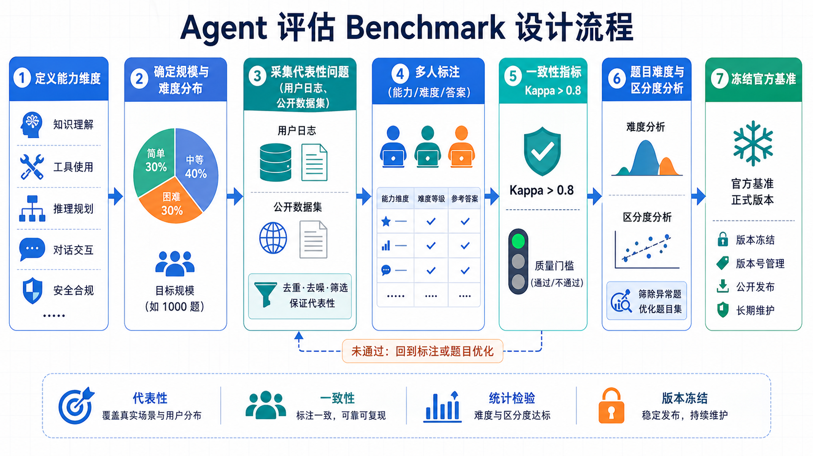

## 知识点讲解



### 1. 核心概念

Benchmark 是一套标准化测试集，用来在同一尺度下量化和比较不同系统的能力。Agent Benchmark 的设计目标是：公平、有区分度、能自动化评分、覆盖真实应用场景。

设计时有三条原则不能丢：

**代表性**：题目分布要反映真实场景，不能尽是简单问答；  
**区分度**：要能有效区分好系统和差系统，一套题让所有人都 95 分以上，没有任何意义；  
**可评估性**：结果得能打分，要么自动化验证，要么能高效人工标注。

### 2. 技术细节

#### 2.1 能力维度设计

一个完整的 Agent Benchmark 至少要覆盖以下维度：

| 能力维度 | 评估内容 | 示例任务 |
| --- | --- | --- |
| 知识问答 | 访问和整合知识库 | 多跳维基百科检索 |
| API 调用 | 正确理解和使用工具 | 根据描述调用正确 API 并填参数 |
| 网页导航 | 在复杂交互界面完成任务 | 在购物网站搜索并下订单 |
| 代码执行 | 编写和执行代码解决问题 | 写 Python 统计分析并返回结果 |
| 多步推理 | 跨多个推理步骤的规划 | 5+ 跳推理链 |
| 错误恢复 | 工具失败或中间步骤出错时的处理 | 工具超时后的重试或换策略 |

#### 2.2 难度分布设计

建议的分布：**简单 30% + 中等 50% + 困难 20%**。

- 简单（直接查询、单步工具调用）：让系统能得基础分，避免 benchmark 太打击信心
- 中等（2-3 步操作、简单推理）：这是大多数真实任务的复杂度
- 困难（复杂推理、多步规划、边界情况）：真正区分强弱的地方

困难题的比例不宜太高，否则所有系统分数都趴在地上，难以看出差距。

#### 2.3 从数据采集到发布的完整流程

| 步骤 | 关键任务 | 质量门槛 |
| --- | --- | --- |
| 需求定义 | 确定评估哪些能力，画维度表 | — |
| 数据采集 | 从用户日志、专家、公开集里采，量要 2-3 倍于目标 | — |
| 分类标注 | 按能力/难度打标签，附标注指南 | — |
| 答案标注 | 标注预期输出和允许的工具调用路径 | 多人标注 |
| 质量控制 | 计算标注一致性，审核争议题 | Cohen's Kappa > 0.8 |
| 统计分析 | 分析题目分布、难度曲线 | — |
| 版本发布 | 冻结版本，建立基线 leaderboard | — |

#### 2.4 静态 vs 动态 Benchmark

静态 benchmark 有版本号，适合追踪进展，但时间一长容易被过拟合——系统针对测试集优化，离线高分、在线翻车。动态 benchmark 定期更新，防过拟合，但版本间数字没法直接比较。

实践里比较务实的做法：**维护一个冻结的静态版本用于公开报告，同时有一个内部动态集用于日常开发**，两者互补。

## 代码示例

```python
import json
from dataclasses import dataclass
from enum import Enum
from typing import List, Dict


class Difficulty(Enum):
    EASY = "easy"
    MEDIUM = "medium"
    HARD = "hard"


class Capability(Enum):
    KNOWLEDGE_QA = "knowledge_qa"
    API_CALL = "api_call"
    REASONING = "reasoning"
    CODE_EXEC = "code_exec"
    ERROR_RECOVERY = "error_recovery"


@dataclass
class BenchmarkItem:
    item_id: str
    question: str
    expected_answer: str
    capability: Capability
    difficulty: Difficulty
    required_tools: List[str]
    valid_answers: List[str]  # 多答案场景


class BenchmarkDesigner:
    def __init__(self):
        self.items: List[BenchmarkItem] = []

    def add_item(self, item: BenchmarkItem):
        self.items.append(item)

    def analyze_distribution(self) -> Dict:
        cap_dist: Dict[str, int] = {}
        diff_dist: Dict[str, int] = {}

        for item in self.items:
            cap_dist[item.capability.value] = cap_dist.get(item.capability.value, 0) + 1
            diff_dist[item.difficulty.value] = diff_dist.get(item.difficulty.value, 0) + 1

        total = len(self.items)
        return {
            "total_items": total,
            "capability_distribution": cap_dist,
            "difficulty_distribution": diff_dist,
            # 检查难度比例是否合理
            "difficulty_ratio": {
                k: v / total for k, v in diff_dist.items()
            },
        }

    def validate_distribution(self) -> List[str]:
        """检查 benchmark 设计是否符合规范，返回告警列表"""
        warnings = []
        dist = self.analyze_distribution()
        ratio = dist["difficulty_ratio"]

        easy_ratio = ratio.get("easy", 0)
        hard_ratio = ratio.get("hard", 0)

        if easy_ratio < 0.2 or easy_ratio > 0.4:
            warnings.append(f"Easy题比例 {easy_ratio:.0%}，建议 20%-40%")
        if hard_ratio < 0.1 or hard_ratio > 0.3:
            warnings.append(f"Hard题比例 {hard_ratio:.0%}，建议 10%-30%")
        if dist["total_items"] < 200:
            warnings.append(f"样本量 {dist['total_items']} 偏少，建议至少 200")

        return warnings

    def export(self, output_path: str):
        data = {
            "metadata": self.analyze_distribution(),
            "items": [
                {
                    "id": item.item_id,
                    "question": item.question,
                    "expected_answer": item.expected_answer,
                    "valid_answers": item.valid_answers,
                    "capability": item.capability.value,
                    "difficulty": item.difficulty.value,
                    "required_tools": item.required_tools,
                }
                for item in self.items
            ],
        }
        with open(output_path, "w", encoding="utf-8") as f:
            json.dump(data, f, ensure_ascii=False, indent=2)
```

## 面试怎么答

设计 Agent Benchmark 的核心是三个原则：代表性（题目分布反映真实场景）、区分度（能有效区分强弱系统）、可评估性（结果能自动化或高效人工打分）。三个少哪个，benchmark 都会失真。

能力维度上，我一般至少覆盖知识检索、API 调用、多步推理、代码执行、错误恢复这几块。难度分布建议简单 30%、中等 50%、困难 20%——困难题太多会让所有系统都趴底，看不出差距。

标注质量这块是最容易被忽略的。多人标注并计算 Cohen's Kappa（目标 > 0.8），争议题要专家裁决，不能少数服从多数。标注指南也很重要，得先写清楚"什么算对、什么算错"，再让人去标，不然标注者会各自理解。

另外，benchmark 容易被过拟合——系统刷分并不代表真实能力提升。应对方法是：公开发布的冻结版本用来和外部对比，内部再维护一个动态集，定期加新题，防止开发团队在测试集上过度优化。

## 高频追问 & 加分点

- **Q1：Benchmark 多大才有意义？**  
    100 个能出初步数字，1000 个才足够稳定地横向比较。公开发布给社区用的 benchmark 一般需要 2000-5000 个样本，不然统计噪声太大，排名随机性很高。
- **Q2：如何确保标注质量？**  
    多人独立标注，算 Cohen's Kappa，争议项专家裁决，标注指南写清楚每种分类的判断标准和示例。不要让标注者自己摸索规则——规则模糊，标注结果就会发散。
- **Q3：Benchmark 被刷了怎么办？**  
    发现 benchmark 上的成绩和在线用户体验严重脱节时，通常说明有过拟合。应对方案：发布新版本 benchmark，把旧版本"退役"成公开参考；同时维护一个不公开的动态评估集，作为内部判断的真正标准。
- **Q4：自建 benchmark 和公开 benchmark 怎么配合使用？**  
    公开 benchmark（比如 AgentBench、SWE-bench）用来确认自己在通用能力上没有明显短板，可以和业界横向比较；自建的才是评估系统在自己业务上能否打的核心工具，两个并行不悖。
