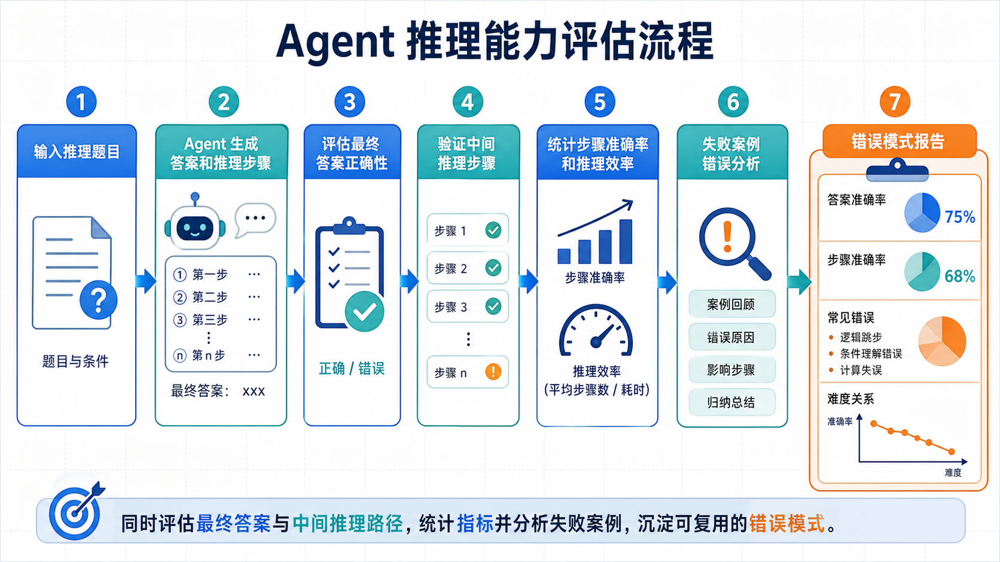

## 知识点讲解



### 1. 核心概念

推理能力是 Agent 的核心，也是最难评估的一块。难在哪？难在**答案对了，不代表推理对了**。

Agent 可能走了一条歪路，中间推理步骤全错，最后凭着某个巧合拿到了正确答案。这种情况如果只看答案，你会以为它推理能力不错；但如果换一道类似的题，它大概率又要翻车。

所以评估推理能力，必须同时看两个维度：**最终答案**和**推理过程**。缺一个，评估结果都不可信。

推理能力的五个子维度：

- **演绎推理**：从一般规则到具体情况（如果 A 则 B，A 成立，所以 B）
- **归纳推理**：从具体案例抽象出规律
- **类比推理**：基于相似性做类推
- **常识推理**：用日常知识做判断
- **反事实推理**：如果某个条件变了，结论怎么变

这五个维度的难度不一样，设计评估集时最好分层覆盖。

### 2. 技术细节

**评估指标**：

| 指标 | 含义 | 计算方式 | 特点 |
| --- | --- | --- | --- |
| 答案正确率 | 最终答案有没有对 | 正确数 / 总题数 | 必要但不够 |
| 推理步骤准确率 | 中间步骤逻辑有没有出错 | 正确步骤 / 总步骤数 | 需要人工标注 |
| 推理效率 | 用了几步，和最优解比 | 最优步骤数 / 实际步骤数 | 越接近 1 越好 |
| 推理鲁棒性 | 换一道相似题还对不对 | 变体题正确数 / 变体题总数 | 考察泛化能力 |

**具体评估方法**：

第一，**思维链评估（CoT Evaluation）**。让 Agent 把推理步骤写出来，然后逐步检查每个步骤是否合理。不需要和标准答案一字不差，但逻辑推进方向要对。

第二，**多跳推理分层测试**。推理题按跳数分级：2 跳（A → B → 结论）、3 跳、5 跳。跳数越多越难，测出来的曲线能直观反映 Agent 的推理能力上限。

第三，**反事实干扰测试**。在题目里加一个干扰条件，看 Agent 能不能识别它是无效的，不被它带偏。这个测试很能暴露"语言流畅但推理松散"的问题。

第四，**人工抽样审查**。自动化测的只能告诉你对错，推理是否严密只有人看才知道。通常抽 10-20% 做深度审查，每季度一次。

**推理评估的代码实现**：

```python
from typing import List, Dict, Any


class ReasoningEvaluator:
    """评估 Agent 的推理能力，同时关注最终答案和推理过程。"""

    def evaluate_reasoning(
        self,
        question: str,
        agent_response: Dict[str, Any],
        expected: Dict[str, Any],
    ) -> Dict[str, Any]:
        actual_steps = agent_response.get("reasoning_steps", [])
        expected_steps = expected.get("reasoning_steps", [])

        return {
            "question": question,
            "final_answer_correct": agent_response.get("answer") == expected.get("answer"),
            "reasoning_steps": actual_steps,
            "steps_correct": self._evaluate_steps(actual_steps, expected_steps),
            "step_count": len(actual_steps),
            "optimal_step_count": len(expected_steps),
        }

    def _evaluate_steps(
        self,
        actual: List[str],
        expected: List[str],
    ) -> List[bool]:
        results = []
        for i, exp_step in enumerate(expected):
            if i < len(actual):
                results.append(self._step_matches(actual[i], exp_step))
            else:
                results.append(False)  # 步骤缺失
        return results

    def _step_matches(self, actual: str, expected: str) -> bool:
        # 生产里换成语义相似度（BERTScore 等），这里用简化版
        return actual.lower().strip() == expected.lower().strip()

    def aggregate_metrics(self, results: List[Dict[str, Any]]) -> Dict[str, float]:
        if not results:
            return {}

        n = len(results)
        answer_correct = sum(1 for r in results if r["final_answer_correct"])

        total_steps = sum(len(r["steps_correct"]) for r in results)
        correct_steps = sum(
            sum(r["steps_correct"]) for r in results
        )

        efficiency_sum = sum(
            r["optimal_step_count"] / r["step_count"]
            if r["step_count"] > 0
            else 0
            for r in results
        )

        return {
            "answer_accuracy": answer_correct / n,
            "step_accuracy": correct_steps / total_steps if total_steps else 0,
            "avg_step_efficiency": efficiency_sum / n,
            "avg_steps_used": sum(r["step_count"] for r in results) / n,
        }

    def find_error_patterns(self, results: List[Dict[str, Any]]) -> Dict[str, int]:
        """区分'推理错但答案对'和'推理+答案都错'两类情况。"""
        patterns: Dict[str, int] = {
            "reasoning_error_answer_wrong": 0,
            "reasoning_error_answer_correct": 0,  # 推理有误但巧合拿对答案
        }
        for r in results:
            if not all(r["steps_correct"]):
                if r["final_answer_correct"]:
                    patterns["reasoning_error_answer_correct"] += 1
                else:
                    patterns["reasoning_error_answer_wrong"] += 1
        return patterns


def evaluate_multihop_reasoning(
    evaluator: ReasoningEvaluator,
    test_cases_by_hops: Dict[int, List[Dict[str, Any]]],
) -> Dict[int, Dict[str, float]]:
    """按推理跳数分层评估，测出 Agent 的推理能力上限。"""
    hop_results: Dict[int, Dict[str, float]] = {}
    for hops, cases in test_cases_by_hops.items():
        results = [
            evaluator.evaluate_reasoning(
                c["question"], c["agent_response"], c["expected"]
            )
            for c in cases
        ]
        hop_results[hops] = evaluator.aggregate_metrics(results)
    return hop_results
```

### 3. 对比与拓展

一个容易忽视的点：推理能力和记忆能力要区分开。

有些题目看起来需要推理，其实就是考背诵——知道这个历史事件的日期，知道这个公式，直接答出来就行。真正的推理题，把背景换成一个虚构的世界，要求用题目里给出的规则推导出结论。这种题测的才是推理，而不是知识储备。

设计评估集的时候，建议专门准备一组"虚构场景"推理题，这样能把推理能力和知识记忆干净地分开。

## 代码示例

上方"技术细节"部分已包含完整的推理评估代码，核心是 `ReasoningEvaluator` 类和多跳分层评估函数 `evaluate_multihop_reasoning`。

## 面试怎么答

推理能力评估最难的地方，是答案对了不等于推理对了。Agent 可能走一条歪路，中间步骤全错，最后巧合拿到正确答案。如果只看答案，完全看不出这个问题。

所以评估推理，我会同时测两个维度：最终答案正确率，加上推理步骤的逐步检查。步骤检查需要提前标注参考步骤，然后对比逻辑推进方向是否一致。

具体做法上，我会按推理跳数分层出题——2 跳、3 跳、5 跳，难度递增。跳数越多，Agent 的错误率通常会明显上升，这条曲线能直观反映能力上限在哪里。另外会定期做反事实干扰测试，在题目里加一个无效条件，看 Agent 能不能识别并无视它。

自动化指标之外，每季度还需要抽 10-20% 做人工审查。自动化测的只能判断对错，推理是否真的严密，还是得人来看。

## 高频追问 & 加分点

- **Q1：推理步骤的正确性怎么自动化评估？**  
    简单场景可以用关键词匹配。生产里更常用 BERTScore（语义相似度）或者专门训练一个 NLI 分类器来判断步骤是否蕴含正确结论。另外，让 LLM 本身来判断步骤是否合理也是一种方案，但要注意 LLM-as-Judge 的偏差问题。加分信号：提到 BERTScore 或 NLI 的，说明真的实践过，不是背的概念。
- **Q2：答案正确但推理错误，这种情况怎么处理？**  
    这类"幸运答对"是最危险的——让你产生虚假的安全感，但换一道稍微不同的题就会翻车。处理方法是：在错误分析里专门统计这类情况的比例，如果比例高，说明 Agent 是在"猜"而不是"推"，需要针对性强化推理链。加分信号：能把这个错误模式单独拎出来分析，说明理解了评估的深层目的。
- **Q3：多跳推理评估，跳数怎么定？**  
    没有固定标准，看你的实际任务。对于日常问答场景，2-3 跳已经覆盖大部分情况；对于复杂分析类任务，可能要测到 5-7 跳。建议从线上数据里采样，看真实任务的平均推理跳数，然后以这个分布设计测试集。
- **Q4：推理能力测出来很差，优先改哪个方向？**  
    先看失败集中在哪个跳数。如果 2 跳都不行，问题在基本的逻辑理解上，优先换更强的基座模型或优化 CoT prompt；如果 2-3 跳还行但 5 跳崩了，是长链推理能力的问题，可以考虑分解任务或引入"思考节点"让 Agent 先规划再执行。
