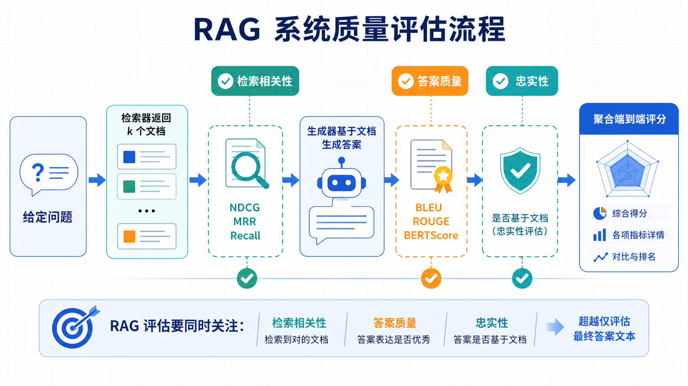

## 知识点讲解



### 1. 核心概念

RAG 系统的评估比单纯问答评估复杂，因为它有两个可以分别出问题的模块：**检索器**和**生成器**。

检索不好，生成再强也没用——你给一个好厨师一堆烂食材，做不出好菜。但检索好了，生成也可以搞砸——把正确的文档喂给它，它可能还是总结错了，或者忽略了关键信息，甚至"发挥"了文档里没有的内容（幻觉）。

所以 RAG 评估必须分三层：

1. **检索层**：检索器有没有找到相关文档？
2. **生成层**：生成器有没有基于这些文档给出正确答案？
3. **端到端**：整体有没有完成任务？答案有没有"忠实"于文档？

三层分开测，出了问题才知道是检索的锅还是生成的锅。

### 2. 技术细节

**各层的核心指标**：

| 层级 | 指标 | 含义 | 计算方式 |
| --- | --- | --- | --- |
| 检索层 | Recall@k | k 个结果里召回了多少相关文档 | 找到的相关文档数 / 总相关文档数 |
| 检索层 | MRR（Mean Reciprocal Rank） | 第一个相关文档排在第几位 | 1 / 第一个相关文档的位置 |
| 检索层 | NDCG | 考虑了相关程度权重的排序质量 | 折损累计增益归一化 |
| 生成层 | ROUGE-L | 答案和参考答案的最长公共子序列 | 召回和精确率的调和平均 |
| 生成层 | BERTScore | 语义层面的相似度 | 基于 BERT embedding 的余弦相似 |
| 端到端 | Answer Correctness | 最终答案对不对 | 精确匹配或人工判断 |
| 端到端 | Faithfulness（忠实性） | 答案的内容是否来自检索文档 | 有文档支持的句子比例 |

忠实性（Faithfulness）是 RAG 特有的指标，普通 QA 不需要关注。它测的是：生成的答案里，有多大比例的信息是从检索文档里来的，而不是模型"凭空编造"的。

**具体评估方法**：

检索层评估：对每个问题，准备一份标注好"哪些文档是相关的"的 ground truth。检索器返回 top-k 个结果，对比 ground truth 计算 Recall、MRR、NDCG。

生成层评估：固定检索结果，评估生成器在这个输入下的表现。用 ROUGE 或 BERTScore 和参考答案对比。

忠实性评估：把生成的答案按句子切分，逐句判断该句的信息能不能在检索文档里找到依据。这步通常需要 LLM-as-Judge 辅助，或者用 NLI 分类器。

**RAG 评估代码实现**：

```python
from typing import Any, Dict, List


class RAGEvaluator:
    """三层评估 RAG 系统：检索、生成、端到端。"""

    # ---------- 检索层 ----------

    def evaluate_retrieval(
        self,
        retrieved_docs: List[Dict[str, Any]],
        relevant_doc_ids: List[str],
        k: int = 5,
    ) -> Dict[str, float]:
        retrieved_ids = [d["id"] for d in retrieved_docs[:k]]
        relevant_retrieved = [i for i, rid in enumerate(retrieved_ids) if rid in relevant_doc_ids]

        # Recall@k
        recall_at_k = len(relevant_retrieved) / len(relevant_doc_ids) if relevant_doc_ids else 0.0

        # MRR
        mrr = 1.0 / (relevant_retrieved[0] + 1) if relevant_retrieved else 0.0

        # NDCG（简化版，只区分相关/不相关）
        dcg = sum(
            1.0 / (pos + 2)  # log2(pos+2) 近似
            for pos in relevant_retrieved
        )
        ideal_dcg = sum(1.0 / (i + 2) for i in range(len(relevant_doc_ids)))
        ndcg = dcg / ideal_dcg if ideal_dcg > 0 else 0.0

        return {"recall_at_k": recall_at_k, "mrr": mrr, "ndcg": ndcg}

    # ---------- 生成层 ----------

    def evaluate_generation(
        self,
        generated: str,
        reference: str,
    ) -> Dict[str, float]:
        gen_tokens = set(generated.lower().split())
        ref_tokens = set(reference.lower().split())
        overlap = len(gen_tokens & ref_tokens)

        precision = overlap / len(gen_tokens) if gen_tokens else 0.0
        recall = overlap / len(ref_tokens) if ref_tokens else 0.0
        f1 = (
            2 * precision * recall / (precision + recall)
            if (precision + recall) > 0
            else 0.0
        )
        return {"precision": precision, "recall": recall, "f1": f1}

    # ---------- 忠实性评估 ----------

    def evaluate_faithfulness(
        self,
        generated: str,
        retrieved_docs: List[Dict[str, Any]],
    ) -> float:
        """计算生成答案中有多少比例的句子能在检索文档里找到依据。"""
        sentences = [s.strip() for s in generated.split(".") if s.strip()]
        if not sentences:
            return 0.0

        doc_corpus = " ".join(d.get("content", "") for d in retrieved_docs).lower()
        supported = sum(1 for sent in sentences if sent.lower() in doc_corpus)
        return supported / len(sentences)

    # ---------- 端到端汇总 ----------

    def evaluate_end_to_end(
        self,
        generated: str,
        reference: str,
        retrieved_docs: List[Dict[str, Any]],
        relevant_doc_ids: List[str],
    ) -> Dict[str, Any]:
        retrieval = self.evaluate_retrieval(retrieved_docs, relevant_doc_ids)
        generation = self.evaluate_generation(generated, reference)
        faithfulness = self.evaluate_faithfulness(generated, retrieved_docs)

        return {
            "retrieval": retrieval,
            "generation": generation,
            "faithfulness": faithfulness,
            "answer_exact_match": generated.lower().strip() == reference.lower().strip(),
        }

    def aggregate(self, results: List[Dict[str, Any]]) -> Dict[str, float]:
        n = len(results)
        if n == 0:
            return {}

        return {
            "avg_recall_at_k": sum(r["retrieval"]["recall_at_k"] for r in results) / n,
            "avg_mrr": sum(r["retrieval"]["mrr"] for r in results) / n,
            "avg_ndcg": sum(r["retrieval"]["ndcg"] for r in results) / n,
            "avg_generation_f1": sum(r["generation"]["f1"] for r in results) / n,
            "avg_faithfulness": sum(r["faithfulness"] for r in results) / n,
            "exact_match_rate": sum(1 for r in results if r["answer_exact_match"]) / n,
        }
```

### 3. 对比与拓展

一个实用的诊断思路：看"检索质量"和"最终答案质量"之间有没有明显落差。

如果检索 Recall@5 很高（该找的文档都找到了），但最终答案质量差，说明问题在生成器——可能是 Prompt 问题，可能是生成器没有充分利用检索文档。这种情况，重点优化生成侧。

如果检索 Recall@5 就很低，那优先修检索，换更好的 embedding 模型或者加 reranker，生成器再强也救不了。

这个"检索-生成落差分析"在实际排查问题时非常有用，能快速定位是哪一层的问题。

## 面试怎么答

RAG 评估要分三层来做：检索层、生成层、端到端。不分层就容易搞不清楚到底是检索的问题还是生成的问题。

检索层的核心指标是 Recall@k 和 MRR——前者测有没有把相关文档检回来，后者测相关文档排在第几位。生成层用 ROUGE 或 BERTScore 和参考答案对比，测文本质量。

RAG 还有一个专属指标叫忠实性（Faithfulness），测的是生成答案里有多少信息是来自检索文档的，而不是模型凭空编造的。这个指标直接反映了幻觉问题，在 RAG 场景里比 ROUGE 还重要。

排查问题的时候，我会先看检索质量和最终答案质量之间有没有落差。如果检索很好但答案差，问题在生成侧；如果检索本身就差，先修检索，换更好的 embedding 模型或者加 reranker，其他的优化再说。

## 高频追问 & 加分点

- **Q1：RAG 评估集怎么构建？标注成本高怎么办？**  
    标注成本高是实际痛点。一个降成本的方法是半自动化：用 LLM 生成候选的问题-答案对，人工只做审核和修改，而不是从零开始标注。另外，优先覆盖高频用户查询，而不是均匀采样。加分信号：提到"LLM 辅助生成 + 人工审核"的混合标注方案，说明真的思考过规模化问题。
- **Q2：ROUGE 和 BERTScore 哪个更好？**  
    用途不同。ROUGE 快、计算成本低，适合大规模粗筛；BERTScore 理解语义，"意思相同但表述不同"的答案 BERTScore 会给高分而 ROUGE 会误判。生产里通常两个都用，ROUGE 做快速过滤，BERTScore 做精细评估。加分信号：能说清楚两者的区别和适用场景，而不是说哪个"更好"。
- **Q3：k 值怎么选？检索几个文档合适？**  
    没有固定答案，需要实验。通常的方法是：以 k=1、3、5、10 分别测 Recall，看 Recall 提升在哪个 k 值趋于平缓，再结合 context window 限制和成本，找到那个拐点。我的经验是大多数场景 k=5 是个不错的起点，复杂多跳问题可能要 k=10。
- **Q4："检索好但生成差"和"检索差但生成弥补了"，怎么区分？**  
    构造对比组：A 组用真实检索结果，B 组直接给 oracle 文档（ground truth 相关文档）。如果 A 组差、B 组好，说明检索出了问题；如果 A 组和 B 组差不多差，说明生成器本身有问题。这个对照实验能干净地区分两种情况，是诊断 RAG 系统的标准手段。
