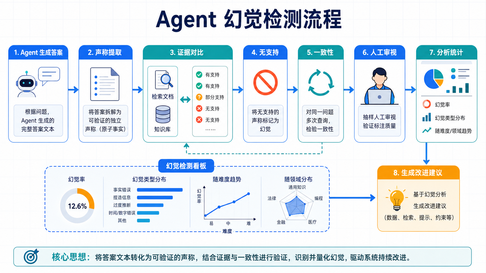

## 知识点讲解



### 1. 核心概念

幻觉是 Agent 系统在生产环境里最难处理的问题之一——它不像崩溃那样显而易见，而是悄无声息地生成"听起来很合理但其实是假的"内容。

幻觉按来源分四类：

- **外在幻觉**：生成了和事实不符的信息（历史日期错了、数字编造了）
- **内在幻觉**：生成内容和提供的上下文文档自相矛盾
- **推理幻觉**：推理链条中间某步逻辑跳错了，得出假结论
- **创意性幻觉**：遇到知识盲区时，编一个听起来合理的填充内容

这四类的危害程度不同，检测方法也不一样。内在幻觉最容易自动化检测（文档和生成内容对比就行），外在幻觉最难（需要外部知识库做对标）。

幻觉最反直觉的一点：**高置信度的幻觉比低置信度的幻觉更危险**。当 Agent 用确定的语气给你一个假信息，比它支支吾吾说不确定，危害大得多——因为用户更容易轻信。

### 2. 技术细节

**核心检测指标**：

| 指标 | 含义 | 侧重点 |
| --- | --- | --- |
| 幻觉率 | 包含幻觉的答案占比 | 越低越好，核心指标 |
| 事实准确率 | 可验证事实声称中准确的比例 | 衡量事实层面的可靠性 |
| 忠实度（Faithfulness） | 答案声称有文档依据的比例 | RAG 场景的核心 |
| 一致性分数 | 同一问题多次查询答案的一致程度 | 低一致性往往暗示幻觉 |
| 置信度校准误差 | 模型自报置信度和实际准确率的差距 | 越小说明模型"知道自己不知道" |

**检测方法**：

第一，**依据检验（Evidence Verification）**：针对 RAG 场景最有用。把答案按句子拆分，逐句判断该句的声称有没有检索文档支持。用 NLI 分类器（Natural Language Inference）效果最好——它能判断"文档 A 是否支持/反驳/中立于声称 B"，精度比简单字符串匹配高很多。

第二，**自动化事实检验**：从答案里抽取命名实体（人名、日期、数字），去对照外部知识库（Wikipedia、专有知识图谱）验证。抽实体+验证这套流程现在有成熟工具，但知识库覆盖范围是瓶颈。

第三，**一致性检验**：同一个问题换多种措辞问三遍，比较三次答案的相似度。高度一致不等于没幻觉（一致的幻觉更危险），但高不一致几乎一定有问题。

第四，**人工抽样审查**：定期抽 10-20% 做深度人工核查，发现自动化方法漏掉的系统性盲点。

**幻觉检测代码实现**：

```python
from typing import Any, Dict, List


class HallucinationDetector:
    """多维度检测 Agent 输出的幻觉问题。"""

    def __init__(self, knowledge_base: Dict[str, Any]) -> None:
        self.kb = knowledge_base

    def detect(
        self,
        answer: str,
        retrieved_docs: List[Dict[str, Any]],
    ) -> Dict[str, Any]:
        """对单个答案做综合幻觉检测。"""
        claims = self._extract_claims(answer)
        verified, hallucinated = [], []

        for claim in claims:
            if self._is_supported(claim, retrieved_docs):
                verified.append(claim)
            else:
                hallucinated.append(claim)

        return {
            "total_claims": len(claims),
            "verified": len(verified),
            "hallucinated": len(hallucinated),
            "hallucination_rate": len(hallucinated) / len(claims) if claims else 0.0,
            "hallucinated_claims": hallucinated,
        }

    def _extract_claims(self, answer: str) -> List[str]:
        # 生产里用 NLP 抽取命名实体+关键声称；这里简化为句子级
        return [s.strip() for s in answer.split(".") if s.strip()]

    def _is_supported(self, claim: str, docs: List[Dict[str, Any]]) -> bool:
        """检查声称是否被文档或知识库支持。"""
        doc_text = " ".join(d.get("content", "") for d in docs).lower()
        if claim.lower() in doc_text:
            return True
        # 知识库兜底查询
        if claim.lower() in str(self.kb).lower():
            return True
        return False

    def check_consistency(
        self,
        answers: List[str],
    ) -> Dict[str, float]:
        """同一问题多次回答的一致性检验。"""
        if len(answers) < 2:
            return {"consistency_score": 1.0}

        sim_sum = 0.0
        count = 0
        for i in range(len(answers) - 1):
            sim_sum += self._token_jaccard(answers[i], answers[i + 1])
            count += 1

        avg_sim = sim_sum / count if count else 1.0
        return {
            "consistency_score": avg_sim,
            "is_inconsistent": avg_sim < 0.5,  # 低于 0.5 认为高度不一致
        }

    def _token_jaccard(self, s1: str, s2: str) -> float:
        t1, t2 = set(s1.lower().split()), set(s2.lower().split())
        return len(t1 & t2) / len(t1 | t2) if (t1 | t2) else 0.0

    def check_confidence_calibration(
        self,
        results: List[Dict[str, Any]],
        confidence_threshold: float = 0.8,
    ) -> Dict[str, float]:
        """检查高置信度答案的实际准确率——理想情况应该接近 confidence_threshold。"""
        high_conf = [r for r in results if r.get("confidence", 0) >= confidence_threshold]
        if not high_conf:
            return {}

        actual_accuracy = sum(1 for r in high_conf if r.get("correct", False)) / len(high_conf)
        calibration_error = abs(actual_accuracy - confidence_threshold)

        return {
            "high_confidence_count": len(high_conf),
            "actual_accuracy_at_high_conf": actual_accuracy,
            "expected_confidence": confidence_threshold,
            "calibration_error": calibration_error,
            "is_overconfident": actual_accuracy < confidence_threshold - 0.1,
        }

    def batch_detect(
        self,
        cases: List[Dict[str, Any]],
    ) -> Dict[str, Any]:
        """批量检测，返回汇总统计。"""
        results = [
            self.detect(c["answer"], c.get("retrieved_docs", []))
            for c in cases
        ]
        n = len(results)
        avg_hallucination_rate = sum(r["hallucination_rate"] for r in results) / n if n else 0.0

        return {
            "total_cases": n,
            "avg_hallucination_rate": avg_hallucination_rate,
            "cases_with_hallucination": sum(1 for r in results if r["hallucinated"] > 0),
        }
```

### 3. 对比与拓展

自动化检测 vs 人工审查，这两个不是替代关系，是分工关系。

自动化检测处理量大、速度快，适合全量监控；但它的覆盖范围受限于知识库和 NLI 模型的能力，有漏检。人工审查覆盖更广、判断更准确，但成本高，只能做抽样。最好的实践是：自动化检测做全量初筛，把高风险样本（高置信度 + 检测到疑似幻觉）优先送人工复核。

另外，一致性检验是一个成本低但容易被忽视的检测手段。不需要额外的知识库，只要多问几遍同一个问题，看答案稳不稳定。答案飘忽的问题往往暗示着 Agent 对这个领域的知识不稳固，值得重点关注。

## 面试怎么答

幻觉检测要分类型来做，不同类型幻觉的检测方法差异很大。内在幻觉（生成内容和文档矛盾）最容易检测，直接用 NLI 分类器对比声称和文档就行；外在幻觉（事实错误）需要外部知识库做对标，难度高很多。

我们实际用的是三层检测：第一层，依据检验——把答案每句话拆开，看有没有文档依据，这是 RAG 场景里最有效的一层；第二层，一致性检验——同一个问题问三遍，低一致性的直接标记为高风险；第三层，置信度校准检查——高置信度回答但实际上是幻觉的，是危害最大的类型，需要重点盯。

自动化检测做全量监控，高风险样本送人工复核，这个组合是实际可落地的方案。纯人工太贵，纯自动化漏检太多，两者结合才能在成本和准确性之间找到平衡。

## 高频追问 & 加分点

- **Q1：一致性高就说明没有幻觉吗？**  
    不一定，甚至可能相反——"稳定的幻觉"比随机幻觉更危险，因为看起来更可信。一致性检验是一个筛选工具，不是幻觉的充分条件。高不一致一定有问题，但高一致不等于没问题，还需要叠加事实验证。加分信号：能指出"一致的幻觉"这个反直觉的情况，说明理解了检测的局限性。
- **Q2：在没有外部知识库的情况下怎么做事实检验？**  
    几个降级方案：第一，把自身知识库（文档库）当作真相来源，做内在一致性检验；第二，用多模型交叉验证——让两个不同模型分别回答，高度分歧的内容重点标记；第三，要求 Agent 在每个事实声称后面附上来源，没有来源的声称自动标记为需核查。加分信号：提到"来源引用要求"这个工程手段，简单实用但很有效。
- **Q3：幻觉率降不下来，从哪里入手？**  
    先看幻觉集中在哪类内容。如果集中在某个知识领域，优先补充该领域的文档到知识库；如果幻觉类型是"补充了文档里没有的细节"，是典型的 RAG 生成器问题，需要在 Prompt 里明确约束"只基于提供的文档回答，不确定的说不知道"；如果是系统性高估自信（置信度校准差），考虑在 Prompt 里加"如果不确定请明确说明"的指令。
- **Q4：幻觉检测和内容安全过滤有什么区别？**  
    角度不同。内容安全过滤关注的是"有没有生成有害内容（违规、歧视、隐私）"，幻觉检测关注的是"内容是否准确（事实对不对、有没有依据）"。两者都需要，但方法完全不同。幻觉检测更难，因为安全过滤有相对明确的规则，幻觉判断需要领域知识。
