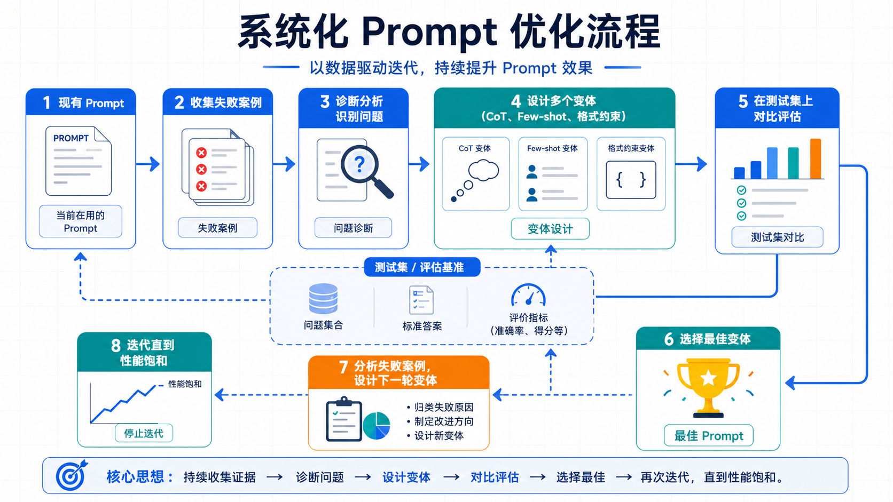

## 知识点讲解



### 1. 核心概念

Prompt 是你和 LLM 之间的接口。很多人把 Prompt 当一次性的事——写完提交就不管了。但做过一段时间工程的人都知道，Prompt 需要像代码一样迭代、有版本、有测试。

Prompt 优化的核心价值在于：**成本最低，见效最快**。不需要重新训练模型，不需要改架构，改几行文字可能就能带来 5-15% 的性能提升。

但"系统地优化"和"随机调改"是两回事。随机调改的问题在于你不知道是哪个改动带来了提升，下次出了问题也不知道怎么回退。系统地优化有四个环节：

1. **诊断**：从失败案例里找问题
2. **设计**：提出多个假设，设计对应的变体
3. **评估**：在固定测试集上量化对比，不靠感觉
4. **迭代**：选最好的变体作为新基线，继续下一轮

Prompt 优化的难点有三个：一是黑盒性，改了一句话效果为什么变了很难解释；二是模型依赖，对 Claude 有效的 Prompt 对 GPT-4 未必有效；三是过度拟合，在验证集上调出来的最优 Prompt，放到真实数据上可能并没有那么好。

### 2. 技术细节

**Prompt 的关键组件**：

| 组件 | 作用 | 示例 |
| --- | --- | --- |
| 系统角色（Role） | 锚定模型的能力范围和风格 | "你是一个专注于代码审查的资深工程师…" |
| 任务描述（Task） | 明确要做什么 | "分析以下代码的潜在问题…" |
| 约束条件（Constraints） | 边界和禁忌 | "不要包含个人观点，只分析技术问题" |
| 输出格式（Format） | 结构化输出，便于解析 | "以 JSON 格式返回，字段为 issues 和 severity" |
| 示例（Examples） | Few-shot 锚定期望的输出 | "示例输入…期望输出…" |
| 推理引导（Reasoning） | 触发 CoT 思维 | "先分析问题的根本原因，再给出建议" |

**常见的有效技巧**：

- **CoT（Chain-of-Thought）**：加一句"请一步步思考"。对需要推理的任务效果显著，但对简单查询反而可能引入多余的中间步骤甚至出错。
- **Few-shot 示例**：3-5 个精心挑选的示例，比写 500 字的任务描述更有效。示例要覆盖边界情况，不要只展示理想案例。
- **结构化输出**：要求 JSON 格式，大幅降低解析失败率，也让评估变得容易。
- **负面约束**：告诉模型"不要做什么"往往比"要做什么"更有效。比如"不要凭空推测，如果不确定请明确说明"。

**Prompt 优化实验框架**：

```python
from typing import Any, Dict, List


class PromptOptimizer:
    """系统化 Prompt 优化：多变体设计 → 固定测试集评估 → 迭代。"""

    def __init__(self, agent: Any, evaluator: Any) -> None:
        self.agent = agent
        self.evaluator = evaluator
        self.experiment_log: List[Dict[str, Any]] = []

    # ---------- 变体设计 ----------

    def generate_variants(self, base_prompt: str) -> List[Dict[str, str]]:
        """围绕不同优化假设生成变体，每个变体对应一个明确的改动方向。"""
        return [
            {
                "name": "baseline",
                "hypothesis": "当前基线",
                "prompt": base_prompt,
            },
            {
                "name": "with_cot",
                "hypothesis": "CoT 能改善推理类错误",
                "prompt": base_prompt + "\n\n请先逐步分析，再给出最终答案。",
            },
            {
                "name": "with_format_constraint",
                "hypothesis": "明确格式能降低解析失败率",
                "prompt": base_prompt + "\n\n以 JSON 格式返回，字段：{answer, confidence, reasoning}",
            },
            {
                "name": "with_negative_constraints",
                "hypothesis": "负面约束能减少幻觉",
                "prompt": base_prompt + "\n\n如果不确定，请明确说明。不要凭空推测未知信息。",
            },
            {
                "name": "combined",
                "hypothesis": "组合优化",
                "prompt": self._build_combined(base_prompt),
            },
        ]

    def _build_combined(self, base: str) -> str:
        return (
            base
            + "\n\n请先逐步分析，再给出最终答案。"
            + "\n如果不确定，明确说明，不要凭空推测。"
            + "\n以 JSON 格式返回：{answer, confidence, reasoning}"
        )

    # ---------- 评估实验 ----------

    def run_experiment(
        self,
        variants: List[Dict[str, str]],
        test_cases: List[Dict[str, Any]],
    ) -> List[Dict[str, Any]]:
        """在同一测试集上评估所有变体，保证对比公平。"""
        results = []
        for variant in variants:
            score = self._score_prompt(variant["prompt"], test_cases)
            result = {
                "name": variant["name"],
                "hypothesis": variant["hypothesis"],
                "score": score,
                "test_count": len(test_cases),
            }
            results.append(result)
            self.experiment_log.append(result)
        return results

    def _score_prompt(
        self,
        prompt: str,
        test_cases: List[Dict[str, Any]],
    ) -> float:
        """在测试集上运行并计算成功率。"""
        success = 0
        for case in test_cases:
            self.agent.system_prompt = prompt
            output = self.agent.run(case["question"])
            if self.evaluator.is_correct(output, case["expected"]):
                success += 1
        return success / len(test_cases) if test_cases else 0.0

    # ---------- 结果分析 ----------

    def pick_winner(
        self,
        results: List[Dict[str, Any]],
    ) -> Dict[str, Any]:
        baseline = next((r for r in results if r["name"] == "baseline"), None)
        best = max(results, key=lambda r: r["score"])

        summary = {
            "winner": best["name"],
            "winner_score": best["score"],
            "baseline_score": baseline["score"] if baseline else 0.0,
        }
        if baseline:
            improvement = best["score"] - baseline["score"]
            summary["absolute_improvement"] = improvement
            summary["relative_improvement"] = (
                improvement / baseline["score"] if baseline["score"] > 0 else 0.0
            )
        return summary

    def analyze_failure_patterns(
        self,
        prompt: str,
        test_cases: List[Dict[str, Any]],
    ) -> Dict[str, int]:
        """找出当前 Prompt 下失败案例的共同特征，指导下一轮改动方向。"""
        error_types: Dict[str, int] = {}
        for case in test_cases:
            self.agent.system_prompt = prompt
            output = self.agent.run(case["question"])
            if not self.evaluator.is_correct(output, case["expected"]):
                err = case.get("error_type", "unknown")
                error_types[err] = error_types.get(err, 0) + 1
        return error_types
```

### 3. 对比与拓展

Prompt 优化的"过度拟合"风险值得特别讲一下。

你在一个 50 题的验证集上反复调，最终调出了一个在这 50 题上得分 92% 的 Prompt。但放到线上真实数据上，可能只有 78%。这不是特例，是 Prompt 优化里非常常见的现象。

应对方法：把数据集分成验证集（用来调 Prompt）和测试集（只在最终验证时用一次）。验证集可以反复跑，测试集不能参与优化过程，只是最终的决策依据。这和机器学习的 train/val/test 划分是同一个思路。

另外，Prompt 版本要管理。不能靠脑子记"上次改了什么"，要有 prompt registry，每个版本有 ID、改动说明、对应的评估结果。这不是大团队才需要的，两个人的项目出了线上 bug，第一件事就是能快速回滚到上一个版本。

## 面试怎么答

Prompt 优化要系统化，不能靠感觉乱改。我的流程是四步：诊断失败案例、设计变体、在固定测试集上量化对比、选最优变体继续迭代。

设计变体的时候，每个变体对应一个明确的假设——"加 CoT 是为了改善推理类错误"、"要求 JSON 格式是为了降低解析失败率"——每次只改一个变量，这样知道是哪个改动起了作用。

有一个容易踩的坑是过度拟合。在验证集上反复调出来的最优 Prompt，放到真实数据上效果会打折。做法是提前把数据分成验证集和测试集，测试集只在最终决策时用一次，不参与优化过程。

Prompt 版本要管理，有 registry、有 ID、有评估结果记录，出了线上问题能快速回滚。这是生产项目必须做的。

## 高频追问 & 加分点

- **Q1：CoT 一定有效吗？**  
    不是。对需要推理的任务（多步逻辑、数学推导），CoT 通常有明显效果；对简单的分类、检索、改写任务，CoT 反而可能引入多余的中间步骤，让模型绕弯路，出错的概率反而上升。判断标准：任务的正确答案需要几步推理？超过 2 步的才比较适合 CoT。加分信号：能说出"CoT 不是万能的，简单任务反而可能有害"，说明真的做过对比实验。
- **Q2：Few-shot 示例怎么选？**  
    三个原则：覆盖边界情况（不要只选理想案例）、包含容易出错的典型失败类型（给模型看"这种情况正确答案是这样的"）、示例数量不要太多（3-5 个足够，超过 10 个会增加 token 成本且边际效益递减）。加分信号：提到用失败案例设计 few-shot 示例，这是真正有效的做法。
- **Q3：Prompt 在不同模型间通用吗？**  
    不完全通用。同一个 Prompt 在 Claude、GPT-4、Llama 上效果可能差很多，因为不同模型的指令理解方式、偏好的表达风格都不一样。换模型必须重新做 Prompt 评估，不能直接迁移。加分信号：提到"换模型时要重新做 Prompt 评估"，说明踩过这个坑。
- **Q4：Prompt 优化到什么时候可以停？**  
    两个停止标准：连续三轮迭代提升幅度都低于 2%，说明 Prompt 层面已接近天花板；或者在失败案例里，问题已经不是 Prompt 能解决的（比如模型本身不知道某个知识，改 Prompt 没用）。到这个阶段，应该考虑更系统的改进，比如微调或换模型。
