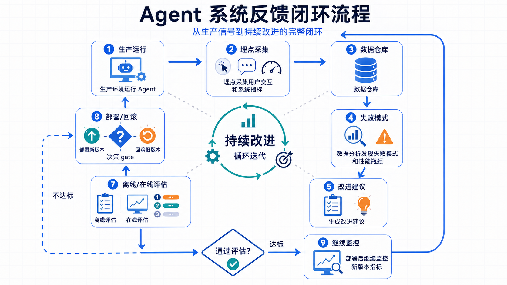

## 知识点讲解



### 1. 核心概念

反馈闭环是把"系统产生的数据"转化为"系统的改进"的过程。没有闭环，系统一旦上线就开始慢慢偏离用户的真实需求，你还不知道。

一个完整的反馈闭环有四个环节：

1. **采集**：收集用户交互数据、反馈信号、系统运行指标
2. **分析**：从数据里找到失败模式、痛点、趋势
3. **改进**：基于分析制定改进方案，优先级排序
4. **验证**：改进上线后，确认效果是否达到预期

这四个环节缺一不可。只采集不分析，数据是死的；只分析不改进，分析是摆设；只改进不验证，不知道改动是否真的有效。

### 2. 技术细节

**两类反馈信号**：

显式反馈直接，但很稀疏——用户不会对每次交互都主动打分。隐式反馈丰富，但需要解读——用户"重新发了一遍类似的问题"，可能意味着上次回答没有满足需求，但也可能只是措辞不同。

| 类型 | 来源 | 优点 | 缺点 |
| --- | --- | --- | --- |
| 显式反馈 | 点赞/踩、评分、评论 | 直接明确 | 稀疏，用户参与率低 |
| 隐式反馈 | 重试、放弃、复制、跳出 | 大量、自然产生 | 需要推断，有噪声 |
| 系统指标 | 响应时间、错误率、工具成功率 | 客观精确 | 不反映内容质量 |

实践上，隐式反馈作为主信号（量大、持续），显式反馈作为验证信号（稀疏但可靠）。

**反馈闭环的实现代码**：

```python
from datetime import datetime, timedelta
from typing import Any, Dict, List, Optional


class FeedbackLoop:
    """反馈闭环系统：采集 → 分析 → 改进建议 → A/B 验证。"""

    def __init__(self) -> None:
        self._interactions: List[Dict[str, Any]] = []
        self._metrics_log: List[Dict[str, Any]] = []
        self._improvement_tracker: List[Dict[str, Any]] = []

    # ---------- 数据采集 ----------

    def log_interaction(
        self,
        session_id: str,
        question: str,
        answer: str,
        success: bool,
        error_type: Optional[str] = None,
        latency_ms: Optional[float] = None,
        user_feedback: Optional[float] = None,  # 显式评分 0-1
        implicit_signals: Optional[Dict[str, Any]] = None,  # 重试、放弃等
    ) -> None:
        self._interactions.append({
            "session_id": session_id,
            "question": question,
            "answer": answer,
            "success": success,
            "error_type": error_type,
            "latency_ms": latency_ms,
            "user_feedback": user_feedback,
            "implicit_signals": implicit_signals or {},
            "timestamp": datetime.now(),
        })

    def record_metrics(self, metrics: Dict[str, float]) -> None:
        self._metrics_log.append({**metrics, "timestamp": datetime.now()})

    # ---------- 分析 ----------

    def analyze_failures(
        self,
        hours: int = 24,
    ) -> Dict[str, Any]:
        cutoff = datetime.now() - timedelta(hours=hours)
        recent = [i for i in self._interactions if i["timestamp"] >= cutoff]
        failures = [i for i in recent if not i["success"]]

        error_dist: Dict[str, int] = {}
        for f in failures:
            et = f.get("error_type") or "unknown"
            error_dist[et] = error_dist.get(et, 0) + 1

        top_errors = sorted(error_dist.items(), key=lambda x: x[1], reverse=True)[:5]

        return {
            "window_hours": hours,
            "total_interactions": len(recent),
            "failure_count": len(failures),
            "failure_rate": len(failures) / len(recent) if recent else 0.0,
            "error_distribution": error_dist,
            "top_5_errors": top_errors,
        }

    def analyze_implicit_feedback(self, hours: int = 24) -> Dict[str, float]:
        cutoff = datetime.now() - timedelta(hours=hours)
        recent = [i for i in self._interactions if i["timestamp"] >= cutoff]
        if not recent:
            return {}

        retry_count = sum(
            1 for i in recent if i["implicit_signals"].get("is_retry", False)
        )
        abandon_count = sum(
            1 for i in recent if i["implicit_signals"].get("abandoned", False)
        )
        return {
            "retry_rate": retry_count / len(recent),
            "abandon_rate": abandon_count / len(recent),
            "implicit_satisfaction": 1 - (retry_count + abandon_count) / len(recent),
        }

    def get_metric_trend(self, metric_name: str, days: int = 7) -> Dict[str, Any]:
        cutoff = datetime.now() - timedelta(days=days)
        recent = [m for m in self._metrics_log if m.get("timestamp", datetime.now()) >= cutoff]
        values = [m.get(metric_name, 0.0) for m in recent]

        if not values:
            return {}

        avg = sum(values) / len(values)
        trend = values[-1] - values[0] if len(values) > 1 else 0.0
        return {
            "metric": metric_name,
            "current": values[-1],
            "avg_over_period": avg,
            "trend": trend,
            "trend_direction": "up" if trend > 0 else "down" if trend < 0 else "flat",
        }

    # ---------- 改进建议 ----------

    def suggest_improvements(
        self,
        analysis: Dict[str, Any],
    ) -> List[Dict[str, str]]:
        suggestions = []
        failure_rate = analysis.get("failure_rate", 0.0)
        top_errors = analysis.get("top_5_errors", [])

        if failure_rate > 0.3:
            suggestions.append({
                "priority": "critical",
                "type": "model_or_architecture",
                "action": "失败率超过 30%，Prompt 优化空间有限，需要评估换模型或改架构",
            })

        for error_type, count in top_errors[:2]:
            if error_type == "tool_error":
                suggestions.append({
                    "priority": "high",
                    "type": "tool_improvement",
                    "action": f"工具调用错误 {count} 次，检查工具定义和参数校验",
                })
            elif error_type == "parsing_error":
                suggestions.append({
                    "priority": "high",
                    "type": "prompt_optimization",
                    "action": f"解析失败 {count} 次，在 Prompt 里明确输出格式，加入 JSON 格式约束",
                })

        return suggestions

    # ---------- A/B 验证 ----------

    def ab_test(
        self,
        improvement_id: str,
        control_results: List[Dict[str, Any]],
        experiment_results: List[Dict[str, Any]],
        min_improvement_threshold: float = 0.02,
    ) -> Dict[str, Any]:
        control_rate = (
            sum(1 for r in control_results if r.get("success")) / len(control_results)
            if control_results
            else 0.0
        )
        exp_rate = (
            sum(1 for r in experiment_results if r.get("success")) / len(experiment_results)
            if experiment_results
            else 0.0
        )
        improvement = exp_rate - control_rate
        relative_improvement = improvement / control_rate if control_rate > 0 else 0.0

        should_deploy = improvement >= min_improvement_threshold
        return {
            "improvement_id": improvement_id,
            "control_success_rate": control_rate,
            "experiment_success_rate": exp_rate,
            "absolute_improvement": improvement,
            "relative_improvement": relative_improvement,
            "recommendation": "deploy" if should_deploy else "rollback_or_iterate",
        }

    def track_improvement(
        self,
        improvement_id: str,
        description: str,
        estimated_impact: float,
    ) -> None:
        self._improvement_tracker.append({
            "id": improvement_id,
            "description": description,
            "estimated_impact": estimated_impact,
            "status": "proposed",
            "proposed_at": datetime.now(),
        })
```

### 3. 对比与拓展

反馈闭环有一个容易忽视的问题：**反应速度和稳定性的权衡**。

改动太快，系统还没稳定就又改了，根本不知道是哪个改动起了作用，更不知道哪个改动反而变差了。改动太慢，线上问题拖着不解决，用户体验一直很差。

一个合理的节奏是：发现问题到部署修复，目标在 1 周以内。这要求：日常监控自动化（不靠人肉看指标），改进方案有快速验证的流程（小流量 A/B），部署有一键回滚能力。

另外，隐式反馈的解读需要谨慎。"用户又发了一遍类似的问题"——可能是上次没答好，也可能用户就是补充了更多信息。把隐式信号和显式反馈交叉验证，结论才可靠。

## 面试怎么答

反馈闭环的核心是把系统产生的数据转化为系统的改进，四个环节缺一不可：采集、分析、改进、验证。

采集层我会同时收集显式反馈（用户评分）和隐式反馈（重试率、放弃率）。隐式信号量大，是主信号；显式信号稀疏但可靠，是验证信号。两者交叉确认才能避免误判。

分析层的重点是失败模式分类——是工具调用出错、解析失败、还是推理断链？不同类型对应不同的改进方向，不能笼统地说"系统变差了就去改 Prompt"。

验证层一定要做 A/B 测试，不能靠感觉说"这个改进更好"。我们的阈值是绝对成功率提升超过 2% 才算有效改进，低于这个阈值继续迭代或者考虑回滚。

闭环的健康节奏是：发现问题到部署修复目标在 1 周以内。这要求监控自动化，不靠人肉盯。

## 高频追问 & 加分点

- **Q1：如何平衡快速迭代和稳定性？**  
    金字塔策略：每天可以改 Prompt（低风险，随时可回滚）；每周可以做一次较大的系统更新（需要跑完 A/B 测试）；每月才考虑架构层面的变动（需要充分验证才上线）。改动影响越大，验证要越严格，时间周期也要越长。加分信号：能给出具体的迭代节奏，而不是泛泛地说"要平衡"。
- **Q2：A/B 测试的样本量怎么确定？**  
    简单公式：要检测的最小效果差（比如 2% 的提升）越小，需要的样本量越大。使用统计功效分析（Power Analysis），一般在置信水平 95%、功效 80% 下，检测 2% 的绝对提升需要约 2000 个样本。日请求量不够的话，可以延长 A/B 测试的时间窗口，而不是降低样本量要求。
- **Q3：用户的隐式反馈如何过滤噪声？**  
    几个处理方法：①只看对同一问题的二次尝试（同 session 内的重试），排除用户主动换话题的情况；②设置行为阈值，单次放弃不算，连续 3 次类似问题都没有好结果才标记为"需求未满足"；③和显式反馈交叉验证，高不满意的显式评分 + 高重试率的隐式信号双重触发，才确认为问题。
- **Q4：闭环里谁来决定哪些改进上线？**  
    建议设置明确的决策标准，而不是靠人拍脑袋。我的做法：A/B 测试结果 + 统计显著性检验（p &lt; 0.05）才自动推荐上线；影响核心功能的改动，还需要人工 review 一遍失败案例再决定。这样既有数据依据，也有人工兜底，不会出现因为"测试集太小 / 采样有偏"导致的误判。
