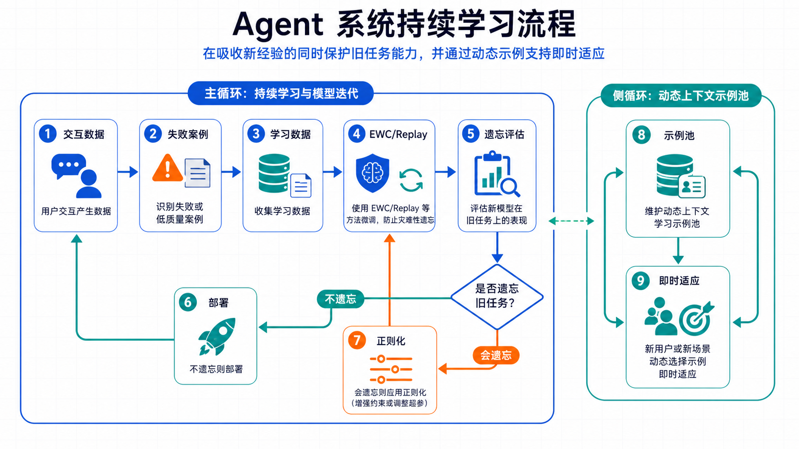

## 知识点讲解



### 1. 核心概念

持续学习讲的是：系统不是一次性训练完就固定了，而是能从新的用户交互中不断改进。

但这件事比听起来难得多。难点不在于"怎么让模型学到新东西"，而在于**怎么在学新东西的同时，不忘旧的**。这个问题有个专门的名字叫"灾难性遗忘（Catastrophic Forgetting）"——微调了 100 个新任务样本之后，模型在原来的通用任务上表现可能大幅退化。提升了 10%，但退化了 30%，得不偿失。

持续学习按速度分三层：

- **离线持续学习**：每周收集高质量样本，定期微调。速度慢（周级别），但学到的知识更稳固。
- **在线学习**：用 In-Context Learning 动态调整。速度快（实时），但每次效果不会持久，只影响当前请求。
- **混合策略**：在线学习处理短期变化，离线微调学习长期模式。这是实际生产里最可行的方案。

### 2. 技术细节

**三种持续学习方式对比**：

| 方式 | 反应速度 | 持久性 | 成本 | 适用场景 |
| --- | --- | --- | --- | --- |
| 离线微调 | 慢（周级别） | 高（模型参数更新） | 高 | 长期知识、领域适应 |
| In-Context Learning | 实时 | 低（只影响当前请求） | 低 | 短期适应、动态示例 |
| RAG 知识库更新 | 快（分钟级） | 高（持久化存储） | 中 | 知识更新、无需改模型 |
| Prompt 适应 | 实时 | 中（依赖 prompt 管理） | 低 | 行为调整、无需训练 |

**防止灾难性遗忘的方法**：

- **EWC（Elastic Weight Consolidation）**：在微调损失里加一个正则化项，保护"重要参数"不被大幅改动。哪些参数重要，通过 Fisher 信息矩阵估计。
- **Replay（重放）**：微调时不只用新数据，同时混入一部分旧任务的样本，让模型在学新东西的同时"复习旧知识"。
- **RAG 替代微调**：知识更新用 RAG 实现（往知识库里加文档），模型参数不动，完全没有灾难性遗忘的问题。这是最稳妥的方案，代价是检索需要更好的设计。

**持续学习代码框架**：

```python
from datetime import datetime
from typing import Any, Dict, List, Optional


class ContinuousLearner:
    """实现三层持续学习：In-Context Learning、RAG 知识更新、离线微调。"""

    def __init__(self, base_model: Any, knowledge_base: Any) -> None:
        self.model = base_model
        self.kb = knowledge_base
        self._learning_log: List[Dict[str, Any]] = []
        self._old_task_baselines: Dict[str, float] = {}

    # ---------- 在线学习：动态 In-Context Learning ----------

    def infer_with_dynamic_examples(
        self,
        question: str,
        feedback_store: List[Dict[str, Any]],
        top_k: int = 3,
    ) -> str:
        """根据问题相似度动态选取最相关的历史正例作为 few-shot 示例。"""
        relevant_examples = self._retrieve_similar_examples(question, feedback_store, top_k)
        prompt = self._build_icl_prompt(question, relevant_examples)
        return self.model.generate(prompt)

    def _retrieve_similar_examples(
        self,
        question: str,
        store: List[Dict[str, Any]],
        top_k: int,
    ) -> List[Dict[str, Any]]:
        # 生产里用 embedding 相似度；这里用简单词重叠近似
        q_tokens = set(question.lower().split())
        scored = [
            (ex, len(q_tokens & set(ex["question"].lower().split())))
            for ex in store
            if ex.get("quality_score", 0) >= 0.8  # 只选高质量样本
        ]
        scored.sort(key=lambda x: x[1], reverse=True)
        return [ex for ex, _ in scored[:top_k]]

    def _build_icl_prompt(
        self,
        question: str,
        examples: List[Dict[str, Any]],
    ) -> str:
        if not examples:
            return question
        shots = "\n".join(
            f"Q: {e['question']}\nA: {e['answer']}" for e in examples
        )
        return f"以下是一些参考示例：\n{shots}\n\n请回答：\n{question}"

    # ---------- RAG 知识更新（最稳妥的持续学习方式）----------

    def update_knowledge_base(
        self,
        new_documents: List[Dict[str, Any]],
    ) -> Dict[str, int]:
        """将新文档加入知识库，无需改动模型参数。"""
        added = 0
        for doc in new_documents:
            self.kb.add(doc)
            added += 1
        self._log_learning(method="rag_update", data_count=added)
        return {"added_documents": added}

    # ---------- 离线微调 ----------

    def collect_fine_tune_data(
        self,
        interactions: List[Dict[str, Any]],
        quality_threshold: float = 0.8,
    ) -> List[Dict[str, Any]]:
        """从交互日志里筛选高质量样本用于微调。"""
        return [
            {
                "question": i["question"],
                "answer": i.get("correct_answer") or i["model_response"],
                "feedback": i.get("user_feedback"),
                "error_type": i.get("error_type"),
            }
            for i in interactions
            if i.get("user_feedback", 0) >= quality_threshold
               or i.get("error_type") is not None  # 失败案例也有学习价值
        ]

    def validate_before_deploy(
        self,
        new_model: Any,
        old_task_test_cases: List[Dict[str, Any]],
        forgetting_threshold: float = 0.05,
    ) -> Dict[str, Any]:
        """微调后先验证旧任务有没有大幅退化，再决定是否部署。"""
        correct = sum(
            1
            for case in old_task_test_cases
            if new_model.generate(case["question"]).get("answer") == case.get("expected")
        )
        new_accuracy = correct / len(old_task_test_cases) if old_task_test_cases else 0.0

        # 找旧任务的基线（如果有记录的话）
        task_name = "general"
        old_accuracy = self._old_task_baselines.get(task_name, new_accuracy)
        forgetting_rate = max(0.0, old_accuracy - new_accuracy)

        should_deploy = forgetting_rate <= forgetting_threshold
        return {
            "old_task_new_accuracy": new_accuracy,
            "old_task_baseline": old_accuracy,
            "forgetting_rate": forgetting_rate,
            "forgetting_threshold": forgetting_threshold,
            "recommendation": "deploy" if should_deploy else "apply_ewc_or_replay",
        }

    def detect_distribution_drift(
        self,
        recent_interactions: List[Dict[str, Any]],
        historical_error_dist: Dict[str, float],
    ) -> Dict[str, Any]:
        """检测近期数据分布是否漂移——如果漂移，说明需要更新模型。"""
        recent_errors: Dict[str, int] = {}
        for i in recent_interactions:
            et = i.get("error_type") or "none"
            recent_errors[et] = recent_errors.get(et, 0) + 1

        total = sum(recent_errors.values()) or 1
        recent_dist = {k: v / total for k, v in recent_errors.items()}

        # 用 L1 距离衡量分布差异
        all_keys = set(recent_dist) | set(historical_error_dist)
        l1_distance = sum(
            abs(recent_dist.get(k, 0) - historical_error_dist.get(k, 0))
            for k in all_keys
        )

        return {
            "recent_error_distribution": recent_dist,
            "l1_distance_from_historical": l1_distance,
            "drift_detected": l1_distance > 0.2,
            "recommendation": "retrain" if l1_distance > 0.2 else "continue",
        }

    # ---------- 辅助 ----------

    def _log_learning(self, method: str, data_count: int) -> None:
        self._learning_log.append({
            "method": method,
            "data_count": data_count,
            "timestamp": datetime.now(),
        })
```

### 3. 对比与拓展

讲真，大多数工程场景下，**RAG 知识更新比模型微调更实用**。

原因很简单：知识库更新立竿见影（加一篇文档，下一个请求就能用），没有灾难性遗忘的风险，回滚也容易（删掉那篇文档就行）。微调要收集数据、训练、验证、部署，整个周期少则几天多则几周。

微调真正值得做的场景是：任务的行为模式要改变（不只是知识更新），比如要让模型学会一种新的回答风格、一种新的工具调用模式。这类"行为"改变用 RAG 加不进去，只能靠微调。

另外，"在线持续学习"这个词在学术界和工程界有不同含义。学术界的在线学习通常指参数实时更新；工程里说的"在线学习"更多是 In-Context Learning 的动态示例选择，模型参数不动。面试时要根据上下文判断对方问的是哪个层面。

## 面试怎么答

持续学习的核心挑战不是"怎么学新东西"，而是"怎么学新东西的同时不忘旧的"——灾难性遗忘是实际项目里最容易踩的坑。

我把持续学习分三层。在线层用 In-Context Learning，根据问题动态选相关的历史正例作为示例，实时生效但不持久。中间层用 RAG 知识库更新，新知识直接加到文档里，不动模型参数，没有遗忘风险，大多数"知识更新"需求用这层就够了。离线层定期微调，用于需要改变行为模式的场景，但微调前必须在旧任务上先验证一遍，确认没有大幅退化才能部署。

三层里我最推荐的是 RAG 知识更新——立竿见影、无遗忘风险、可以随时回滚，工程成本最低。微调只在 RAG 解决不了的行为类改变时才上。

## 高频追问 & 加分点

- **Q1：灾难性遗忘有多严重？**  
    严重程度和新旧数据的分布差异正相关。如果新微调数据和原训练数据分布很相近，遗忘不明显；如果差异很大，在极端情况下新任务提升了 10%，但旧任务退化了 30%。防遗忘最实用的工程方法是 Replay——微调时在新数据里混入 10-20% 的旧任务数据，让模型同时复习，大多数场景这个方法就够用了。加分信号：提到 Replay 比 EWC 更实用，说明了解两者的工程复杂度差异。
- **Q2：如何判断什么时候需要微调？**  
    三个触发条件：①Prompt 优化连续迭代 3 轮提升低于 2%；②失败分析显示问题是行为模式（不是知识）；③在评估集上，oracle Prompt 和当前最优 Prompt 的差距超过 10%（说明模型能力本身是瓶颈）。三个都满足才启动微调流程，启动前先评估数据收集成本。
- **Q3：用户反馈有噪声，怎么过滤？**  
    几个过滤层：第一层，只取有效的显式反馈（评分很高或很低的，中间的模糊反馈意义不大）；第二层，高质量的失败案例——正确答案已知、错误类型明确的，学习价值最高；第三层，多人共同认可的反馈（多个用户对同一类问题都有负面反馈），比单用户反馈可靠得多。加分信号：区分"个别用户的偶发反馈"和"系统性差反馈"，说明理解了噪声的来源。
- **Q4：数据分布漂移怎么检测？**  
    核心是对比近期数据和历史数据的分布差异。最简单的方法：统计近期失败案例的错误类型分布，和历史基线对比，如果某类错误占比突然上升 20% 以上，说明用户需求或数据分布变了，需要考虑重新微调。更严格的方法是用统计检验（KS 检验或 Chi-square 检验）做形式化的漂移检测。
